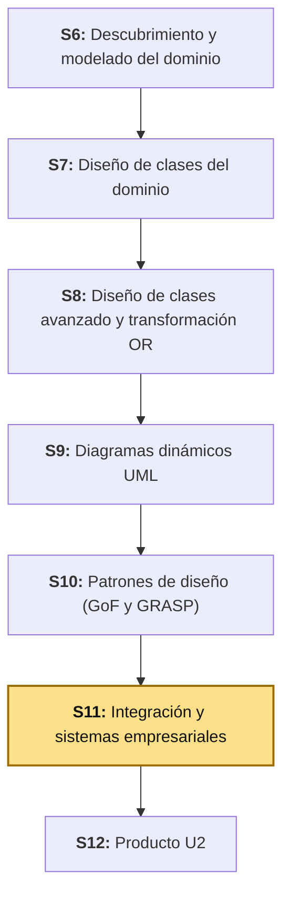
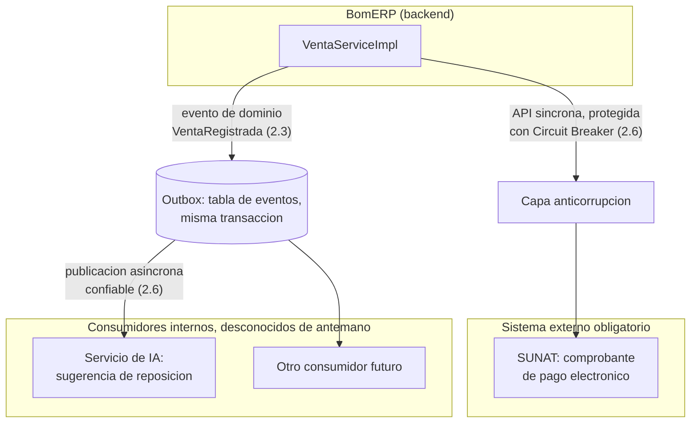
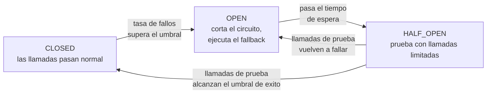
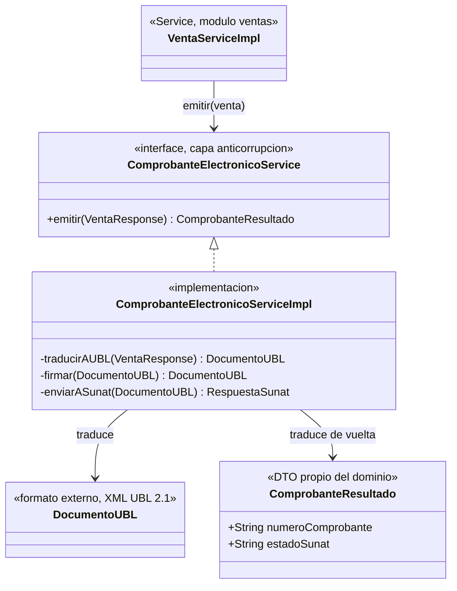
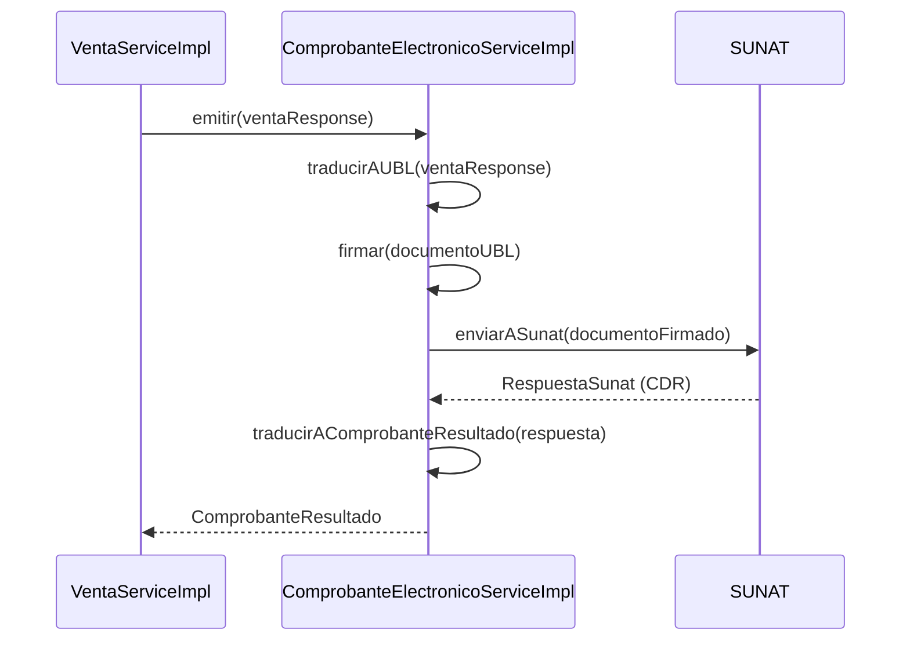
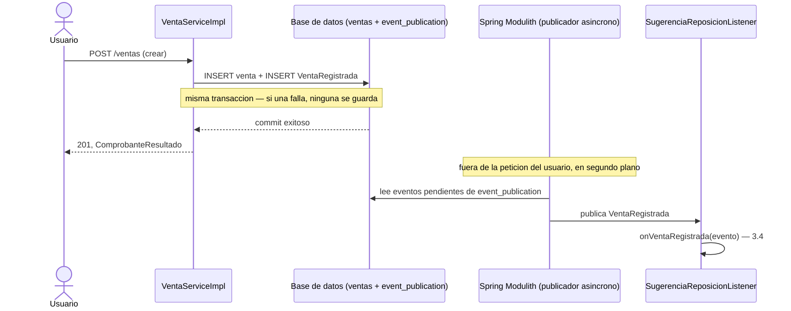
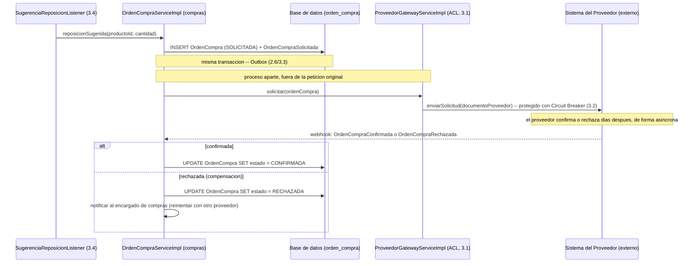

# S11 - Integración y Sistemas Empresariales

## 1. Introducción

Tiempo: 20 min.

### 1.1 Presentación de la sesión

Hasta S10, todas las fronteras que BomERP cruzó fueron internas: `ventas` llamando a `catalogo`, siempre dentro del mismo backend, protegida por `@NamedInterface` y Dependency Injection. Esta sesión cruza la frontera que de verdad importa para un ERP (*Enterprise Resource Planning*) real: la que separa a BomERP del resto del mundo. Una venta registrada en Perú no termina en la base de datos — por ley, tiene que convertirse en un comprobante de pago electrónico y enviarse a SUNAT (*Superintendencia Nacional de Aduanas y de Administración Tributaria*); otros sistemas de la empresa (reposición de inventario, análisis de demanda) necesitan enterarse de que esa venta ocurrió, sin que `ventas` tenga que conocerlos a todos uno por uno. Esta sesión diseña esas dos fronteras — hacia un sistema externo obligatorio y hacia consumidores internos desconocidos de antemano — con los patrones que las protegen de romperse cuando el otro lado falla o cambia.

Esto no es, como S6-S10, una sesión que se queda dentro de los límites que `lp2/bomerp-backend` ya construyó: por el alcance de ADS (Análisis y Diseño de Sistemas de Información) dentro del ciclo —ver la nota de 1.7—, esta sesión diseña infraestructura e integraciones que LP2 (Lenguaje de Programación II) todavía no tiene por qué implementar, y que puede que implemente recién en una sesión futura de ese curso. Diseñar antes de que exista el código es exactamente el mismo patrón ya usado con `Venta.anular()` (S7, S9, S10) — con una frontera distinta: ya no es intra-empresa, es la empresa completa hacia afuera.

Esta sesión va, además, un paso más allá de lo que BomERP necesita hoy: diseña una **Saga coreografiada** (2.7, 3.5) para un proceso de negocio que cruza un tercer sistema externo (un Proveedor), con su paso de compensación cuando algo falla a mitad de camino. BomERP, como monolito modular que es hoy, no lo necesita todavía — pero el ciclo en el que se dicta esta sesión es, de los seis cursos que forman la cadena de BomERP (1.7), el **único** con el nivel de un curso de arquitectura y diseño de sistemas: cuando estos mismos estudiantes lleguen al curso de Sistemas Distribuidos, no van a tener un curso paralelo como ADS que les enseñe a diseñar este patrón con calma, en papel, antes de construirlo contra Kafka y microservicios reales. Este es, literalmente, el único momento del plan de estudios para hacerlo bien.

El porqué de que una integración sin protección pueda tumbar un sistema entero, aunque el sistema remoto sea el que falla, se desarrolla en 1.6.

### 1.2 Índice

1. APIs externas y servicios de terceros.
2. Eventos de dominio y publicación/suscripción.
3. Integración entre servicios y mensajería asíncrona.
4. Servicios de inteligencia artificial.
5. Patrones de integración: capa anticorrupción, *circuit breaker* y *outbox*.
6. Consistencia distribuida con Saga: por qué va más allá de lo que BomERP necesita hoy.

### 1.3 Propósito de aprendizaje

Al concluir la clase, estarás en condiciones de:

- **Diseñar** la integración de tu proyecto con al menos un sistema externo obligatorio y con consumidores internos desconocidos de antemano, **protegiendo** cada frontera con el patrón de integración correspondiente (capa anticorrupción, *circuit breaker*, *outbox*), **coordinar** un proceso de negocio de varios pasos entre sistemas independientes con una Saga coreografiada, **diseñar** su paso de compensación cuando uno de esos pasos falla, y **documentar** qué cruza cada frontera y con qué garantía.

### 1.4 Producto de sesión

Diseño de integración empresarial de `ventas`: contrato conceptual de la integración con SUNAT (comprobante de pago electrónico, formato UBL 2.1, *Universal Business Language*) con su capa anticorrupción, diseño del *circuit breaker* que protege esa llamada, evento de dominio `VentaRegistrada` con su publicación confiable (patrón *Outbox*, el mismo mecanismo que Spring Modulith ya reserva para una sesión futura de LP2), diseño de un consumidor de IA (inteligencia artificial) que se suscribe a ese evento para sugerir reposición de stock, la Saga coreografiada que convierte esa sugerencia en una orden de compra real contra un Sistema del Proveedor externo —con su paso de compensación cuando el proveedor rechaza la orden—, y una matriz de integración que documenta qué cruza cada frontera de la empresa, hacia dónde y con qué patrón protegido.

### 1.5 Metodología

**Tabla 1. Metodología de la sesión**

| Actividades a Realizar en el Periodo | Orientaciones generales (Orientaciones Metodológicas) | Material de estudio recomendado |
|---|---|---|
| Revisión previa individual | Repasar el catálogo completo de patrones GoF y GRASP de `ventas` (S10, Tabla 12) y el contrato REST ya existente del módulo (S8, Tabla 17). Trabajo individual, antes de clase. | S10 (2.7, Indirection/Protected Variations; 2.8, Dependency Injection). |
| Clase presencial | Diseño guiado de la integración con SUNAT, su capa anticorrupción y su *circuit breaker*, del evento de dominio `VentaRegistrada` con publicación confiable, de un consumidor de IA, y de la Saga coreografiada que coordina la orden de compra con el Proveedor, con su compensación. Trabajo individual, siguiendo al docente paso a paso; consulta inmediata ante dudas sobre qué patrón corresponde a cada frontera. | Pasos 3.1 a 3.6 de esta guía. |
| Evaluación formativa | Revisión en clase del diseño de la capa anticorrupción, de la Saga con su compensación, y de la matriz de integración completa. La evidencia se completa y sustenta de forma individual, fuera del aula, según los criterios mínimos de la sección 4.4. | Indicaciones de entrega (4.3), rúbrica de evaluación (4.6). |

### 1.6 Motivación de la sesión

#### 1.6.1 Caso: la llamada lenta que Netflix dejó de tolerar

A inicios de la década de 2010, Netflix operaba uno de los sistemas distribuidos más grandes del mundo: cada solicitud de un usuario disparaba docenas de llamadas internas a microservicios distintos. El riesgo que identificaron, documentado en su propio blog de ingeniería, fue este: si **uno solo** de esos servicios empezaba a responder lento —no caído, solo lento—, los hilos (*threads*) que esperaban su respuesta se acumulaban sin liberarse, hasta agotar el *pool* de hilos disponible. Un servicio lento, en vez de fallar solo, terminaba arrastrando a todo el sistema que dependía de él, incluidas partes que no tenían nada que ver con el servicio lento original.

Fuente: Netflix Technology Blog. (2012). *Fault Tolerance in a High Volume, Distributed System*. https://netflixtechblog.com/fault-tolerance-in-a-high-volume-distributed-system-91ab4faae74a

La respuesta de Netflix fue Hystrix, una librería que implementa el patrón **Circuit Breaker** (*interruptor de circuito*, Fowler, 2014): cuando las llamadas a un servicio remoto empiezan a fallar o a demorar más de lo esperado, el circuito "se abre" y las siguientes llamadas fallan de inmediato, sin siquiera intentar contactar al servicio lento — dándole tiempo a ese servicio para recuperarse, en vez de bombardearlo con más tráfico mientras ya está en problemas. Fowler lo resume así: una llamada remota puede fallar o demorar, y cuando varios clientes insisten en contactar a un servicio que no responde, agotan recursos críticos del lado de quien llama, no solo del lado que falló.

Ninguna de las integraciones de S10 (`ventas` llamando a `catalogo`) corre este riesgo: ambos módulos viven en la misma JVM (*Java Virtual Machine*), en el mismo proceso, sin red de por medio. Una llamada a SUNAT sí — es una llamada de red real, a un sistema que BomERP no controla, que puede estar lento, caído o simplemente no responder a tiempo. Diseñar esa llamada sin un *circuit breaker* es exponer a BomERP exactamente al riesgo que Netflix documentó.

**Preguntas de análisis**

**Activación de conocimientos previos**

1. Antes de leer la causa técnica, ¿por qué un servicio **lento** (no caído) puede ser más peligroso para el sistema completo que un servicio que falla de inmediato?

**Comprensión de la integración con sistemas externos**

1. Según el caso, ¿qué diferencia hay entre que SUNAT responda con un error y que SUNAT simplemente no responda nunca? ¿Cuál de los dos es más peligroso para BomERP si no hay ningún límite de tiempo ni *circuit breaker*?
2. En tu propio proyecto, ¿qué sistema externo (de verdad, no inventado) tendría que integrar, y qué pasaría si ese sistema se cayera mientras un usuario está usando tu aplicación?

### 1.7 Ubicación en el curso

- Producto del curso: Diseño Técnico Profesional Documentado.
- Producto de unidad: Catálogo UML con patrones de diseño e integración aplicados.
- Avance del producto en esta sesión: diseño de integración empresarial completo — sistema externo obligatorio, eventos de dominio, consumidor de IA, Saga coreografiada con compensación contra un segundo sistema externo, y los patrones de integración que protegen cada frontera.

**Nota sobre el alcance de esta sesión.** ADS es, de los tres cursos del ciclo que comparten BomERP, el que ve el panorama completo de la empresa —infraestructura y sistemas externos—, no solo el backend (LP2) o la base de datos (BD2). Por eso esta sesión diseña una integración con SUNAT y un mecanismo de eventos que LP2 todavía no implementa: ese diseño es la referencia con la que LP2 va a trabajar cuando su propio sílabo llegue a esa funcionalidad, el mismo criterio ya aplicado con `Venta.anular()` desde S7.

**Por qué esta sesión diseña también una Saga, más allá de lo que BomERP necesita hoy.** La malla curricular no vuelve a ofrecer un curso de arquitectura y diseño de sistemas junto al curso de Sistemas Distribuidos — a diferencia de este ciclo, donde ADS, BD2 y LP2 avanzan en paralelo sobre el mismo proyecto, el curso de Distribuidas se dicta más adelante, solo. Diseñar una Saga coreografiada aquí, con calma y en papel, es la única oportunidad del plan de estudios para aprender el patrón con el rigor de un curso de diseño antes de tener que construirlo bajo la presión de un proyecto real con Kafka y microservicios — exactamente el mismo razonamiento que ya justifica diseñar la integración con SUNAT antes de que LP2 la implemente.

**Figura 1. Roadmap del producto de la unidad**



## 2. Explica

Tiempo: 40 min.

### 2.1 Arquitectura de la sesión

**Figura 2. Las dos fronteras que esta sesión diseña**



Lectura del diagrama: hay dos tipos de frontera, con dos formas de protegerse. La llamada a SUNAT es **síncrona y obligatoria** — BomERP necesita la respuesta para continuar, y por eso necesita un *circuit breaker* que falle rápido si SUNAT no responde. La publicación del evento `VentaRegistrada` es **asíncrona y de cardinalidad desconocida** — hoy existe un consumidor de IA, mañana puede haber dos más, y `ventas` no debería tener que cambiar cada vez que aparece uno nuevo; por eso se publica como evento, no como una llamada directa a cada consumidor. Cada apartado siguiente desarrolla una pieza, en el mismo orden del Índice (1.2).

### 2.2 APIs externas y servicios de terceros

Una **API externa** (*Application Programming Interface*) es un contrato que BomERP no controla: su forma, sus reglas de negocio y su disponibilidad las define otra organización, y cambian según el calendario de esa organización, no el de BomERP. La integración con SUNAT es el ejemplo real y obligatorio para cualquier ERP peruano: todo comprobante de pago electrónico se emite como un archivo XML bajo el estándar UBL 2.1 (*Universal Business Language*), firmado digitalmente (X.509 v3) y enviado a SUNAT (directo o a través de un OSE, *Operador de Servicios Electrónicos*), que responde con un CDR (*Comprobante de Recepción*) confirmando o rechazando el comprobante.

Fuente: SUNAT. (2024). *Guía de elaboración de documentos XML - Factura electrónica UBL 2.1*. https://cpe.sunat.gob.pe/sites/default/files/inline-files/guia+xml+factura+version%202-1+1+0%20(2)_0%20(2).pdf

**Tabla 2. Lo que BomERP controla frente a lo que SUNAT impone**

| | BomERP controla | SUNAT impone |
|---|---|---|
| Forma de los datos internos | `Venta`, `DetalleVenta`, con los nombres y tipos que el dominio de S6-S7 ya definió | El XML UBL 2.1, con su propia estructura, sus propios nombres de campo, su propio esquema |
| Cuándo cambia | Cuando el equipo decide evolucionar el dominio | Cuando SUNAT publique una nueva versión del estándar — fuera del control o del calendario de BomERP |
| Disponibilidad | El uptime del backend propio | El uptime de SUNAT, que BomERP no puede garantizar ni influir |

Que BomERP no controle ninguna de las tres filas de la columna derecha es exactamente la razón por la que esta integración necesita los patrones de 2.6: una API externa obligatoria es, por definición, una fuente de cambio y de falla que el diseño tiene que anticipar, no una dependencia más como `catalogo`.

### 2.3 Eventos de dominio y publicación/suscripción

Un **evento de dominio** representa algo que **ya ocurrió** en el negocio y que a otras partes del sistema les interesa saber, aunque no hayan participado en que ocurriera (Evans, 2003). `VentaRegistrada` es ese evento: cuando `VentaServiceImpl.crear` termina con éxito, algo relevante pasó —una venta existe, con sus líneas y su total— y ese hecho puede interesarle a un consumidor que `ventas` nunca necesita conocer por nombre.

**Publicación/suscripción** (*publish/subscribe*) es el patrón de integración donde quien publica un evento no sabe (ni necesita saber) quién lo consume — cualquier número de suscriptores, incluidos consumidores que todavía no existen, puede reaccionar al mismo evento sin que el publicador cambie una sola línea (Hohpe & Woolf, 2003).

**Tabla 3. Llamada directa frente a evento publicado**

| | Llamada directa (S8-S10, `ventas` → `catalogo`) | Evento publicado (`VentaRegistrada`) |
|---|---|---|
| Quién conoce a quién | `ventas` conoce la interfaz de `catalogo` por su nombre | `ventas` no conoce a ningún consumidor del evento |
| Cuántos consumidores | Exactamente uno, fijo en el código | Cero, uno o varios — se agregan sin tocar `ventas` |
| Qué pasa si el consumidor falla | La transacción de `ventas` puede fallar también (están acopladas) | Depende del mecanismo de entrega (2.6, *Outbox*) — el objetivo es que no arrastre a `ventas` |

La llamada a `ProductoService` (S8-S10) sigue siendo correcta tal como está: `ventas` *necesita* la respuesta de `catalogo` para decidir si la venta se completa. `VentaRegistrada` es distinto — ningún consumidor del evento puede impedir que la venta ya registrada exista; por eso es evento, no llamada directa.

### 2.4 Integración entre servicios y mensajería asíncrona

Una integración es **síncrona** cuando quien llama espera la respuesta antes de continuar (la llamada a `ProductoService`, la llamada a SUNAT); es **asíncrona** cuando quien publica continúa sin esperar a que el consumidor procese nada (`VentaRegistrada`). La **mensajería asíncrona** (*asynchronous messaging*) es la infraestructura que hace posible lo segundo: un intermediario (un *broker* de mensajes, o el mecanismo de eventos de Spring Modulith, 2.6) recibe el mensaje y garantiza entregarlo a cada suscriptor, sin que el publicador quede bloqueado esperando a ninguno de ellos.

**Tabla 4. Cuándo cada tipo de integración**

| Tipo | Úsala cuando... | Ejemplo en BomERP |
|---|---|---|
| Síncrona | El resultado de la llamada **cambia** lo que pasa a continuación. | `ProductoService.descontarStock` — si falla, la venta no se completa (S8, RN2). |
| Asíncrona | A quien llama **no le importa** cuándo ni si el consumidor terminó de procesar. | `VentaRegistrada` — la venta ya está completa exista o no un consumidor escuchando. |

**Error frecuente**: hacer síncrona una integración que debería ser asíncrona "para estar seguros de que el consumidor la recibió". Eso reintroduce exactamente el acoplamiento que 2.3 evita — si `ventas` espera una confirmación del servicio de IA antes de responder al usuario, una falla de ese servicio (que no debería importarle a una venta) ahora sí puede tumbar el registro de la venta.

### 2.5 Servicios de inteligencia artificial

Un servicio de IA (inteligencia artificial) se integra, desde el punto de vista de arquitectura, igual que cualquier otro consumidor o proveedor externo — la diferencia está en qué hace con los datos, no en cómo se conecta. Un servicio de **sugerencia de reposición de stock**, por ejemplo, se suscribe a `VentaRegistrada` (2.3): cada vez que una venta descuenta stock, el servicio acumula esa información y, con un modelo entrenado sobre el historial de ventas, sugiere cuándo y cuánto reponer de cada producto — sin que `ventas` sepa que existe, ni que sea IA y no una regla fija la que genera la sugerencia.

**Tabla 5. Dónde encaja un servicio de IA en esta arquitectura**

| Pregunta | Respuesta para el servicio de reposición |
|---|---|
| ¿Síncrono o asíncrono? | Asíncrono — ninguna venta debe esperar a que la IA termine de sugerir nada. |
| ¿Qué consume? | El evento `VentaRegistrada` (2.3), no una llamada directa a `ventas`. |
| ¿Qué patrón lo protege? | El mismo *Outbox* (2.6) que protege a cualquier otro suscriptor del evento. |
| ¿BomERP necesita saber cómo funciona el modelo? | No — es una caja negra desde la arquitectura; solo importa el contrato de entrada (el evento) y de salida (una sugerencia, consumida por la Saga de reposición, 2.7/3.5). |

### 2.6 Patrones de integración: capa anticorrupción, *circuit breaker* y *outbox*

Tres patrones, cada uno protegiendo un riesgo distinto de los dos tipos de frontera de 2.1:

**Capa anticorrupción** (*Anti-Corruption Layer*, Evans, 2003) traduce entre el modelo de un sistema externo y el modelo propio, para que el vocabulario y la estructura de datos del externo nunca se filtren al dominio. `Venta` nunca debe tener un campo que se llame igual que una etiqueta del XML UBL de SUNAT — existe una clase intermedia que traduce `VentaResponse` a ese XML, y nada más que esa clase conoce el formato de SUNAT.

**Circuit Breaker** (Fowler, 2014; Nygard, 2018; 1.6) protege contra un sistema externo que falla o se vuelve lento: monitorea el resultado de una llamada protegida y, cuando la **tasa de fallos** (no un conteo simple de fallos seguidos) supera un umbral configurado, "abre" el circuito — las siguientes llamadas fallan de inmediato, sin intentar la llamada real, hasta que un temporizador permite un grupo limitado de llamadas de prueba para ver si el sistema externo se recuperó. Esa tasa se mide, concretamente, sobre una **ventana deslizante** de las últimas N llamadas (*sliding window*, SACAViX, 2026) — el mismo criterio, con los nombres reales de parámetro de Resilience4j, que aplica la Tabla 8.

**Tabla 6. Los tres estados de un Circuit Breaker**

| Estado | Comportamiento | Transición |
|---|---|---|
| `CLOSED` (cerrado) | Las llamadas pasan normalmente a SUNAT. | Si la tasa de fallos de la ventana supera el umbral → `OPEN`. |
| `OPEN` (abierto) | Las llamadas fallan de inmediato, sin contactar a SUNAT. | Después de un tiempo de espera → `HALF_OPEN`. |
| `HALF_OPEN` (semiabierto) | Se permite un número limitado de llamadas de prueba. | Si su tasa de éxito alcanza el umbral → `CLOSED`; si no → `OPEN` de nuevo. |

El umbral que de verdad importa no es "cuántos fallos seguidos", sino la **tasa de fallos sobre una ventana de las últimas N llamadas** (una *sliding window*, 3.2) — con la configuración real de esta sesión (Tabla 8: ventana de 10, umbral de 50%), el circuito se abre con 5 fallos de las últimas 10 llamadas, sin que importe si llegaron seguidos o intercalados con alguna llamada exitosa.

**Figura 3. Ciclo de estados de un Circuit Breaker**



**Outbox** (Richardson, 2018) resuelve un problema distinto: ¿cómo se garantiza que un evento se publique si, y solo si, el cambio que lo origina de verdad se guardó? Guardar la venta en la base de datos y publicar `VentaRegistrada` en un *broker* son dos operaciones separadas — si la primera tiene éxito y la segunda falla, el evento se pierde para siempre; si ocurre al revés, se publica un evento de una venta que nunca existió. *Outbox* resuelve esto guardando el evento en una tabla de la **misma** base de datos, dentro de la **misma** transacción que guarda la venta — un proceso aparte, después, se encarga de tomar esos eventos pendientes y publicarlos, reintentando si hace falta, sin arriesgar nunca la atomicidad entre "la venta existe" y "el evento quedó registrado para publicarse".

Esto no es un patrón hipotético para BomERP: Spring Modulith (el framework ya elegido en ADR-002 de LP2) implementa exactamente este patrón con su propia tabla `event_publication` — hoy removida a propósito del `pom.xml` de LP2 porque ningún módulo publica eventos todavía (LP2, nota de arquitectura), reservada para cuando una sesión futura de ese curso adopte comunicación por eventos. El diseño de esta sesión es, literalmente, la especificación de esa sesión futura.

### 2.7 Consistencia distribuida con Saga

*Circuit Breaker* (2.6) y *Saga* suelen aparecer juntos en cualquier catálogo de patrones de microservicios, pero no resuelven el mismo problema — conviene distinguirlos antes de diseñar la Saga de 3.5. *Circuit Breaker* protege **una llamada síncrona puntual** (2.1 de la frontera con SUNAT) de un sistema remoto que falla o se vuelve lento. **Saga** (Richardson, 2018, cap. 4; Garcia-Molina & Salem, 1987) resuelve un problema distinto: cómo mantener la consistencia de un **proceso de negocio de varios pasos**, cuando esos pasos viven en servicios independientes, cada uno con su propia base de datos — exactamente el escenario en el que una transacción distribuida clásica (*two-phase commit*) no escala, porque bloquear la base de un servicio mientras se espera la respuesta de otro acopla en tiempo real a dos sistemas que deberían poder fallar y escalar por separado.

La idea central: en vez de una sola transacción distribuida, la operación se parte en una secuencia de **transacciones locales**, una por servicio — y cada paso que pueda fallar define su propia **transacción de compensación**, una acción que deshace el efecto de negocio ya confirmado (nunca una reversión de base de datos ajena, porque ningún servicio tiene acceso directo a la base de otro). El sistema queda, mientras tanto, **temporalmente inconsistente** — Saga garantiza consistencia *eventual*, no instantánea.

**Tabla 7. Dos formas de coordinar una Saga**

| | Orquestada | Coreografiada |
|---|---|---|
| ¿Quién conoce el flujo completo? | Un *Saga Orchestrator* central, que envía comandos y decide el siguiente paso. | Nadie — cada servicio reacciona al evento que le corresponde y publica el suyo. |
| Ventaja | Más fácil de entender, probar y depurar: el flujo vive en un solo lugar. | Elimina el punto único de coordinación. |
| Costo | Acopla a todos los participantes al orquestador. | El flujo de negocio queda implícito, repartido entre los *listeners* de cada servicio. |

**¿Por qué una Saga, si `ventas` ni siquiera cruza ese límite hoy?** Porque, a diferencia de un sistema de microservicios real (cada servicio con su propia base de datos), BomERP es hoy un **monolito modular**: `ventas`, `catalogo` y los demás módulos viven en la misma JVM (1.6) y comparten la misma base de datos Oracle — ninguna transacción interna cruza un límite de red ni de base de datos, así que una transacción local normal (con `@Transactional`, S4) ya garantiza consistencia *instantánea* entre módulos, sin necesitar el costo de la consistencia *eventual* que Saga exige a cambio de escalar. La integración con SUNAT (3.1-3.2) tampoco la necesita: tiene un solo paso remoto, sin ningún paso posterior que dependa de su éxito para completarse — por eso se resuelve con *Circuit Breaker* + *fallback*, no con compensación.

Pero el consumidor de IA de 2.5 sí abre esa puerta, en cuanto su sugerencia deja de ser solo una sugerencia y se convierte en una **acción real**: pedirle stock a un Proveedor externo. Ahí aparecen, de golpe, las dos condiciones que Saga exige — un segundo sistema, con su propia base de datos, fuera del control de BomERP; y una secuencia de pasos donde el segundo puede fallar (el proveedor rechaza la orden) después de que el primero ya se confirmó (BomERP ya registró la intención de compra). 3.5 diseña exactamente esa Saga — coreografiada, reusando la capa anticorrupción (3.1), el *circuit breaker* (3.2) y el *outbox* (3.3) que esta misma sesión ya construyó, ahora compuestos en un proceso de negocio completo. Es el mismo escenario, con microservicios reales en vez de un monolito modular, que DIST construye en su sesión dedicada a este patrón (`pagatu-orden-ms` y `pagatu-pago-ms`, coordinados por eventos de Kafka, con compensación real cuando un pago se rechaza).

## 3. Aplica: actividad práctica guiada

Tiempo: 100 min.

**Actividad:** diseño de la integración empresarial completa de `ventas`: la llamada obligatoria a SUNAT protegida con capa anticorrupción y *circuit breaker*, el evento de dominio `VentaRegistrada` con publicación confiable, un consumidor de IA, la Saga coreografiada que coordina la orden de compra con un Proveedor externo, y la matriz que documenta las tres fronteras.

**Propósito de la actividad:** aplicar los patrones de integración de 2.6 a un caso real y obligatorio (SUNAT) y a un caso de cardinalidad abierta (consumidores del evento), y componer esos mismos patrones en una Saga coreografiada (2.7) que coordina un proceso de negocio completo, con el mismo nivel de rigor que S8-S10 ya aplicaron a las fronteras internas.

**Orientaciones metodológicas:** en el laboratorio, el docente diseña la integración de `ventas` paso a paso frente a la clase; los estudiantes repiten cada paso sobre al menos un sistema externo real de su propio proyecto (ver sección 4).

**Actividades para realizar:**

- **3.1** Diseñar la integración con SUNAT y su capa anticorrupción.
- **3.2** Proteger la llamada con un *Circuit Breaker*.
- **3.3** Diseñar el evento de dominio `VentaRegistrada` y su publicación confiable.
- **3.4** Diseñar el consumidor de IA.
- **3.5** Diseñar la Saga coreografiada de reposición con el Proveedor.
- **3.6** Armar la matriz de integración.

### 3.1 Diseñar la integración con SUNAT y su capa anticorrupción

**Producto del paso:** el contrato conceptual de la integración, con la clase anticorrupción que aísla a `ventas` del formato de SUNAT.

**Figura 4. Capa anticorrupción entre `ventas` y SUNAT**



Dos traducciones, no una: `traducirAUBL` convierte el lenguaje de BomERP al de SUNAT (antes de salir), y el resultado de SUNAT (el CDR, *Comprobante de Recepción*, con su propio formato) se traduce de vuelta a `ComprobanteResultado` — un DTO (*Data Transfer Object*, S8) propio del dominio de BomERP, con solo lo que `ventas` necesita (`numeroComprobante`, `estadoSunat`). Ni `VentaServiceImpl` ni `Venta` importan jamás una clase con el nombre de un campo UBL.

La Figura 4 muestra la **estructura** (qué clases existen y de qué dependen); la Figura 5 muestra el **orden real** en el que esas piezas se ejecutan en una sola llamada — las dos traducciones del párrafo anterior, vistas como pasos concretos:

**Figura 5. Secuencia de una emisión, con las dos traducciones de la capa anticorrupción**



Ninguno de los dos pasos de traducción (`traducirAUBL`, `traducirAComprobanteResultado`) es visible para `VentaServiceImpl` — desde su punto de vista, solo existe `emitir(venta)` y una respuesta ya en su propio idioma. `enviarASunat` (paso 4) es, exactamente, la llamada que 3.2 protege con el *circuit breaker*: todo lo que pasa antes y después de esa flecha corre siempre, sin importar si SUNAT responde o no.

**Error frecuente**: devolver el CDR de SUNAT directamente como respuesta de `VentaServiceImpl`, "para no tener que mapear dos veces". Si el formato de SUNAT cambia (una nueva versión de UBL, por ejemplo), ese cambio se propagaría directo hasta el dominio de `ventas` — exactamente lo que la capa anticorrupción existe para evitar.

### 3.2 Proteger la llamada con un *Circuit Breaker*

**Producto del paso:** el diseño del *circuit breaker* que envuelve `enviarASunat`, con su umbral y su `fallback`.

**Tabla 8. Configuración del *Circuit Breaker* de la integración con SUNAT**

| Parámetro | Valor propuesto | Justificación |
|---|---|---|
| Tamaño de la ventana deslizante (*sliding window*, por cantidad de llamadas) | 10 llamadas | Suficiente volumen para que un solo pico aislado no dispare el umbral, sin exigir un historial tan largo que tarde en reaccionar a un problema real. |
| Umbral de tasa de fallos | 50% | Si 5 de las últimas 10 llamadas a SUNAT fallan, el circuito se abre — una tasa, no un conteo de fallos seguidos: distingue un problema real de SUNAT de fallos aislados intercalados con llamadas exitosas. |
| Tiempo en estado `OPEN` | 30 segundos | Tiempo razonable para que un problema transitorio de red se resuelva, sin bloquear al usuario por minutos. |
| Llamadas de prueba permitidas en `HALF_OPEN` | 3 | Confirma la recuperación con más de una muestra, sin reabrir la ventana completa de 10 llamadas para decidir si SUNAT ya respondió. |
| *Fallback* (qué responder mientras el circuito está `OPEN`) | Guardar la venta igual, marcando el comprobante como "pendiente de emisión", y reintentar más tarde (proceso aparte, fuera de la petición del usuario). | La ley exige emitir el comprobante, pero no exige que la venta **espere** a SUNAT para completarse — emitir el comprobante y registrar la venta son responsabilidades distintas (2.4). |

El *fallback* es la decisión de diseño más importante de este paso: un *circuit breaker* sin un *fallback* pensado simplemente cambia un error lento por un error rápido — sigue siendo un error. El *fallback* elegido aquí convierte una falla externa (SUNAT caída) en una degradación controlada (la venta se completa, el comprobante queda pendiente) en vez de en una falla total (la venta no se puede registrar porque un sistema de terceros está lento).

```yaml
# application.yml — configuracion del circuit breaker "sunat", valores de la Tabla 8
resilience4j:
  circuitbreaker:
    instances:
      sunat:
        sliding-window-size: 10
        failure-rate-threshold: 50
        wait-duration-in-open-state: 30s
        permitted-number-of-calls-in-half-open-state: 3
```

```java
// ComprobanteElectronicoServiceImpl.java — circuit breaker, pseudocodigo de diseño
@CircuitBreaker(name = "sunat", fallbackMethod = "emitirPendiente")
public ComprobanteResultado emitir(VentaResponse venta) {
    DocumentoUBL documento = traducirAUBL(venta);
    DocumentoUBL firmado = firmar(documento);
    RespuestaSunat respuesta = enviarASunat(firmado);  // la llamada protegida (Figura 3)
    return traducirAComprobanteResultado(respuesta);
}

// Se ejecuta si el circuito esta OPEN (Tabla 6/Figura 3), o si enviarASunat
// lanza timeout/error de red -- nunca si el problema es una regla de negocio
public ComprobanteResultado emitirPendiente(VentaResponse venta, Exception causa) {
    return new ComprobanteResultado(numeroComprobante: null, estadoSunat: "PENDIENTE_EMISION");
    // un proceso aparte, fuera de esta peticion, reintenta mas tarde (Tabla 8)
}
```

La anotación envuelve exactamente la llamada que 3.1 ya aisló en `enviarASunat` — ninguna otra línea de `ComprobanteElectronicoServiceImpl` necesita saber que existe un *circuit breaker*: ni `traducirAUBL` ni `firmar` corren contra la red, así que ninguna de las dos necesita protegerse. El `fallbackMethod` solo se dispara por la causa que la Tabla 8 ya previó (SUNAT lenta, caída o sin responder) — un rechazo de SUNAT por un dato mal formado (un error de negocio, no de disponibilidad) no debe entrar nunca a `emitirPendiente`: reintentar un comprobante mal formado no lo arregla, solo repite el mismo error.

### 3.3 Diseñar el evento de dominio `VentaRegistrada` y su publicación confiable

**Producto del paso:** la forma del evento y el mecanismo que garantiza que, si la venta se guardó, el evento también quedó registrado para publicarse (2.6, *Outbox*).

```java
// VentaRegistrada.java — evento de dominio, pseudocodigo de diseño
public record VentaRegistrada(
    Long ventaId,
    List<Long> productoIds,
    BigDecimal total,
    LocalDateTime fecha
) {}
```

```text
// VentaServiceImpl.crear(request) — version con publicacion de evento, misma transaccion
crear(request):
    // ... todo lo de S8 3.3: validar productos, descontar stock, armar detalles ...
    ventaGuardada = ventaRepository.guardar(venta)
    publicarEvento(new VentaRegistrada(ventaGuardada.id, productoIds, total, fecha))
    // Spring Modulith (2.6) escribe el evento en su tabla event_publication
    // DENTRO de la misma transaccion que el guardar() de arriba — Outbox
    devolver ventaMapper.toResponse(ventaGuardada)
```

El evento se publica **dentro** del mismo método transaccional que guarda la venta — ninguna línea nueva de coordinación manual hace falta, porque Spring Modulith ya implementa el patrón *Outbox* (2.6) a nivel de framework: si la transacción se revierte (por ejemplo, RN2 de S8 falla a mitad del bucle), el evento tampoco se publica, porque ambas escrituras viven en la misma unidad atómica.

El pseudocódigo de arriba deja implícito algo que conviene ver explícito: *Outbox* tiene **dos tiempos distintos**, no uno — la escritura es síncrona (ocurre dentro de la petición del usuario), la publicación es asíncrona (ocurre después, sin que el usuario la espere):

**Figura 6. Las dos fases de *Outbox*: escritura síncrona, publicación asíncrona**



El usuario ya recibió su respuesta (`201`) **antes** de que `SugerenciaReposicionListener` siquiera se entere de que la venta existió — exactamente la garantía de 2.4 (asíncrono: quien publica no espera a quien consume). Si `SugerenciaReposicionListener` tardara, fallara, o ni siquiera existiera todavía, la venta ya está guardada y confirmada: nada de eso puede revertir lo que ya ocurrió en el primer bloque (síncrono) de este diagrama.

### 3.4 Diseñar el consumidor de IA

**Producto del paso:** el contrato del consumidor que se suscribe a `VentaRegistrada` sin que `ventas` lo conozca.

```java
// SugerenciaReposicionListener.java — modulo nuevo, previsto, pseudocodigo
@ApplicationModuleListener
void onVentaRegistrada(VentaRegistrada evento) {
    para cada productoId en evento.productoIds():
        servicioIA.registrarMovimiento(productoId, fecha: evento.fecha())
    // El modelo de IA, entrenado aparte, usa este historial acumulado
    // para sugerir cuando y cuanto reponer -- fuera del alcance de esta sesion
}
```

`@ApplicationModuleListener` (Spring Modulith) es la anotación que conecta un método con un evento publicado por otro módulo, sin que el módulo publicador (`ventas`) importe ni conozca el módulo que escucha — la misma garantía de 2.3 (publicación/suscripción), ahora expresada en el framework real que el proyecto ya eligió.

**Error frecuente**: hacer que `SugerenciaReposicionListener` llame de vuelta a `VentaService` para pedir más datos de la venta. El evento (3.3) ya debe llevar todo lo que un consumidor razonable necesita (`productoIds`, `total`, `fecha`) — si un consumidor necesita llamar de vuelta al publicador para completar su trabajo, el acoplamiento que 2.3 quiso evitar se reintrodujo por la puerta de atrás.

### 3.5 Diseñar la Saga coreografiada de reposición con el Proveedor

**Producto del paso:** la Saga completa que convierte una sugerencia de reposición (3.4) en una orden de compra real contra un Sistema del Proveedor externo, con sus tres pasos y su compensación (2.7).

Hasta 3.4, el servicio de IA termina su trabajo generando una sugerencia (2.5, Tabla 5: "una sugerencia, consumida por otro caso de uso todavía fuera de alcance"). Ese "otro caso de uso" es el que se diseña aquí: un módulo nuevo, `compras`, que escucha la sugerencia y actúa — creando una orden de compra local y solicitándola a un Sistema del Proveedor real, un sistema tan ajeno a BomERP como lo es SUNAT (3.1), con la diferencia de que esta vez la respuesta no llega en la misma llamada, sino días después.

**Tabla 9. Los pasos de la Saga de reposición, con su compensación**

| Paso | Módulo / sistema | Si falla | Compensación |
|---|---|---|---|
| 1. Crear la orden de compra local | `compras` (BomERP, transacción local) | No se publica nada — falla antes de confirmar cualquier cosa | No aplica — nada que compensar |
| 2. Solicitar la compra al Proveedor | `compras` → Sistema del Proveedor (ACL de 3.1 + Circuit Breaker de 3.2) | El proveedor no responde a tiempo, o el circuito está `OPEN` | *Fallback* del Circuit Breaker (3.2): la orden queda `SOLICITADA`, reintento posterior — **no** es la compensación de la Saga, es la del propio *circuit breaker* |
| 3. Confirmar o rechazar la orden, según la respuesta del proveedor | `compras`, al recibir la respuesta (días después, asíncrona) | El proveedor rechaza la orden (sin stock, precio ya no vigente) | `SOLICITADA → RECHAZADA`, y notificar al encargado de compras para reintentar con otro proveedor — la **compensación real** de esta Saga |

La fila 2 deja algo importante explícito: el *fallback* del Circuit Breaker y la compensación de la Saga no son la misma cosa, aunque las dos reaccionen a una falla. El *fallback* reacciona a que la **llamada** no se pudo completar (red, timeout, circuito abierto) — la compensación reacciona a que el **paso de negocio sí se completó, y la respuesta fue un rechazo**. Confundirlos es el "Error frecuente" de más abajo.

**Figura 7. La Saga coreografiada, paso a paso, componiendo los patrones ya construidos**



Nada de este diagrama inventa infraestructura nueva: `ProveedorGatewayServiceImpl` es la misma capa anticorrupción de 3.1, aplicada a un segundo sistema externo; la llamada a `enviarSolicitud` se protege exactamente igual que `enviarASunat` (3.2); y el paso 1 persiste su evento con el mismo mecanismo *Outbox* de 3.3. Lo único genuinamente nuevo es la **coreografía**: ningún componente conoce el flujo completo — `compras` reacciona a la sugerencia de la IA sin saber que existe un paso 3 pendiente, y reacciona a la respuesta del proveedor sin que nadie se lo haya "orquestado" — exactamente la definición de 2.7.

```java
// OrdenCompraServiceImpl.java — Saga coreografiada, pseudocodigo de diseño
@ApplicationModuleListener
void onReposicionSugerida(ReposicionSugerida sugerencia) {
    OrdenCompra orden = new OrdenCompra(sugerencia.productoId(), sugerencia.cantidad(), estado: SOLICITADA);
    ordenCompraRepository.guardar(orden);
    publicarEvento(new OrdenCompraSolicitada(orden.id(), sugerencia.productoId(), sugerencia.cantidad()));
    // misma transaccion -- Outbox (2.6/3.3), igual que VentaRegistrada
}

@ApplicationModuleListener
void onOrdenCompraSolicitada(OrdenCompraSolicitada evento) {
    proveedorGateway.solicitar(evento);  // ACL (3.1) + Circuit Breaker (3.2)
}

// Webhook entrante del Proveedor -- no es un evento interno de Spring Modulith,
// es la frontera externa que cierra el paso 3 de la Tabla 9
@PostMapping("/webhooks/proveedor")
void onRespuestaProveedor(RespuestaProveedorRequest respuesta) {
    OrdenCompra orden = ordenCompraRepository.buscar(respuesta.ordenCompraId());
    if (respuesta.confirmada()) {
        orden.confirmar();          // SOLICITADA -> CONFIRMADA
    } else {
        orden.rechazar();           // SOLICITADA -> RECHAZADA -- COMPENSACION (Tabla 9, paso 3)
        notificarEncargadoCompras(orden);
    }
    ordenCompraRepository.guardar(orden);
}
```

**Error frecuente**: implementar la compensación del paso 3 dentro del `fallbackMethod` del `@CircuitBreaker` de 3.2, como si fueran la misma protección. El *fallback* de 3.2 solo se dispara cuando la llamada `enviarSolicitud` **no se pudo completar** (red, timeout, circuito abierto) — un rechazo real del proveedor (`OrdenCompraRechazada`) es una respuesta de negocio perfectamente válida, que sí llegó, y que por eso nunca pasa por el `fallbackMethod`: pasa por `onRespuestaProveedor`, el *listener* diseñado específicamente para recibir esa respuesta y ejecutar la compensación de la Tabla 9.

### 3.6 Armar la matriz de integración

**Producto del paso:** documentación completa de las tres fronteras — qué cruza, hacia dónde, protegido por qué patrón.

**Tabla 10. Matriz de integración empresarial de `ventas`**

| Qué cruza la frontera | Dirección | Tipo | Patrón que la protege |
|---|---|---|---|
| Comprobante de pago electrónico (UBL 2.1) | BomERP → SUNAT | Síncrona, obligatoria | Capa anticorrupción (3.1) + Circuit Breaker (3.2) |
| `VentaRegistrada` | BomERP → consumidores internos (cardinalidad abierta) | Asíncrona | Outbox (3.3) |
| Sugerencia de reposición | Servicio de IA → `compras` (interno) | Asíncrona | Outbox (3.3) — mismo mecanismo que `VentaRegistrada` |
| Orden de compra | `compras` → Sistema del Proveedor (externo) | Síncrona (la solicitud) + asíncrona (la respuesta) | Capa anticorrupción (3.1) + Circuit Breaker (3.2) + Saga coreografiada con compensación (3.5) |
| `ProductoService` (S8-S10, referencia) | `ventas` → `catalogo` | Síncrona, interna | Protected Variations (S10) — no capa anticorrupción, porque ambos lados son del mismo dominio BomERP |

La fila del Proveedor es la más cargada de la tabla, y es deliberado: muestra que los patrones no son alternativas entre las que se elige una — se **componen**. La misma capa anticorrupción y el mismo *circuit breaker* que protegen la llamada a SUNAT protegen la llamada al Proveedor; lo que agrega la Saga es la coordinación de **varios** pasos y su compensación, un problema que ni ACL ni *Circuit Breaker* resuelven por sí solos. La última fila sigue siendo la única sin capa anticorrupción, por la misma razón de siempre: `catalogo` habla el mismo lenguaje ubicuo que `ventas` (S6), no un formato ajeno.

**Evidencia de aprendizaje:**

- Diseño conceptual de la integración con SUNAT, con su capa anticorrupción documentada.
- Configuración justificada del *Circuit Breaker*, con su *fallback* explícito.
- Evento de dominio `VentaRegistrada` diseñado, con su publicación confiable (*Outbox*, vía Spring Modulith).
- Consumidor de IA diseñado, suscrito al evento sin acoplarse de vuelta al publicador.
- Saga coreografiada de reposición diseñada, con sus tres pasos y su compensación, distinguida con claridad del *fallback* del Circuit Breaker.
- Matriz de integración completa, con el patrón correcto para cada frontera (y la justificación de por qué una frontera interna no necesita capa anticorrupción).

## 4. Crea: actividad autónoma

Tiempo: 2h fuera del aula.

### 4.1 Actividad

Diseño de integración empresarial del proyecto propio del equipo, documentado en evidencia individual.

Completa y evidencia estas tareas:

1. Identificar al menos un sistema externo **real** (no inventado) con el que tu proyecto necesitaría integrarse, y diseñar su capa anticorrupción: qué formato ajeno traduce, y qué DTO propio expone en su lugar.
2. Diseñar el *Circuit Breaker* de esa integración, con su umbral, su tiempo de espera y, sobre todo, un *fallback* justificado — qué hace tu sistema mientras el externo no responde.
3. Diseñar al menos un evento de dominio propio, con los datos que lleva, y explicar por qué se publica como evento y no como llamada directa (criterio de 2.3-2.4).
4. Diseñar un consumidor de ese evento (de IA, o de cualquier otro tipo) que no necesite llamar de vuelta al publicador para completar su trabajo.
5. Diseñar una Saga coreografiada para un proceso de negocio de tu propio proyecto que involucre al menos un paso remoto que pueda fallar, con la tabla de sus pasos y su compensación (como la Tabla 9) — distinguiendo explícitamente la compensación de la Saga del *fallback* de tu *Circuit Breaker*.
6. Armar tu propia matriz de integración, como la Tabla 10, incluyendo al menos una frontera interna (para justificar por qué no necesita capa anticorrupción) y una externa.

### 4.2 Propósito

Que cada estudiante demuestre, de forma individual y fuera del aula, que puede diseñar la integración de su propio sistema con el exterior, protegiendo cada frontera con el patrón correspondiente a su riesgo real, sin el acompañamiento del docente.

### 4.3 Indicaciones

Entrega un PDF con el siguiente nombre:

```text
S11_ADS_Equipo##_ApellidoNombre.pdf
```

Cada captura de pantalla del informe debe mostrar, sin recortar, el reloj del sistema (fecha y hora) y tu usuario o foto de perfil (Windows, VS Code o navegador) visibles en pantalla — es lo que permite verificar que la evidencia es tuya y que corresponde al momento real de tu trabajo.

#### 4.3.1 Estructura del informe

**Datos del estudiante**

- Nombre:
- Equipo:
- Sesión: S11 - Integración y Sistemas Empresariales
- Rol o aporte realizado:
- Link de GitHub:

**Evidencia técnica**

Incluye capturas o extractos con una breve explicación debajo de cada uno, organizados en los mismos 5 bloques de la rúbrica (4.6):

1. *Integración con sistema externo y capa anticorrupción*
    - El sistema externo real elegido, su contrato conceptual y la clase anticorrupción que lo aísla del dominio.
2. *Circuit Breaker*
    - Configuración (umbral, tiempo de espera) y *fallback* justificado.
3. *Evento de dominio y consumidor*
    - El evento diseñado, con su justificación de por qué es asíncrono, y el consumidor que lo escucha.
4. *Saga coreografiada y compensación*
    - La tabla de pasos con su compensación, y la explicación de por qué esa compensación no es el *fallback* del *Circuit Breaker*.
5. *Matriz de integración*
    - Matriz completa, con al menos una frontera interna y una externa, cada una con su patrón correcto.

**Error o hallazgo**

Describe un error real: un dato del sistema externo que casi se filtró directo al dominio sin traducir, un *fallback* que al principio no tenía sentido de negocio (por ejemplo, "reintentar indefinidamente"), o un evento que diseñaste primero como llamada directa y tuviste que replantear.

**Reflexión técnica breve**

Responde en 5 a 8 líneas:

```text
¿Qué pasaría en tu propio sistema si el sistema externo que elegiste
se cayera durante dos horas, y tu integración no tuviera ningún
Circuit Breaker ni fallback? Relaciona tu respuesta con el caso de
Netflix (1.6).
```

### 4.4 Criterios mínimos de aceptación

- El archivo respeta el nombre solicitado.
- El sistema externo elegido es real (no inventado), con su capa anticorrupción documentada.
- El *Circuit Breaker* tiene umbral, tiempo de espera y un *fallback* con sentido de negocio, no genérico.
- El evento de dominio está justificado como asíncrono (criterio de 2.3-2.4), no como una llamada directa disfrazada.
- El consumidor del evento no llama de vuelta al publicador para completar su trabajo.
- La Saga tiene al menos un paso remoto que puede fallar, con su compensación explícita y distinguida del *fallback* del *Circuit Breaker*.
- La matriz de integración incluye al menos una frontera interna y una externa, cada una con el patrón correspondiente justificado.
- Cada captura de la evidencia técnica muestra el reloj del sistema y el usuario/perfil visible, sin recortar.
- Las fechas y horas de las capturas son coherentes con el historial de commits de su repositorio en GitHub.
- Incluye un error o hallazgo técnico diagnosticado.
- Incluye la reflexión técnica breve solicitada.

### 4.5 Preguntas de defensa

1. ¿Por qué tu integración con el sistema externo necesita una capa anticorrupción, y tu integración interna (si la tienes) no?
2. ¿Qué le pasaría a tu sistema si tu *Circuit Breaker* no tuviera ningún *fallback*, solo un error genérico?
3. ¿Por qué el umbral de un *Circuit Breaker* real se mide como una tasa de fallos sobre una ventana de llamadas, y no como un conteo de fallos seguidos? ¿Qué problema evita esa diferencia?
4. ¿Por qué tu evento de dominio se publica en vez de llamarse directamente? ¿Qué perderías si lo volvieras síncrono?
5. ¿Qué pasaría si dos consumidores distintos de tu evento necesitaran información que el evento no lleva?
6. ¿Por qué `VentaRegistrada` se publica dentro de la misma transacción que guarda la venta, y no después?
7. ¿Qué diferencia de fondo hay entre el *fallback* de tu *Circuit Breaker* y la compensación de tu Saga, si los dos reaccionan a que "algo salió mal"?
8. ¿Por qué tu Saga es coreografiada y no orquestada (o viceversa)? ¿Qué tendrías que cambiar si el número de pasos de tu proceso de negocio creciera a seis o siete?
9. Si tu sistema fuera, como BomERP hoy, un monolito con una sola base de datos, ¿seguirías necesitando una Saga para ese mismo proceso de negocio? ¿Por qué sí o por qué no?
10. Relaciona el caso de Netflix (1.6) con qué pasaría en tu propio sistema si el sistema externo elegido respondiera lento en vez de caerse de inmediato.

### 4.6 Rúbrica de evaluación

**Tabla 11. Rúbrica de evaluación**

| Criterio | Peso (%) | A (20 pts) | B (15 pts) | C (10 pts) | D (5 pts) | Nivel obtenido |
|---|---:|---|---|---|---|---:|
| 1. Integración con sistemas externos y capa anticorrupción* | 20 | Sistema externo real, con capa anticorrupción completa que aísla el dominio de su formato. | Integración real, con la capa anticorrupción incompleta (algún dato externo se filtra). | Sistema externo inventado o sin ninguna traducción de formato. | No presenta integración con sistema externo. | |
| 2. Circuit Breaker* | 20 | Umbral, tiempo de espera y *fallback* con sentido de negocio real, justificado. | Configuración completa, con el *fallback* genérico o poco justificado. | Circuit Breaker mencionado sin configuración concreta. | No presenta diseño de Circuit Breaker. | |
| 3. Evento de dominio y consumidor* | 20 | Evento bien justificado como asíncrono, consumidor que no llama de vuelta al publicador. | Evento correcto, con algún acoplamiento menor hacia el publicador. | Evento que en realidad debería ser una llamada síncrona, mal justificado. | No presenta evento ni consumidor. | |
| 4. Saga coreografiada y compensación* | 20 | Pasos y compensación bien diseñados, claramente distinguidos del *fallback* de un *Circuit Breaker*. | Saga completa, con la distinción frente al *fallback* poco clara. | Saga incompleta, o sin un paso de compensación real. | No presenta diseño de Saga. | |
| 5. Matriz de integración* | 20 | Matriz completa, con al menos una frontera interna y una externa, cada patrón correctamente justificado. | Matriz completa, con alguna justificación superficial. | Matriz incompleta o con el patrón equivocado para alguna frontera. | No presenta matriz de integración. | |

\* Agregado manual.

Nota final = suma de (`Peso` / 100 × `Puntos del nivel obtenido`) = ____ / 20.

Para usar la rúbrica con IA (inteligencia artificial), solicita:

```text
Evalúa el PDF usando la rúbrica de la sesión.
Para cada criterio selecciona el nivel obtenido usando la escala A=20, B=15, C=10, D=5 puntos.
Justifica brevemente cada nivel asignado.
Verifica que cada captura muestre reloj del sistema y usuario/perfil visible, y que las fechas sean coherentes con el historial de commits de GitHub. Si falta esta evidencia o hay inconsistencias, indícalo explícitamente antes de calificar.
Calcula la nota final con la fórmula: suma de (Peso/100 × Puntos del nivel obtenido), directamente sobre 20.
Indica 2 fortalezas y 2 recomendaciones.
```

## 5. Cierre

Tiempo: 5 min.

**Resumen breve:** hoy BomERP cruzó, por primera vez, su propia frontera hacia el exterior: una integración obligatoria con SUNAT, aislada del dominio por una capa anticorrupción y protegida de fallas remotas por un *Circuit Breaker* con un *fallback* que tiene sentido de negocio real; y una integración de cardinalidad abierta —el evento `VentaRegistrada`, publicado de forma confiable con el mismo patrón *Outbox* que Spring Modulith ya reserva para una sesión futura de LP2— que permite agregar consumidores (como el servicio de IA de reposición) sin que `ventas` tenga que cambiar. Esa sugerencia de IA se llevó, además, un paso más allá de lo que BomERP necesita hoy: una Saga coreografiada completa, coordinando una orden de compra con un segundo sistema externo (el Proveedor) y compensando con criterio cuando ese sistema rechaza la orden — la pieza de diseño que esta sesión enseña a propósito antes de que el curso de Distribuidas la exija sin red de seguridad. La matriz final dejó claro que no toda frontera necesita el mismo patrón, ni los mismos patrones se usan solos: la interna (`catalogo`) se protege distinto que las externas, y la del Proveedor combina tres patrones ya construidos en uno solo.

**Dinámica participativa:** en una ronda rápida, cada estudiante comparte en una frase qué sistema externo real eligió para su propio proyecto, y qué pasaría si se cayera.

**Metacognición:** ¿qué te costó más entender hoy: por qué una integración interna no necesita capa anticorrupción, cómo diseñar un *fallback* que de verdad tenga sentido de negocio, o la diferencia entre ese *fallback* y la compensación de una Saga?

**Proyección:** S12 integra todo el diseño dinámico de la unidad —diagramas, patrones e integraciones— en el Catálogo UML completo que se presenta y sustenta como producto de la Unidad II.

## Bibliografía

1. Netflix Technology Blog. (2012). *Fault Tolerance in a High Volume, Distributed System*. https://netflixtechblog.com/fault-tolerance-in-a-high-volume-distributed-system-91ab4faae74a
2. Fowler, M. (2014). *CircuitBreaker*. martinfowler.com. https://martinfowler.com/bliki/CircuitBreaker.html
3. Nygard, M. (2018). *Release It!: Design and Deploy Production-Ready Software* (2nd ed.). Pragmatic Bookshelf.
4. SACAViX. (2026). *Circuit Breaker*. SACAViX System Design — Circuit Breaker. https://systemdesign.sacavix.com/patterns/circuit-breaker
5. SUNAT. (2024). *Guía de elaboración de documentos XML - Factura electrónica UBL 2.1*. https://cpe.sunat.gob.pe/sites/default/files/inline-files/guia+xml+factura+version%202-1+1+0%20(2)_0%20(2).pdf
6. Evans, E. (2003). *Domain-Driven Design: Tackling Complexity in the Heart of Software*. Addison-Wesley.
7. Hohpe, G., & Woolf, B. (2003). *Enterprise Integration Patterns: Designing, Building, and Deploying Messaging Solutions*. Addison-Wesley.
8. Richardson, C. (2018). *Microservices Patterns: With examples in Java*. Manning Publications.
9. Garcia-Molina, H., & Salem, K. (1987). *Sagas*. ACM SIGMOD Record, 16(3), 249-259. https://doi.org/10.1145/38713.38742
