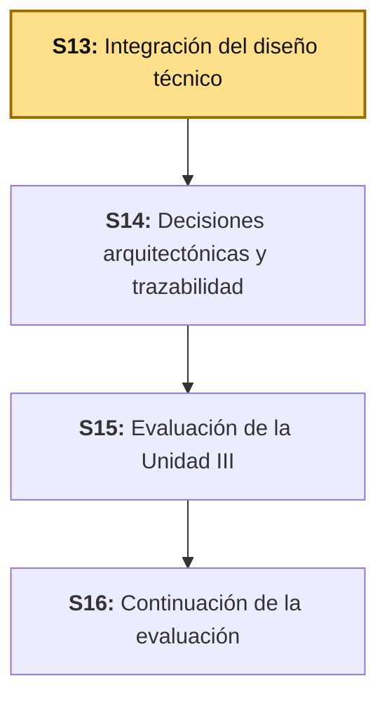
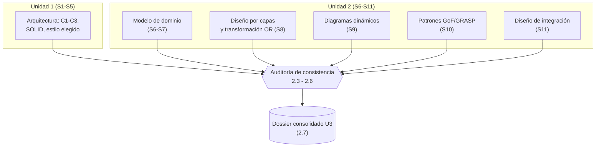

# S13 - Integración del Diseño Técnico

## 1. Introducción

Tiempo: 20 min.

### 1.1 Presentación de la sesión

S12 cerró la Unidad II con el Catálogo UML completo: dominio (S6-S7), diseño por capas y transformación objeto-relacional (S8), diagramas dinámicos (S9), patrones GoF/GRASP (S10) e integración empresarial (S11). Cada uno de esos artefactos se construyó y se evaluó por separado, en una sesión distinta, a veces con semanas de distancia entre una y otra. Nadie, hasta hoy, ha verificado que todos sigan contando la misma historia sobre BomERP.

Esta sesión abre la Unidad III (Proyecto de Diseño Técnico Profesional) con ese trabajo exacto: reunir el producto ya consolidado de Unidad 1 (`u1/ads-producto.md`: arquitectura, SOLID, estilo elegido) y el de Unidad 2 (`u2/ads-producto.md`: dominio, UML, patrones, integración) y auditar que lo que uno afirma siga siendo cierto frente a lo que el otro afirma — antes de registrar una sola decisión arquitectónica formal (ADR) o trazar una sola fila de la matriz final, que es trabajo de S14. No es una sesión de contenido nuevo: es la primera vez que todo el diseño técnico de BomERP se mira como un solo sistema, no como once entregas sueltas.

La auditoría de hoy no es un ejercicio hipotético: al revisar los propios artefactos de BomERP para preparar esta guía, aparecieron dos inconsistencias reales entre sesiones — una ya autodetectada por el propio S8, otra que ninguna sesión anterior había señalado todavía. Ambas se desarrollan en 2.4 y 2.3, y se resuelven en 3.2-3.5.

### 1.2 Índice

1. Qué es un dossier técnico consolidado, y en qué se diferencia de concatenar once archivos.
2. Consistencia entre la arquitectura (U1) y el modelo de dominio (U2).
3. Consistencia entre el modelo de dominio y el catálogo UML/patrones.
4. Consistencia entre los patrones aplicados y el diseño de integración.
5. Auditoría de nombres y responsabilidades a través de las sesiones.
6. Estructura del dossier consolidado de la Unidad III.

### 1.3 Propósito de aprendizaje

Al concluir la clase, estarás en condiciones de: **auditar** los artefactos ya consolidados de tus propias Unidades 1 y 2, **detectar** inconsistencias reales de nombres, atributos o responsabilidades entre ellos, **registrar** cada hallazgo con su resolución propuesta, y **consolidar** el resultado en un dossier único, listo para recibir las decisiones arquitectónicas formales (ADR) y la trazabilidad completa de S14.

### 1.4 Producto de sesión

Dossier consolidado de la Unidad III: arquitectura, modelo de dominio, catálogo UML y patrones de integración de BomERP, auditados por consistencia entre sí, con una tabla de hallazgos que registra cada inconsistencia real encontrada (incluida al menos una ya existente entre S7 y S8) y su resolución propuesta.

### 1.5 Metodología

**Tabla 1. Metodología de la sesión**

| Actividades a Realizar en el Periodo | Orientaciones generales (Orientaciones Metodológicas) | Material de estudio recomendado |
|---|---|---|
| Revisión previa individual | Releer el producto consolidado de Unidad 1 y de Unidad 2 propios, sin corregir nada todavía — solo identificar qué partes de uno mencionan algo que el otro también menciona. Trabajo individual, antes de clase. | `u1/ads-producto.md`, `u2/ads-producto.md` (o los equivalentes del proyecto propio). |
| Clase presencial | Auditoría guiada de consistencia arquitectura-dominio, dominio-UML y patrones-integración sobre el caso real de BomERP, registro de hallazgos y armado del dossier consolidado. Trabajo individual, siguiendo al docente paso a paso. | Pasos 3.1 a 3.6 de esta guía. |
| Evaluación formativa | Revisión en clase de la tabla de hallazgos y del dossier consolidado. La evidencia se completa y sustenta de forma individual, fuera del aula, según los criterios mínimos de la sección 4.4. | Indicaciones de entrega (4.3), rúbrica de evaluación (4.6). |

### 1.6 Motivación de la sesión

#### 1.6.1 Caso: por qué Michael Nygard inventó el ADR

En 2011, Michael Nygard, consultor de arquitectura de software, publicó un problema que había visto repetirse en proyectos grandes: las decisiones arquitectónicas importantes de un sistema —por qué se eligió tal estructura, por qué un módulo se diseñó de tal forma— sí se tomaban, pero no quedaban en ningún lugar consolidado. Vivían repartidas entre wikis desactualizados, comentarios de código aislados, la memoria de quien decidió, o ningún lugar en absoluto. El síntoma que describe: un equipo, meses después, no podía reconstruir por qué el sistema era como era — y terminaba repitiendo debates ya resueltos, o tomando una decisión nueva que contradecía una anterior sin saberlo, porque nadie tenía a la vista las dos decisiones juntas.

Fuente: Nygard, M. (2011). *Documenting Architecture Decisions*. Cognitect Blog. https://www.cognitect.com/blog/2011/11/15/documenting-architecture-decisions

Nygard resolvió ese problema específico con el ADR (*Architecture Decision Record*, formalizado la próxima sesión, S14). Pero su diagnóstico empieza un paso antes, el paso de hoy: antes de poder registrar una decisión de forma consolidada, hay que tener un solo lugar donde el estado actual del diseño —no solo las decisiones sobre él— sea consistente consigo mismo. BomERP, después de once sesiones escritas por separado, corre exactamente ese riesgo, y no es hipotético: 2.3 y 2.4 muestran dos casos reales donde ya ocurrió.

**Preguntas de análisis**

**Activación de conocimientos previos**

1. Antes de leer la causa técnica, ¿por qué un sistema documentado en once archivos separados, escritos en semanas distintas, corre más riesgo de contradecirse a sí mismo que uno documentado en un solo lugar desde el principio?

**Comprensión del caso**

1. Según Nygard, ¿qué pierde un equipo que no tiene sus decisiones consolidadas, aunque cada decisión individual haya sido correcta en su momento?
2. En tu propio proyecto, ¿qué artefacto de una sesión anterior (dominio, UML, patrones) no has vuelto a revisar desde que lo entregaste? ¿Qué pasaría si lo compararas hoy contra el más reciente que construiste?

### 1.7 Ubicación en el curso

- Producto del curso: Diseño Técnico Profesional Documentado.
- Producto de unidad: Diseño Técnico Profesional Documentado (Unidad III completa; esta es su primera sesión).
- Avance del producto en esta sesión: arquitectura, modelo de dominio, catálogo UML y diseño de integración auditados por consistencia entre sí y consolidados en un solo dossier, con sus hallazgos registrados — insumo directo para los ADR formales y la matriz de trazabilidad completa de S14.

**Figura 1. Roadmap del producto de la unidad**



## 2. Explica

Tiempo: 40 min.

### 2.1 Arquitectura de la sesión

**Figura 2. De once artefactos sueltos a un dossier auditado**



Lectura del diagrama: la auditoría no vuelve a escribir cada artefacto desde cero — toma lo que `u1/ads-producto.md` y `u2/ads-producto.md` ya consolidaron por unidad, y verifica los cruces entre ambos que ninguna sesión anterior tuvo la oportunidad de revisar, porque cada una miraba solo su propio corte. Cada apartado siguiente desarrolla un cruce distinto, en el mismo orden del Índice (1.2).

### 2.2 Qué es un dossier técnico consolidado

**Consolidar** no es lo mismo que **concatenar**. Concatenar es unir varios documentos en uno solo, uno detrás del otro, en el orden en que se escribieron. Consolidar es verificar que cada parte siga siendo cierta frente a las demás antes de unirlas — y, cuando no lo es, decidir explícitamente cuál de las dos versiones queda y por qué.

**Tabla 2. Concatenar frente a consolidar**

| | Concatenar | Consolidar (esta sesión) |
|---|---|---|
| Qué hace | Une los artefactos en un solo documento, en orden. | Verifica cada artefacto contra los demás antes de unirlos. |
| Qué detecta | Nada — un nombre, atributo o responsabilidad que cambió de sesión a sesión pasa sin que nadie lo note. | Exactamente ese tipo de cambio silencioso (2.3-2.6). |
| Resultado | Un documento largo, no necesariamente coherente. | Un documento donde cada parte puede verificarse contra las demás. |

BomERP ya tiene dos documentos consolidados **por unidad**: `u1/ads-producto.md` (arquitectura) y `u2/ads-producto.md` (dominio, UML, patrones, integración) — cada uno ya reunió varias sesiones sin contradecirse hacia adentro (o eso hay que confirmar, no asumir). Lo que falta, y es el trabajo de hoy, es consolidar **entre** unidades: verificar que lo que U1 afirma sobre la arquitectura sigue siendo cierto frente a lo que U2 construyó encima.

### 2.3 Consistencia entre la arquitectura y el modelo de dominio

Una vista de componentes (C3, ADS S2) declara qué módulos existen en el sistema. Un modelo de dominio (S6-S7) declara qué entidades y reglas de negocio existen. Ambos describen el mismo sistema desde dos ángulos distintos — y por eso **todo módulo que el dominio necesite debe poder ubicarse en la vista de componentes**, aunque sea como módulo futuro, igual que ya se hace con `inventario` o `compras`.

**Tabla 3. Auditoría real: módulos declarados en cada artefacto de BomERP**

| Módulo o entidad | ¿Aparece en la Vista C3 de U1? | ¿Aparece en el modelo de dominio de U2? |
|---|---|---|
| `catalogo` | Sí (real) | Sí |
| `ventas` | Sí (real) | Sí |
| `inventario` | Sí (futuro, sin sesión asignada) | No modelado aún |
| `compras` | Sí (futuro, delimitado) | No modelado aún |
| `seguridad` | Sí (futuro, S10) | No aplica — no es dominio de negocio |
| `clientes` (`Cliente`, con herencia `ClientePersonaNatural`/`ClienteEmpresa`) | **No aparece, ni real ni futuro** | Sí (S6-S7) |

**Hallazgo real:** `Cliente` es el único caso donde el dominio modela algo que la Vista C3 de U1 nunca declaró — ni como módulo real, ni como módulo futuro (a diferencia de `inventario`/`compras`, que sí están previstos ahí). Esto no es necesariamente un error de diseño: tiene dos resoluciones válidas, pero el dossier debe elegir una de forma explícita, no dejarla implícita:

- (a) agregar `clientes` a la Vista C3 como módulo futuro, con el mismo criterio que `inventario`/`compras`; o
- (b) documentar que `Cliente` vive dentro de `ventas` por ahora, porque todavía no justifica un módulo propio — el mismo criterio que ya evita crear carpetas vacías en LP2 (ADR-001: un módulo se agrega recién cuando una sesión concreta le da contenido).

3.2 aplica este mismo criterio y deja la decisión registrada.

### 2.4 Consistencia entre el modelo de dominio y el catálogo UML/patrones

Una operación que un diagrama de clases del dominio (S7) asigna a una entidad sigue siendo responsabilidad de esa entidad en todas las sesiones posteriores que la usan — a menos que una decisión explícita la mueva, y esa decisión quede registrada donde cualquiera pueda encontrarla, no solo en la sesión que la movió.

**Hallazgo real, ya autodetectado:** el diagrama de clases de S7 lista `calcularTotal()` como operación propia de `Venta`:

```text
class Venta {
    ...
    +calcularTotal()
    +anular()
}
```

Pero S8, al diseñar el servicio de aplicación por capas, documenta algo distinto sobre el mismo método:

> "`Venta.calcularTotal()` aparece como operación en el diagrama de S7 y hoy, en LP2, el total se calcula dentro de `VentaServiceImpl.crear`: es un refactor pendiente que la matriz de 3.8 deja registrado, no un error del diseño." (S8, 3.8)

El propio S8 ya detectó la inconsistencia y la registró como "refactor pendiente" — pero ese registro vive dentro de una tabla de una sola sesión, sin que ninguna sesión posterior (S9 dinámico, S10 patrones) vuelva a mencionarlo. Es exactamente el síntoma de Nygard (1.6): una decisión real, tomada, documentada en algún lugar — pero no consolidada en el lugar donde alguien que revise el diseño completo la vería. 3.3 la registra en la tabla de hallazgos de esta sesión, con destino explícito: formalizarla como ADR en S14, no resolverla en código desde ADS.

### 2.5 Consistencia entre los patrones aplicados y el diseño de integración

Un evento de dominio (S11) que lleva datos de una entidad debe llevar exactamente los datos que esa entidad tiene, según el diagrama de clases que la definió (S7) y el diseño por capas que la persistió (S8) — nunca un campo que la entidad no tiene, ni omitir uno que un consumidor necesitaría.

**Verificación real:** el evento `VentaRegistrada` (S11, 3.3) se define así:

```java
public record VentaRegistrada(
    Long ventaId,
    List<Long> productoIds,
    BigDecimal total,
    LocalDateTime fecha
) {}
```

Contra los atributos reales de `Venta` (`id`, `total: BigDecimal` persistido, `fecha`, S7-S8) y de `DetalleVenta` (que referencia `productoId`, S8): los cuatro campos del evento corresponden exactamente a atributos que esas dos entidades ya tienen — ninguno inventado, ninguno faltante. A diferencia de 2.3 y 2.4, esta verificación **no encontró** una inconsistencia: se registra igual en la tabla de hallazgos (3.5), porque confirmar que algo sigue siendo consistente es tan parte de la auditoría como encontrar que no lo es.

### 2.6 Auditoría de nombres y responsabilidades a través de las sesiones

La técnica detrás de 2.3-2.5, generalizada: para cualquier entidad o módulo que aparezca en más de una sesión, se construye una fila por elemento y una columna por sesión, y se verifica que lo que cada columna dice sea compatible con las demás. Un campo en blanco no es un error — significa que esa sesión no tenía por qué mencionar ese elemento todavía. Una fila con una celda que contradice a otra sí lo es.

**Tabla 4. Plantilla de auditoría de nombres (aplicada a `Venta` en 3.3)**

| Elemento | S6 (dominio) | S7 (clases) | S8 (capas/OR) | S9 (dinámico) | S10 (patrones) | S11 (integración) |
|---|---|---|---|---|---|---|
| `anular()` | regla de negocio | operación de `Venta` | confirma que sigue en la entidad | diagrama de secuencia de anulación | Information Expert | no participa |
| `calcularTotal()` | — | operación de `Venta` | **documentado en el servicio, no en la entidad** | — | — | — |
| `total` | regla de negocio | atributo `Dinero total` | persistido `BigDecimal total` | usado en el flujo de registro | referenciado | campo del evento |

La fila de `calcularTotal()` es la que 3.3 registra como hallazgo; las otras dos filas son el mismo método aplicado a un resultado consistente, no un ejercicio distinto.

### 2.7 Estructura del dossier consolidado de la Unidad III

El producto final de ADS (`u3/ads-producto.md`) ya define los componentes que debe tener el dossier completo. Esta sesión entrega los primeros cuatro; los dos últimos son trabajo de S14, no de hoy:

**Tabla 5. Qué se consolida en esta sesión frente a lo que queda para S14**

| Componente del dossier | ¿Se consolida en S13? | Dónde |
|---|---|---|
| Arquitectura final (C4 actualizado) | Sí — verificada contra el dominio (2.3) | `u3/ads-producto.md`, sección "Componentes finales" |
| Modelo de dominio | Sí — verificado contra el catálogo UML (2.4) | idem |
| Catálogo UML | Sí — verificado contra patrones e integración (2.5) | idem |
| Patrones e integración | Sí | idem |
| ADRs | No — se formalizan en S14 (incluido el hallazgo de 2.4, como ADR-008) | S14 |
| Trazabilidad completa | No — se completa en S14 | S14 |

## 3. Aplica: actividad práctica guiada

Tiempo: 100 min.

**Actividad:** auditar la consistencia entre el producto consolidado de Unidad 1 y el de Unidad 2 de BomERP, registrar los hallazgos reales (incluido el ya existente entre S7 y S8), y armar con eso el dossier consolidado de la Unidad III.

**Propósito de la actividad:** aplicar la auditoría de consistencia de 2.3-2.6 sobre el caso real de BomERP —con sus dos hallazgos genuinos— antes de repetir el mismo método sobre el proyecto propio en la sección 4.

**Orientaciones metodológicas:** el docente conduce la auditoría en vivo contra los archivos ya publicados `u1/ads-producto.md` y `u2/ads-producto.md`; los estudiantes repiten cada paso sobre los artefactos consolidados de su propio proyecto (sección 4).

**Actividades para realizar:**

- **3.1** Reunir los insumos: los productos ya consolidados de U1 y U2.
- **3.2** Auditar consistencia entre arquitectura y dominio.
- **3.3** Auditar consistencia entre dominio y catálogo UML/patrones.
- **3.4** Auditar consistencia entre patrones e integración.
- **3.5** Registrar los hallazgos de la auditoría.
- **3.6** Armar el dossier consolidado.

### 3.1 Reunir los insumos: los productos ya consolidados de U1 y U2

**Producto del paso:** confirmación de que el dossier de U3 no se escribe desde las once sesiones sueltas, sino a partir de lo que U1 y U2 ya consolidaron.

**Tabla 6. Insumos del dossier consolidado U3**

| Insumo | Qué consolida | Dónde vive |
|---|---|---|
| Producto U1 | Arquitectura (C1-C3), SOLID, estilo elegido, ADR iniciales | `u1/ads-producto.md` |
| Producto U2 | Modelo de dominio, catálogo UML, patrones, diseño de integración | `u2/ads-producto.md` |
| Esta sesión (S13) | Auditoría de consistencia entre ambos, más la estructura del dossier U3 | `u3/ads-producto.md` |

**Error frecuente**: volver a copiar el contenido de cada sesión (S1 a S11) dentro del dossier de U3, "para que esté todo junto". Eso es concatenar (2.2), no consolidar — y además duplica cualquier error que ya existiera en U1 o U2 en un tercer lugar más.

### 3.2 Auditar consistencia entre arquitectura y dominio

**Producto del paso:** la Tabla 3 (2.3) completada contra los artefactos reales, con la decisión tomada sobre el hallazgo de `clientes`.

Para tu propio proyecto: lista los módulos de tu Vista C3 (ADS S2) en una columna, y las entidades/módulos de tu modelo de dominio (S6-S7) en otra. Cualquier entidad del dominio que no puedas ubicar en ninguna fila de la Vista C3 —ni como módulo real, ni como módulo futuro— es un hallazgo, igual que `clientes` en BomERP.

Para BomERP, la decisión que esta sesión deja registrada es la opción (a) de 2.3: `clientes` se agrega a la Vista C3 de `u1/ads-producto.md` como módulo futuro, con el mismo criterio que `inventario`/`compras` — sin sesión asignada aún, porque ninguna sesión de LP2 lo ha implementado todavía.

### 3.3 Auditar consistencia entre dominio y catálogo UML/patrones

**Producto del paso:** el hallazgo de `calcularTotal()` (2.4) formalmente registrado como pendiente de ADR, no resuelto en código desde ADS.

Para tu propio proyecto: toma cada operación que tu diagrama de clases (S7) asignó a una entidad, y verifica que las sesiones posteriores que la mencionan (diseño por capas S8, diagramas dinámicos S9, patrones S10) sigan de acuerdo en quién es responsable de ejecutarla. Un método que "se mudó" de la entidad a un servicio sin que ninguna sesión lo registre explícitamente es un hallazgo.

**Error frecuente**: "corregir" el diagrama de S7 borrando `calcularTotal()` para que coincida con S8, sin dejar ningún rastro de que existió esa decisión. El objetivo de esta auditoría no es borrar la inconsistencia en silencio — es registrarla (3.5) para que S14 la convierta en una decisión arquitectónica explícita, con su justificación.

### 3.4 Auditar consistencia entre patrones e integración

**Producto del paso:** la verificación de 2.5 confirmada: los campos de `VentaRegistrada` corresponden exactamente a atributos reales de `Venta`/`DetalleVenta`.

Para tu propio proyecto: toma cada evento de dominio que diseñaste en S11, y confirma que cada campo que lleva corresponde a un atributo real de la entidad que lo origina, según tu propio diagrama de clases (S7) y tu diseño por capas (S8) — ni un campo inventado, ni uno que un consumidor razonable necesitaría y no está.

### 3.5 Registrar los hallazgos de la auditoría

**Producto del paso:** la tabla de hallazgos completa de BomERP, con los tres resultados de 3.2-3.4 (dos inconsistencias, una verificación confirmada).

**Tabla 7. Hallazgos de la auditoría de consistencia (BomERP)**

| # | Dónde se auditó | Hallazgo | Estado | Resolución propuesta |
|---|---|---|---|---|
| 1 | Arquitectura (U1) vs dominio (U2) | `clientes` modelado en el dominio (S6-S7), ausente de la Vista C3 (U1), ni siquiera como módulo futuro | Inconsistencia real | Agregar `clientes` a la Vista C3 como módulo futuro, igual que `inventario`/`compras` |
| 2 | Dominio (S7) vs diseño por capas (S8) | `Venta.calcularTotal()` documentado como operación de la entidad en S7, calculado en `VentaServiceImpl.crear` según S8 | Inconsistencia ya autodetectada por S8 | Se formaliza como ADR-008 en S14 — no se resuelve en código desde ADS |
| 3 | Patrones (S10) vs integración (S11) | Campos de `VentaRegistrada` frente a los atributos reales de `Venta`/`DetalleVenta` | Consistente | Ninguna — queda documentado como verificado |

Una tabla de hallazgos sin ninguna fila "Consistente" es sospechosa: significa que la auditoría solo buscó errores, no los verificó de verdad. La fila 3 existe precisamente para mostrar que confirmar también es un resultado válido de auditar.

### 3.6 Armar el dossier consolidado

**Producto del paso:** `u3/ads-producto.md` con sus componentes finales (Tabla 5, 2.7) y la Tabla 7 de hallazgos incorporada como evidencia de que la consolidación fue real, no solo declarada.

El dossier de esta sesión no repite el contenido completo de `u1/ads-producto.md` ni de `u2/ads-producto.md` — los referencia como ya consolidados, y agrega únicamente lo que esta sesión produjo: la verificación de que ambos siguen de acuerdo entre sí, y la tabla de hallazgos con sus resoluciones. S14 construye encima de este dossier, no al revés.

**Evidencia de aprendizaje:**

- Tabla de módulos (Tabla 3) completada, con la decisión registrada sobre `clientes`.
- Hallazgo de `calcularTotal()` documentado con su destino explícito (ADR-008 en S14).
- Verificación de `VentaRegistrada` contra los atributos reales de `Venta`/`DetalleVenta`.
- Tabla de hallazgos (Tabla 7) completa, con al menos una inconsistencia real y al menos una verificación confirmada.
- Dossier consolidado de Unidad III con sus cuatro componentes de esta sesión (arquitectura, dominio, UML, patrones/integración).

## 4. Crea: actividad autónoma

Tiempo: 2h fuera del aula.

### 4.1 Actividad

Auditoría de consistencia y consolidación del diseño técnico propio del equipo, documentada en evidencia individual.

Completa y evidencia estas tareas:

1. Auditar la consistencia entre tu Vista C3 (arquitectura, U1) y tu modelo de dominio (U2): toda entidad del dominio debe poder ubicarse en algún módulo de la Vista C3, real o futuro. Registra cualquier caso que no cumpla esto, como el de `clientes` en BomERP.
2. Auditar la consistencia entre tu diagrama de clases (S7) y las sesiones que lo usan después (S8 diseño por capas, S9 dinámico, S10 patrones): toda operación asignada a una entidad debe seguir siendo responsabilidad de esa entidad, a menos que una decisión explícita la haya movido.
3. Auditar la consistencia entre al menos un evento de dominio (S11) y los atributos reales de la entidad que lo origina (S7-S8): cada campo del evento debe corresponder a un atributo real.
4. Registrar los resultados de las tres auditorías anteriores en una tabla de hallazgos (como la Tabla 7), incluyendo al menos un resultado "Consistente" y, si corresponde, al menos una inconsistencia real con su resolución propuesta.
5. Armar tu propio dossier consolidado de Unidad III con los cuatro componentes de esta sesión (arquitectura, dominio, UML, patrones/integración), referenciando tus productos de U1 y U2 ya consolidados, sin volver a copiar su contenido completo.

### 4.2 Propósito

Que cada estudiante demuestre, de forma individual y fuera del aula, que puede auditar la consistencia de su propio diseño técnico entre unidades y consolidar el resultado en un solo dossier, sin el acompañamiento del docente.

### 4.3 Indicaciones

Entrega un PDF con el siguiente nombre:

```text
S13_ADS_Equipo##_ApellidoNombre.pdf
```

Cada captura de pantalla del informe debe mostrar, sin recortar, el reloj del sistema (fecha y hora) y tu usuario o foto de perfil (Windows, VS Code o navegador) visibles en pantalla — es lo que permite verificar que la evidencia es tuya y que corresponde al momento real de tu trabajo.

#### 4.3.1 Estructura del informe

**Datos del estudiante**

- Nombre:
- Equipo:
- Sesión: S13 - Integración del Diseño Técnico
- Rol o aporte realizado:
- Link de GitHub:

**Evidencia técnica**

Incluye capturas o extractos con una breve explicación debajo de cada uno, organizados en los mismos 5 bloques de la rúbrica (4.6):

1. *Consistencia arquitectura-dominio*
    - La tabla de módulos de tu propio proyecto, con cualquier caso sin resolver y su decisión.
2. *Consistencia dominio-UML/patrones*
    - La operación auditada, y si sigue siendo consistente entre S7 y las sesiones posteriores que la usan.
3. *Consistencia patrones-integración*
    - El evento de dominio auditado, contra los atributos reales de su entidad de origen.
4. *Tabla de hallazgos*
    - La tabla completa, con al menos un resultado "Consistente" y, si corresponde, al menos una inconsistencia real.
5. *Dossier consolidado*
    - Los cuatro componentes de esta sesión, referenciando (no copiando) tus productos de U1 y U2.

**Error o hallazgo**

Describe una inconsistencia real que encontraste al auditar tu propio diseño (un nombre, un atributo o una responsabilidad que cambió de sesión a sesión sin que lo notaras), o explica por qué, tras auditar a fondo, no encontraste ninguna.

**Reflexión técnica breve**

Responde en 5 a 8 líneas:

```text
¿Qué parte de tu propio diseño técnico no habías vuelto a revisar
desde que la entregaste por primera vez? Relaciona tu respuesta
con el caso de Nygard (1.6): ¿qué hubiera pasado si nunca la
hubieras vuelto a auditar?
```

### 4.4 Criterios mínimos de aceptación

- El archivo respeta el nombre solicitado.
- La auditoría arquitectura-dominio cubre todas las entidades del modelo de dominio frente a la Vista C3.
- La auditoría dominio-UML/patrones identifica al menos una operación y confirma (o corrige) su consistencia entre S7 y las sesiones posteriores.
- La auditoría patrones-integración verifica al menos un evento de dominio contra los atributos reales de su entidad de origen.
- La tabla de hallazgos incluye al menos un resultado "Consistente", no solo inconsistencias.
- El dossier consolidado referencia los productos de U1 y U2 sin copiar su contenido completo.
- Cada captura de la evidencia técnica muestra el reloj del sistema y el usuario/perfil visible, sin recortar.
- Las fechas y horas de las capturas son coherentes con el historial de commits de su repositorio en GitHub.
- Incluye un error o hallazgo técnico diagnosticado (o la justificación de por qué no se encontró ninguno).
- Incluye la reflexión técnica breve solicitada.

### 4.5 Preguntas de defensa

1. ¿Por qué una entidad de tu modelo de dominio que no aparece en ninguna parte de tu Vista C3 es un hallazgo, y no simplemente un detalle menor?
2. Si una operación "se mudó" de tu entidad a un servicio entre dos sesiones, ¿qué se pierde si esa mudanza no queda registrada en ningún lugar?
3. ¿Por qué confirmar que algo sigue siendo consistente cuenta como un resultado válido de una auditoría, y no solo encontrar errores?
4. Relaciona el caso de Nygard (1.6) con tu propia experiencia: ¿qué decisión de tu proyecto hubieras olvidado por qué se tomó, si no la hubieras vuelto a revisar hoy?
5. ¿Por qué el dossier consolidado de esta sesión referencia tus productos de U1 y U2 en vez de copiar su contenido completo?
6. Si tu auditoría no encontró ninguna inconsistencia real, ¿cómo demuestras que de verdad la hiciste, y no que simplemente no la hiciste a fondo?
7. ¿Qué diferencia hay entre resolver una inconsistencia en el código (como podría hacerlo LP2) y resolverla en el diseño (lo que hace ADS en esta sesión)?
8. ¿Por qué el hallazgo de `calcularTotal()` en BomERP no se corrige borrando la operación del diagrama de S7, sino registrándolo para convertirlo en una decisión formal en S14?

### 4.6 Rúbrica de evaluación

**Tabla 8. Rúbrica de evaluación**

| Criterio | Peso (%) | A (20 pts) | B (15 pts) | C (10 pts) | D (5 pts) | Nivel obtenido |
|---|---:|---|---|---|---|---:|
| 1. Consistencia arquitectura-dominio* | 20 | Todas las entidades del dominio ubicadas en la Vista C3 (real o futuro); cualquier caso sin resolver tiene una decisión explícita. | Auditoría completa, con algún caso sin decisión explícita. | Auditoría parcial, revisa solo algunos módulos. | No presenta esta auditoría. | |
| 2. Consistencia dominio-UML/patrones* | 20 | Al menos una operación auditada a través de todas las sesiones que la usan, con su consistencia confirmada o corregida y registrada. | Auditoría presente, con alguna sesión posterior no revisada. | Auditoría superficial, sin verificar sesiones posteriores reales. | No presenta esta auditoría. | |
| 3. Consistencia patrones-integración* | 20 | Evento de dominio verificado campo por campo contra los atributos reales de su entidad de origen. | Verificación presente, con algún campo no confirmado. | Verificación superficial o sin comparar contra atributos reales. | No presenta esta verificación. | |
| 4. Tabla de hallazgos* | 20 | Tabla completa, con al menos un resultado "Consistente" y, si corresponde, inconsistencias reales con resolución propuesta. | Tabla completa, con resoluciones poco justificadas. | Tabla incompleta o solo con inconsistencias, sin ninguna verificación confirmada. | No presenta tabla de hallazgos. | |
| 5. Dossier consolidado* | 20 | Los cuatro componentes de la sesión, coherentes entre sí, referenciando U1/U2 sin copiar su contenido completo. | Dossier completo, con alguna referencia innecesariamente duplicada. | Dossier incompleto o que copia el contenido de U1/U2 en vez de referenciarlo. | No presenta dossier consolidado. | |

\* Agregado manual.

Nota final = suma de (`Peso` / 100 × `Puntos del nivel obtenido`) = ____ / 20.

Para usar la rúbrica con IA (inteligencia artificial), solicita:

```text
Evalúa el PDF usando la rúbrica de la sesión.
Para cada criterio selecciona el nivel obtenido usando la escala A=20, B=15, C=10, D=5 puntos.
Justifica brevemente cada nivel asignado.
Verifica que cada captura muestre reloj del sistema y usuario/perfil visible, y que las fechas sean coherentes con el historial de commits de GitHub. Si falta esta evidencia o hay inconsistencias, indícalo explícitamente antes de calificar.
Calcula la nota final con la fórmula: suma de (Peso/100 × Puntos del nivel obtenido), directamente sobre 20.
Indica 2 fortalezas y 2 recomendaciones.
```

## 5. Cierre

Tiempo: 5 min.

**Resumen breve:** hoy BomERP se miró por primera vez como un solo sistema, no como once entregas sueltas. La auditoría encontró dos inconsistencias reales —`clientes` ausente de la Vista C3 pese a existir en el dominio, y `calcularTotal()` documentado en la entidad pero calculado en el servicio desde S8— y confirmó que una tercera relación, el evento `VentaRegistrada` frente a los atributos reales de `Venta`/`DetalleVenta`, sigue siendo consistente. Ninguna de las dos inconsistencias se resolvió en código: quedaron registradas, con su resolución propuesta, en el dossier consolidado de la Unidad III — listas para que S14 las convierta en decisiones arquitectónicas formales (ADR), exactamente el paso que Nygard (1.6) identificó que la mayoría de equipos nunca da.

**Dinámica participativa:** en una ronda rápida, cada estudiante comparte en una frase qué inconsistencia (real o confirmada como consistente) encontró al auditar su propio proyecto.

**Metacognición:** ¿qué te costó más: encontrar una inconsistencia real entre tus propios artefactos, o confiar en que una verificación que no encontró ningún error también es un resultado válido?

**Proyección:** S14 toma los hallazgos de hoy —empezando por `calcularTotal()`— y los convierte en ADR formales, además de construir la matriz de trazabilidad completa entre requerimientos, arquitectura, base de datos y diseño.

## Bibliografía

1. Nygard, M. (2011). *Documenting Architecture Decisions*. Cognitect Blog. https://www.cognitect.com/blog/2011/11/15/documenting-architecture-decisions
2. Brown, S. (2024). *The C4 model for visualising software architecture*. https://c4model.com/
3. Evans, E. (2003). *Domain-Driven Design: Tackling Complexity in the Heart of Software*. Addison-Wesley.
