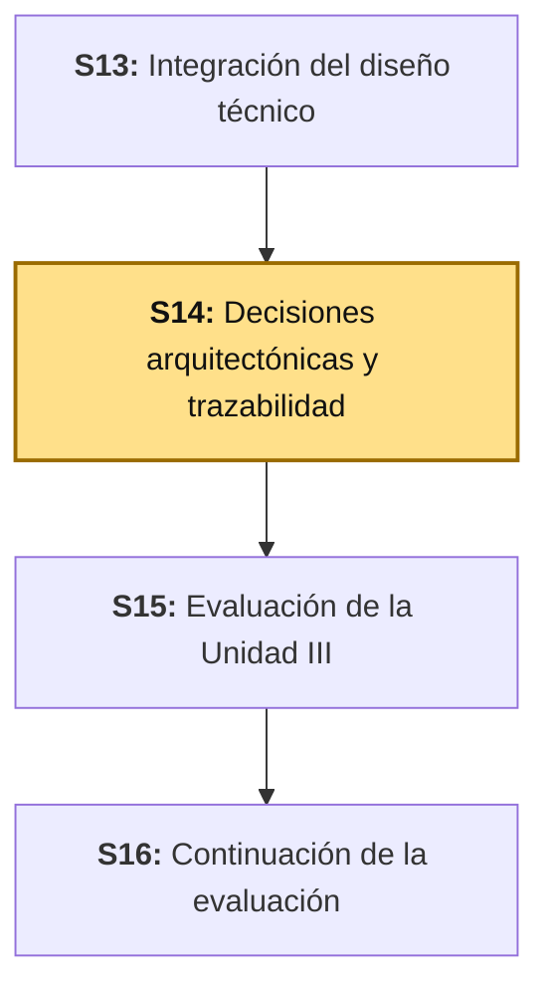
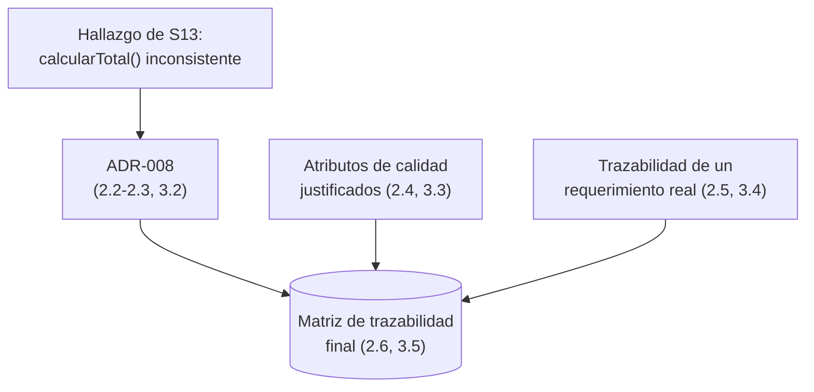

# S14 - Decisiones Arquitectónicas y Trazabilidad

## 1. Introducción

Tiempo: 20 min.

### 1.1 Presentación de la sesión

S13 auditó la consistencia entre Unidad 1 y Unidad 2 de BomERP y encontró dos hallazgos reales. Uno se resolvió en el momento (`clientes` agregado como módulo futuro a la Vista C3). El otro —`Venta.calcularTotal()` documentado como operación de la entidad en S7, pero calculado dentro del servicio según S8— quedó deliberadamente sin resolver, con un destino explícito: "se formaliza como ADR-008 en S14". Esta sesión cumple esa promesa: convierte un hallazgo de auditoría en una decisión arquitectónica registrada, con su contexto, sus alternativas y sus consecuencias — exactamente el paso que Nygard (S13, 1.6) dijo que la mayoría de equipos nunca da.

Esta sesión cierra, además, algo que viene pendiente desde la primera clase del curso: S1 (3.3) priorizó atributos de calidad como **insumo** de diseño, sin calificarlos todavía — el criterio 3 del producto de esta unidad ("Justifica atributos de calidad y decisiones técnicas") es, literalmente, la primera vez que esa tabla de S1 se evalúa con evidencia real, no solo se declara. Y cierra con la pieza que sostiene todo el dossier: la matriz de trazabilidad completa, desde un requerimiento real (una regla de negocio, S8) hasta su evidencia verificable en BD2 y LP2.

### 1.2 Índice

1. Qué es un ADR (*Architecture Decision Record*) y su estructura real.
2. Formalizar ADR-008: la decisión pendiente de `calcularTotal()`.
3. Justificar atributos de calidad con evidencia real.
4. Trazabilidad: de un requerimiento real a su evidencia verificable.
5. La matriz de trazabilidad completa del dossier.

### 1.3 Propósito de aprendizaje

Al concluir la clase, estarás en condiciones de: **redactar** un ADR completo (contexto, decisión, alternativas consideradas, consecuencias) a partir de un hallazgo real de inconsistencia, **justificar** con evidencia verificable —no solo declarar— los atributos de calidad definidos desde S1, y **trazar** un requerimiento real hasta su evidencia en arquitectura, base de datos y backend, consolidando todo en la matriz de trazabilidad final del dossier.

### 1.4 Producto de sesión

ADR-008 formalizado (la decisión de `calcularTotal()` que S13 dejó pendiente), la tabla de atributos de calidad de S1 justificada con evidencia real de las 13 sesiones anteriores, y la matriz de trazabilidad completa del dossier —requerimiento, arquitectura, base de datos, diseño y prueba— con al menos un requerimiento real trazado de punta a punta.

### 1.5 Metodología

**Tabla 1. Metodología de la sesión**

| Actividades a Realizar en el Periodo | Orientaciones generales (Orientaciones Metodológicas) | Material de estudio recomendado |
|---|---|---|
| Revisión previa individual | Releer el hallazgo 2 de la Tabla 7 de S13 (`calcularTotal()`) y la tabla de atributos de calidad de S1 (Tabla 2), sin redactar nada todavía. Trabajo individual, antes de clase. | S1 (2.4, 3.3), S13 (2.4, 3.3, 3.5). |
| Clase presencial | Redacción guiada del ADR-008 completo, justificación de cada atributo de calidad con evidencia real, trazado de un requerimiento real hasta su evidencia, y armado de la matriz de trazabilidad final. Trabajo individual, siguiendo al docente paso a paso. | Pasos 3.1 a 3.6 de esta guía. |
| Evaluación formativa | Revisión en clase del ADR-008, de la justificación de atributos de calidad, y de la matriz de trazabilidad completa. La evidencia se completa y sustenta de forma individual, fuera del aula, según los criterios mínimos de la sección 4.4. | Indicaciones de entrega (4.3), rúbrica de evaluación (4.6). |

### 1.6 Motivación de la sesión

#### 1.6.1 Caso: el vuelo 501 de Ariane 5 (1996)

El 4 de junio de 1996, el cohete Ariane 5 se autodestruyó 37 segundos después del despegue, en su vuelo inaugural. La causa, documentada en el informe oficial de investigación (Lions, 1996): el software de referencia inercial (SRI) reutilizó, sin volver a validar, código del Ariane 4 — incluida una variable (*Horizontal Bias*) que los programadores del Ariane 4 habían decidido, a propósito, **no** proteger contra *overflow*, porque en la trayectoria de ese cohete su valor nunca podía crecer lo suficiente para desbordar. Esa decisión nunca quedó registrada como una asunción que alguien debía revisar si el contexto cambiaba — solo quedó como código que funcionaba.

Fuente: Lions, J. L. (1996). *Ariane 5 Flight 501 Failure: Report by the Inquiry Board*. European Space Agency.

El Ariane 5 tenía una trayectoria inicial distinta, con mayor velocidad horizontal — exactamente la condición que hacía crecer esa variable fuera del rango protegido. El valor se desbordó, el SRI lanzó una excepción, y los dos módulos redundantes (que corrían el mismo código, con la misma asunción) fallaron **al mismo tiempo** — el diseño redundante no protegió nada, porque el error no era aleatorio: era sistemático. El informe lo resume así: no fue una falla de hardware ni un error aleatorio — fue una decisión de diseño válida en un contexto, nunca revalidada cuando el contexto cambió.

Esa es, en miniatura, la razón de ser de un ADR: no basta con que una decisión haya sido correcta cuando se tomó — tiene que quedar registrada con su contexto, para que alguien pueda revisarla cuando el contexto cambie. `calcularTotal()` (2.3) es una versión de bajo riesgo del mismo problema: una decisión de diseño (S7) que el código (S8) contradijo en silencio, sin que nadie lo registrara hasta la auditoría de S13.

**Preguntas de análisis**

**Activación de conocimientos previos**

1. Antes de leer la causa técnica, ¿por qué reutilizar código que "ya funcionaba" en otro contexto puede ser más peligroso que escribir código nuevo?

**Comprensión del caso**

1. Según el informe, ¿por qué los dos módulos redundantes del SRI fallaron exactamente al mismo tiempo, en vez de que uno cubriera el fallo del otro?
2. ¿Qué habría cambiado si la decisión de no proteger esa variable hubiera quedado registrada, con el contexto que la hacía válida, en vez de solo vivir como código?
3. En tu propio proyecto, ¿qué decisión de diseño tomaste en una sesión anterior que nunca volviste a revisar cuando el proyecto creció?

### 1.7 Ubicación en el curso

- Producto del curso: Diseño Técnico Profesional Documentado.
- Producto de unidad: Diseño Técnico Profesional Documentado (Unidad III).
- Avance del producto en esta sesión: ADR-008 formalizado, atributos de calidad justificados con evidencia real, y matriz de trazabilidad completa — listo para la sustentación final de S15.

**Figura 1. Roadmap del producto de la unidad**



## 2. Explica

Tiempo: 40 min.

### 2.1 Arquitectura de la sesión

**Figura 2. De un hallazgo de auditoría a una decisión registrada**



Lectura del diagrama: las tres piezas (ADR, atributos de calidad, trazabilidad de un requerimiento) no son pasos de una sola cadena — son tres evidencias distintas que convergen en el mismo destino, la matriz final. Cada apartado siguiente desarrolla una pieza, en el mismo orden del Índice (1.2).

### 2.2 Qué es un ADR y su estructura real

Un **ADR** (*Architecture Decision Record*) registra una decisión arquitectónica significativa, con el contexto que la motivó, para que alguien —el mismo equipo meses después, o un equipo nuevo— pueda entender por qué el sistema es como es, sin tener que reconstruir la conversación original (Nygard, 2011, ya citado en S13). No registra cualquier decisión: solo las que cambian la estructura o las propiedades del sistema de forma duradera.

**Tabla 2. Las cuatro partes de un ADR**

| Parte | Qué responde |
|---|---|
| Contexto | ¿Qué situación real obligó a decidir algo? |
| Decisión | ¿Qué se decidió, en una frase clara y verificable? |
| Alternativas consideradas | ¿Qué otras opciones se evaluaron, y por qué se descartaron? |
| Consecuencias | ¿Qué cambia —para bien o para mal— a partir de esta decisión? |

Es el mismo formato que los ADR reales de LP2 (`docs/lp2/adr/`, ya citados desde S8) — esta sesión no inventa una plantilla nueva, aplica la que el proyecto ya usa.

### 2.3 Formalizar ADR-008: la decisión pendiente de `calcularTotal()`

El hallazgo de S13 (Tabla 7, fila 2) resumido: S7 documenta `calcularTotal()` como operación de `Venta`; S8, documentando el código real de LP2, registra que el total se calcula dentro de `VentaServiceImpl.crear`. Ninguna sesión posterior volvió a mencionarlo — es exactamente el síntoma de Nygard (S13, 1.6): una decisión real, nunca consolidada donde alguien la vería.

Resolver esto no es "elegir un lado al azar" — es aplicar el mismo criterio que S10 (GRASP, Information Expert) ya estableció: la responsabilidad de calcular algo debe asignarse a la clase que tiene los datos necesarios para hacerlo, sin depender de nada externo. `Venta` ya tiene su lista de `detalles`, cada uno con su `subtotal` (S7-S8) — no necesita ningún dato que no sea suyo para sumarlos. 3.2 redacta el ADR completo con este criterio.

### 2.4 Justificar atributos de calidad con evidencia real

S1 (3.3) priorizó atributos de calidad como **insumo** de diseño — una tabla de decisiones iniciales, sin calificar todavía (ver `u1/ads-producto.md`, Tabla 2). "Justificar" un atributo de calidad no es repetir la decisión inicial: es mostrar **evidencia verificable, construida después**, de que el sistema de verdad la cumple.

**Tabla 3. Declarar frente a justificar**

| | Declarar (S1) | Justificar (esta sesión) |
|---|---|---|
| Qué dice | "Mantenibilidad: paquetes de módulo cohesionados." | "`ModularityTests` pasa en verde, verificado contra el código real de hoy." |
| Cuándo se puede hacer | Antes de construir nada — es una intención. | Después de tener evidencia real que confirme (o contradiga) la intención. |
| Qué pasa si no hay evidencia | La intención queda sin verificar — puede ser falsa y nadie lo notaría. | El atributo no se justifica; se reporta como pendiente, no como cumplido. |

3.3 recorre la Tabla 2 completa de S1 y reemplaza cada "decisión inicial" por evidencia real de las 13 sesiones ya construidas.

### 2.5 Trazabilidad: de un requerimiento real a su evidencia verificable

**Trazabilidad** es la capacidad de seguir una línea continua desde un requerimiento real (una regla de negocio, S8) hasta la evidencia concreta que demuestra que se cumple — pasando por la decisión arquitectónica, el objeto de base de datos, y el código del backend (CE021, Nivel 2, ya citado desde S1). Una matriz sin esa línea completa es una lista de buenas intenciones, no trazabilidad.

**Tabla 4. Un requerimiento real trazado de punta a punta (ejemplo RN2)**

| Eslabón | Contenido real |
|---|---|
| Requerimiento (S8) | RN2: "Debe haber stock suficiente para cada `cantidad`." |
| Arquitectura (S8, S10) | `ProductoService.descontarStock`, llamada síncrona protegida por Information Expert/Protected Variations. |
| Base de datos (BD2) | Columna `STOCK` de `PRODUCTOS`, con la regla verificada contra datos reales. |
| Backend (LP2) | `StockInsuficienteException` → `409`. |
| Prueba (S8) | "Dado un producto con stock 2, cuando se vende cantidad 3, entonces responde `409` y el stock sigue en 2." |

Ningún eslabón de esta cadena es nuevo — cada uno ya existe en una sesión anterior. Lo que esta sesión agrega es la línea que los conecta explícitamente, en un solo lugar.

### 2.6 La matriz de trazabilidad completa del dossier

La matriz final de `u3/ads-producto.md` ya existe desde que se publicó esa plantilla, pero le falta la columna que el sílabo de esta sesión pide de forma explícita: el requerimiento real del que parte cada fila, no solo la decisión, la base de datos y el backend. 3.5 agrega esa columna.

## 3. Aplica: actividad práctica guiada

Tiempo: 100 min.

**Actividad:** formalizar el ADR-008 pendiente de S13, justificar con evidencia real la tabla de atributos de calidad de S1, trazar un requerimiento real de punta a punta, y completar la matriz de trazabilidad final con la columna de requerimiento.

**Propósito de la actividad:** convertir un hallazgo de auditoría en una decisión registrada, una intención declarada en una evidencia verificada, y una matriz incompleta en una trazabilidad real de punta a punta — sobre el caso real de BomERP.

**Orientaciones metodológicas:** el docente redacta el ADR-008 en vivo frente a la clase; los estudiantes repiten cada paso sobre al menos una decisión pendiente real de su propio proyecto (sección 4).

**Actividades para realizar:**

- **3.1** Reunir los hallazgos de S13 como insumo.
- **3.2** Redactar el ADR-008 completo.
- **3.3** Justificar cada atributo de calidad de la Tabla 2 (S1) con evidencia real.
- **3.4** Trazar un requerimiento real de punta a punta.
- **3.5** Completar la matriz de trazabilidad final.
- **3.6** Actualizar el dossier con el ADR y la matriz.

### 3.1 Reunir los hallazgos de S13 como insumo

**Producto del paso:** confirmación de que el hallazgo 2 de la Tabla 7 de S13 (`calcularTotal()`) es el insumo directo del ADR de esta sesión — no se redacta un ADR desde cero sin un hallazgo real que lo motive.

### 3.2 Redactar el ADR-008 completo

**Producto del paso:** el ADR-008, con sus cuatro partes (2.2), formalizando la decisión de 2.3.

```markdown
# ADR-008 - Responsabilidad de calcularTotal(): entidad Venta, no el servicio

## Estado
Aprobada. Pendiente de aplicar en el código de LP2 (deuda técnica registrada).

## Contexto
S13 (auditoría de consistencia, Unidad 3) encontró que el diagrama de clases de S7
documenta `calcularTotal()` como operación propia de `Venta`, pero S8 (RN1-RN6,
postcondición de `crear`) documenta que, en el código real de LP2, el total se
calcula dentro de `VentaServiceImpl.crear`. Ninguna sesión posterior (S9, S10)
volvió a mencionar esta discrepancia -- quedó registrada una sola vez, sin que
nadie la convirtiera en una decisión formal.

## Decisión
`Venta.calcularTotal()` es la responsabilidad correcta, según Information Expert
(S10): la entidad ya tiene todo lo que necesita (su lista de `detalles`, cada uno
con `subtotal` ya calculado) sin depender de ningún dato externo al agregado.
La implementación actual de LP2 (el cálculo en el servicio) queda registrada como
deuda técnica, no como una alternativa de diseño válida.

## Alternativas consideradas
| Alternativa | Por qué se descarta |
|---|---|
| Dejar el cálculo en el servicio y actualizar el diagrama de S7 para que coincida | Reintroduce el Anemic Domain Model que S7 (2.8) explícitamente decidió evitar. |
| No decidir nada, dejar la inconsistencia documentada sin resolver | Es el síntoma exacto que Nygard (S13, 1.6) describe: una decisión sin registro formal se pierde. |

## Consecuencias
- LP2 tiene un refactor pendiente documentado: mover la suma de
  `VentaServiceImpl.crear` a `Venta.calcularTotal()`, y que el servicio solo
  invoque ese método.
- Ninguna prueba existente debería romperse -- el resultado (`total` persistido)
  es el mismo, solo cambia quién lo calcula.
- Mientras el refactor no se aplique, el diagrama de clases de S7 sigue siendo
  la referencia de diseño correcta -- el código, no el diagrama, está en deuda.
```

**Error frecuente**: redactar la "Decisión" de un ADR como una descripción vaga ("se mejorará el diseño de `Venta`"), sin una regla verificable. Una decisión de ADR debe poder confirmarse o refutarse contra el código real, igual que cualquier otro criterio de esta rúbrica.

### 3.3 Justificar cada atributo de calidad de la Tabla 2 (S1) con evidencia real

**Producto del paso:** la Tabla 2 de `u1/ads-producto.md`, con cada "decisión inicial" acompañada de evidencia real de hoy.

**Tabla 5. Atributos de calidad: de decisión inicial a justificación final**

| Atributo | Decisión inicial (S1) | Evidencia real (hoy) |
|---|---|---|
| Seguridad futura | Autenticación y autorización para U2. | Keycloak integrado (LP2 S10b-S11): JWT con `realm_access.roles`, decodificado por la SPA; Gateway valida el rol antes de reenviar. |
| Mantenibilidad | Ejecutable único, paquetes de módulo cohesionados. | `ModularityTests` en verde (ADR-002), verificado contra el código real. |
| Integridad | Reglas transaccionales en servicio y Oracle. | RN1-RN10 (S8) + `TRG_PRODUCTO_AUDITORIA` (BD2 S2). |
| Rendimiento | Índices y consultas optimizadas por fecha. | `IX_VENTAS_FECHA` (BD2 S5), selectividad medida con criterio, no por intuición (BD2 S10). |
| Auditabilidad | Trigger de auditoría de cambios de precio/stock. | `TRG_PRODUCTO_AUDITORIA` disparado en vivo (BD2 S2) + Unified Auditing (BD2 S9). |
| Escalabilidad inicial | API *stateless* preparada para SPA. | JWT sin sesión de servidor (LP2 S10b); `VENTAS_HISTORICO` particionado como preparación para volumen (BD2 S11). |

**Error frecuente**: justificar un atributo con una evidencia que en realidad corresponde a otro — por ejemplo, usar el particionamiento de BD2 (pensado para volumen) como evidencia de "Seguridad". Cada fila debe conectar con una evidencia que de verdad responde a esa propiedad del sistema, no a cualquier trabajo reciente.

### 3.4 Trazar un requerimiento real de punta a punta

**Producto del paso:** la Tabla 4 (2.5) completada con un segundo requerimiento real, distinto de RN2, elegido por el estudiante.

Para tu propio proyecto: elige un requerimiento real de tu módulo transaccional (`brief.md`, sección 3), y completa los cinco eslabones de la Tabla 4 —requerimiento, arquitectura, base de datos, backend, prueba— sin saltarte ninguno. Si algún eslabón todavía no existe en tu proyecto, regístralo como pendiente, no lo inventes.

### 3.5 Completar la matriz de trazabilidad final

**Producto del paso:** la matriz final de `u3/ads-producto.md`, con la columna de requerimiento agregada.

**Tabla 6. Matriz final de trazabilidad, con requerimiento (actualización de `u3/ads-producto.md`)**

| Requerimiento | Decisión ADS | Evidencia BD2 | Evidencia LP2 | Prueba o sustentación |
|---|---|---|---|---|
| RN8 (filtra por `vendedorId` si es `VENDEDOR`) | API REST *stateless* con JWT | Usuario/rol de aplicación | Backend y SPA protegidos | Login, *guard* e interceptor. |
| Precondición de `anular()`: `{estado = 'REGISTRADA'}` (S7, 2.7) | Auditabilidad de ventas | Trigger o auditoría Oracle | Registro/anulación de venta | Evidencia de evento auditado. |
| RN10 (`ordenarPor` de lista cerrada) | Rendimiento en consultas | Índice, estadísticas o AWR | Filtros y consultas API | Comparación de plan o tiempo. |
| RN1 (`404` si el producto no existe o no está activo) | Service + Repository | Paquetes/tablas Oracle | Servicios y repositorios | Demo de flujo transaccional. |
| Requisito no funcional: listar grandes volúmenes sin degradar | Paginación de alto volumen | Índices y consulta estable | Metadatos, filtros y ordenamiento | Prueba con volumen justificable. |
| Requisito no funcional: diagnosticar un error en producción | Observabilidad | Sesiones, bloqueos y monitoreo Oracle | Logs, salud y monitoreo básico | Diagnóstico de una operación y un error. |
| RN2 (stock suficiente, `409`) | Integración *full-stack* | Dato persistido y auditado | Flujo SPA → API → Oracle | Prueba end-to-end y regresión. |

Esta tabla reemplaza, con una columna más, a la del mismo nombre en `u3/ads-producto.md` — no se publica como una tabla aparte.

### 3.6 Actualizar el dossier con el ADR y la matriz

**Producto del paso:** `u3/ads-producto.md` con el ADR-008 agregado a su tabla de ADR y la matriz de trazabilidad reemplazada por la de 3.5.

**Evidencia de aprendizaje:**

- ADR-008 completo, con sus cuatro partes, verificable contra el código real de LP2.
- Tabla de atributos de calidad de S1 justificada con evidencia real de las 13 sesiones anteriores.
- Un requerimiento real (distinto de RN2) trazado de punta a punta, sobre el proyecto propio.
- Matriz de trazabilidad final, con la columna de requerimiento agregada.

## 4. Crea: actividad autónoma

Tiempo: 2h fuera del aula.

### 4.1 Actividad

Decisiones arquitectónicas y trazabilidad del proyecto propio del equipo, documentadas en evidencia individual.

Completa y evidencia estas tareas:

1. Identificar al menos una decisión de diseño de tu propio proyecto que una sesión posterior contradijo en silencio (como `calcularTotal()`), y formalizarla como un ADR completo (contexto, decisión, alternativas, consecuencias).
2. Justificar con evidencia real al menos cuatro atributos de calidad de tu propio proyecto (los que definiste en S1), reemplazando cada decisión inicial por evidencia construida después.
3. Trazar al menos dos requerimientos reales de tu propio proyecto de punta a punta (requerimiento → arquitectura → base de datos → backend → prueba), con todos los eslabones completos o registrados explícitamente como pendientes.
4. Armar tu propia matriz de trazabilidad final, con la columna de requerimiento.

### 4.2 Propósito

Que cada estudiante demuestre, de forma individual y fuera del aula, que puede convertir un hallazgo de inconsistencia en una decisión arquitectónica formal, justificar atributos de calidad con evidencia real, y trazar requerimientos reales de punta a punta, sin el acompañamiento del docente.

### 4.3 Indicaciones

Entrega un PDF con el siguiente nombre:

```text
S14_ADS_Equipo##_ApellidoNombre.pdf
```

Cada captura de pantalla del informe debe mostrar, sin recortar, el reloj del sistema (fecha y hora) y tu usuario o foto de perfil (Windows, VS Code o navegador) visibles en pantalla — es lo que permite verificar que la evidencia es tuya y que corresponde al momento real de tu trabajo.

#### 4.3.1 Estructura del informe

**Datos del estudiante**

- Nombre:
- Equipo:
- Sesión: S14 - Decisiones Arquitectónicas y Trazabilidad
- Rol o aporte realizado:
- Link de GitHub:

**Evidencia técnica**

Incluye capturas o extractos con una breve explicación debajo de cada uno, organizados en los mismos 4 bloques de la rúbrica (4.6):

1. *ADR formalizado*
    - El ADR completo, con sus cuatro partes, a partir de un hallazgo real de tu propio proyecto.
2. *Atributos de calidad justificados*
    - Al menos cuatro atributos, con su decisión inicial y su evidencia real.
3. *Requerimientos trazados de punta a punta*
    - Al menos dos requerimientos, con los cinco eslabones completos o pendientes registrados explícitamente.
4. *Matriz de trazabilidad final*
    - Tu propia matriz, con la columna de requerimiento.

**Error o hallazgo**

Describe una inconsistencia real que encontraste entre una decisión de diseño y el código actual de tu propio proyecto, distinta de la ya resuelta en S13.

**Reflexión técnica breve**

Responde en 5 a 8 líneas:

```text
¿Qué decisión de tu propio proyecto nunca registraste formalmente, y
qué hubiera pasado si el contexto que la hacía válida cambiara sin que
nadie lo notara? Relaciona tu respuesta con el caso del Ariane 5 (1.6).
```

### 4.4 Criterios mínimos de aceptación

- El archivo respeta el nombre solicitado.
- El ADR tiene sus cuatro partes completas, a partir de un hallazgo real, con una decisión verificable contra el código.
- Al menos cuatro atributos de calidad están justificados con evidencia real, no solo con la decisión inicial repetida.
- Al menos dos requerimientos reales están trazados de punta a punta, con los eslabones completos o pendientes registrados explícitamente.
- La matriz de trazabilidad final incluye la columna de requerimiento, coherente con el resto de columnas.
- Cada captura de la evidencia técnica muestra el reloj del sistema y el usuario/perfil visible, sin recortar.
- Las fechas y horas de las capturas son coherentes con el historial de commits de su repositorio en GitHub.
- Incluye un error o hallazgo técnico diagnosticado.
- Incluye la reflexión técnica breve solicitada.

### 4.5 Preguntas de defensa

1. ¿Por qué un ADR necesita una "Decisión" verificable contra el código, y no solo una intención bien redactada?
2. ¿Por qué `Venta.calcularTotal()` es la responsabilidad correcta según Information Expert, y no una preferencia estética?
3. ¿Qué diferencia hay entre declarar un atributo de calidad y justificarlo con evidencia? Da un ejemplo propio de cada uno.
4. En tu requerimiento trazado, ¿qué eslabón fue el más difícil de completar, y por qué?
5. Relaciona el caso del Ariane 5 (1.6) con tu propia decisión no registrada: ¿qué contexto tendría que cambiar para que esa decisión dejara de ser válida?
6. ¿Por qué la matriz de trazabilidad necesita la columna de requerimiento, y no basta con decisión-BD-backend-prueba?
7. Si encontraras hoy una segunda inconsistencia real en tu propio proyecto, ¿la resolverías en el código o la registrarías como ADR primero? ¿Por qué?

### 4.6 Rúbrica de evaluación

**Tabla 7. Rúbrica de evaluación**

| Criterio | Peso (%) | A (20 pts) | B (15 pts) | C (10 pts) | D (5 pts) | Nivel obtenido |
|---|---:|---|---|---|---|---:|
| 1. ADR formalizado* | 25 | ADR completo (4 partes), a partir de un hallazgo real, con decisión verificable contra el código. | ADR completo, con la decisión poco verificable o el hallazgo genérico. | ADR incompleto (falta alguna de las 4 partes). | No presenta ADR. | |
| 2. Atributos de calidad justificados* | 25 | Al menos 4 atributos, cada uno con evidencia real distinta y correctamente asignada. | Al menos 4 atributos, con alguna evidencia mal asignada o repetida. | Menos de 4 atributos, o evidencia genérica sin conexión real. | No presenta justificación de atributos de calidad. | |
| 3. Requerimientos trazados de punta a punta* | 25 | Al menos 2 requerimientos, con los 5 eslabones completos o pendientes registrados explícitamente. | Al menos 2 requerimientos, con algún eslabón faltante sin registrar. | Solo 1 requerimiento trazado completo. | No presenta trazabilidad de ningún requerimiento. | |
| 4. Matriz de trazabilidad final* | 25 | Matriz completa, con la columna de requerimiento coherente con el resto. | Matriz completa, con la columna de requerimiento parcialmente coherente. | Matriz incompleta o sin la columna de requerimiento. | No presenta matriz de trazabilidad. | |

\* Agregado manual.

Nota final = suma de (`Peso` / 100 × `Puntos del nivel obtenido`) = ____ / 20.

Para usar la rúbrica con IA (inteligencia artificial), solicita:

```text
Evalúa el PDF usando la rúbrica de la sesión.
Para cada criterio selecciona el nivel obtenido usando la escala A=20, B=15, C=10, D=5 puntos.
Justifica brevemente cada nivel asignado.
Verifica que cada captura muestre reloj del sistema y usuario/perfil visible, y que las fechas sean coherentes con el historial de commits de GitHub. Si falta esta evidencia o hay inconsistencias, indícalo explícitamente antes de calificar.
Calcula la nota final con la fórmula: suma de (Peso/100 × Puntos del nivel obtenido), directamente sobre 20.
Indica 2 fortalezas y 2 recomendaciones.
```

## 5. Cierre

Tiempo: 5 min.

**Resumen breve:** hoy el hallazgo que S13 dejó deliberadamente pendiente se convirtió en una decisión real: ADR-008 confirma que `Venta.calcularTotal()` es la responsabilidad correcta según Information Expert, y registra el cálculo actual del servicio como deuda técnica explícita, no como una alternativa válida. La tabla de atributos de calidad de S1 —una intención declarada desde la primera clase— por fin tiene evidencia real detrás de cada fila. Y la matriz de trazabilidad del dossier ganó la columna que le faltaba: el requerimiento real del que parte cada decisión, cerrando la cadena completa que el sílabo exige desde el requerimiento hasta la prueba. El caso del Ariane 5 (1.6) deja la lección que atraviesa toda la sesión: una decisión válida en su momento, nunca registrada, es una falla esperando el cambio de contexto que la exponga.

**Dinámica participativa:** en una ronda rápida, cada estudiante comparte en una frase qué decisión de su propio proyecto formalizó hoy como ADR, y qué la motivó.

**Metacognición:** ¿qué te costó más: encontrar una decisión real no registrada en tu propio proyecto, o conseguir evidencia real (no solo repetir la intención) para justificar un atributo de calidad?

**Proyección:** S15 integra todo el Diseño Técnico Profesional Documentado —arquitectura, dominio, UML, patrones, integraciones, ADRs y trazabilidad— en la sustentación final del curso.

## Bibliografía

1. Nygard, M. (2011). *Documenting Architecture Decisions*. Cognitect Blog. https://www.cognitect.com/blog/2011/11/15/documenting-architecture-decisions
2. Lions, J. L. (1996). *Ariane 5 Flight 501 Failure: Report by the Inquiry Board*. European Space Agency. https://esamultimedia.esa.int/docs/esa-x-1819eng.pdf
