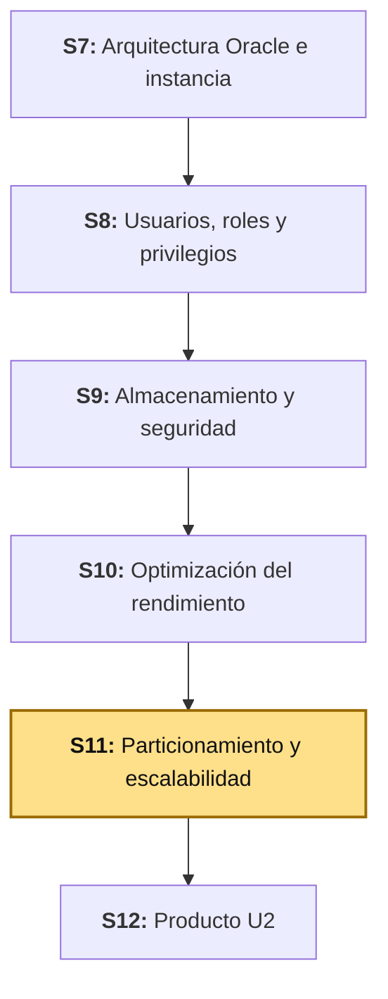
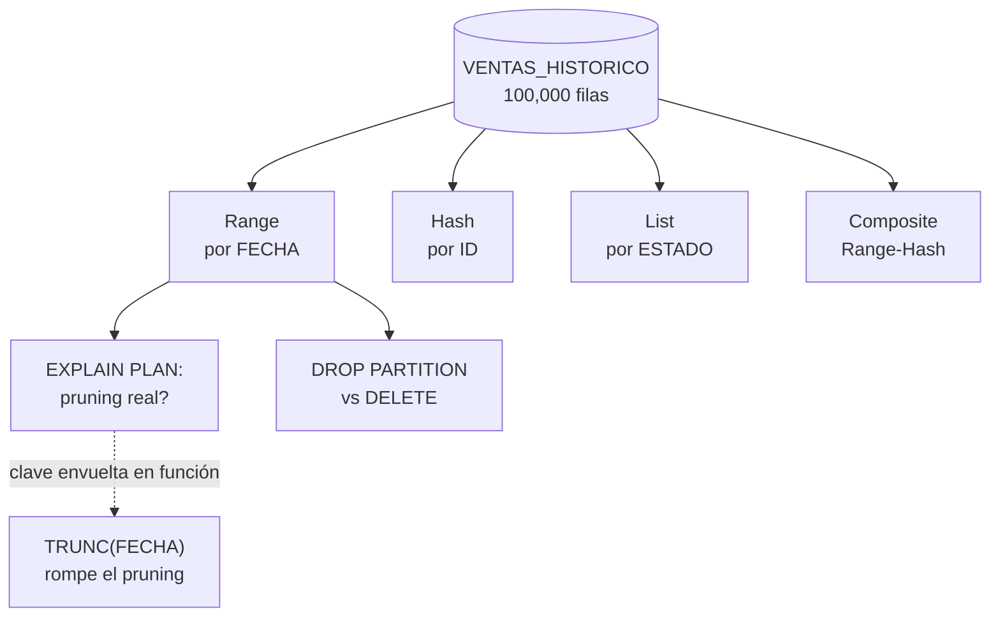

# S11 - Particionamiento y Escalabilidad

## 1. Introducción

Tiempo: 20 min.

### 1.1 Presentación de la sesión

S10 cerró con un criterio: medir antes de decidir, aplicado a un índice. Esta sesión aplica el mismo criterio a un problema distinto — qué hacer cuando una tabla ya no crece en cientos de filas, sino en cientos de miles, y un índice ya no alcanza. `VENTAS` hoy es pequeña (el volumen de prueba de S4-S10 ronda 500 filas), pero el producto real que BomERP representa — un ERP en producción, con años de operación — acumula ventas sin parar. Esta sesión construye, a propósito, una tabla con 100,000 filas (`VENTAS_HISTORICO`, el archivo histórico de ventas que `VENTAS` todavía no necesita) para que el particionamiento tenga un volumen real donde demostrarse, no un argumento abstracto. Sobre esa tabla se crean las cuatro estrategias que el sílabo pide — `Range`, `Hash`, `List` y `Composite` — y se mide, con `EXPLAIN PLAN`, el mecanismo que las hace valiosas: el *partition pruning*. 2.6 retoma, bajo una luz distinta, algo que S5 ya construyó: el índice `Function-Based` sobre `TRUNC(FECHA)` — porque la misma función que ahí resolvía un problema, aquí desactiva el pruning si no se usa con cuidado.

### 1.2 Índice

1. Range Partitioning.
2. Hash Partitioning.
3. List Partitioning.
4. Composite Partitioning.
5. Partition pruning: cuándo el optimizador descarta particiones completas, y cuándo no.
6. Estrategias para grandes volúmenes e impacto en el rendimiento: `DROP PARTITION` frente a `DELETE`.

### 1.3 Propósito de aprendizaje

Al concluir la clase, estarás en condiciones de:

- **Diseñar** una tabla particionada con la estrategia adecuada al patrón de acceso real (`Range`, `Hash`, `List` o `Composite`), **verificar con evidencia** —`EXPLAIN PLAN`, no intuición— si el optimizador de verdad descarta particiones completas (*partition pruning*), **reconocer** el error que desactiva ese pruning sin que Oracle avise con un error, y **decidir con criterio medido** cuándo particionar una tabla aporta más que indexarla.

### 1.4 Producto de sesión

Una tabla de gran volumen (`VENTAS_HISTORICO`, 100,000 filas reales) particionada por `Range` sobre `FECHA`, con `EXPLAIN PLAN` confirmando *partition pruning* real (una sola partición accedida, no las tres) y, a propósito, el mismo plan roto al envolver la clave de partición en `TRUNC` — reproduciendo, en particionamiento, el mismo error que un índice `Function-Based` ya resolvía en S5. Variantes `Hash`, `List` y `Composite` creadas y verificadas sobre la misma tabla, con su sintaxis real documentada. Una decisión medida —con tiempos reales, no estimados— entre `DROP PARTITION` y `DELETE` para el mismo volumen de datos históricos.

### 1.5 Metodología

**Tabla 1. Metodología de la sesión**

| Actividades a Realizar en el Periodo | Orientaciones generales (Orientaciones Metodológicas) | Material de estudio recomendado |
|---|---|---|
| Revisión previa individual | Repasar el índice `Function-Based` de S5 (2.5, `TRUNC(FECHA)`) y la decisión medida sobre selectividad de S10 (3.7). Confirmar que `bomerp-oracle` sigue corriendo. Trabajo individual, antes de clase. | S5 (2.5, 3.5), S10 (2.6, 3.7). |
| Clase presencial | Construcción guiada de `VENTAS_HISTORICO` con 100,000 filas, particionamiento `Range` sobre `FECHA`, verificación de *partition pruning* con `EXPLAIN PLAN`, reproducción guiada del error que lo desactiva, variantes `Hash`/`List`/`Composite`, y comparación medida `DROP PARTITION` frente a `DELETE`. Trabajo individual en la propia laptop, siguiendo al docente paso a paso. | Contenedor `bomerp-oracle` corriendo (S1), Pasos 3.1 a 3.6 de esta guía. |
| Evaluación formativa | Revisión en clase del plan de ejecución con pruning confirmado, de la reproducción del error con `TRUNC`, y de la comparación medida `DROP PARTITION`/`DELETE`. La evidencia se completa y sustenta de forma individual, fuera del aula, según los criterios mínimos de la sección 4.4. | Indicaciones de entrega (4.3), rúbrica de evaluación (4.6). |

### 1.6 Motivación de la sesión

#### 1.6.1 Caso: la función que apaga el *partition pruning* sin ningún error

La documentación oficial de Oracle sobre *partition pruning* advierte un caso preciso: aplicar cualquier función sobre la columna de partición en el filtro de una consulta —explícita o implícita, incluida una conversión de tipo o un truncamiento de valores— generalmente desactiva el pruning, sin que el optimizador avise con ningún error ni advertencia (Oracle Corporation, 2024b). El ejemplo que la propia documentación usa es casi idéntico al de esta sesión: una consulta que envuelve la columna de fecha en una función para filtrar por año termina recorriendo **todas** las particiones, no solo la que corresponde.

Fuente: Oracle Corporation. (2024b). *Partition Pruning Tips*. VLDB and Partitioning Guide. https://docs.oracle.com/en/database/oracle/oracle-database/23/vldbg/partition-availability.html

Esto no es una advertencia abstracta para este curso: S5 (2.5) ya construyó `ix_ventas_fecha_dia` como un índice `Function-Based` sobre `TRUNC(VENTAS.FECHA)`, precisamente porque un reporte agregado necesitaba filtrar por día calendario. Si `VENTAS` se particionara algún día por `FECHA` y una consulta reutilizara ese mismo patrón (`WHERE TRUNC(FECHA) = ...`) sin pensarlo dos veces, el pruning se apagaría exactamente de la misma forma — no porque el particionamiento esté mal diseñado, sino porque la consulta envuelve la clave. 3.3 reproduce este error con datos reales y lo mide.

**Preguntas de análisis**

**Activación de conocimientos previos**

1. En S5, ¿por qué `TRUNC(VENTAS.FECHA)` necesitó un índice `Function-Based` y no bastaba con el `B-Tree` ya creado sobre `FECHA`?

**Comprensión de particionamiento y pruning**

1. ¿Qué significa, en el plan de ejecución, que `Pstart` y `Pstop` muestren el mismo número de partición?
2. ¿Por qué el mismo error de 1.6.1 puede aparecer tanto en un índice `Function-Based` (S5) como en una tabla particionada (hoy), aunque sean mecanismos distintos?

### 1.7 Ubicación en el curso

- Unidad: U2 - Administración, almacenamiento, seguridad y optimización.
- Producto del curso: base de datos empresarial Oracle operativa, administrada, optimizada, auditada y resiliente.
- Producto de unidad: base de datos empresarial administrada, optimizada y asegurada.
- Avance del producto en esta sesión: una tabla de gran volumen particionada por `Range` con *partition pruning* verificado, variantes `Hash`/`List`/`Composite` documentadas, y una decisión medida sobre la estrategia de mantenimiento de datos históricos (`DROP PARTITION` frente a `DELETE`).

**Figura 1. Roadmap del producto de la unidad**



**Sobre el ambiente de esta sesión.** El sílabo declara Oracle Database 19c EE (*Enterprise Edition*) sobre Oracle Linux, todavía no aprovisionado en este repositorio. Esta guía trabaja sobre `bomerp-oracle` (Oracle Database Free, el mismo contenedor de S1-S10). A diferencia de AWR en S10 —una zona gris de licencia incluso en Oracle Database Free—, el particionamiento **no** lo es: verificado contra el manual oficial de licenciamiento, *Oracle Partitioning* aparece como *opción incluida* (no de costo adicional) en Oracle Database Free, y solo como opción de costo adicional en Enterprise Edition estándar (Oracle Corporation, 2024e). Esta sesión sí se puede practicar sin ninguna zona gris de licencia.

## 2. Explica

Tiempo: 30 min.

### 2.1 Arquitectura de la sesión

**Figura 2. De una tabla de gran volumen a una estrategia de particionamiento verificada**



Lectura del diagrama: la misma tabla alimenta las cuatro estrategias de particionamiento (2.2-2.5), pero solo `Range` se usa para demostrar las dos consecuencias prácticas de particionar un volumen real — el pruning que sí funciona, y el que un descuido apaga (2.6) — y la decisión de mantenimiento que cierra la sesión (3.5).

### 2.2 Range Partitioning

Range Partitioning asigna cada fila a una partición según el rango de valores de la clave de partición, definido explícitamente para cada partición (Oracle Corporation, 2024c). Es el tipo más común, y casi siempre se usa con fechas (Oracle Corporation, 2024c): cada partición representa un período (un año, un mes), y los datos nuevos entran siempre a la partición más reciente — exactamente el patrón de una tabla de ventas históricas que crece con el tiempo, sin que los datos viejos cambien nunca.

```sql
CREATE TABLE VENTAS_HISTORICO (
    ID      NUMBER,
    FECHA   DATE NOT NULL,
    ESTADO  VARCHAR2(20) NOT NULL,
    TOTAL   NUMBER(10,2)
)
PARTITION BY RANGE (FECHA) (
    PARTITION P_2024 VALUES LESS THAN (DATE '2025-01-01'),
    PARTITION P_2025 VALUES LESS THAN (DATE '2026-01-01'),
    PARTITION P_2026 VALUES LESS THAN (DATE '2027-01-01')
);
```

### 2.3 Hash Partitioning

Hash Partitioning asigna cada fila a una partición aplicando un algoritmo de *hashing* de Oracle sobre la clave de partición (Oracle Corporation, 2024c) — no hay un rango que definir, Oracle reparte las filas de forma pareja entre el número de particiones que se indique. Es la alternativa cuando los datos no son históricos o no tienen una clave natural de partición evidente (Oracle Corporation, 2024c), y su propósito no es facilitar el mantenimiento por período (eso es `Range`), sino **distribuir** el volumen de forma pareja.

```sql
CREATE TABLE VENTAS_HASH (
    ID NUMBER, FECHA DATE NOT NULL, ESTADO VARCHAR2(20) NOT NULL, TOTAL NUMBER(10,2)
)
PARTITION BY HASH (ID) PARTITIONS 4;
```

**Error frecuente**: sin nombrar las particiones, Oracle las genera con un nombre automático tipo `SYS_Pnnnn` (verificado contra `bomerp-oracle`: `SYS_P1661`-`SYS_P1664` para 4 particiones, el número exacto depende de la secuencia interna de la base y **va a variar** entre instancias) — un nombre inútil para cualquier mantenimiento posterior (`ALTER TABLE ... DROP PARTITION SYS_P1661` no dice nada por sí mismo). Si vas a referenciarlas después, nómbralas explícitamente:

```sql
CREATE TABLE VENTAS_HASH (
    ID NUMBER, FECHA DATE NOT NULL, ESTADO VARCHAR2(20) NOT NULL, TOTAL NUMBER(10,2)
)
PARTITION BY HASH (ID) (
    PARTITION P_H0, PARTITION P_H1, PARTITION P_H2, PARTITION P_H3
);
```

### 2.4 List Partitioning

List Partitioning asigna cada fila a una partición según una lista explícita de valores discretos, declarada para cada partición (Oracle Corporation, 2024c) — su ventaja es agrupar valores que no tienen un orden natural, pero sí una agrupación lógica (una región, una categoría, un estado) (Oracle Corporation, 2024c). Una partición `DEFAULT` recoge cualquier fila que no coincida con ningún valor listado, evitando que una fila inesperada produzca un error (Oracle Corporation, 2024c).

```sql
CREATE TABLE VENTAS_LIST (
    ID NUMBER, FECHA DATE NOT NULL, ESTADO VARCHAR2(20) NOT NULL, TOTAL NUMBER(10,2)
)
PARTITION BY LIST (ESTADO) (
    PARTITION P_REGISTRADA VALUES ('REGISTRADA'),
    PARTITION P_ANULADA VALUES ('ANULADA'),
    PARTITION P_OTROS VALUES (DEFAULT)
);
```

**Tabla 2. Qué resuelve cada estrategia, en una tabla de ventas**

| Estrategia | Qué agrupa | Candidato en `VENTAS_HISTORICO` |
|---|---|---|
| Range | Un rango continuo de valores (fechas, montos) | `FECHA` — datos históricos, que crecen por período |
| Hash | Nada en particular — solo reparte parejo | `ID` — sin clave de agrupación natural |
| List | Un conjunto explícito de valores discretos | `ESTADO` — pocos valores conocidos de antemano |

### 2.5 Composite Partitioning

Composite Partitioning particiona una tabla con una estrategia, y después subdivide cada partición con una segunda estrategia (Oracle Corporation, 2024c). La combinación `Range-Hash` —la más común— da la facilidad de mantenimiento por período de `Range` (agregar una partición nueva por año, eliminar la más vieja) y, dentro de cada período, la distribución pareja de `Hash` (Oracle Corporation, 2024c).

```sql
CREATE TABLE VENTAS_COMPOSITE (
    ID NUMBER, FECHA DATE NOT NULL, ESTADO VARCHAR2(20) NOT NULL, TOTAL NUMBER(10,2)
)
PARTITION BY RANGE (FECHA) SUBPARTITION BY HASH (ID) SUBPARTITIONS 4 (
    PARTITION P_2024 VALUES LESS THAN (DATE '2025-01-01'),
    PARTITION P_2025 VALUES LESS THAN (DATE '2026-01-01'),
    PARTITION P_2026 VALUES LESS THAN (DATE '2027-01-01')
);
```

Verificado contra `bomerp-oracle`: 3 particiones de `Range` × 4 subparticiones de `Hash` cada una produce 12 subparticiones reales (`USER_TAB_SUBPARTITIONS` las confirma, con nombre automático `SYS_SUBPnnnn` — el mismo "Error frecuente" de 2.3 aplica también aquí si no se nombran explícitamente las subparticiones).

### 2.6 Partition pruning: cuándo el optimizador descarta particiones, y cuándo no

*Partition pruning* es el mecanismo por el que el optimizador descarta, antes de ejecutar, las particiones que no pueden contener ninguna fila relevante para la consulta — accede solo a la o las particiones necesarias, no a toda la tabla (Oracle Corporation, 2024a). En el plan de ejecución, las columnas `Pstart` y `Pstop` de `DBMS_XPLAN` muestran exactamente qué particiones tocó el plan: si ambas muestran el mismo número, el pruning descartó todas las demás.

**La condición que lo rompe, documentada oficialmente**: aplicar cualquier función sobre la columna de partición en el filtro —explícita (una función que se ve) o implícita (una conversión de tipo que Oracle agrega sola)— generalmente desactiva el pruning, sea cual sea la función, incluido un truncamiento de valores (Oracle Corporation, 2024b). 3.3 reproduce esto con la misma función que S5 (2.5) ya usó para otro propósito: `TRUNC(FECHA)`.

## 3. Aplica: actividad práctica guiada

Tiempo: 100 min.

**Actividad:** construcción guiada de `VENTAS_HISTORICO` con 100,000 filas reales, particionamiento `Range` sobre `FECHA`, verificación de *partition pruning* con `EXPLAIN PLAN`, reproducción del error que lo desactiva, variantes `Hash`/`List`/`Composite`, y comparación medida `DROP PARTITION` frente a `DELETE` (Producto de la sesión en 1.4).

**Propósito de la actividad:** salir de la sesión con el hábito de verificar con `EXPLAIN PLAN` —nunca asumir— si una tabla particionada de verdad descarta particiones, y con un error real ya vivido (no solo leído) para reconocerlo en el proyecto propio.

**Orientaciones metodológicas:** en el laboratorio, el docente construye `VENTAS_HISTORICO` paso a paso frente a la clase, incluida la reproducción deliberada del error de `TRUNC`; los estudiantes repiten cada paso en su propia instancia y aplican después el mismo criterio a su propio proyecto (ver sección 4).

**Actividades para realizar:**

- **3.1** Construir `VENTAS_HISTORICO` con `Range Partitioning` y cargar 100,000 filas reales.
- **3.2** Verificar *partition pruning* real con `EXPLAIN PLAN`.
- **3.3** Reproducir el error: envolver la clave de partición en `TRUNC` y medir la diferencia.
- **3.4** Crear y verificar las variantes `Hash`, `List` y `Composite`.
- **3.5** Medir `DROP PARTITION` frente a `DELETE`, y decidir con los tiempos reales.
- **3.6** Relacionar con ADS y LP2.

### 3.1 Construir `VENTAS_HISTORICO` con `Range Partitioning` y cargar 100,000 filas reales

**Producto del paso:** una tabla particionada por `Range` sobre `FECHA`, con volumen real suficiente para que el pruning se note.

```bash
docker exec -it bomerp-oracle sqlplus BOM_VENTAS/123456@localhost:1521/FREEPDB1
```

```sql
CREATE TABLE VENTAS_HISTORICO (
    ID      NUMBER,
    FECHA   DATE NOT NULL,
    ESTADO  VARCHAR2(20) NOT NULL,
    TOTAL   NUMBER(10,2)
)
PARTITION BY RANGE (FECHA) (
    PARTITION P_2024 VALUES LESS THAN (DATE '2025-01-01'),
    PARTITION P_2025 VALUES LESS THAN (DATE '2026-01-01'),
    PARTITION P_2026 VALUES LESS THAN (DATE '2027-01-01')
);

INSERT INTO VENTAS_HISTORICO
SELECT LEVEL,
       DATE '2024-01-01' + MOD(LEVEL, 1095),
       CASE WHEN MOD(LEVEL,7)=0 THEN 'ANULADA' ELSE 'REGISTRADA' END,
       ROUND(DBMS_RANDOM.VALUE(10,500),2)
FROM DUAL CONNECT BY LEVEL <= 100000;
COMMIT;

BEGIN
    DBMS_STATS.GATHER_TABLE_STATS(USER, 'VENTAS_HISTORICO', CASCADE => TRUE);
END;
/
```

`VENTAS_HISTORICO` es una tabla nueva, separada de `VENTAS` — no se particiona la tabla de producción del proyecto (eso cambiaría su estructura en pleno curso), se construye el volumen de prueba que `VENTAS` hoy no tiene, de la misma forma que S4 y S5 construyeron su propio volumen de prueba sin tocar el esquema real.

```sql
SELECT PARTITION_NAME, HIGH_VALUE, NUM_ROWS
FROM USER_TAB_PARTITIONS
WHERE TABLE_NAME = 'VENTAS_HISTORICO'
ORDER BY PARTITION_POSITION;
```

Resultado esperado (verificado contra `bomerp-oracle`): tres particiones, con las filas repartidas de forma aproximadamente pareja entre los tres años (`P_2024` con 33,661 filas, `P_2025` con 33,215, `P_2026` con 33,124 — los números exactos varían con la semilla aleatoria de `DBMS_RANDOM`, lo que importa es que las tres particiones tengan volumen real).

### 3.2 Verificar *partition pruning* real con `EXPLAIN PLAN`

**Producto del paso:** evidencia, en el plan de ejecución, de que una consulta acotada a un año accede solo a esa partición.

```sql
EXPLAIN PLAN FOR
SELECT ESTADO, COUNT(*)
FROM VENTAS_HISTORICO
WHERE FECHA >= DATE '2025-01-01' AND FECHA < DATE '2026-01-01'
GROUP BY ESTADO;

SELECT * FROM TABLE(DBMS_XPLAN.DISPLAY(NULL, NULL, 'BASIC +PARTITION +COST'));
```

Verificado contra `bomerp-oracle`: el plan muestra `PARTITION RANGE SINGLE`, con `Pstart` y `Pstop` ambos en `2` (la posición de `P_2025`) y `Cost = 274`. El optimizador identificó, antes de ejecutar, que el filtro de fechas solo puede estar en una partición, y descartó las otras dos por completo — nunca las tocó.

**Error frecuente**: confundir `PARTITION RANGE SINGLE` con "la tabla tiene una sola partición". La tabla tiene tres; `SINGLE` describe lo que el plan de **esta consulta** accedió, no cuántas particiones existen. Confírmalo contra el resultado de 3.1.

### 3.3 Reproducir el error: envolver la clave de partición en `TRUNC` y medir la diferencia

**Producto del paso:** el mismo error documentado en 1.6.1/2.6, reproducido con datos reales y con su costo medido, no solo leído.

```sql
EXPLAIN PLAN FOR
SELECT ESTADO, COUNT(*)
FROM VENTAS_HISTORICO
WHERE TRUNC(FECHA, 'YYYY') = DATE '2025-01-01'
GROUP BY ESTADO;

SELECT * FROM TABLE(DBMS_XPLAN.DISPLAY(NULL, NULL, 'BASIC +PARTITION +COST'));
```

Es la misma pregunta de negocio que 3.2 ("ventas del 2025"), escrita de una forma distinta — envolviendo `FECHA` en `TRUNC` en vez de acotarla con un rango explícito. Verificado contra `bomerp-oracle`: el plan ahora muestra `PARTITION RANGE ALL`, con `Pstart = 1` y `Pstop = 3` —las tres particiones, aunque la respuesta solo podía estar en una— y `Cost = 822`, exactamente tres veces el costo de 3.2 (`274 × 3 = 822`): el optimizador recorrió por completo las tres particiones porque ya no pudo saber, antes de ejecutar, en cuál podía estar la fila.

**Tabla 3. La misma pregunta, dos formas de escribirla**

| | 3.2: `FECHA >= ... AND FECHA < ...` | 3.3: `TRUNC(FECHA,'YYYY') = ...` |
|---|---|---|
| Pruning | Sí — `PARTITION RANGE SINGLE` | No — `PARTITION RANGE ALL` |
| `Pstart`/`Pstop` | `2` / `2` | `1` / `3` |
| Cost | 274 | 822 (3×) |
| Error de Oracle | Ninguno — el plan corre igual, solo más caro | Ninguno — exactamente el riesgo que advierte 1.6.1: nada avisa que el pruning se apagó |

**Error frecuente**: el mismo que S5 (2.5) ya resolvió con un índice `Function-Based`, aplicado ahora a particiones — pero la solución **no** es la misma. Un índice `Function-Based` sobre `TRUNC(FECHA)` sí puede acelerar esta consulta exacta (sigue siendo una opción válida si la necesitas), pero no le devuelve el pruning a la tabla particionada: el índice y las particiones son dos mecanismos independientes. La única forma de recuperar el pruning aquí es reescribir la consulta sin envolver la clave de partición, como en 3.2.

### 3.4 Crear y verificar las variantes `Hash`, `List` y `Composite`

**Producto del paso:** las cuatro estrategias del sílabo, creadas y verificadas sobre la misma tabla de ventas.

```sql
CREATE TABLE VENTAS_HASH (
    ID NUMBER, FECHA DATE NOT NULL, ESTADO VARCHAR2(20) NOT NULL, TOTAL NUMBER(10,2)
)
PARTITION BY HASH (ID) (
    PARTITION P_H0, PARTITION P_H1, PARTITION P_H2, PARTITION P_H3
);

CREATE TABLE VENTAS_LIST (
    ID NUMBER, FECHA DATE NOT NULL, ESTADO VARCHAR2(20) NOT NULL, TOTAL NUMBER(10,2)
)
PARTITION BY LIST (ESTADO) (
    PARTITION P_REGISTRADA VALUES ('REGISTRADA'),
    PARTITION P_ANULADA VALUES ('ANULADA'),
    PARTITION P_OTROS VALUES (DEFAULT)
);

CREATE TABLE VENTAS_COMPOSITE (
    ID NUMBER, FECHA DATE NOT NULL, ESTADO VARCHAR2(20) NOT NULL, TOTAL NUMBER(10,2)
)
PARTITION BY RANGE (FECHA) SUBPARTITION BY HASH (ID) SUBPARTITIONS 4 (
    PARTITION P_2024 VALUES LESS THAN (DATE '2025-01-01'),
    PARTITION P_2025 VALUES LESS THAN (DATE '2026-01-01'),
    PARTITION P_2026 VALUES LESS THAN (DATE '2027-01-01')
);
```

Verifica cada una:

```sql
SELECT PARTITION_NAME, PARTITION_POSITION FROM USER_TAB_PARTITIONS WHERE TABLE_NAME = 'VENTAS_HASH' ORDER BY 2;
SELECT PARTITION_NAME, HIGH_VALUE FROM USER_TAB_PARTITIONS WHERE TABLE_NAME = 'VENTAS_LIST' ORDER BY PARTITION_POSITION;
SELECT PARTITION_NAME, SUBPARTITION_NAME FROM USER_TAB_SUBPARTITIONS WHERE TABLE_NAME = 'VENTAS_COMPOSITE' ORDER BY 1, 2;
```

Para `VENTAS_COMPOSITE`, el resultado esperado son 12 filas (3 particiones de `Range` × 4 subparticiones de `Hash` cada una) — confirma que cada partición de año tiene sus propias 4 subparticiones, no que existan 4 subparticiones compartidas entre los tres años.

No cargues 100,000 filas en estas tres tablas — su propósito es verificar la sintaxis y la estructura real, no repetir la medición de pruning (eso ya lo hizo `VENTAS_HISTORICO` con `Range`, la estrategia que de verdad aplica al caso de uso de ventas históricas).

### 3.5 Medir `DROP PARTITION` frente a `DELETE`, y decidir con los tiempos reales

**Producto del paso:** el tiempo real de eliminar un año completo de datos históricos de dos formas distintas, medido, no asumido.

Una tarea real de mantenimiento: `P_2024` ya cumplió su ciclo de vida y hay que retirarla. Sobre `VENTAS_HISTORICO` (particionada):

```sql
SET TIMING ON

ALTER TABLE VENTAS_HISTORICO DROP PARTITION P_2024;
```

Y, para comparar de forma honesta, la misma eliminación sobre una tabla gemela sin particionar, con el mismo volumen:

```sql
CREATE TABLE VENTAS_SIN_PARTICION (
    ID NUMBER, FECHA DATE NOT NULL, ESTADO VARCHAR2(20) NOT NULL, TOTAL NUMBER(10,2)
);

INSERT INTO VENTAS_SIN_PARTICION
SELECT LEVEL, DATE '2024-01-01' + MOD(LEVEL, 1095),
       CASE WHEN MOD(LEVEL,7)=0 THEN 'ANULADA' ELSE 'REGISTRADA' END,
       ROUND(DBMS_RANDOM.VALUE(10,500),2)
FROM DUAL CONNECT BY LEVEL <= 100000;
COMMIT;

DELETE FROM VENTAS_SIN_PARTICION WHERE FECHA < DATE '2025-01-01';
COMMIT;
```

Verificado contra `bomerp-oracle`, con el mismo volumen (100,000 filas, ~33,661 a eliminar en ambos casos): `DROP PARTITION` tomó **0.02 segundos**; `DELETE` del mismo rango de fechas tomó **0.66 segundos** — más de 30 veces más lento, en una laptop de desarrollo con un solo usuario conectado, sin ninguna carga concurrente.

**Por qué la diferencia es real, no casualidad.** `DROP PARTITION` (y `TRUNCATE PARTITION`) están optimizados para hacer el mantenimiento de índices **solo a nivel de metadatos**: Oracle no recorre fila por fila, actualiza el diccionario de datos para que esa partición deje de existir (Oracle Corporation, 2024d). `DELETE`, en cambio, es una operación de fila por fila: por cada una de las 33,661 filas, genera su propio registro de `redo` y `undo`, además de evaluar el `WHERE` contra cada fila de la tabla completa (sin pruning de por medio, porque no hay particiones). La diferencia de tiempos de esta sesión —con solo 100,000 filas y sin usuarios concurrentes— ya es medible; en una tabla de producción con millones de filas y escrituras simultáneas, la misma diferencia de mecanismo se vuelve crítica: un `DELETE` masivo compite por bloqueos y genera un volumen de `redo`/`undo` proporcional a las filas eliminadas, mientras que `DROP PARTITION` mantiene un costo prácticamente constante sin importar cuántas filas contenía la partición.

```sql
DROP TABLE VENTAS_HASH PURGE;
DROP TABLE VENTAS_LIST PURGE;
DROP TABLE VENTAS_COMPOSITE PURGE;
DROP TABLE VENTAS_SIN_PARTICION PURGE;
DROP TABLE VENTAS_HISTORICO PURGE;
```

Limpia las cinco tablas de prueba al cerrar esta sección — son volumen de prueba de esta sesión, igual que el de S4/S5, no parte del esquema real del proyecto.

### 3.6 Relacionar con ADS y LP2

Sesión equivalente en los otros dos cursos, misma semana: ADS S11 integra sistemas empresariales externos (facturación electrónica, pasarela de pagos), una preocupación de integración, no de volumen de datos — son capas independientes, el mismo particionamiento de hoy aplicaría igual si `VENTAS` tuviera que conversar con un sistema externo o no. LP2 no tiene una sesión dedicada a particionamiento (responsabilidad de BD2), pero si un equipo de LP2 reporta que un listado de ventas se vuelve lento a medida que el proyecto acumula más datos de prueba, el criterio de hoy —medir con `EXPLAIN PLAN` antes de asumir que hace falta particionar, y verificar que el pruning de verdad ocurre si se particiona— es exactamente el que corresponde aplicar, antes que cualquier cambio de esquema.

**Evidencia de aprendizaje:**

- `VENTAS_HISTORICO` construida con `Range Partitioning` sobre `FECHA`, con 100,000 filas reales y estadísticas actualizadas.
- `EXPLAIN PLAN` confirmando *partition pruning* real (`PARTITION RANGE SINGLE`, `Pstart = Pstop`).
- El mismo pruning roto al envolver la clave en `TRUNC`, con el costo comparado (`PARTITION RANGE ALL`, 3× el costo).
- Las variantes `Hash`, `List` y `Composite` creadas y verificadas con sus vistas de diccionario correspondientes.
- Tiempos reales de `DROP PARTITION` frente a `DELETE` sobre el mismo volumen, con la decisión justificada.

## 4. Crea: actividad autónoma

Tiempo: 2h fuera del aula.

### 4.1 Actividad

Diseño, construcción y verificación de particionamiento sobre una tabla de gran volumen del proyecto propio del equipo, documentado en evidencia individual.

Completa y evidencia estas tareas:

1. Identificar, en tu propio proyecto, una tabla candidata a gran volumen (la que más crece con el tiempo) y justificar qué estrategia de particionamiento (`Range`, `Hash`, `List` o `Composite`) corresponde a su patrón de acceso real.
2. Construir esa tabla particionada (o una tabla de prueba equivalente, con volumen real cargado) y verificar su estructura con las vistas de diccionario correspondientes.
3. Capturar `EXPLAIN PLAN` de una consulta representativa y confirmar, con `Pstart`/`Pstop`, si el *partition pruning* ocurre.
4. Reproducir, deliberadamente, el error que desactiva el pruning (una función sobre la clave de partición) y medir la diferencia de costo.
5. Medir el tiempo real de `DROP PARTITION` (o `TRUNCATE PARTITION`) frente a un `DELETE` equivalente, y documentar la decisión con los tiempos obtenidos.

### 4.2 Propósito

Que cada estudiante demuestre, de forma individual y fuera del aula, que puede diseñar una estrategia de particionamiento justificada por el patrón de acceso real de los datos, verificar con evidencia si el optimizador aprovecha esa estrategia, y reconocer el error que la anula sin que Oracle lo advierta.

### 4.3 Indicaciones

Entrega un PDF con el siguiente nombre:

```text
S11_BD2_Equipo##_ApellidoNombre.pdf
```

Cada captura de pantalla del informe debe mostrar, sin recortar, el reloj del sistema (fecha y hora) y tu usuario o foto de perfil (Windows, VS Code o navegador) visibles en pantalla — es lo que permite verificar que la evidencia es tuya y que corresponde al momento real de tu trabajo.

#### 4.3.1 Estructura del informe

**Datos del estudiante**

- Nombre:
- Equipo:
- Sesión: S11 - Particionamiento y Escalabilidad
- Rol o aporte realizado:
- Link de GitHub:

**Evidencia técnica**

Incluye capturas o salidas con una breve explicación debajo de cada una, organizadas en los mismos 4 bloques de la rúbrica (4.6):

1. *Tabla particionada y estrategia justificada*
    - La tabla candidata, la estrategia elegida y por qué, con la sentencia `CREATE TABLE ... PARTITION BY` real y la verificación en `USER_TAB_PARTITIONS` (o `USER_TAB_SUBPARTITIONS` si es `Composite`).
2. *Partition pruning verificado*
    - `EXPLAIN PLAN` de una consulta representativa, con `Pstart`/`Pstop` interpretados.
3. *Error de pruning reproducido*
    - El mismo plan, roto deliberadamente con una función sobre la clave de partición, con el costo comparado.
4. *`DROP PARTITION` frente a `DELETE`, medido*
    - Los dos tiempos reales (`SET TIMING ON`) sobre el mismo volumen, y la decisión justificada.

**Error o hallazgo**

Describe un error real: una consulta donde esperabas pruning y no ocurrió, una estrategia de particionamiento que elegiste y tuviste que cambiar porque no encajaba con el patrón de acceso, o una diferencia de tiempos que no esperabas.

**Reflexión técnica breve**

Responde en 5 a 8 líneas:

```text
¿Por qué una función sobre la clave de partición puede apagar el
pruning sin que Oracle devuelva ningún error ni advertencia, y qué
costo real tiene esa diferencia a medida que una tabla crece?
Relaciona tu respuesta con el caso de 1.6 y con tu propia medición
de DROP PARTITION frente a DELETE.
```

**Anexo: Feedback de la sesión**

Pega esta página como la última hoja del PDF, con tus respuestas.

1. ¿Cuál es el aprendizaje más importante que te llevas de la clase de hoy?
2. ¿Qué punto de la clase te resultó más confuso o te dejó con dudas?
3. ¿Tienes alguna pregunta que te gustaría que sea respondida la siguiente clase?
4. Sobre tu nivel de comprensión de la clase de hoy, marca una opción:
    - ¡Entendido! - Lo domino y podría explicarlo.
    - Más o menos. - Entendí la idea general, pero tengo dudas.
    - Necesito ayuda. - Me siento perdido/a con este tema.
5. ¿Cómo puedo ayudarte a comprender mejor el tema?
6. Pensando en tu participación y esfuerzo en la clase de hoy, ¿cómo te autoevaluarías? Marca una opción:
    - Muy Comprometido/a: Me esforcé al máximo.
    - Comprometido/a: Sé que podría haberme esforzado un poco más.
    - Poco Comprometido/a: Hoy no di mi mejor esfuerzo.
7. Mi satisfacción con la clase fue... (califica del 1 al 10, donde 1 es insatisfecho y 10 es muy satisfecho).

### 4.4 Criterios mínimos de aceptación

La evidencia individual se considera completa si:

- El archivo respeta el nombre solicitado.
- Identifica una tabla candidata real y justifica la estrategia de particionamiento elegida con el patrón de acceso de los datos, no por intuición.
- Construye la tabla particionada (o su equivalente de prueba) y la verifica contra las vistas de diccionario correspondientes.
- Presenta `EXPLAIN PLAN` de una consulta representativa, con `Pstart`/`Pstop` interpretados correctamente.
- Reproduce deliberadamente el error que desactiva el pruning, con el costo comparado antes y después.
- Mide (no estima) el tiempo real de `DROP PARTITION`/`TRUNCATE PARTITION` frente a `DELETE` sobre el mismo volumen, con la decisión justificada por los tiempos obtenidos.
- Cada captura de la evidencia técnica muestra el reloj del sistema y el usuario/perfil visible, sin recortar.
- Las fechas y horas de las capturas son coherentes con el historial de commits de su repositorio en GitHub.
- Incluye un error o hallazgo técnico diagnosticado.
- Incluye la reflexión técnica breve solicitada.
- Incluye el Anexo de feedback de la sesión respondido, como última página del PDF.

### 4.5 Preguntas de defensa

1. ¿Qué diferencia hay, en el propósito de cada una, entre particionar por `Range`, por `Hash` y por `List`?
2. ¿Para qué sirve `Composite Partitioning`, y por qué la combinación `Range-Hash` es la más común?
3. ¿Qué significa que `Pstart` y `Pstop` muestren el mismo número de partición en un `EXPLAIN PLAN`?
4. ¿Por qué envolver la clave de partición en una función —incluso una tan simple como `TRUNC`— puede desactivar el pruning, sin que Oracle devuelva ningún error?
5. ¿Por qué `DROP PARTITION` puede ser mucho más rápido que un `DELETE` equivalente, en términos del mecanismo real (no solo del resultado)?
6. ¿Por qué el particionamiento, a diferencia de AWR en S10, no es una zona gris de licencia en Oracle Database Free?
7. En tu propio proyecto, ¿qué tabla candidata a particionar identificaste, y qué estrategia elegiste — y por qué las otras tres no encajaban igual de bien?

### 4.6 Rúbrica de evaluación

**Tabla 4. Rúbrica de evaluación**

| Criterio | Peso (%) | A (20 pts) | B (15 pts) | C (10 pts) | D (5 pts) | Nivel obtenido |
|---|---:|---|---|---|---|---:|
| 1. Tabla particionada y estrategia justificada* | 25 | Tabla construida y verificada, estrategia justificada con el patrón de acceso real. | Ambos presentes, con la justificación incompleta. | Solo uno de los dos completo. | No presenta ninguno de los dos. | |
| 2. Partition pruning verificado* | 25 | `EXPLAIN PLAN` capturado e interpretado correctamente (`Pstart`/`Pstop`). | Presente, con interpretación parcial. | Evidencia presente, sin interpretar el resultado. | No presenta evidencia de pruning. | |
| 3. Error de pruning reproducido* | 25 | Error reproducido deliberadamente, con el costo comparado antes y después. | Reproducido, sin comparar el costo. | Menciona el error sin reproducirlo con evidencia. | No presenta evidencia del error. | |
| 4. `DROP PARTITION` frente a `DELETE`, medido* | 25 | Ambos tiempos medidos sobre el mismo volumen, decisión justificada con los datos. | Ambos medidos, decisión parcialmente justificada. | Solo uno de los dos medido. | No presenta ninguna medición. | |

\* Agregado manual.

Nota final = suma de (`Peso` / 100 × `Puntos del nivel obtenido`) = ____ / 20.

Para usar la rúbrica con IA (inteligencia artificial), solicita:

```text
Evalúa el PDF usando la rúbrica de la sesión.
Para cada criterio selecciona el nivel obtenido usando la escala A=20, B=15, C=10, D=5 puntos.
Justifica brevemente cada nivel asignado.
Verifica que cada captura muestre reloj del sistema y usuario/perfil visible, y que las fechas sean coherentes con el historial de commits de GitHub. Si falta esta evidencia o hay inconsistencias, indícalo explícitamente antes de calificar.
Calcula la nota final con la fórmula: suma de (Peso/100 × Puntos del nivel obtenido), directamente sobre 20.
Indica 2 fortalezas y 2 recomendaciones.
```

## 5. Cierre

Tiempo: 5 min.

**Resumen breve:** hoy `VENTAS_HISTORICO` ganó el volumen real (100,000 filas) que `VENTAS` todavía no tiene, y sobre ese volumen se construyeron las cuatro estrategias de particionamiento del sílabo — `Range`, `Hash`, `List` y `Composite` —, cada una verificada contra `bomerp-oracle`. El mecanismo que las hace valiosas, *partition pruning*, quedó confirmado con `EXPLAIN PLAN` (`Pstart = Pstop`, costo 274) y también roto a propósito con la misma función que S5 ya había usado para otro fin (`TRUNC`, costo 822 — tres veces más). Cierra con una decisión medida con tiempos reales, no supuestos: `DROP PARTITION` (0.02 s) frente a `DELETE` (0.66 s) sobre el mismo volumen de datos históricos.

**Dinámica participativa:** en una ronda rápida, cada estudiante comparte en una frase qué estrategia de particionamiento eligió para su propio proyecto, y por qué las otras tres no encajaban igual de bien.

**Metacognición:** ¿qué te costó más entender hoy: por qué una función tan simple como `TRUNC` puede apagar el pruning sin ningún error, o por qué `DROP PARTITION` es tan distinto de `DELETE` aunque el resultado final —menos filas— sea el mismo?

**Proyección:** S12 integra todo lo construido en la Unidad 2 —arquitectura de instancia, usuarios y roles, almacenamiento y seguridad, optimización y particionamiento— en el Producto de Unidad 2: una base de datos empresarial administrada, optimizada y asegurada.

## Bibliografía

1. Oracle Corporation. (2024a). *Partition Pruning*. VLDB and Partitioning Guide. https://docs.oracle.com/en/database/oracle/oracle-database/23/vldbg/partition-pruning.html
2. Oracle Corporation. (2024b). *Partition Pruning Tips*. VLDB and Partitioning Guide. https://docs.oracle.com/en/database/oracle/oracle-database/23/vldbg/partition-availability.html
3. Oracle Corporation. (2024c). *Partitioning Strategies*. VLDB and Partitioning Guide. https://docs.oracle.com/en/database/oracle/oracle-database/23/vldbg/partition-concepts.html
4. Oracle Corporation. (2024d). *Asynchronous Global Index Maintenance for Dropping and Truncating Partitions*. VLDB and Partitioning Guide. https://docs.oracle.com/en/database/oracle/oracle-database/23/vldbg/partition-admin.html
5. Oracle Corporation. (2024e). *Oracle Database Licensing Information User Manual*. https://docs.oracle.com/en/database/oracle/oracle-database/23/dblic/Licensing-Information.html
