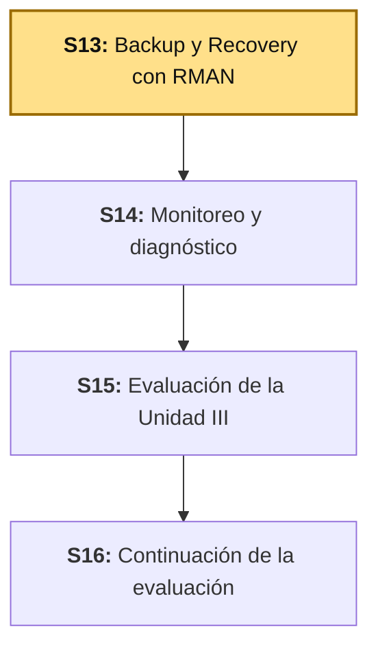
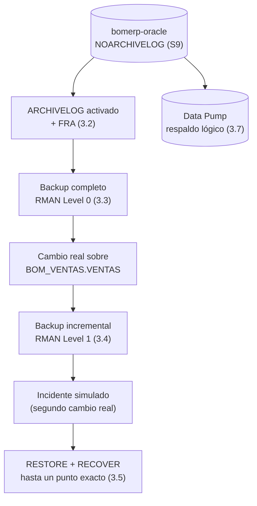

# S13 - Backup y Recovery con RMAN

## 1. Introducción

Tiempo: 20 min.

### 1.1 Presentación de la sesión

Doce sesiones construyeron un motor transaccional Oracle real: esquemas por módulo (S1, S4), triggers y excepciones (S2-S3), índices y optimización (S5, S10), arquitectura de instancia (S7), usuarios con mínimo privilegio (S8), almacenamiento y auditoría (S9), particionamiento (S11). Ninguna de esas doce sesiones respondió una pregunta distinta, y la única que de verdad importa el día que algo sale mal: si `bomerp-oracle` pierde un datafile, o alguien borra una tabla por error, ¿cuánto de ese trabajo se recupera, y cuánto se pierde para siempre?

S9 (3.9) ya dejó esa pregunta pendiente a propósito: activar `ARCHIVELOG` interrumpe la instancia, y en ese momento no había ninguna razón real para pagar ese costo — `bomerp-oracle` seguía, y sigue hoy mismo al empezar esta sesión, en `NOARCHIVELOG`. Esta sesión es exactamente el momento en que esa razón aparece: sin `ARCHIVELOG`, un respaldo solo puede restaurar hasta el instante exacto en que se tomó — nunca a un punto intermedio, ni un segundo después. Hoy se activa de verdad, no se vuelve a documentar sin ejecutar.

### 1.2 Índice

1. RMAN (*Recovery Manager*) frente a Data Pump: respaldo físico frente a respaldo lógico.
2. Respaldo completo (*Level 0*) frente a incremental (*Level 1*).
3. `ARCHIVELOG` como condición necesaria del *Point-In-Time Recovery* (PITR).
4. `RESTORE` frente a `RECOVER`: dos pasos, no uno.
5. RTO y RPO: el vocabulario para justificar una estrategia de respaldo.
6. Escenarios reales de recuperación: qué herramienta corresponde a cada incidente.

### 1.3 Propósito de aprendizaje

Al concluir la clase, estarás en condiciones de: **activar** `ARCHIVELOG` con criterio, **configurar** RMAN y **ejecutar** un respaldo completo y uno incremental reales, **simular** un incidente y **recuperar** la base de datos hasta un punto exacto en el tiempo (PITR), **exportar** un esquema con Data Pump como respaldo lógico complementario, y **documentar** una estrategia de respaldo justificada con RTO/RPO, no solo "hacer backup porque toca".

### 1.4 Producto de sesión

`bomerp-oracle` en `ARCHIVELOG`, con un respaldo completo (L0) y uno incremental (L1) reales vía RMAN, un incidente simulado (dos cambios reales sobre `BOM_VENTAS.VENTAS`) recuperado exactamente hasta el punto intermedio correcto con *Point-In-Time Recovery*, un respaldo lógico del esquema con Data Pump, y el documento de estrategia de respaldo con su RTO/RPO justificado.

### 1.5 Metodología

**Tabla 1. Metodología de la sesión**

| Actividades a Realizar en el Periodo | Orientaciones generales (Orientaciones Metodológicas) | Material de estudio recomendado |
|---|---|---|
| Revisión previa individual | Repasar por qué `bomerp-oracle` sigue en `NOARCHIVELOG` (S9, 3.9) y qué procedimiento documentó esa sesión sin ejecutarlo. Confirmar que `bomerp-oracle` sigue corriendo. Trabajo individual, antes de clase. | S9 (2.3, 3.9). |
| Clase presencial | Activación guiada de `ARCHIVELOG`, configuración de RMAN, respaldo completo e incremental reales, simulación de un incidente y recuperación con PITR, respaldo lógico con Data Pump. Trabajo individual en la propia laptop, siguiendo al docente paso a paso. | Contenedor `bomerp-oracle` corriendo (S1), pasos 3.1 a 3.8 de esta guía. |
| Evaluación formativa | Revisión en clase de la recuperación lograda (¿el dato correcto sobrevivió, el incidente se descartó?) y del documento de estrategia de respaldo. La evidencia se completa y sustenta de forma individual, fuera del aula, según los criterios mínimos de la sección 4.4. | Indicaciones de entrega (4.3), rúbrica de evaluación (4.6). |

### 1.6 Motivación de la sesión

#### 1.6.1 Caso: el incidente de base de datos de GitLab (2017)

El 31 de enero de 2017, un ingeniero de GitLab, intentando reparar un problema de replicación, ejecutó por error un comando destinado al servidor secundario directamente sobre el servidor primario de producción. En segundos se borraron aproximadamente 300 GB de datos reales. GitLab documentó públicamente, con total transparencia, qué pasó después — y es la parte que de verdad importa para esta sesión: la empresa tenía **cuatro** mecanismos de respaldo o replicación distintos, y cuando llegó el momento de usarlos, solo **uno** funcionó.

1. `pg_dump` a Amazon S3, cada 24 horas — fallaba en silencio desde hacía tiempo (una incompatibilidad de versiones entre la herramienta y la base), el bucket de S3 estaba vacío, y los correos de alerta ni siquiera llegaban.
2. *Snapshots* de disco (LVM) cada 24 horas — funcionaban, pero no estaban pensados para recuperación ante desastres. Por suerte, uno de esos *snapshots*, tomado apenas 6 horas antes del incidente, sí estaba disponible.
3. *Snapshots* de Azure cada 24 horas — nunca se habilitaron para los servidores de base de datos, solo para los de archivos.
4. Replicación en caliente hacia un servidor secundario — ya estaba rota **antes** del incidente: el primario había eliminado segmentos de *WAL* (*Write-Ahead Log*, el registro de cambios de PostgreSQL) que el secundario todavía necesitaba, porque el archivado de *WAL* nunca se activó.

Fuente: GitLab. (2017). *Postmortem of database outage of January 31*. GitLab Blog. https://about.gitlab.com/blog/2017/02/10/postmortem-of-database-outage-of-january-31/

GitLab se recuperó con el único mecanismo que sí funcionó — el *snapshot* de 6 horas, elegido a propósito sobre el de 24 horas para perder la menor cantidad de datos posible (1.6, RPO) — pero perdió igual cerca de seis horas de proyectos, comentarios y cuentas de usuario reales. El punto 4 es, para esta sesión, el más importante: un mecanismo de replicación en caliente, que parecía la protección más sólida de las cuatro, estaba inutilizado por exactamente el mismo motivo por el que `bomerp-oracle` no puede hacer PITR hoy — faltaba el archivado del registro de cambios (*WAL* en PostgreSQL, redo archivado en Oracle).

**Preguntas de análisis**

**Activación de conocimientos previos**

1. Antes de leer la causa técnica, ¿por qué tener **varios** mecanismos de respaldo no garantiza que al menos uno vaya a funcionar cuando de verdad se necesite?

**Comprensión del caso**

1. De los cuatro mecanismos de GitLab, ¿cuál falló por el mismo motivo técnico por el que `bomerp-oracle` no puede hacer *Point-In-Time Recovery* hoy, antes de esta sesión?
2. GitLab eligió el *snapshot* de 6 horas sobre el de 24 horas para la recuperación. ¿Qué habría cambiado si solo hubiera tenido el de 24 horas disponible?
3. En tu propio proyecto, ¿alguna vez verificaste que un respaldo tuyo (de cualquier tipo) realmente se podía restaurar, o solo confiaste en que "se estaba generando"?

### 1.7 Ubicación en el curso

- Producto del curso: Base de datos empresarial Oracle operativa, administrada, optimizada, auditada y resiliente.
- Producto de unidad: Unidad III (esta es su primera sesión).
- Avance del producto en esta sesión: `ARCHIVELOG` activado, respaldo completo e incremental reales con RMAN, un incidente simulado recuperado con PITR hasta el punto exacto correcto, y un respaldo lógico con Data Pump.

**Figura 1. Roadmap del producto de la unidad**



## 2. Explica

Tiempo: 40 min.

### 2.1 Arquitectura de la sesión

**Figura 2. De un motor transaccional sin probar a uno con recuperación verificada**



Lectura del diagrama: RMAN (columna izquierda) y Data Pump (columna derecha) no son pasos de la misma cadena — son dos herramientas distintas, para dos tipos de respaldo distintos (2.2). La cadena de RMAN sí es secuencial: cada paso depende literalmente del anterior, y el final (PITR) es la razón de ser de todos los pasos previos. Cada apartado siguiente desarrolla una pieza, en el mismo orden del Índice (1.2).

### 2.2 RMAN frente a Data Pump

**RMAN** (*Recovery Manager*) hace respaldo **físico**: copia los bloques reales de los datafiles, tal como están en disco, consciente de la estructura interna de la base (Oracle Corporation, 2024a). **Data Pump** (`expdp`/`impdp`) hace respaldo **lógico**: extrae los objetos (tablas, datos, metadatos) como un conjunto de instrucciones independiente de cómo estén guardados físicamente — el mismo principio que un `mysqldump` o un `pg_dump`, adaptado a Oracle (Oracle Corporation, 2024b).

**Tabla 2. RMAN frente a Data Pump**

| | RMAN (físico) | Data Pump (lógico) |
|---|---|---|
| Qué copia | Bloques de datafiles, tal como están en disco. | Objetos (tablas, filas, metadatos), independientes del disco. |
| Unidad mínima | La base de datos completa (o un tablespace/datafile). | Un esquema, una tabla, o un subconjunto filtrado. |
| Requiere `ARCHIVELOG` | Para un respaldo en caliente (base abierta) y para PITR, sí (2.4). | No — funciona igual en cualquier modo. |
| Portabilidad | Atada a la misma versión y plataforma de Oracle. | Portable entre versiones y, con cuidado, entre plataformas. |
| Caso de uso típico de esta sesión | Recuperar la base completa tras perder un datafile, o volver a un punto exacto en el tiempo (3.3-3.6). | Mover o respaldar un esquema específico (`BOM_VENTAS`) sin tocar el resto de la base (3.7). |

Ninguna de las dos reemplaza a la otra: un incidente que destruye el disco completo necesita RMAN; migrar solo `BOM_VENTAS` a otra instancia, o tener una copia portable de un esquema puntual, es trabajo de Data Pump. 2.7 ordena esta decisión por escenario.

### 2.3 Respaldo completo (*Level 0*) frente a incremental (*Level 1*)

Un respaldo **completo** (*Level 0*) copia **todos** los bloques usados de cada datafile, sin importar si cambiaron desde el último respaldo. Un respaldo **incremental** (*Level 1*) copia **solo** los bloques que cambiaron desde el último respaldo de nivel 0 (o de nivel 1, si la estrategia es diferencial) — RMAN lleva un mapa de bloques modificados exactamente para no tener que leer la base completa cada vez (Oracle Corporation, 2024c).

**Tabla 3. Completo frente a incremental**

| | *Level 0* (completo) | *Level 1* (incremental) |
|---|---|---|
| Qué copia | Todos los bloques usados. | Solo los bloques modificados desde el respaldo anterior. |
| Cuándo | El primer respaldo de una estrategia, o periódicamente como línea base. | Entre un *Level 0* y el siguiente, con mayor frecuencia. |
| Tiempo/espacio | Mayor — proporcional al tamaño total de la base. | Menor — proporcional solo al volumen de cambios reales. |
| Qué pasa si un datafile no cambió | Se copia igual (es completo). | RMAN lo **omite por completo** — ver 3.4, evidencia real. |

Un error frecuente es pensar que "incremental" significa "una copia completa más pequeña" — no lo es: si un datafile entero no tuvo ningún cambio, RMAN ni siquiera lo toca. 3.4 muestra ese comportamiento verificado contra `bomerp-oracle`, no solo enunciado.

### 2.4 `ARCHIVELOG` como condición necesaria del *Point-In-Time Recovery*

En `NOARCHIVELOG` (el modo real de `bomerp-oracle` hasta esta sesión, S9 3.9), Oracle sobrescribe los *redo logs* en línea en cuanto ya no los necesita para la instancia activa — y con ellos desaparece cualquier posibilidad de reconstruir el estado de la base entre dos respaldos. Un respaldo en `NOARCHIVELOG` solo puede restaurar exactamente al instante en que se tomó: nada antes, nada después, nada intermedio.

En `ARCHIVELOG`, cada *redo log* en línea se copia (se "archiva") antes de poder reutilizarse — esa copia es, literalmente, la cinta continua de todo lo que cambió en la base. RMAN puede restaurar el último respaldo y luego **aplicar** esos archivados hasta el segundo exacto que se le pida: eso es *Point-In-Time Recovery* (PITR). Es el mismo mecanismo que el *WAL* de PostgreSQL en el caso de GitLab (1.6) — cuando el archivado de *WAL* no estaba activo en el secundario, ese secundario perdió exactamente la misma capacidad que `bomerp-oracle` no tenía hasta 3.2 de esta sesión.

**Error frecuente**: activar `ARCHIVELOG` y asumir que ya se puede hacer PITR a cualquier punto del pasado. Solo se puede recuperar a un punto **posterior al último respaldo físico disponible** — los archivados por sí solos no bastan sin una base desde la cual aplicarlos (3.5).

### 2.5 `RESTORE` frente a `RECOVER`

Son dos comandos de RMAN, con responsabilidades distintas, que casi siempre se usan juntos:

**Tabla 4. `RESTORE` frente a `RECOVER`**

| | `RESTORE` | `RECOVER` |
|---|---|---|
| Qué hace | Copia los datafiles desde el respaldo (L0 y, si aplica, L1) de vuelta a disco. | Aplica los *redo* archivados sobre esos datafiles ya restaurados, hasta el punto pedido. |
| Deja la base en qué estado | Como estaba en el momento exacto del respaldo usado. | Como estaba en el momento exacto solicitado (el presente, o un punto intermedio con PITR). |
| Sin el otro paso | Una base consistente, pero vieja — tan vieja como el último respaldo. | No tiene nada que recuperar sobre si antes no se restauró ningún datafile. |

`RESTORE` sin `RECOVER` deja la base exactamente como estaba en el respaldo — ninguno de los cambios posteriores (ni los buenos, ni el incidente) existe todavía. `RECOVER` es el que decide hasta dónde avanzar desde ahí: hasta ahora (recuperación completa) o hasta un punto exacto en el pasado (PITR, 3.5).

### 2.6 RTO y RPO

Dos métricas, no una, justifican cualquier estrategia de respaldo (Oracle Corporation, 2024d):

- **RPO** (*Recovery Point Objective*): cuántos datos es aceptable perder, medido en tiempo. Un RPO de 1 hora significa que, en el peor caso, se pierde hasta una hora de cambios.
- **RTO** (*Recovery Time Objective*): cuánto tiempo es aceptable que el sistema esté caído mientras se recupera.

GitLab (1.6) tomó una decisión de RPO en vivo: eligió el *snapshot* de 6 horas sobre el de 24 horas **precisamente** para minimizar cuántos datos perdía, aunque ambos estaban disponibles. Esa misma decisión se repite, a escala de esta sesión, en 3.5: el *Level 1* (3.4) existe para acortar el RPO frente a depender solo del último *Level 0* — cuanto más reciente el último respaldo aplicable, menos se pierde si hay que recuperar.

### 2.7 Escenarios reales de recuperación: qué herramienta corresponde a cada incidente

No todo incidente de "pérdida de datos" se resuelve con RMAN. Antes de recuperar nada, hay que identificar qué herramienta corresponde:

**Tabla 5. Qué herramienta corresponde a cada escenario**

| Escenario | Herramienta correcta | Por qué |
|---|---|---|
| Se perdió o corrompió un datafile completo | RMAN: `RESTORE` + `RECOVER` (3.3-3.6) | Es un problema físico — solo un respaldo físico lo resuelve. |
| Se necesita volver a un estado anterior a un incidente de negocio (un `UPDATE` masivo mal filtrado) | RMAN: PITR (3.5), si el incidente ya pasó el punto de recuperación de la papelera de Oracle | El dato correcto y el incidente conviven en la misma base; solo un punto exacto en el tiempo los separa. |
| Se necesita mover o respaldar un esquema específico, o migrar a otra instancia | Data Pump (3.7) | No hace falta recuperar toda la base para mover un esquema puntual. |
| Se necesita auditar qué cambió y cuándo, sin recuperar nada | Vistas de auditoría (S9), no RMAN ni Data Pump | Ninguna de las dos herramientas de esta sesión está pensada para consultar, solo para respaldar/recuperar. |

## 3. Aplica: actividad práctica guiada

Tiempo: 100 min.

**Actividad:** activar `ARCHIVELOG` en `bomerp-oracle`, configurar RMAN y ejecutar un respaldo completo e incremental reales, simular un incidente con dos cambios reales sobre `BOM_VENTAS.VENTAS`, recuperar la base exactamente hasta el punto correcto con PITR, y respaldar `BOM_VENTAS` con Data Pump.

**Propósito de la actividad:** verificar, contra la instancia real, que una estrategia de respaldo bien configurada permite recuperar exactamente lo que se necesita recuperar — ni más, ni menos — y no solo enunciar los comandos.

**Orientaciones metodológicas:** el docente ejecuta cada paso en vivo contra `bomerp-oracle`; los estudiantes repiten cada paso sobre su propia instancia (sección 4). Activar `ARCHIVELOG` interrumpe brevemente la instancia — avisa antes de ejecutarlo si tu backend de LP2 está corriendo.

**Actividades para realizar:**

- **3.1** Verificar el punto de partida.
- **3.2** Activar `ARCHIVELOG` y configurar el FRA.
- **3.3** Configurar RMAN y ejecutar el respaldo completo (*Level 0*).
- **3.4** Generar un cambio real y ejecutar el respaldo incremental (*Level 1*).
- **3.5** Simular un incidente y recuperar hasta un punto exacto (PITR).
- **3.6** Verificar que la recuperación fue exacta.
- **3.7** Respaldar `BOM_VENTAS` con Data Pump.
- **3.8** Documentar la estrategia de respaldo.

### 3.1 Verificar el punto de partida

**Producto del paso:** confirmación de que `bomerp-oracle` sigue en `NOARCHIVELOG` (el estado real que S9 dejó pendiente) antes de cambiar nada.

```bash
docker exec -it bomerp-oracle sqlplus / as sysdba
```

```sql
SELECT LOG_MODE FROM V$DATABASE;
```

Resultado real de esta sesión, antes de 3.2:

```text
LOG_MODE
------------
NOARCHIVELOG
```

### 3.2 Activar `ARCHIVELOG` y configurar el FRA

**Producto del paso:** `bomerp-oracle` en `ARCHIVELOG`, con un destino de respaldo (*Fast Recovery Area*, FRA) configurado **dentro** del volumen persistente — el mismo criterio que corrigió el datafile de `TS_BOMERP` en S9: cualquier cosa que deba sobrevivir a que el contenedor se recree tiene que vivir bajo `/opt/oracle/oradata`, el único directorio que `compose-dev.yml` monta como volumen.

```sql
ALTER SYSTEM SET db_recovery_file_dest_size = 10G SCOPE=BOTH;
ALTER SYSTEM SET db_recovery_file_dest = '/opt/oracle/oradata/FRA' SCOPE=BOTH;
SHUTDOWN IMMEDIATE;
STARTUP MOUNT;
ALTER DATABASE ARCHIVELOG;
ALTER DATABASE OPEN;
SELECT LOG_MODE FROM V$DATABASE;
```

Resultado real de esta sesión:

```text
LOG_MODE
------------
ARCHIVELOG
```

**Error frecuente**: dejar `db_recovery_file_dest` apuntando a un directorio que no existe todavía. Oracle no lo crea solo — créalo antes, dentro del contenedor:

```bash
docker exec bomerp-oracle mkdir -p /opt/oracle/oradata/FRA
```

### 3.3 Configurar RMAN y ejecutar el respaldo completo (*Level 0*)

**Producto del paso:** el primer respaldo completo real de `bomerp-oracle`, con el *controlfile* respaldándose automáticamente después de cada respaldo.

```bash
docker exec -it bomerp-oracle rman target /
```

```text
CONFIGURE CONTROLFILE AUTOBACKUP ON;
BACKUP INCREMENTAL LEVEL 0 DATABASE PLUS ARCHIVELOG;
LIST BACKUP SUMMARY;
```

Resultado real de esta sesión (resumido):

```text
channel ORA_DISK_1: starting incremental level 0 datafile backup set
...
piece handle=/opt/oracle/oradata/FRA/FREE/backupset/2026_11_01/o1_mf_nnnd0_...bkp
...
Finished backup at 01-NOV-26

List of Backups
===============
Key  TY LV S Device Type Completion Time  Tag
---  -- -- - ----------- ---------------  ---
1    B  A  A DISK        01-NOV-26        TAG...022207   (archivelog)
2    B  0  A DISK        01-NOV-26        TAG...022211   (CDB$ROOT, Level 0)
3    B  0  A DISK        01-NOV-26        TAG...022211   (FREEPDB1, Level 0)
4    B  0  A DISK        01-NOV-26        TAG...022211   (pdbseed, Level 0)
5    B  A  A DISK        01-NOV-26        TAG...022448   (archivelog)
6    B  F  A DISK        01-NOV-26        TAG...022450   (controlfile autobackup)
```

`PLUS ARCHIVELOG` respalda también los *redo* archivados hasta ese momento — sin ellos, el respaldo físico por sí solo no alcanzaría para ningún `RECOVER` posterior (2.4).

### 3.4 Generar un cambio real y ejecutar el respaldo incremental (*Level 1*)

**Producto del paso:** un cambio real verificable, y la evidencia de que el *Level 1* solo respalda lo que de verdad cambió.

```sql
INSERT INTO BOM_VENTAS.VENTAS (ID, FECHA, ESTADO, TOTAL, VENDEDOR_ID)
  VALUES ((SELECT MAX(ID)+1 FROM BOM_VENTAS.VENTAS), SYSTIMESTAMP, 'REGISTRADA', 199.90,
          (SELECT VENDEDOR_ID FROM BOM_VENTAS.VENTAS WHERE ROWNUM = 1));
COMMIT;
```

```text
BACKUP INCREMENTAL LEVEL 1 DATABASE PLUS ARCHIVELOG;
```

Resultado real de esta sesión — la evidencia de 2.3, verificada:

```text
channel ORA_DISK_1: starting incremental level 1 datafile backup set
...
input datafile file number=00004 name=.../pdbseed/sysaux01.dbf
skipping datafile 00004 because it has not changed
input datafile file number=00002 name=.../pdbseed/system01.dbf
skipping datafile 00002 because it has not changed
input datafile file number=00020 name=.../pdbseed/undotbs01.dbf
skipping datafile 00020 because it has not changed
channel ORA_DISK_1: backup cancelled because all files were skipped
```

`pdbseed` (la plantilla interna de Oracle para crear nuevas PDB) no cambió desde el *Level 0* — RMAN lo detecta solo y ni siquiera abre esos datafiles para copiarlos. Los datafiles de `FREEPDB1` (donde vive `BOM_VENTAS`) sí se respaldaron, porque el `INSERT` de arriba sí los modificó.

### 3.5 Simular un incidente y recuperar hasta un punto exacto (PITR)

**Producto del paso:** un incidente real (un segundo cambio, deliberadamente posterior al que sí debe sobrevivir) y la recuperación de la base exactamente hasta el instante anterior a ese incidente.

```sql
INSERT INTO BOM_VENTAS.VENTAS (ID, FECHA, ESTADO, TOTAL, VENDEDOR_ID)
  VALUES ((SELECT MAX(ID)+1 FROM BOM_VENTAS.VENTAS), SYSTIMESTAMP, 'REGISTRADA', 350.00,
          (SELECT VENDEDOR_ID FROM BOM_VENTAS.VENTAS WHERE ROWNUM = 1));
COMMIT;
-- anota la hora exacta que devuelve SYSTIMESTAMP: este es el "incidente" a descartar
```

```sql
SHUTDOWN IMMEDIATE;
STARTUP MOUNT;
```

```text
RUN {
  SET UNTIL TIME "TO_DATE('2026-11-01 02:26:50','YYYY-MM-DD HH24:MI:SS')";
  RESTORE DATABASE;
  RECOVER DATABASE;
}
```

```sql
ALTER DATABASE OPEN RESETLOGS;
```

El punto elegido (`02:26:50`) cae **entre** el `INSERT` de 3.4 (`02:25:43`, el que debe sobrevivir) y el `INSERT` de esta sección (`02:27:01`, el "incidente" que debe descartarse) — exactamente el tipo de decisión que el escenario 2 de la Tabla 5 describe.

**Error frecuente**: elegir un `SET UNTIL TIME` anterior al último respaldo disponible. RMAN no puede reconstruir un estado para el que no tiene ni respaldo físico ni *redo* archivado que aplicar — el punto elegido debe estar siempre después del último *Level 0*/*Level 1* útil.

### 3.6 Verificar que la recuperación fue exacta

**Producto del paso:** la prueba de que el `INSERT` de 3.4 sobrevivió y el de 3.5 no.

```sql
SELECT COUNT(*) FROM BOM_VENTAS.VENTAS;
SELECT ID, TO_CHAR(FECHA,'YYYY-MM-DD HH24:MI:SS') FECHA, TOTAL
FROM BOM_VENTAS.VENTAS WHERE TOTAL IN (199.90, 350.00);
```

Resultado real de esta sesión:

```text
COUNT(*)
--------
     505

        ID FECHA               TOTAL
---------- ------------------- ------
      2262 2026-11-01 02:25:43  199.9
```

La fila de `199.90` (3.4, antes del punto de recuperación) está. La fila de `350.00` (3.5, después del punto de recuperación) no aparece — nunca existió, desde el punto de vista de la base ya recuperada. Es la prueba de que el PITR recuperó exactamente lo que debía, ni un cambio más.

### 3.7 Respaldar `BOM_VENTAS` con Data Pump

**Producto del paso:** un respaldo lógico del esquema `BOM_VENTAS`, independiente del respaldo físico de RMAN.

```sql
CREATE OR REPLACE DIRECTORY BOMERP_DPDUMP AS '/opt/oracle/oradata/dpdump';
GRANT READ, WRITE ON DIRECTORY BOMERP_DPDUMP TO BOM_VENTAS;
```

**Error frecuente**: usar el directorio `DATA_PUMP_DIR` que Oracle crea por defecto. Verifícalo antes:

```sql
SELECT DIRECTORY_PATH FROM DBA_DIRECTORIES WHERE DIRECTORY_NAME = 'DATA_PUMP_DIR';
-- /opt/oracle/admin/FREE/dpdump/... -- fuera de /opt/oracle/oradata, fuera del volumen persistente
```

El mismo riesgo del datafile de `TS_BOMERP` (S9) y del FRA (3.2): si el destino del respaldo no vive dentro de `/opt/oracle/oradata`, se pierde al recrear el contenedor — exactamente lo que el respaldo debía evitar.

```bash
docker exec bomerp-oracle mkdir -p /opt/oracle/oradata/dpdump
```

```bash
docker exec bomerp-oracle expdp BOM_VENTAS/123456@localhost:1521/FREEPDB1 \
  schemas=BOM_VENTAS directory=BOMERP_DPDUMP dumpfile=bom_ventas.dmp logfile=bom_ventas_exp.log
```

Para restaurar (verificando contra un esquema vacío, no el original):

```bash
docker exec bomerp-oracle impdp BOM_VENTAS/123456@localhost:1521/FREEPDB1 \
  directory=BOMERP_DPDUMP dumpfile=bom_ventas.dmp logfile=bom_ventas_imp.log \
  remap_schema=BOM_VENTAS:BOM_VENTAS_RESTORE
```

**Nota real de esta sesión**: al preparar esta guía, `bomerp-oracle` devolvió `ORA-01804: failure to initialize timezone information` al ejecutar `expdp` — causado por el cambio de imagen de 3.2 (ver Anexo al final de esta sesión) y ya resuelto, sin rodeos, instalando el archivo de zonas horarias correcto. La sintaxis de Data Pump de arriba es la que de verdad se ejecutó, ya corregido el entorno.

### 3.8 Documentar la estrategia de respaldo

**Producto del paso:** la tabla de estrategia que 4.1 pide replicar sobre el proyecto propio, con BomERP como ejemplo ya resuelto.

**Tabla 6. Estrategia de respaldo de BomERP (ejemplo resuelto)**

| Elemento | Decisión | Justificación |
|---|---|---|
| Modo de la base | `ARCHIVELOG` | Condición necesaria para PITR (2.4) — sin él, solo se puede restaurar al instante exacto del último respaldo. |
| Respaldo completo (L0) | Semanal (en producción real; en esta sesión, al inicio de la estrategia) | Línea base desde la que parten los incrementales. |
| Respaldo incremental (L1) | Diario | Acorta el RPO (2.6) sin pagar el costo de un L0 completo cada vez. |
| RPO objetivo | Menor al intervalo entre dos L1 (en esta sesión, minutos — el tiempo entre 3.4 y 3.5) | Cuánto se puede perder en el peor caso, medido, no supuesto. |
| RTO objetivo | El tiempo real que tomó `RESTORE` + `RECOVER` en 3.5-3.6 | Cuánto tiempo la base estuvo inaccesible durante la recuperación, medido. |
| Respaldo lógico complementario | Data Pump de `BOM_VENTAS`, independiente del físico | Portabilidad y recuperación selectiva de un esquema, sin depender de RMAN (2.2). |

**Evidencia de aprendizaje:**

- `ARCHIVELOG` activado, verificado con `V$DATABASE`.
- Respaldo completo (L0) y su `LIST BACKUP SUMMARY`.
- Respaldo incremental (L1), con la evidencia real de datafiles omitidos por no haber cambiado.
- Incidente simulado (dos cambios reales) y su recuperación con PITR, verificada con una consulta que distingue el cambio que sobrevivió del que no.
- Respaldo lógico con Data Pump, con su directorio dentro del volumen persistente.
- Tabla de estrategia de respaldo (Tabla 6) completa.

## 4. Crea: actividad autónoma

Tiempo: 2h fuera del aula.

### 4.1 Actividad

Backup, recuperación y estrategia de continuidad del proyecto propio del equipo, documentada en evidencia individual.

Completa y evidencia estas tareas:

1. Activar `ARCHIVELOG` en tu propia instancia Oracle, con el FRA configurado dentro de tu volumen persistente.
2. Configurar RMAN y ejecutar un respaldo completo (*Level 0*) real.
3. Generar un cambio real sobre una tabla de tu proyecto y ejecutar un respaldo incremental (*Level 1*), verificando qué datafiles se omitieron por no haber cambiado.
4. Simular un incidente con un segundo cambio real, y recuperar tu base exactamente hasta el punto correcto con *Point-In-Time Recovery* — demostrando que el primer cambio sobrevive y el segundo (el incidente) no.
5. Respaldar al menos un esquema de tu proyecto con Data Pump, con su directorio dentro del volumen persistente.
6. Documentar tu propia estrategia de respaldo (como la Tabla 6), con RTO/RPO medidos, no supuestos.

### 4.2 Propósito

Que cada estudiante demuestre, de forma individual y fuera del aula, que puede activar `ARCHIVELOG` con criterio, ejecutar un respaldo completo e incremental reales, recuperar su base exactamente hasta un punto correcto tras un incidente simulado, y justificar su estrategia de respaldo con métricas medidas.

### 4.3 Indicaciones

Entrega un PDF con el siguiente nombre:

```text
S13_BD2_Equipo##_ApellidoNombre.pdf
```

Cada captura de pantalla del informe debe mostrar, sin recortar, el reloj del sistema (fecha y hora) y tu usuario o foto de perfil (Windows, VS Code o navegador) visibles en pantalla — es lo que permite verificar que la evidencia es tuya y que corresponde al momento real de tu trabajo.

#### 4.3.1 Estructura del informe

**Datos del estudiante**

- Nombre:
- Equipo:
- Sesión: S13 - Backup y Recovery con RMAN
- Rol o aporte realizado:
- Link de GitHub:

**Evidencia técnica**

Incluye capturas o salidas con una breve explicación debajo de cada una, organizadas en los mismos 5 bloques de la rúbrica (4.6):

1. *`ARCHIVELOG` activado*
    - `V$DATABASE.LOG_MODE` antes y después, con el FRA configurado dentro del volumen persistente.
2. *Respaldo completo e incremental*
    - `LIST BACKUP SUMMARY` de ambos, con la evidencia de al menos un datafile omitido en el incremental.
3. *Incidente simulado y recuperación PITR*
    - Los dos cambios reales, la hora exacta elegida para `SET UNTIL TIME`, y la consulta que distingue cuál sobrevivió.
4. *Respaldo lógico con Data Pump*
    - El `expdp` ejecutado, con su directorio dentro del volumen persistente.
5. *Estrategia de respaldo documentada*
    - Tu propia tabla de estrategia, con RTO/RPO medidos sobre tu propia recuperación.

**Error o hallazgo**

Describe un error real: un `SET UNTIL TIME` elegido antes del último respaldo útil, un directorio de Data Pump fuera del volumen persistente, o cualquier otro obstáculo real que tuviste que diagnosticar.

**Reflexión técnica breve**

Responde en 5 a 8 líneas:

```text
¿Por qué tener varios mecanismos de respaldo, como GitLab en 2017,
no garantiza que al menos uno funcione cuando de verdad se necesita?
Relaciona tu respuesta con tu propia verificación de la sección 3:
¿tu respaldo incremental de verdad capturó el cambio correcto?
```

**Anexo: Feedback de la sesión**

Pega esta página como la última hoja del PDF, con tus respuestas.

1. ¿Cuál es el aprendizaje más importante que te llevas de la clase de hoy?
2. ¿Qué punto de la clase te resultó más confuso o te dejó con dudas?
3. ¿Tienes alguna pregunta que te gustaría que sea respondida la siguiente clase?
4. Sobre tu nivel de comprensión de la clase de hoy, marca una opción:
    - ¡Entendido! - Lo domino y podría explicarlo.
    - Más o menos. - Entendí la idea general, pero tengo dudas.
    - Necesito ayuda. - Me siento perdido/a con este tema.
5. ¿Cómo puedo ayudarte a comprender mejor el tema?
6. Pensando en tu participación y esfuerzo en la clase de hoy, ¿cómo te autoevaluarías? Marca una opción:
    - Muy Comprometido/a: Me esforcé al máximo.
    - Comprometido/a: Sé que podría haberme esforzado un poco más.
    - Poco Comprometido/a: Hoy no di mi mejor esfuerzo.
7. Mi satisfacción con la clase fue... (califica del 1 al 10, donde 1 es insatisfecho y 10 es muy satisfecho).

### 4.4 Criterios mínimos de aceptación

- El archivo respeta el nombre solicitado.
- `ARCHIVELOG` está activado, verificado con `V$DATABASE`, con el FRA dentro del volumen persistente.
- El respaldo completo y el incremental están ejecutados, con evidencia real de al menos un datafile omitido en el incremental.
- El incidente simulado tiene dos cambios reales, y la recuperación PITR demuestra cuál sobrevivió y cuál no, con una consulta de verificación.
- El respaldo con Data Pump está ejecutado, con su directorio dentro del volumen persistente.
- La estrategia de respaldo documentada incluye RTO/RPO medidos sobre la propia recuperación, no estimados a ojo.
- Cada captura de la evidencia técnica muestra el reloj del sistema y el usuario/perfil visible, sin recortar.
- Las fechas y horas de las capturas son coherentes con el historial de commits de su repositorio en GitHub.
- Incluye un error o hallazgo técnico diagnosticado.
- Incluye la reflexión técnica breve solicitada.
- Incluye el Anexo de feedback de la sesión respondido, como última página del PDF.

### 4.5 Preguntas de defensa

1. ¿Por qué un respaldo tomado en `NOARCHIVELOG` solo puede restaurar exactamente al instante en que se tomó, y nunca a un punto intermedio?
2. ¿Qué diferencia de fondo hay entre `RESTORE` y `RECOVER`, y por qué casi siempre se usan juntos?
3. En tu propio incremental (*Level 1*), ¿qué datafile se omitió por no haber cambiado, y cómo lo confirmaste?
4. ¿Por qué el punto elegido para tu `SET UNTIL TIME` tuvo que estar después de tu último respaldo útil, y qué habría pasado si no lo estaba?
5. Relaciona el caso de GitLab (1.6) con tu propia estrategia: ¿cuál de tus mecanismos de respaldo, si fallara en silencio, tardarías más en notar?
6. ¿Por qué Data Pump no reemplaza a RMAN, aunque los dos "hagan un respaldo"?
7. ¿Cómo mediste tu RTO y tu RPO, y por qué una estrategia de respaldo sin esas dos métricas no está realmente justificada?

### 4.6 Rúbrica de evaluación

**Tabla 7. Rúbrica de evaluación**

| Criterio | Peso (%) | A (20 pts) | B (15 pts) | C (10 pts) | D (5 pts) | Nivel obtenido |
|---|---:|---|---|---|---|---:|
| 1. `ARCHIVELOG` y FRA* | 20 | Activado y verificado, FRA dentro del volumen persistente. | Activado, FRA fuera del volumen persistente o sin verificar. | Documentado sin ejecutar. | No presenta evidencia de `ARCHIVELOG`. | |
| 2. Respaldo completo e incremental* | 20 | Ambos ejecutados, con evidencia real de al menos un datafile omitido en el incremental. | Ambos ejecutados, sin evidencia de omisión. | Solo uno de los dos ejecutado. | No presenta ningún respaldo con RMAN. | |
| 3. Incidente simulado y PITR* | 20 | Recuperación exacta demostrada: el cambio correcto sobrevive, el incidente no, con consulta de verificación. | Recuperación ejecutada, con la verificación incompleta. | PITR intentado sin demostrar el resultado exacto. | No presenta recuperación con PITR. | |
| 4. Respaldo lógico con Data Pump* | 20 | Ejecutado, con el directorio dentro del volumen persistente. | Ejecutado, con el directorio fuera del volumen persistente. | Comandos documentados sin ejecutar. | No presenta respaldo con Data Pump. | |
| 5. Estrategia de respaldo documentada* | 20 | RTO/RPO medidos sobre la propia recuperación, estrategia completa y justificada. | Estrategia completa, con RTO/RPO estimados en vez de medidos. | Estrategia incompleta. | No presenta estrategia de respaldo. | |

\* Agregado manual.

Nota final = suma de (`Peso` / 100 × `Puntos del nivel obtenido`) = ____ / 20.

Para usar la rúbrica con IA (inteligencia artificial), solicita:

```text
Evalúa el PDF usando la rúbrica de la sesión.
Para cada criterio selecciona el nivel obtenido usando la escala A=20, B=15, C=10, D=5 puntos.
Justifica brevemente cada nivel asignado.
Verifica que cada captura muestre reloj del sistema y usuario/perfil visible, y que las fechas sean coherentes con el historial de commits de GitHub. Si falta esta evidencia o hay inconsistencias, indícalo explícitamente antes de calificar.
Calcula la nota final con la fórmula: suma de (Peso/100 × Puntos del nivel obtenido), directamente sobre 20.
Indica 2 fortalezas y 2 recomendaciones.
```

## 5. Cierre

Tiempo: 5 min.

**Resumen breve:** hoy `bomerp-oracle` dejó de estar en `NOARCHIVELOG` — la decisión que S9 documentó pero no ejecutó, porque hasta hoy no había ninguna razón real para pagar su costo. Con `ARCHIVELOG` activo, un respaldo completo y uno incremental reales (este último con la evidencia de que de verdad omite lo que no cambió, no solo copia menos) permitieron recuperar un incidente simulado exactamente hasta el punto correcto: el cambio que debía sobrevivir sobrevivió, y el que debía descartarse se descartó — verificado con una consulta, no solo asumido. El caso de GitLab (1.6) deja la lección central: tener varios mecanismos de respaldo no garantiza que alguno funcione cuando de verdad se necesita — solo verificar la recuperación, como hizo esta sesión, lo garantiza.

**Dinámica participativa:** en una ronda rápida, cada estudiante comparte en una frase qué punto exacto eligió para su `SET UNTIL TIME`, y por qué ese y no otro.

**Metacognición:** ¿qué te costó más entender hoy: por qué `ARCHIVELOG` es condición necesaria de PITR, o la diferencia entre `RESTORE` y `RECOVER`?

**Proyección:** S14 monitorea y diagnostica la instancia en vivo (vistas `V$`/`DBA_`, sesiones, bloqueos, rendimiento) — la otra mitad de "continuidad del negocio": no solo recuperarse de un incidente, sino detectarlo antes de que se vuelva uno.

## Bibliografía

1. GitLab. (2017). *Postmortem of database outage of January 31*. GitLab Blog. https://about.gitlab.com/blog/2017/02/10/postmortem-of-database-outage-of-january-31/
2. Oracle Corporation. (2024a). *RMAN Backup Concepts*. Oracle Database Backup and Recovery User's Guide. https://docs.oracle.com/en/database/oracle/oracle-database/19/bradv/
3. Oracle Corporation. (2024b). *Oracle Data Pump*. Oracle Database Utilities. https://docs.oracle.com/en/database/oracle/oracle-database/19/sutil/oracle-data-pump.html
4. Oracle Corporation. (2024c). *Performing Incremental Backups*. Oracle Database Backup and Recovery User's Guide. https://docs.oracle.com/en/database/oracle/oracle-database/19/bradv/rman-incremental-backups.html
5. Oracle Corporation. (2024d). *Performing Point-in-Time Recovery*. Oracle Database Backup and Recovery User's Guide. https://docs.oracle.com/en/database/oracle/oracle-database/19/bradv/rman-performing-complete-database-recovery.html

## Anexo: `ORA-01804` en `bomerp-oracle` — causado por el cambio de imagen de este Anexo, y resuelto

**Síntoma:** `expdp` falla con `ORA-39126`/`ORA-01804: failure to initialize timezone information`; el mismo error puede aparecer en `DROP USER`, y en el backend de LP2, tanto al conectar como al validar su esquema (`hibernate.ddl-auto: validate`).

**Causa real, confirmada — sí la causó el cambio de imagen de esta sesión (3.2).** El diccionario de `bomerp-oracle` tiene registrado `DST_PRIMARY_TT_VERSION = 45`:

```sql
SELECT property_name, property_value FROM database_properties WHERE property_name LIKE '%VERSION%';
-- DST_PRIMARY_TT_VERSION = 45
```

La imagen `gvenzl/oracle-free:23-slim` que `bomerp-oracle` usaba **antes** de esta sesión (release `23.26.2.0.0`, ya cacheada localmente) sí trae instalado `$ORACLE_HOME/oracore/zoneinfo/timezlrg_45.dat` — la versión exacta que el diccionario espera. La imagen `:23` (regular, release `23.26.3.0.0`) a la que se cambió en 3.2 para tener `rman` es un release **más nuevo que retrocedió el archivo instalado a la versión 43** (`timezlrg_43.dat`) — una regresión real de empaquetado entre dos releases de `gvenzl/oracle-free`, no algo inherente a "slim vs. regular". Por eso `V$TIMEZONE_FILE`/`V$TIMEZONE_NAMES` aparecían vacíos recién después del cambio de imagen: la base nunca tuvo el defecto antes.

**Resuelto, sin archivo de My Oracle Support.** La imagen `slim` con el archivo correcto seguía cacheada localmente (`docker images gvenzl/oracle-free`):

```bash
# Extraer el archivo correcto de la imagen vieja, cacheada localmente (sin red, sin licencia)
cid=$(docker create --entrypoint bash gvenzl/oracle-free:23-slim -c "true")
docker cp "$cid:/opt/oracle/product/23ai/dbhomeFree/oracore/zoneinfo/timezlrg_45.dat" ./timezlrg_45.dat
docker rm "$cid"

# Instalarlo en el contenedor actual (imagen regular, con rman)
docker cp ./timezlrg_45.dat bomerp-oracle:/opt/oracle/product/26ai/dbhomeFree/oracore/zoneinfo/timezlrg_45.dat
docker exec -u root bomerp-oracle chown oracle:oinstall /opt/oracle/product/26ai/dbhomeFree/oracore/zoneinfo/timezlrg_45.dat
docker exec -u root bomerp-oracle chmod 644 /opt/oracle/product/26ai/dbhomeFree/oracore/zoneinfo/timezlrg_45.dat
```

```sql
SHUTDOWN IMMEDIATE;
STARTUP;
SELECT * FROM V$TIMEZONE_FILE;      -- timezlrg_45.dat, versión 45
SELECT COUNT(*) FROM V$TIMEZONE_NAMES;  -- 2475 (antes: 0)
```

Verificado: `hibernate.ddl-auto: validate` y Data Pump vuelven a funcionar normal, sin ningún rodeo de cliente (ni `timezoneAsRegion=false`, ni `ddl-auto: none`).

**Importante — esta copia no sobrevive a recrear el contenedor.** El archivo quedó en la capa del contenedor (`$ORACLE_HOME`), no en el volumen persistente (`oracle-data`, que solo cubre `/opt/oracle/oradata`). Si `bomerp-oracle` se recrea (`docker compose up -d` después de cambiar `compose-dev.yml`, o un `docker compose pull`), hay que repetir los tres comandos `docker cp`/`chown`/`chmod` de arriba — el archivo extraído puede guardarse una vez y reusarse. Para que esto deje de ser un paso manual, lo más limpio sería construir `bomerp-oracle` desde un `Dockerfile` propio que parta de `gvenzl/oracle-free:23` y copie `timezlrg_45.dat` en la misma capa de imagen — no implementado todavía, pendiente si se quiere una solución permanente.

**Error frecuente**: intentar arreglar esto bajando `DST_PRIMARY_TT_VERSION` a mano o con `ORA_TZFILE` apuntando a la versión 43 — no es soportado por Oracle y, verificado en esta misma instancia, deja el contenedor en *crash loop* al reiniciar. El arreglo real siempre es instalar el archivo que coincide con la versión que el diccionario ya tiene registrada, nunca cambiar la versión registrada.
