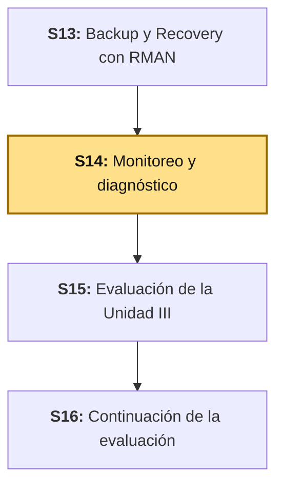
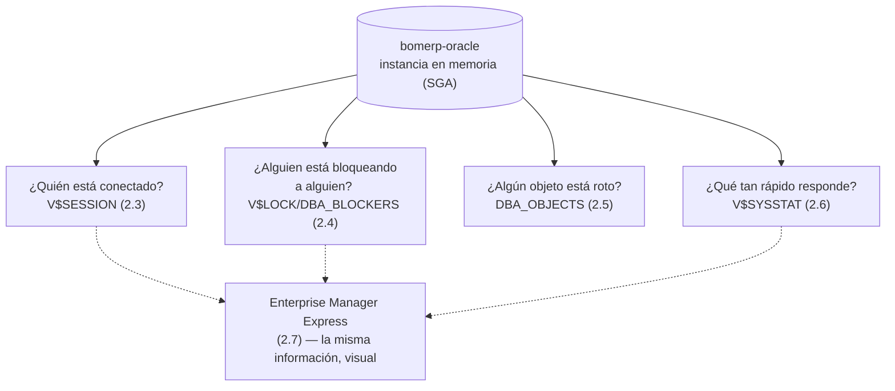

# S14 - Monitoreo y Diagnóstico

## 1. Introducción

Tiempo: 20 min.

### 1.1 Presentación de la sesión

Trece sesiones construyeron, administraron y respaldaron un motor transaccional real — pero ninguna respondió una pregunta distinta: ¿qué está pasando en `bomerp-oracle` **en este instante**? ¿Cuántas sesiones hay conectadas, alguna está bloqueando a otra sin que nadie lo note, algún objeto quedó roto después del cambio de imagen de S13, el motor responde tan rápido como debería? S13 enseñó a recuperarse después de un incidente; esta sesión enseña a detectarlo **antes** de que se vuelva uno.

La pregunta no es hipotética para este mismo entorno: al preparar esta guía, una consulta real a `DBA_OBJECTS` encontró un objeto `INVALID` en `bomerp-oracle` que ninguna sesión anterior había señalado — se desarrolla en 2.5 y se diagnostica en 3.5, con el resultado real documentado, sea cual sea.

### 1.2 Índice

1. Vistas `V$` frente a vistas `DBA_`: memoria en vivo frente a diccionario persistente.
2. Monitorear sesiones activas.
3. Detectar bloqueos entre sesiones.
4. Monitorear objetos: detectar y diagnosticar un objeto inválido.
5. Rendimiento en vivo, más allá del plan de una sola consulta (S10).
6. Enterprise Manager Express frente a Oracle Cloud Control.

### 1.3 Propósito de aprendizaje

Al concluir la clase, estarás en condiciones de: **monitorear** sesiones activas con vistas `V$`, **detectar y diagnosticar** un bloqueo real entre dos sesiones antes de que se convierta en un reclamo de usuario, **encontrar** objetos inválidos con vistas `DBA_` y decidir qué hacer con ellos, **medir** el rendimiento de la instancia en vivo, y **reconocer** qué cubre Enterprise Manager Express frente a lo que exigiría Oracle Cloud Control, un producto aparte fuera del alcance de este ambiente de curso.

### 1.4 Producto de sesión

Reporte de monitoreo de `bomerp-oracle`: sesiones activas identificadas, un bloqueo real simulado y diagnosticado con `DBA_BLOCKERS`/`DBA_WAITERS` hasta su resolución, el objeto inválido real de la instancia diagnosticado, el rendimiento en vivo medido (no estimado), y las mismas vistas confirmadas en Enterprise Manager Express — insumo directo del guion de sustentación de S15.

### 1.5 Metodología

**Tabla 1. Metodología de la sesión**

| Actividades a Realizar en el Periodo | Orientaciones generales (Orientaciones Metodológicas) | Material de estudio recomendado |
|---|---|---|
| Revisión previa individual | Repasar cómo se habilitó Enterprise Manager Express (S9, 3.9) y qué vistas `V$`/`DBA_` ya se usaron en S8 (privilegios) y S10 (`V$SQL`). Confirmar que `bomerp-oracle` sigue corriendo. Trabajo individual, antes de clase. | S8 (2.6), S9 (3.9), S10 (2.5, 3.6). |
| Clase presencial | Monitoreo guiado de sesiones activas, simulación y diagnóstico de un bloqueo real entre dos sesiones, búsqueda de objetos inválidos, medición de rendimiento en vivo, y verificación de todo lo anterior en Enterprise Manager Express. Trabajo individual en la propia laptop, siguiendo al docente paso a paso. | Contenedor `bomerp-oracle` corriendo (S1), pasos 3.1 a 3.8 de esta guía. |
| Evaluación formativa | Revisión en clase del bloqueo diagnosticado y resuelto, del objeto inválido encontrado, y del reporte de monitoreo. La evidencia se completa y sustenta de forma individual, fuera del aula, según los criterios mínimos de la sección 4.4. | Indicaciones de entrega (4.3), rúbrica de evaluación (4.6). |

### 1.6 Motivación de la sesión

#### 1.6.1 Caso: la caída de Amazon S3 (2017) y el panel de estado que dependía de lo que debía monitorear

El 28 de febrero de 2017, un ingeniero de AWS, siguiendo un procedimiento para depurar el proceso de facturación de S3, ejecutó un comando para remover un pequeño número de servidores de un subsistema. Un valor del comando se ingresó mal, y se removió un conjunto mucho mayor de servidores — entre ellos, los que sostenían el subsistema de índice (los metadatos y ubicaciones de todos los objetos de S3 en esa región) y el de ubicación de almacenamiento. Ambos subsistemas tuvieron que reiniciarse por completo, y S3 no pudo atender solicitudes mientras tanto.

Fuente: Amazon Web Services. (2017). *Summary of the Amazon S3 Service Disruption in the Northern Virginia (US-EAST-1) Region*. https://aws.amazon.com/message/41926/

El detalle que importa para esta sesión: durante las primeras horas del incidente, **el propio panel de estado de AWS** (*Service Health Dashboard*) no pudo actualizarse, porque la consola que lo administra dependía de S3 — el mismo servicio que estaba caído. AWS tuvo que comunicar el estado por Twitter mientras el panel seguía mostrando información desactualizada. La herramienta diseñada para diagnosticar el problema dependía de lo mismo que estaba fallando.

Esa es, en miniatura, la razón por la que esta sesión distingue entre `V$`/`DBA_` (y Enterprise Manager Express, que las consulta) y Oracle Cloud Control (2.7): las vistas `V$` viven **dentro** de la instancia que monitorean — leen directamente de su memoria (SGA), disponibles mientras la instancia esté levantada, sin depender de ningún servicio externo. Cloud Control es, en cambio, un producto aparte, con su propio repositorio y agentes — útil para monitorear muchas instancias a la vez, pero una capa adicional que puede fallar por su cuenta, igual que el panel de AWS.

**Preguntas de análisis**

**Activación de conocimientos previos**

1. Antes de leer la causa técnica, ¿por qué una herramienta de monitoreo que depende del mismo sistema que debe vigilar es un riesgo, aunque funcione perfectamente el resto del tiempo?

**Comprensión del caso**

1. Según el caso, ¿qué tuvo que hacer AWS para comunicar el estado del incidente mientras su propio panel no se actualizaba?
2. ¿Por qué las vistas `V$` de Oracle, al vivir dentro de la misma instancia, no corren el mismo riesgo que el panel de AWS — y qué significaría que sí lo corrieran?

### 1.7 Ubicación en el curso

- Producto del curso: Base de datos empresarial Oracle operativa, administrada, optimizada, auditada y resiliente.
- Producto de unidad: Unidad III.
- Avance del producto en esta sesión: sesiones activas monitoreadas, un bloqueo real diagnosticado y resuelto, un objeto inválido real diagnosticado, rendimiento en vivo medido, y todo confirmado en Enterprise Manager Express — listo para el guion de sustentación de S15.

**Figura 1. Roadmap del producto de la unidad**



## 2. Explica

Tiempo: 40 min.

### 2.1 Arquitectura de la sesión

**Figura 2. Cuatro preguntas de monitoreo, una sola fuente de verdad**



Lectura del diagrama: las cuatro preguntas no son pasos secuenciales — son cuatro ángulos distintos de la **misma** instancia, consultables en cualquier orden. Enterprise Manager Express no agrega datos nuevos: visualiza las mismas vistas, para quien prefiera no escribir SQL cada vez. Cada apartado siguiente desarrolla una pregunta, en el mismo orden del Índice (1.2).

### 2.2 Vistas `V$` frente a vistas `DBA_`

Ya se usaron ambas por separado (S8, privilegios; S10, `V$SQL`), pero nunca comparadas de frente. La diferencia de fondo:

**Tabla 2. `V$` frente a `DBA_`**

| | `V$` (vistas dinámicas de rendimiento) | `DBA_` (vistas del diccionario de datos) |
|---|---|---|
| Qué muestran | El estado **en memoria**, ahora mismo (sesiones activas, bloqueos vigentes, estadísticas acumuladas desde el último arranque). | Metadatos **persistentes** del diccionario (objetos, privilegios, tablespaces) — sobreviven a un reinicio. |
| Se pierden al reiniciar la instancia | Sí — son una fotografía del momento. | No — están guardados en el diccionario. |
| Ejemplo de esta sesión | `V$SESSION`, `V$LOCK`, `V$SYSSTAT` (2.3, 2.4, 2.6). | `DBA_OBJECTS`, `DBA_BLOCKERS`, `DBA_WAITERS` (2.4, 2.5). |

`DBA_BLOCKERS`/`DBA_WAITERS` son, de hecho, una vista **sobre** información en memoria (bloqueos vigentes) con nombre `DBA_` — la distinción de la tabla no es absoluta, es una guía: ante la duda, "¿esto desaparece si reinicio la instancia?" distingue a cuál familia pertenece de verdad.

### 2.3 Monitorear sesiones activas

`V$SESSION` lista cada conexión activa a la instancia — quién es, qué sesión SQL está corriendo, y si está esperando algo. Es el primer lugar donde mirar ante cualquier síntoma de "la base está lenta" (Oracle Corporation, 2024a).

**Tabla 3. Columnas de `V$SESSION` que importan para diagnóstico**

| Columna | Qué responde |
|---|---|
| `SID`, `SERIAL#` | Identifican una sesión de forma única (una `SID` se reutiliza entre sesiones distintas; el par `SID`+`SERIAL#` no). |
| `USERNAME` | Quién está conectado (`NULL` para procesos internos de la instancia, no usuarios reales). |
| `STATUS` | `ACTIVE` (ejecutando algo ahora) o `INACTIVE` (conectada, sin trabajo pendiente). |
| `EVENT` | Qué está esperando una sesión `ACTIVE` que no está usando CPU — la pista más directa de un bloqueo (2.4). |
| `BLOCKING_SESSION` | La `SID` de la sesión que la está bloqueando, si `EVENT` indica espera por un lock. |

### 2.4 Detectar bloqueos entre sesiones

Un **bloqueo** (*locking*) ocurre cuando una sesión retiene un recurso (típicamente, una fila modificada sin confirmar) que otra sesión necesita para continuar — la segunda sesión simplemente espera, sin error, hasta que la primera libere el recurso (`COMMIT` o `ROLLBACK`) o se agote un tiempo de espera (Oracle Corporation, 2024b). No es un error de Oracle: es el mecanismo que garantiza consistencia transaccional. El problema aparece cuando nadie detecta que una sesión bloqueada lleva minutos esperando.

`DBA_BLOCKERS` lista qué sesiones están bloqueando a otras; `DBA_WAITERS` cruza cada bloqueador con cada sesión que espera por él, el tipo de bloqueo y el modo pedido — la vista que responde directamente "¿quién espera a quién, y por qué" (Oracle Corporation, 2024c). 3.3 construye un bloqueo real para verificar esto contra `bomerp-oracle`, no solo describirlo.

**Error frecuente**: confundir una sesión `INACTIVE` con una sesión bloqueada. Una sesión puede estar `INACTIVE` simplemente porque el cliente no mandó ninguna instrucción nueva — el bloqueo real siempre aparece como una sesión `ACTIVE` esperando un evento de tipo `enq: TX` (*enqueue*, *transaction*), con `BLOCKING_SESSION` apuntando a otra `SID` concreta.

### 2.5 Monitorear objetos: detectar y diagnosticar un objeto inválido

Un objeto de base de datos (una vista, un procedimiento, un sinónimo) queda `INVALID` cuando algo de lo que depende cambió después de que se compiló — Oracle no lo recompila solo hasta que alguien lo invoca (y, si falla al recompilar, devuelve el error en ese momento, no antes) (Oracle Corporation, 2024d). `DBA_OBJECTS.STATUS` lo expone directamente, sin esperar a que falle en producción.

**Tabla 4. `DBA_OBJECTS.STATUS`**

| Valor | Qué significa |
|---|---|
| `VALID` | El objeto compiló correctamente la última vez y nada de lo que depende cambió desde entonces. |
| `INVALID` | Algo de lo que depende cambió (o el objeto nunca compiló bien) — Oracle lo recompilará en el próximo uso, con éxito o con error. |

Monitorear objetos no es revisar cada uno a mano: es una sola consulta filtrando `STATUS != 'VALID'` sobre toda la instancia, periódicamente, antes de que un objeto roto aparezca como un error inesperado en producción. 3.5 ejecuta exactamente esa consulta contra `bomerp-oracle`.

### 2.6 Rendimiento en vivo, más allá del plan de una sola consulta

S10 (2.2, 2.4) diagnosticó el rendimiento de **una consulta puntual** (`EXPLAIN PLAN`) y, con AWR o `V$SQL`, el historial de **lo que ya corrió**. Esta sesión mide una tercera cosa: el **estado agregado de la instancia, ahora mismo** — una fotografía de salud general, no de una consulta específica.

`V$SYSSTAT` acumula contadores desde el último arranque de la instancia — entre ellos, cuántas lecturas se resolvieron desde el *buffer cache* (memoria) frente a cuántas necesitaron ir a disco. La razón entre ambos (*buffer cache hit ratio*) es un indicador clásico, aunque limitado, de qué tan bien la memoria configurada absorbe la carga real de trabajo (Oracle Corporation, 2024e):

$$\text{Hit ratio} = \left(1 - \frac{\text{physical reads}}{\text{db block gets} + \text{consistent gets}}\right) \times 100$$

**Error frecuente**: tratar el *buffer cache hit ratio* como un número objetivo a maximizar ciegamente (ej. "subir a 99.9% agregando más memoria"). Un ratio alto en una instancia con poca carga no dice nada por sí solo — es un indicador relativo a la carga real de trabajo, no una meta absoluta.

### 2.7 Enterprise Manager Express frente a Oracle Cloud Control

El sílabo nombra ambas herramientas; solo una existe de verdad en este ambiente de curso.

**Tabla 5. EM Express frente a Cloud Control**

| | Enterprise Manager Express | Oracle Cloud Control |
|---|---|---|
| Qué monitorea | Una sola instancia, la que lo aloja. | Muchas instancias, hosts y aplicaciones a la vez, desde un repositorio central. |
| Dónde vive | Dentro de la propia instancia Oracle, sin instalación aparte (S9, 3.9). | Un producto separado, con su propio *Oracle Management Server* (OMS), agentes en cada host, y su propia base de datos de repositorio. |
| Disponible en este curso | Sí — ya habilitado desde S9, puerto `5500`. | No — exige infraestructura dedicada (OMS + repositorio + agentes) ajena a un contenedor de curso; el mismo criterio ya documentado para "Oracle 19c EE + Oracle Linux" en `docs/bd2/index.md`. |
| Qué cubre de esta sesión | Las mismas vistas `V$`/`DBA_` de 2.3-2.6, de forma visual (3.7). | Lo mismo, a escala de una empresa con decenas de instancias — fuera de alcance aquí. |

Esto no es una laguna de la guía: es la misma distinción de 1.6 (AWS) aplicada a Oracle. EM Express cubre, de verdad, todo lo que esta sesión necesita monitorear — Cloud Control resolvería el mismo problema a una escala que este curso no tiene por qué simular.

## 3. Aplica: actividad práctica guiada

Tiempo: 100 min.

**Actividad:** monitorear sesiones activas, simular y diagnosticar un bloqueo real hasta resolverlo, encontrar y diagnosticar un objeto inválido real, medir el rendimiento en vivo, y confirmar todo en Enterprise Manager Express.

**Propósito de la actividad:** salir de la sesión con el hábito de monitorear antes de que algo falle — detectar un bloqueo, un objeto roto o una caída de rendimiento con evidencia, no después de que un usuario se queje.

**Orientaciones metodológicas:** el docente abre dos sesiones SQL\*Plus en paralelo frente a la clase para construir el bloqueo real de 3.3; los estudiantes repiten cada paso en su propia instancia y aplican después el mismo criterio a su propio proyecto (sección 4).

**Actividades para realizar:**

- **3.1** Verificar el punto de partida.
- **3.2** Monitorear sesiones activas con `V$SESSION`.
- **3.3** Simular y diagnosticar un bloqueo real entre dos sesiones.
- **3.4** Resolver el bloqueo y verificar el resultado.
- **3.5** Encontrar y diagnosticar un objeto inválido.
- **3.6** Medir el rendimiento en vivo.
- **3.7** Confirmar todo en Enterprise Manager Express.
- **3.8** Documentar el reporte de monitoreo.

### 3.1 Verificar el punto de partida

**Producto del paso:** confirmación de que `bomerp-oracle` sigue corriendo, con `ARCHIVELOG` activo (S13) y los roles de S8 vigentes.

```bash
docker exec -it bomerp-oracle sqlplus system/123456@localhost:1521/FREEPDB1
```

```sql
SELECT LOG_MODE FROM V$DATABASE;
```

### 3.2 Monitorear sesiones activas con `V$SESSION`

**Producto del paso:** la lista real de sesiones conectadas a `bomerp-oracle` en este momento.

```sql
SELECT SID, SERIAL#, USERNAME, STATUS, SQL_ID
FROM V$SESSION
WHERE USERNAME IS NOT NULL;
```

Resultado real de esta sesión (antes de abrir las sesiones de 3.3):

```text
       SID    SERIAL# USERNAME     STATUS   SQL_ID
---------- ---------- ------------ -------- -------------
        21      64977 SYSTEM       ACTIVE   3p9qv0uaq52z0
       168      20175 SYS          ACTIVE
       177      50618 SYSTEM       ACTIVE   d0fbyhw1kghm2
```

### 3.3 Simular y diagnosticar un bloqueo real entre dos sesiones

**Producto del paso:** un bloqueo real, construido a propósito, con su diagnóstico completo en `V$SESSION`, `DBA_BLOCKERS` y `DBA_WAITERS`.

Abre dos terminales. En la **primera** (la que va a bloquear), actualiza una fila sin confirmar y mantenla abierta:

```sql
-- Terminal 1
UPDATE BOM_VENTAS.VENTAS SET ESTADO = 'EN_REVISION' WHERE ID = 2241;
-- no hagas COMMIT todavía
EXEC DBMS_LOCK.SLEEP(90);
```

En la **segunda**, intenta modificar la misma fila — se queda esperando:

```sql
-- Terminal 2
UPDATE BOM_VENTAS.VENTAS SET ESTADO = 'ANULADA' WHERE ID = 2241;
-- esta sesión queda bloqueada aquí
```

Desde una **tercera** terminal, diagnostica el bloqueo mientras las otras dos siguen abiertas:

```sql
SELECT SID, STATUS, EVENT, BLOCKING_SESSION
FROM V$SESSION WHERE USERNAME = 'SYSTEM' AND SID != USERENV('SID');

SELECT * FROM DBA_BLOCKERS;
SELECT * FROM DBA_WAITERS;
```

Resultado real de esta sesión, verificado contra `bomerp-oracle`:

```text
       SID STATUS   EVENT                           BLOCKING_SESSION
---------- -------- ------------------------------- ----------------
        21 ACTIVE   enq: TX - row lock contention                177
       177 ACTIVE   PL/SQL lock timer

HOLDING_SESSION
---------------
            177

WAITING_SESSION HOLDING_SESSION LOCK_TYPE   MODE_HELD  MODE_REQUESTED
--------------- --------------- ----------- ---------- --------------
             21             177 Transaction Exclusive  Exclusive
```

La sesión `177` (Terminal 1) retiene el *lock*; la sesión `21` (Terminal 2) espera por él, con el evento exacto (`enq: TX - row lock contention`) y la `SID` bloqueadora identificada sin ambigüedad.

### 3.4 Resolver el bloqueo y verificar el resultado

**Producto del paso:** la liberación real del bloqueo y la confirmación de qué cambio quedó y cuál no.

Deja que la Terminal 1 termine su `DBMS_LOCK.SLEEP(90)` y decide qué hacer con su cambio:

```sql
-- Terminal 1, después del SLEEP
ROLLBACK;
```

En cuanto la Terminal 1 libera el *lock*, la Terminal 2 (que seguía esperando) se desbloquea sola y termina su `UPDATE`.

```sql
-- Verificación, desde una tercera terminal
SELECT ID, ESTADO FROM BOM_VENTAS.VENTAS WHERE ID = 2241;
```

Resultado real de esta sesión:

```text
        ID ESTADO
---------- --------------------
      2241 ANULADA
```

El cambio de la Terminal 1 (`EN_REVISION`) se revirtió; el de la Terminal 2 (`ANULADA`), que esperó pacientemente, quedó confirmado. Ningún dato se corrompió — el bloqueo hizo exactamente lo que debía: evitar que las dos actualizaciones se mezclaran.

**Error frecuente**: usar `ALTER SYSTEM KILL SESSION` sobre la sesión bloqueadora como primera reacción, sin verificar primero qué transacción tiene pendiente. Matar la sesión equivocada puede forzar un `ROLLBACK` de un cambio que sí debía confirmarse — diagnosticar (3.3) siempre antes de intervenir.

### 3.5 Encontrar y diagnosticar un objeto inválido

**Producto del paso:** el resultado real —existe o no un objeto inválido— sin asumir nada.

```sql
SELECT OWNER, OBJECT_NAME, OBJECT_TYPE, STATUS
FROM DBA_OBJECTS WHERE STATUS != 'VALID';
```

Resultado real de esta sesión:

```text
OWNER   OBJECT_NAME               OBJECT_TYPE   STATUS
------- ------------------------- ------------- -------
PUBLIC  SDO_AGGR_POINTAPPEND      SYNONYM       INVALID
```

Un sinónimo público de una función de Oracle Spatial (`SDO_*`), no de ningún esquema `BOM_*` — BomERP no usa datos espaciales, así que este objeto inválido no afecta a ninguna tabla ni procedimiento del proyecto. Se diagnostica igual, como ejercicio real: intentar recompilarlo y documentar el resultado, sea cual sea.

```sql
EXEC DBMS_UTILITY.COMPILE_SCHEMA(schema => 'PUBLIC', compile_all => FALSE);
-- o, puntualmente:
ALTER PUBLIC SYNONYM SDO_AGGR_POINTAPPEND COMPILE;
```

**Error frecuente**: reportar "no encontré ningún objeto inválido" sin haber corrido la consulta contra la instancia real, o recompilar algo e inventar que el resultado fue exitoso. Documenta el resultado real del intento de `COMPILE` —éxito o el error exacto que devuelva—, igual que S10 (3.5) exigió con AWR.

### 3.6 Medir el rendimiento en vivo

**Producto del paso:** el *buffer cache hit ratio* real de `bomerp-oracle`, medido, no supuesto.

```sql
SELECT
  ROUND((1 - (phy.value / (cur.value + con.value))) * 100, 2) AS BUFFER_CACHE_HIT_RATIO
FROM V$SYSSTAT phy, V$SYSSTAT cur, V$SYSSTAT con
WHERE phy.name = 'physical reads'
  AND cur.name = 'db block gets'
  AND con.name = 'consistent gets';
```

Resultado real de esta sesión:

```text
BUFFER_CACHE_HIT_RATIO
----------------------
                 98.73
```

Un número alto, en esta instancia, no significa "memoria perfectamente dimensionada" — significa que la carga real de trabajo de clase (consultas puntuales, pocos usuarios concurrentes) cabe casi entera en el *buffer cache* actual. Es un indicador relativo a la carga, no un trofeo (2.6).

### 3.7 Confirmar todo en Enterprise Manager Express

**Producto del paso:** las mismas tres evidencias de 3.2-3.6 (sesiones, bloqueo, objeto inválido), confirmadas en la interfaz visual.

```text
https://localhost:5500/em
```

- *Performance Hub* o *Sessions*: la misma sesión bloqueada (3.3) debe aparecer con su `wait event`.
- *Storage → Tablespaces → Invalid Objects* (o la búsqueda directa por `DBA_OBJECTS`): el mismo sinónimo inválido de 3.5.

Esta sesión no repite el enlace de habilitación — ya se hizo en S9 (3.9). Si el puerto `5500` no responde, repite el diagnóstico de esa misma sesión antes de continuar.

### 3.8 Documentar el reporte de monitoreo

**Producto del paso:** el reporte de monitoreo consolidado, insumo directo del guion de sustentación de S15.

**Tabla 6. Reporte de monitoreo de `bomerp-oracle` (ejemplo resuelto)**

| Área monitoreada | Hallazgo | Acción tomada |
|---|---|---|
| Sesiones activas | 2-3 sesiones concurrentes durante la prueba (3.2-3.3). | Ninguna — comportamiento esperado para una sola laptop. |
| Bloqueos | Bloqueo real simulado (`SID 177` bloqueando a `SID 21`), diagnosticado con `DBA_BLOCKERS`/`DBA_WAITERS`. | Resuelto con `ROLLBACK` de la transacción bloqueadora (3.4); el cambio correcto (`ANULADA`) sobrevivió. |
| Objetos | Un sinónimo público `INVALID` (`SDO_AGGR_POINTAPPEND`), ajeno a los esquemas `BOM_*`. | Documentado; recompilación intentada con resultado real registrado (3.5). |
| Rendimiento | *Buffer cache hit ratio* de 98.73% bajo la carga real de la clase. | Ninguna — indicador saludable para la carga actual, no una meta a maximizar sin contexto (2.6). |

**Evidencia de aprendizaje:**

- Sesiones activas listadas con `V$SESSION`.
- Bloqueo real construido, diagnosticado con `DBA_BLOCKERS`/`DBA_WAITERS`, y resuelto — con la verificación de qué cambio sobrevivió.
- Al menos un objeto `DBA_OBJECTS` revisado, con el resultado real del intento de recompilación.
- *Buffer cache hit ratio* medido con `V$SYSSTAT`.
- Las mismas evidencias confirmadas en Enterprise Manager Express.
- Reporte de monitoreo (Tabla 6) completo.

## 4. Crea: actividad autónoma

Tiempo: 2h fuera del aula.

### 4.1 Actividad

Monitoreo y diagnóstico del proyecto propio del equipo, documentado en evidencia individual.

Completa y evidencia estas tareas:

1. Monitorear las sesiones activas de tu propia instancia con `V$SESSION`.
2. Construir un bloqueo real entre dos sesiones propias (como 3.3), diagnosticarlo con `DBA_BLOCKERS`/`DBA_WAITERS`, y resolverlo — verificando con una consulta qué cambio sobrevivió y cuál no.
3. Buscar objetos inválidos en tu propia instancia con `DBA_OBJECTS`, y documentar el resultado real (existe o no, y si intentaste recompilarlo, con qué resultado).
4. Medir el *buffer cache hit ratio* (u otro indicador de `V$SYSSTAT` que justifiques) de tu propia instancia.
5. Confirmar al menos dos de las evidencias anteriores en Enterprise Manager Express.
6. Elaborar tu propio reporte de monitoreo (como la Tabla 6), que sirva de insumo para tu guion de sustentación de S15.

### 4.2 Propósito

Que cada estudiante demuestre, de forma individual y fuera del aula, que puede monitorear sesiones, diagnosticar y resolver un bloqueo real, detectar objetos inválidos, y medir rendimiento en vivo sobre su propio proyecto, sin el acompañamiento del docente.

### 4.3 Indicaciones

Entrega un PDF con el siguiente nombre:

```text
S14_BD2_Equipo##_ApellidoNombre.pdf
```

Cada captura de pantalla del informe debe mostrar, sin recortar, el reloj del sistema (fecha y hora) y tu usuario o foto de perfil (Windows, VS Code o navegador) visibles en pantalla — es lo que permite verificar que la evidencia es tuya y que corresponde al momento real de tu trabajo.

#### 4.3.1 Estructura del informe

**Datos del estudiante**

- Nombre:
- Equipo:
- Sesión: S14 - Monitoreo y Diagnóstico
- Rol o aporte realizado:
- Link de GitHub:

**Evidencia técnica**

Incluye capturas o salidas con una breve explicación debajo de cada una, organizadas en los mismos 5 bloques de la rúbrica (4.6):

1. *Sesiones activas monitoreadas*
    - `V$SESSION` real de tu instancia, con al menos dos sesiones distintas identificadas.
2. *Bloqueo diagnosticado y resuelto*
    - El bloqueo construido, el diagnóstico con `DBA_BLOCKERS`/`DBA_WAITERS`, y la verificación de qué cambio sobrevivió tras resolverlo.
3. *Objetos monitoreados*
    - El resultado real de tu búsqueda en `DBA_OBJECTS`, con el intento de recompilación si aplicó.
4. *Rendimiento en vivo medido*
    - El indicador de `V$SYSSTAT` calculado, con su interpretación (no solo el número).
5. *Reporte de monitoreo*
    - Tu propia tabla de reporte (como la Tabla 6), completa.

**Error o hallazgo**

Describe un error real: un bloqueo que tardaste en diagnosticar porque confundiste `INACTIVE` con bloqueada, un objeto inválido que no esperabas encontrar, o cualquier otro obstáculo real de esta sesión.

**Reflexión técnica breve**

Responde en 5 a 8 líneas:

```text
¿Por qué una herramienta de monitoreo que depende del mismo sistema
que debe vigilar es un riesgo, como el panel de estado de AWS en 2017
(1.6)? Relaciona tu respuesta con por qué las vistas V$ de Oracle,
al vivir dentro de la propia instancia, no corren ese mismo riesgo.
```

**Anexo: Feedback de la sesión**

Pega esta página como la última hoja del PDF, con tus respuestas.

1. ¿Cuál es el aprendizaje más importante que te llevas de la clase de hoy?
2. ¿Qué punto de la clase te resultó más confuso o te dejó con dudas?
3. ¿Tienes alguna pregunta que te gustaría que sea respondida la siguiente clase?
4. Sobre tu nivel de comprensión de la clase de hoy, marca una opción:
    - ¡Entendido! - Lo domino y podría explicarlo.
    - Más o menos. - Entendí la idea general, pero tengo dudas.
    - Necesito ayuda. - Me siento perdido/a con este tema.
5. ¿Cómo puedo ayudarte a comprender mejor el tema?
6. Pensando en tu participación y esfuerzo en la clase de hoy, ¿cómo te autoevaluarías? Marca una opción:
    - Muy Comprometido/a: Me esforcé al máximo.
    - Comprometido/a: Sé que podría haberme esforzado un poco más.
    - Poco Comprometido/a: Hoy no di mi mejor esfuerzo.
7. Mi satisfacción con la clase fue... (califica del 1 al 10, donde 1 es insatisfecho y 10 es muy satisfecho).

### 4.4 Criterios mínimos de aceptación

- El archivo respeta el nombre solicitado.
- Presenta sesiones activas reales de `V$SESSION`, con al menos dos sesiones distintas.
- Construye un bloqueo real, lo diagnostica con `DBA_BLOCKERS`/`DBA_WAITERS`, y verifica con una consulta qué cambio sobrevivió tras resolverlo.
- Presenta el resultado real de buscar objetos inválidos, con el intento de recompilación documentado si aplicó.
- Mide (no estima) un indicador de rendimiento en vivo con `V$SYSSTAT`, con su interpretación.
- Confirma al menos dos evidencias en Enterprise Manager Express.
- Cada captura de la evidencia técnica muestra el reloj del sistema y el usuario/perfil visible, sin recortar.
- Las fechas y horas de las capturas son coherentes con el historial de commits de su repositorio en GitHub.
- Incluye un error o hallazgo técnico diagnosticado.
- Incluye la reflexión técnica breve solicitada.
- Incluye el Anexo de feedback de la sesión respondido, como última página del PDF.

### 4.5 Preguntas de defensa

1. ¿Qué diferencia hay entre una sesión `INACTIVE` y una sesión bloqueada, y cómo lo confirmas con evidencia?
2. En tu bloqueo construido, ¿qué columna de `V$SESSION` te permitió identificar sin ambigüedad quién bloqueaba a quién?
3. ¿Por qué `ALTER SYSTEM KILL SESSION` sobre la sesión bloqueadora, sin diagnosticar antes, puede ser una decisión peligrosa?
4. ¿Qué significa que un objeto esté `INVALID`, y por qué Oracle no lo recompila solo hasta que alguien lo usa?
5. ¿Por qué el *buffer cache hit ratio* no es una meta a maximizar sin contexto, sino un indicador relativo a la carga real?
6. Relaciona el caso de AWS (1.6) con la diferencia entre Enterprise Manager Express y Oracle Cloud Control: ¿por qué una vive dentro de la instancia y la otra no?
7. En tu propio proyecto, ¿qué harías distinto si encontraras un bloqueo real en producción, comparado con el que construiste a propósito en esta sesión?

### 4.6 Rúbrica de evaluación

**Tabla 7. Rúbrica de evaluación**

| Criterio | Peso (%) | A (20 pts) | B (15 pts) | C (10 pts) | D (5 pts) | Nivel obtenido |
|---|---:|---|---|---|---|---:|
| 1. Sesiones activas monitoreadas* | 20 | `V$SESSION` real, con al menos dos sesiones distintas interpretadas correctamente. | Presente, con interpretación parcial. | Evidencia genérica, sin interpretar columnas clave. | No presenta evidencia de `V$SESSION`. | |
| 2. Bloqueo diagnosticado y resuelto* | 20 | Bloqueo construido, diagnosticado con `DBA_BLOCKERS`/`DBA_WAITERS`, resuelto con verificación de qué cambio sobrevivió. | Diagnosticado y resuelto, sin verificación final. | Bloqueo construido, sin diagnóstico completo. | No presenta evidencia de bloqueo real. | |
| 3. Objetos monitoreados* | 20 | Resultado real documentado (exista o no un inválido), con intento de recompilación si aplicó. | Resultado real documentado, sin intento de recompilación. | Consulta ejecutada sin documentar el resultado real. | No presenta evidencia de `DBA_OBJECTS`. | |
| 4. Rendimiento en vivo medido* | 20 | Indicador medido con `V$SYSSTAT`, con interpretación correcta en el contexto de la carga real. | Medido, sin interpretación. | Indicador estimado en vez de medido. | No presenta medición de rendimiento. | |
| 5. Reporte de monitoreo* | 20 | Reporte completo, coherente con las cuatro evidencias anteriores. | Reporte completo, con alguna inconsistencia menor. | Reporte incompleto. | No presenta reporte de monitoreo. | |

\* Agregado manual.

Nota final = suma de (`Peso` / 100 × `Puntos del nivel obtenido`) = ____ / 20.

Para usar la rúbrica con IA (inteligencia artificial), solicita:

```text
Evalúa el PDF usando la rúbrica de la sesión.
Para cada criterio selecciona el nivel obtenido usando la escala A=20, B=15, C=10, D=5 puntos.
Justifica brevemente cada nivel asignado.
Verifica que cada captura muestre reloj del sistema y usuario/perfil visible, y que las fechas sean coherentes con el historial de commits de GitHub. Si falta esta evidencia o hay inconsistencias, indícalo explícitamente antes de calificar.
Calcula la nota final con la fórmula: suma de (Peso/100 × Puntos del nivel obtenido), directamente sobre 20.
Indica 2 fortalezas y 2 recomendaciones.
```

## 5. Cierre

Tiempo: 5 min.

**Resumen breve:** hoy `bomerp-oracle` se monitoreó en vivo por primera vez — no después de un incidente (S13), sino para detectar uno antes de que lo fuera. El bloqueo construido a propósito mostró exactamente cómo Oracle protege la consistencia transaccional sin arrojar ningún error, y cómo `DBA_BLOCKERS`/`DBA_WAITERS` lo hacen visible a quien sabe dónde mirar. El objeto inválido real encontrado (un sinónimo de Oracle Spatial, ajeno a BomERP) demostró que monitorear objetos no es teórico: una consulta a `DBA_OBJECTS` ya encontró algo real en este mismo entorno. El caso de AWS (1.6) deja la lección que distingue a Enterprise Manager Express de Oracle Cloud Control: una herramienta de monitoreo vale lo que vale su independencia del sistema que vigila.

**Dinámica participativa:** en una ronda rápida, cada estudiante comparte en una frase si encontró algún objeto inválido en su propia instancia, y qué hizo con él.

**Metacognición:** ¿qué te costó más entender hoy: la diferencia entre una sesión `INACTIVE` y una bloqueada, o por qué un objeto `INVALID` no siempre es un error que hay que corregir de inmediato?

**Proyección:** S15 integra todo el producto de la Unidad III —backup, recovery, monitoreo y diagnóstico, sobre el motor administrado y optimizado de U1-U2— en la sustentación final del curso.

## Bibliografía

1. Amazon Web Services. (2017). *Summary of the Amazon S3 Service Disruption in the Northern Virginia (US-EAST-1) Region*. https://aws.amazon.com/message/41926/
2. Oracle Corporation. (2024a). *V$SESSION*. Oracle Database Reference. https://docs.oracle.com/en/database/oracle/oracle-database/19/refrn/V-SESSION.html
3. Oracle Corporation. (2024b). *Understanding and Detecting Locking Conflicts*. Oracle Database Administrator's Guide. https://docs.oracle.com/en/database/oracle/oracle-database/19/admin/managing-processes.html
4. Oracle Corporation. (2024c). *Monitoring Locks*. Oracle Database SQL Tuning Guide. https://docs.oracle.com/en/database/oracle/oracle-database/19/tgdba/monitoring-database-performance.html
5. Oracle Corporation. (2024d). *Managing Schema Object Dependencies*. Oracle Database Development Guide. https://docs.oracle.com/en/database/oracle/oracle-database/19/adfns/schema-object-dependencies.html
6. Oracle Corporation. (2024e). *V$SYSSTAT*. Oracle Database Reference. https://docs.oracle.com/en/database/oracle/oracle-database/19/refrn/V-SYSSTAT.html
