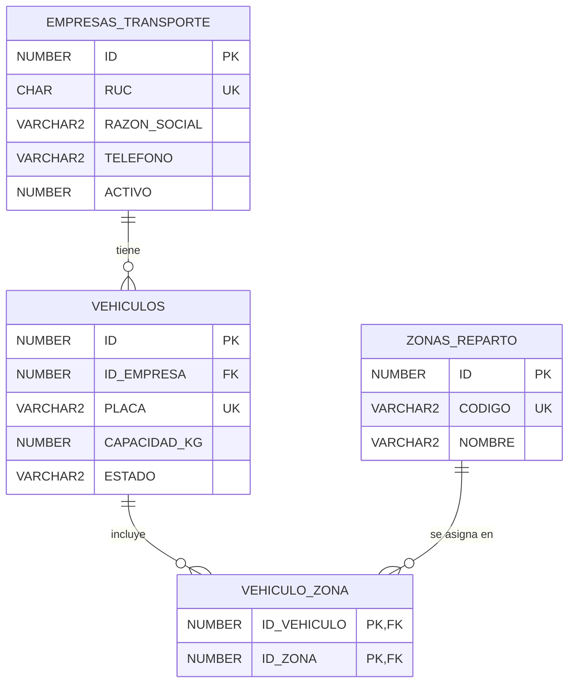

# Examen Final Práctico Individual de LP2 · Variante 1

*Por: Angel Sullon Macalupu @asullom - 2026*

## 1. Propósito

Comprueba que sabes **hacer**: construir un módulo nuevo, con base de datos, backend y SPA (*Single Page Application*, aplicación de una sola página), **dentro de tu proyecto grupal** y con el patrón de cabecera y detalles que practicaste en clase. El módulo `logistica` no existe todavía en tu proyecto, así que no hay nada que memorizar. Es la forma práctica de la [evaluación final individual](../sesiones/S16_Evaluacion_Final_Individual.md#2-evaluacion-final-individual-teorico-practica-s1-s14).

## 2. Reglas

- **Duración:** 120 minutos. **Puntaje:** 20 puntos.
- **Construye sobre tu proyecto:** abre tu proyecto grupal (backend y SPA) y agrega el módulo `logistica` dentro de él. No se acepta un proyecto nuevo ni una copia vacía.
- **Permitido:** la guía de las sesiones, el código de tu proyecto grupal y el código de BomERP.
- **No permitido:** IA ni chat de ningún tipo, ni ayuda de otras personas.
- **Cada funcionalidad se demuestra desde tu SPA** (Angular, Vue o React, la que usaste en tu proyecto). Si solo funciona desde el backend (Swagger o Postman), vale **la mitad** de sus puntos. El ítem de base de datos no se reduce.
- **Revisión en vivo:** al terminar los 120 minutos, el docente pasa por cada puesto y te pide demostrar cada ítem funcionando, en tu navegador o, si es de base de datos, en PowerShell o tu IDE (sección 7). Deja tu backend y tu SPA en ejecución y no modifiques código durante la revisión.
- **Antes de empezar:** tu backend y tu SPA deben estar funcionando. El tiempo corre desde que el docente da la señal de inicio.

## 3. Preparar tu esquema de base de datos

Ejecuta estos dos bloques en PowerShell, uno tras otro. Si usas un IDE de Oracle, copia solo el SQL de dentro de las comillas y ejecútalo como script, conectado como `system` al servicio `FREEPDB1`.

Cada bloque empieza con `$DB = 'bomerp-oracle'`: **cambia ese valor por el nombre del contenedor Oracle de tu entorno de desarrollo** (`docker ps` te lo muestra). Si tu `system` tiene otra contraseña, ajústala también. Si tu proyecto usa PostgreSQL en lugar de Oracle, usa los scripts del [Anexo B](#anexo-b-scripts-para-postgresql).

El esquema `EXA_LOGISTICA` tiene cuatro tablas (Figura 1). `VEHICULO_ZONA` es la tabla intermedia de la relación muchos a muchos: su clave primaria es compuesta y cada una de sus dos columnas es clave foránea.

**Figura 1. Diagrama de la base de datos del módulo**



`PK` es clave primaria, `FK` clave foránea y `UK` valor único. En cada relación, el extremo con doble barra es el lado «uno» y el extremo con pata de gallo es el lado «muchos».

**Script 1. Esquema**

```powershell
$DB = 'bomerp-oracle'   # nombre de TU contenedor Oracle en dev (míralo con: docker ps)
@'
CREATE USER EXA_LOGISTICA IDENTIFIED BY "123456" QUOTA UNLIMITED ON USERS;
GRANT CREATE SESSION, CREATE TABLE, CREATE VIEW, CREATE PROCEDURE, CREATE TRIGGER TO EXA_LOGISTICA;
EXIT
'@ | docker exec -i $DB sqlplus -s system/123456@//localhost:1521/FREEPDB1
```

**Script 2. Tablas, semillas y permisos**

Incluye las cuatro tablas, la tabla intermedia `VEHICULO_ZONA`, los datos de ejemplo y los permisos para el usuario de la aplicación. No tienes que modificarlo.

```powershell
$DB = 'bomerp-oracle'   # nombre de TU contenedor Oracle en dev (míralo con: docker ps)
@'
CREATE TABLE EXA_LOGISTICA.EMPRESAS_TRANSPORTE (
    ID            NUMBER GENERATED BY DEFAULT AS IDENTITY PRIMARY KEY,
    RUC           CHAR(11)      NOT NULL,
    RAZON_SOCIAL  VARCHAR2(150) NOT NULL,
    TELEFONO      VARCHAR2(20),
    ACTIVO        NUMBER(1)     DEFAULT 1 NOT NULL,
    CONSTRAINT UQ_EMPRESA_RUC UNIQUE (RUC),
    CONSTRAINT CK_EMPRESA_ACTIVO CHECK (ACTIVO IN (0, 1))
);

CREATE TABLE EXA_LOGISTICA.VEHICULOS (
    ID            NUMBER GENERATED BY DEFAULT AS IDENTITY PRIMARY KEY,
    ID_EMPRESA    NUMBER        NOT NULL,
    PLACA         VARCHAR2(10)  NOT NULL,
    CAPACIDAD_KG  NUMBER(8,2)   NOT NULL,
    ESTADO        VARCHAR2(20)  DEFAULT 'DISPONIBLE' NOT NULL,
    CONSTRAINT FK_VEHICULO_EMPRESA FOREIGN KEY (ID_EMPRESA)
        REFERENCES EXA_LOGISTICA.EMPRESAS_TRANSPORTE(ID),
    CONSTRAINT UQ_VEHICULO_PLACA UNIQUE (PLACA),
    CONSTRAINT CK_VEHICULO_CAPACIDAD CHECK (CAPACIDAD_KG > 0),
    CONSTRAINT CK_VEHICULO_ESTADO CHECK (ESTADO IN ('DISPONIBLE', 'EN_RUTA', 'MANTENIMIENTO'))
);

CREATE TABLE EXA_LOGISTICA.ZONAS_REPARTO (
    ID      NUMBER GENERATED BY DEFAULT AS IDENTITY PRIMARY KEY,
    CODIGO  VARCHAR2(10)  NOT NULL,
    NOMBRE  VARCHAR2(100) NOT NULL,
    CONSTRAINT UQ_ZONA_CODIGO UNIQUE (CODIGO)
);

INSERT INTO EXA_LOGISTICA.EMPRESAS_TRANSPORTE (RUC, RAZON_SOCIAL, TELEFONO, ACTIVO) VALUES ('20123456789', 'Transportes Andinos SAC', '951234567', 1);
INSERT INTO EXA_LOGISTICA.EMPRESAS_TRANSPORTE (RUC, RAZON_SOCIAL, TELEFONO, ACTIVO) VALUES ('20456789012', 'Logistica del Sur EIRL', '952345678', 1);
INSERT INTO EXA_LOGISTICA.EMPRESAS_TRANSPORTE (RUC, RAZON_SOCIAL, TELEFONO, ACTIVO) VALUES ('20987654321', 'Cargas Titicaca SRL', '953456789', 0);

INSERT INTO EXA_LOGISTICA.VEHICULOS (ID_EMPRESA, PLACA, CAPACIDAD_KG, ESTADO)
    SELECT ID, 'ABC-123', 3500, 'DISPONIBLE' FROM EXA_LOGISTICA.EMPRESAS_TRANSPORTE WHERE RUC = '20123456789';
INSERT INTO EXA_LOGISTICA.VEHICULOS (ID_EMPRESA, PLACA, CAPACIDAD_KG, ESTADO)
    SELECT ID, 'DEF-456', 8000, 'EN_RUTA' FROM EXA_LOGISTICA.EMPRESAS_TRANSPORTE WHERE RUC = '20123456789';
INSERT INTO EXA_LOGISTICA.VEHICULOS (ID_EMPRESA, PLACA, CAPACIDAD_KG, ESTADO)
    SELECT ID, 'GHI-789', 1500, 'DISPONIBLE' FROM EXA_LOGISTICA.EMPRESAS_TRANSPORTE WHERE RUC = '20456789012';
INSERT INTO EXA_LOGISTICA.VEHICULOS (ID_EMPRESA, PLACA, CAPACIDAD_KG, ESTADO)
    SELECT ID, 'JKL-012', 12000, 'MANTENIMIENTO' FROM EXA_LOGISTICA.EMPRESAS_TRANSPORTE WHERE RUC = '20456789012';

INSERT INTO EXA_LOGISTICA.ZONAS_REPARTO (CODIGO, NOMBRE) VALUES ('Z-01', 'Juliaca Centro');
INSERT INTO EXA_LOGISTICA.ZONAS_REPARTO (CODIGO, NOMBRE) VALUES ('Z-02', 'Juliaca Norte');
INSERT INTO EXA_LOGISTICA.ZONAS_REPARTO (CODIGO, NOMBRE) VALUES ('Z-03', 'Juliaca Sur');
INSERT INTO EXA_LOGISTICA.ZONAS_REPARTO (CODIGO, NOMBRE) VALUES ('Z-04', 'Puno Ciudad');
INSERT INTO EXA_LOGISTICA.ZONAS_REPARTO (CODIGO, NOMBRE) VALUES ('Z-05', 'Lampa');
COMMIT;

CREATE TABLE EXA_LOGISTICA.VEHICULO_ZONA (
    ID_VEHICULO  NUMBER NOT NULL,
    ID_ZONA      NUMBER NOT NULL,
    CONSTRAINT PK_VEHICULO_ZONA PRIMARY KEY (ID_VEHICULO, ID_ZONA),
    CONSTRAINT FK_VZ_VEHICULO FOREIGN KEY (ID_VEHICULO) REFERENCES EXA_LOGISTICA.VEHICULOS(ID),
    CONSTRAINT FK_VZ_ZONA     FOREIGN KEY (ID_ZONA)     REFERENCES EXA_LOGISTICA.ZONAS_REPARTO(ID)
);

INSERT INTO EXA_LOGISTICA.VEHICULO_ZONA (ID_VEHICULO, ID_ZONA)
    SELECT v.ID, z.ID FROM EXA_LOGISTICA.VEHICULOS v, EXA_LOGISTICA.ZONAS_REPARTO z
    WHERE (v.PLACA, z.CODIGO) IN (('ABC-123', 'Z-01'), ('ABC-123', 'Z-02'), ('DEF-456', 'Z-03'));
COMMIT;

CREATE INDEX EXA_LOGISTICA.IDX_VEHICULO_EMPRESA ON EXA_LOGISTICA.VEHICULOS(ID_EMPRESA);

GRANT SELECT, INSERT, UPDATE, DELETE ON EXA_LOGISTICA.EMPRESAS_TRANSPORTE TO BOMERP_APP;
GRANT SELECT, INSERT, UPDATE, DELETE ON EXA_LOGISTICA.VEHICULOS           TO BOMERP_APP;
GRANT SELECT, INSERT, UPDATE, DELETE ON EXA_LOGISTICA.ZONAS_REPARTO       TO BOMERP_APP;
GRANT SELECT, INSERT, UPDATE, DELETE ON EXA_LOGISTICA.VEHICULO_ZONA       TO BOMERP_APP;
EXIT
'@ | docker exec -i $DB sqlplus -s system/123456@//localhost:1521/FREEPDB1
```

**Script 3. Verificar** (debe listar 4 tablas: `EMPRESAS_TRANSPORTE`, `VEHICULOS`, `VEHICULO_ZONA` y `ZONAS_REPARTO`)

```powershell
$DB = 'bomerp-oracle'   # nombre de TU contenedor Oracle en dev (míralo con: docker ps)
@'
SELECT table_name FROM dba_tables WHERE owner='EXA_LOGISTICA' ORDER BY 1;
EXIT
'@ | docker exec -i $DB sqlplus -s system/123456@//localhost:1521/FREEPDB1
```

Para repetir desde cero, ejecuta `DROP USER EXA_LOGISTICA CASCADE;` como `system` y vuelve a correr los scripts 1 y 2.

## 4. Prototipos de las pantallas

Tu SPA no tiene que ser idéntica a estas figuras, pero sí debe tener estas pantallas y estas acciones.

Las Figuras 2 y 3 corresponden a la pregunta 1. En las Figuras 4, 5 y 6 el vehículo es la cabecera y las zonas son sus líneas, igual que la cabecera con detalles que practicaste en clase, como una venta con sus productos.

**Figura 2. Empresas de transporte: listado**

```text
+- Logística · Empresas de transporte --------------------------------------------------+
|                                                                  [ + Nueva empresa ]  |
|                                                                                       |
| +-------------+-------------------------+-----------+--------+---------------------+  |
| | RUC         | Razón social            | Teléfono  | Activa | Acciones            |  |
| +-------------+-------------------------+-----------+--------+---------------------+  |
| | 20123456789 | Transportes Andinos SAC | 951234567 | Sí     | [Editar] [Eliminar] |  |
| | 20456789012 | Logistica del Sur EIRL  | 952345678 | Sí     | [Editar] [Eliminar] |  |
| | 20987654321 | Cargas Titicaca SRL     | 953456789 | No     | [Editar] [Eliminar] |  |
| +-------------+-------------------------+-----------+--------+---------------------+  |
+---------------------------------------------------------------------------------------+
```

**Figura 3. Empresa: formulario para crear y editar, con los errores visibles**

```text
+- Nueva empresa  (la misma pantalla sirve para editar) -----------------+
| RUC            [ 2012345 ]          × El RUC debe tener 11 dígitos     |
| Razón social   [ ______________ ]   × La razón social es obligatoria   |
| Teléfono       [ ______________ ]                                      |
| Activa         [x]                                                     |
|                                                                        |
|                                           [ Cancelar ]   [ Guardar ]   |
+------------------------------------------------------------------------+
```

**Figura 4. Vehículos: listado**

```text
+- Logística · Vehículos ---------------------------------------------------------------+
|                                                                 [ + Nuevo vehículo ]  |
|                                                                                       |
| +---------+-------------------------+-----------+---------------+------------------+  |
| | Placa   | Empresa                 | Capac. kg | Estado        | Acciones         |  |
| +---------+-------------------------+-----------+---------------+------------------+  |
| | ABC-123 | Transportes Andinos SAC | 3500.00   | DISPONIBLE    | [Ver] [Eliminar] |  |
| | DEF-456 | Transportes Andinos SAC | 8000.00   | EN_RUTA       | [Ver] [Eliminar] |  |
| | GHI-789 | Logistica del Sur EIRL  | 1500.00   | DISPONIBLE    | [Ver] [Eliminar] |  |
| +---------+-------------------------+-----------+---------------+------------------+  |
+---------------------------------------------------------------------------------------+
```

**Figura 5. Nuevo vehículo, con la asignación de zonas**

```text
+- Nuevo vehículo -----------------------------------------------------+
| Empresa  [ Transportes Andinos SAC v ]     Placa [ ________ ]        |
| Capacidad (kg) [ ______ ]                  Estado [ DISPONIBLE v ]   |
|                                                                      |
| Zonas de reparto   [ Juliaca Centro v ] [ Agregar ]                  |
|                                                                      |
| +--------+------------------+----------+                             |
| | Z-01   | Juliaca Centro   | [Quitar] |                             |
| | Z-03   | Juliaca Sur      | [Quitar] |                             |
| +--------+------------------+----------+                             |
|                                                                      |
|                                         [ Cancelar ]   [ Guardar ]   |
+----------------------------------------------------------------------+
```

**Figura 6. Ver vehículo, con sus zonas (solo lectura)**

```text
+- Vehículo ABC-123 ---------------------------------------------------+
| Empresa: Transportes Andinos SAC     Capacidad: 3500.00 kg           |
| Estado:  DISPONIBLE                                                  |
|                                                                      |
| Zonas asignadas:                                                     |
| +--------+------------------+                                        |
| | Z-01   | Juliaca Centro   |                                        |
| | Z-02   | Juliaca Norte    |                                        |
| +--------+------------------+                                        |
|                                                                      |
|                                                         [ Volver ]   |
+----------------------------------------------------------------------+
```

## 5. Preguntas

**1. (7 pts)** Crea el módulo `logistica` en tu backend y el CRUD (*Create, Read, Update, Delete*) de `EMPRESAS_TRANSPORTE` (Figuras 2 y 3).

- DB: crea el esquema de tu nuevo módulo ejecutando los scripts de la sección 3 y lista las tablas del esquema mediante PowerShell o tu IDE. **(2 pts)**
- CRUD funcionando desde la SPA: listar, crear, editar y eliminar. **(4 pts)**
- RUC (Registro Único de Contribuyentes) de 11 dígitos y razón social obligatoria, con el error visible en el formulario. **(1 pt)**

**2. (13 pts)** Ahora `VEHICULOS` con sus `ZONAS_REPARTO`, igual que la cabecera con detalles que practicaste en clase, como una venta con sus productos (Figuras 4, 5 y 6). El vehículo es la cabecera y las zonas son sus líneas.

- Zonas: listar (vienen precargadas). **(1 pt)**
- Crear un vehículo: empresa elegida desde una lista desplegable, placa, capacidad y estado como enumerado. **(3 pts)**
- Asignar zonas al crear el vehículo: eliges una zona de la lista, la agregas a la tabla de zonas asignadas, puedes quitarla y, al guardar, queda registrada. **(4 pts)**
- Listar los vehículos y ver el detalle de uno, con su tabla de zonas asignadas. **(3 pts)**
- Eliminar un vehículo desde el listado. **(2 pts)**

## 6. Calificación

**Tabla 1. Puntaje por ítem según dónde funciona**

| Ítem | Pregunta | Desde la SPA | Solo desde el backend |
|---|---|---:|---:|
| Esquema creado y tablas listadas | 1 | 2 | 2 |
| CRUD de empresas | 1 | 4 | 2 |
| Validaciones de empresa | 1 | 1 | 0.5 |
| Zonas: listar | 2 | 1 | 0.5 |
| Crear un vehículo | 2 | 3 | 1.5 |
| Asignar zonas al crear el vehículo | 2 | 4 | 2 |
| Listar y ver el detalle del vehículo con sus zonas | 2 | 3 | 1.5 |
| Eliminar un vehículo | 2 | 2 | 1 |
| **Total** | | **20** | |

Un ítem vale su puntaje completo solo si lo muestras funcionando. Si el código existe pero falla, vale 0.

**Tabla 2. Distribución sugerida del tiempo**

| Bloque | Minutos |
|---|---:|
| Pregunta 1 | 50 |
| Pregunta 2 | 65 |
| Cierre: dejar todo en ejecución para la revisión | 5 |
| **Total** | **120** |

Los ítems se califican por separado: si te atascas en uno, pasa al siguiente.

## 7. Revisión en vivo

Al terminar los 120 minutos, el docente revisa tu puesto en unos 5 minutos. Para cada ítem te pedirá hacer esto, en vivo y sin ayuda:

**Tabla 3. Qué demuestras en la revisión**

| Ítem | Qué te pide el docente |
|---|---|
| Esquema creado y tablas listadas | Ejecutar el script 3 y mostrar las 4 tablas. |
| CRUD de empresas | Crear una empresa, editarla y eliminarla desde la SPA. |
| Validaciones de empresa | Guardar una empresa con un RUC de menos de 11 dígitos y con la razón social vacía: los errores deben verse en el formulario. |
| Zonas: listar | Mostrar las 5 zonas precargadas. |
| Crear un vehículo | Crear un vehículo eligiendo la empresa de la lista desplegable, con placa, capacidad y estado. |
| Asignar zonas al crear el vehículo | En un vehículo nuevo, agregar 2 zonas, quitar 1 y guardar. |
| Listar y ver el detalle del vehículo con sus zonas | Encontrar ese vehículo en el listado, abrirlo y ver la zona que quedó asignada. |
| Eliminar un vehículo | Eliminar ese vehículo desde el listado. |

Lo que falla durante la revisión se califica como no logrado: no se corrige en ese momento.

## Anexo A. Opcional: usar PostgreSQL en lugar de Oracle

Si tu proyecto en desarrollo usa PostgreSQL, o prefieres usarlo en el examen, haz estos tres cambios. Con Oracle no tienes que tocar nada.

**1. `compose-dev.yml`.** Reemplaza el servicio `oracle` y el volumen `oracle-data` por esto:

```yaml
services:
  postgres:
    image: postgres:17-alpine
    container_name: bomerp-postgres
    restart: unless-stopped
    ports:
      - "35433:5432"
    environment:
      POSTGRES_DB: bomerp
      POSTGRES_USER: bomerp_app
      POSTGRES_PASSWORD: 123456
      TZ: America/Lima
    volumes:
      - postgres-data:/var/lib/postgresql/data
    healthcheck:
      test: ["CMD-SHELL", "pg_isready -U bomerp_app -d bomerp"]
      interval: 10s
      timeout: 5s
      retries: 10
      start_period: 15s

volumes:
  postgres-data:
```

El puerto `35433` es solo un ejemplo: usa cualquiera que esté libre en tu máquina. Levántalo con:

```powershell
docker compose -f compose-dev.yml up -d postgres
```

**2. `pom.xml`.** Reemplaza la dependencia `ojdbc11` por el controlador de PostgreSQL:

```xml
<dependency>
    <groupId>org.postgresql</groupId>
    <artifactId>postgresql</artifactId>
    <scope>runtime</scope>
</dependency>
```

**3. `application-dev.yml`.** Reemplaza el bloque `datasource`:

```yaml
spring:
  datasource:
    url: jdbc:postgresql://localhost:35433/bomerp
    username: bomerp_app
    password: 123456
    driver-class-name: org.postgresql.Driver
```

Tus entidades siguen usando `@Table(schema = "EXA_LOGISTICA")`: PostgreSQL lee ese nombre sin distinguir mayúsculas.

## Anexo B. Scripts para PostgreSQL

Son los mismos scripts de la sección 3, con la sintaxis de PostgreSQL y los mismos datos. En PostgreSQL el esquema es el equivalente al usuario de Oracle, y `bomerp_app` es el mismo usuario con el que corre tu backend, por lo que no hacen falta permisos adicionales. Cambia `$DB` por el nombre del contenedor PostgreSQL de tu entorno de desarrollo (`docker ps`), y ajusta el usuario (`-U`) y la base (`-d`) si tu entorno usa otros.

**Script 1 (PostgreSQL). Esquema**

```powershell
$DB = 'bomerp-postgres'   # nombre de TU contenedor PostgreSQL en dev (míralo con: docker ps)
@'
CREATE SCHEMA EXA_LOGISTICA;
'@ | docker exec -i $DB psql -U bomerp_app -d bomerp -v ON_ERROR_STOP=1
```

**Script 2 (PostgreSQL). Tablas y semillas**

```powershell
$DB = 'bomerp-postgres'   # nombre de TU contenedor PostgreSQL en dev (míralo con: docker ps)
@'
CREATE TABLE EXA_LOGISTICA.EMPRESAS_TRANSPORTE (
    ID            BIGINT GENERATED BY DEFAULT AS IDENTITY PRIMARY KEY,
    RUC           CHAR(11)      NOT NULL,
    RAZON_SOCIAL  VARCHAR(150) NOT NULL,
    TELEFONO      VARCHAR(20),
    ACTIVO        SMALLINT     DEFAULT 1 NOT NULL,
    CONSTRAINT UQ_EMPRESA_RUC UNIQUE (RUC),
    CONSTRAINT CK_EMPRESA_ACTIVO CHECK (ACTIVO IN (0, 1))
);

CREATE TABLE EXA_LOGISTICA.VEHICULOS (
    ID            BIGINT GENERATED BY DEFAULT AS IDENTITY PRIMARY KEY,
    ID_EMPRESA    BIGINT        NOT NULL,
    PLACA         VARCHAR(10)  NOT NULL,
    CAPACIDAD_KG  NUMERIC(8,2)   NOT NULL,
    ESTADO        VARCHAR(20)  DEFAULT 'DISPONIBLE' NOT NULL,
    CONSTRAINT FK_VEHICULO_EMPRESA FOREIGN KEY (ID_EMPRESA)
        REFERENCES EXA_LOGISTICA.EMPRESAS_TRANSPORTE(ID),
    CONSTRAINT UQ_VEHICULO_PLACA UNIQUE (PLACA),
    CONSTRAINT CK_VEHICULO_CAPACIDAD CHECK (CAPACIDAD_KG > 0),
    CONSTRAINT CK_VEHICULO_ESTADO CHECK (ESTADO IN ('DISPONIBLE', 'EN_RUTA', 'MANTENIMIENTO'))
);

CREATE TABLE EXA_LOGISTICA.ZONAS_REPARTO (
    ID      BIGINT GENERATED BY DEFAULT AS IDENTITY PRIMARY KEY,
    CODIGO  VARCHAR(10)  NOT NULL,
    NOMBRE  VARCHAR(100) NOT NULL,
    CONSTRAINT UQ_ZONA_CODIGO UNIQUE (CODIGO)
);

INSERT INTO EXA_LOGISTICA.EMPRESAS_TRANSPORTE (RUC, RAZON_SOCIAL, TELEFONO, ACTIVO) VALUES ('20123456789', 'Transportes Andinos SAC', '951234567', 1);
INSERT INTO EXA_LOGISTICA.EMPRESAS_TRANSPORTE (RUC, RAZON_SOCIAL, TELEFONO, ACTIVO) VALUES ('20456789012', 'Logistica del Sur EIRL', '952345678', 1);
INSERT INTO EXA_LOGISTICA.EMPRESAS_TRANSPORTE (RUC, RAZON_SOCIAL, TELEFONO, ACTIVO) VALUES ('20987654321', 'Cargas Titicaca SRL', '953456789', 0);

INSERT INTO EXA_LOGISTICA.VEHICULOS (ID_EMPRESA, PLACA, CAPACIDAD_KG, ESTADO)
    SELECT ID, 'ABC-123', 3500, 'DISPONIBLE' FROM EXA_LOGISTICA.EMPRESAS_TRANSPORTE WHERE RUC = '20123456789';
INSERT INTO EXA_LOGISTICA.VEHICULOS (ID_EMPRESA, PLACA, CAPACIDAD_KG, ESTADO)
    SELECT ID, 'DEF-456', 8000, 'EN_RUTA' FROM EXA_LOGISTICA.EMPRESAS_TRANSPORTE WHERE RUC = '20123456789';
INSERT INTO EXA_LOGISTICA.VEHICULOS (ID_EMPRESA, PLACA, CAPACIDAD_KG, ESTADO)
    SELECT ID, 'GHI-789', 1500, 'DISPONIBLE' FROM EXA_LOGISTICA.EMPRESAS_TRANSPORTE WHERE RUC = '20456789012';
INSERT INTO EXA_LOGISTICA.VEHICULOS (ID_EMPRESA, PLACA, CAPACIDAD_KG, ESTADO)
    SELECT ID, 'JKL-012', 12000, 'MANTENIMIENTO' FROM EXA_LOGISTICA.EMPRESAS_TRANSPORTE WHERE RUC = '20456789012';

INSERT INTO EXA_LOGISTICA.ZONAS_REPARTO (CODIGO, NOMBRE) VALUES ('Z-01', 'Juliaca Centro');
INSERT INTO EXA_LOGISTICA.ZONAS_REPARTO (CODIGO, NOMBRE) VALUES ('Z-02', 'Juliaca Norte');
INSERT INTO EXA_LOGISTICA.ZONAS_REPARTO (CODIGO, NOMBRE) VALUES ('Z-03', 'Juliaca Sur');
INSERT INTO EXA_LOGISTICA.ZONAS_REPARTO (CODIGO, NOMBRE) VALUES ('Z-04', 'Puno Ciudad');
INSERT INTO EXA_LOGISTICA.ZONAS_REPARTO (CODIGO, NOMBRE) VALUES ('Z-05', 'Lampa');

CREATE TABLE EXA_LOGISTICA.VEHICULO_ZONA (
    ID_VEHICULO  BIGINT NOT NULL,
    ID_ZONA      BIGINT NOT NULL,
    CONSTRAINT PK_VEHICULO_ZONA PRIMARY KEY (ID_VEHICULO, ID_ZONA),
    CONSTRAINT FK_VZ_VEHICULO FOREIGN KEY (ID_VEHICULO) REFERENCES EXA_LOGISTICA.VEHICULOS(ID),
    CONSTRAINT FK_VZ_ZONA     FOREIGN KEY (ID_ZONA)     REFERENCES EXA_LOGISTICA.ZONAS_REPARTO(ID)
);

INSERT INTO EXA_LOGISTICA.VEHICULO_ZONA (ID_VEHICULO, ID_ZONA)
    SELECT v.ID, z.ID FROM EXA_LOGISTICA.VEHICULOS v, EXA_LOGISTICA.ZONAS_REPARTO z
    WHERE (v.PLACA, z.CODIGO) IN (('ABC-123', 'Z-01'), ('ABC-123', 'Z-02'), ('DEF-456', 'Z-03'));

CREATE INDEX IDX_VEHICULO_EMPRESA ON EXA_LOGISTICA.VEHICULOS(ID_EMPRESA);
'@ | docker exec -i $DB psql -U bomerp_app -d bomerp -v ON_ERROR_STOP=1
```

**Script 3 (PostgreSQL). Verificar** (debe listar 4 tablas)

```powershell
$DB = 'bomerp-postgres'   # nombre de TU contenedor PostgreSQL en dev (míralo con: docker ps)
@'
SELECT table_name FROM information_schema.tables WHERE table_schema = 'exa_logistica' ORDER BY 1;
'@ | docker exec -i $DB psql -U bomerp_app -d bomerp
```

Para repetir desde cero, ejecuta `DROP SCHEMA EXA_LOGISTICA CASCADE;` y vuelve a correr los scripts 1 y 2.
