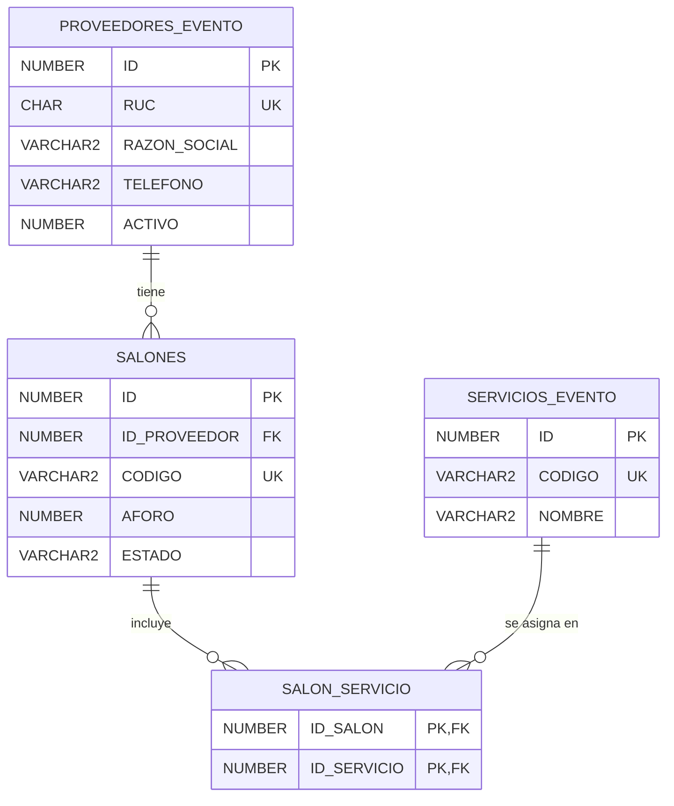

# Examen Final Práctico Individual de LP2 · Variante 2

*Por: Angel Sullon Macalupu @asullom - 2026*

## 1. Propósito

Comprueba que sabes **hacer**: construir un módulo nuevo, con base de datos, backend y SPA (*Single Page Application*, aplicación de una sola página), **dentro de tu proyecto grupal** y con el patrón de cabecera y detalles que practicaste en clase. El módulo `eventos` no existe todavía en tu proyecto, así que no hay nada que memorizar. Es la forma práctica de la [evaluación final individual](../sesiones/S16_Evaluacion_Final_Individual.md#2-evaluacion-final-individual-teorico-practica-s1-s14).

## 2. Reglas

- **Duración:** 120 minutos. **Puntaje:** 20 puntos.
- **Construye sobre tu proyecto:** abre tu proyecto grupal (backend y SPA) y agrega el módulo `eventos` dentro de él. No se acepta un proyecto nuevo ni una copia vacía.
- **Permitido:** la guía de las sesiones, el código de tu proyecto grupal y el código de BomERP.
- **No permitido:** IA ni chat de ningún tipo, ni ayuda de otras personas.
- **Cada funcionalidad se demuestra desde tu SPA** (Angular, Vue o React, la que usaste en tu proyecto). Si solo funciona desde el backend (Swagger o Postman), vale **la mitad** de sus puntos. El ítem de base de datos no se reduce.
- **Revisión en vivo:** al terminar los 120 minutos, el docente pasa por cada puesto y te pide demostrar cada ítem funcionando, en tu navegador o, si es de base de datos, en PowerShell o tu IDE (sección 7). Deja tu backend y tu SPA en ejecución y no modifiques código durante la revisión.
- **Antes de empezar:** tu backend y tu SPA deben estar funcionando. El tiempo corre desde que el docente da la señal de inicio.

## 3. Preparar tu esquema de base de datos

Ejecuta estos dos bloques en PowerShell, uno tras otro. Si usas un IDE de Oracle, copia solo el SQL de dentro de las comillas y ejecútalo como script, conectado como `system` al servicio `FREEPDB1`.

Cada bloque empieza con `$DB = 'bomerp-oracle'`: **cambia ese valor por el nombre del contenedor Oracle de tu entorno de desarrollo** (`docker ps` te lo muestra). Si tu `system` tiene otra contraseña, ajústala también. Si tu proyecto usa PostgreSQL en lugar de Oracle, usa los scripts del [Anexo B](#anexo-b-scripts-para-postgresql).

El esquema `EXA_EVENTOS` tiene cuatro tablas (Figura 1). `SALON_SERVICIO` es la tabla intermedia de la relación muchos a muchos: su clave primaria es compuesta y cada una de sus dos columnas es clave foránea.

**Figura 1. Diagrama de la base de datos del módulo**



`PK` es clave primaria, `FK` clave foránea y `UK` valor único. En cada relación, el extremo con doble barra es el lado «uno» y el extremo con pata de gallo es el lado «muchos».

**Script 1. Esquema**

```powershell
$DB = 'bomerp-oracle'   # nombre de TU contenedor Oracle en dev (míralo con: docker ps)
@'
CREATE USER EXA_EVENTOS IDENTIFIED BY "123456" QUOTA UNLIMITED ON USERS;
GRANT CREATE SESSION, CREATE TABLE, CREATE VIEW, CREATE PROCEDURE, CREATE TRIGGER TO EXA_EVENTOS;
EXIT
'@ | docker exec -i $DB sqlplus -s system/123456@//localhost:1521/FREEPDB1
```

**Script 2. Tablas, semillas y permisos**

Incluye las cuatro tablas, la tabla intermedia `SALON_SERVICIO`, los datos de ejemplo y los permisos para el usuario de la aplicación. No tienes que modificarlo.

```powershell
$DB = 'bomerp-oracle'   # nombre de TU contenedor Oracle en dev (míralo con: docker ps)
@'
CREATE TABLE EXA_EVENTOS.PROVEEDORES_EVENTO (
    ID            NUMBER GENERATED BY DEFAULT AS IDENTITY PRIMARY KEY,
    RUC           CHAR(11)      NOT NULL,
    RAZON_SOCIAL  VARCHAR2(150) NOT NULL,
    TELEFONO      VARCHAR2(20),
    ACTIVO        NUMBER(1)     DEFAULT 1 NOT NULL,
    CONSTRAINT UQ_PROVEEDOR_RUC UNIQUE (RUC),
    CONSTRAINT CK_PROVEEDOR_ACTIVO CHECK (ACTIVO IN (0, 1))
);

CREATE TABLE EXA_EVENTOS.SALONES (
    ID            NUMBER GENERATED BY DEFAULT AS IDENTITY PRIMARY KEY,
    ID_PROVEEDOR  NUMBER        NOT NULL,
    CODIGO        VARCHAR2(10)  NOT NULL,
    AFORO         NUMBER(6)     NOT NULL,
    ESTADO        VARCHAR2(20)  DEFAULT 'DISPONIBLE' NOT NULL,
    CONSTRAINT FK_SALON_PROVEEDOR FOREIGN KEY (ID_PROVEEDOR)
        REFERENCES EXA_EVENTOS.PROVEEDORES_EVENTO(ID),
    CONSTRAINT UQ_SALON_CODIGO UNIQUE (CODIGO),
    CONSTRAINT CK_SALON_AFORO CHECK (AFORO > 0),
    CONSTRAINT CK_SALON_ESTADO CHECK (ESTADO IN ('DISPONIBLE', 'RESERVADO', 'MANTENIMIENTO'))
);

CREATE TABLE EXA_EVENTOS.SERVICIOS_EVENTO (
    ID      NUMBER GENERATED BY DEFAULT AS IDENTITY PRIMARY KEY,
    CODIGO  VARCHAR2(10)  NOT NULL,
    NOMBRE  VARCHAR2(100) NOT NULL,
    CONSTRAINT UQ_SERVICIO_CODIGO UNIQUE (CODIGO)
);

INSERT INTO EXA_EVENTOS.PROVEEDORES_EVENTO (RUC, RAZON_SOCIAL, TELEFONO, ACTIVO) VALUES ('20111222333', 'Eventos Altiplano SAC', '951111222', 1);
INSERT INTO EXA_EVENTOS.PROVEEDORES_EVENTO (RUC, RAZON_SOCIAL, TELEFONO, ACTIVO) VALUES ('20444555666', 'Banquetes del Sur EIRL', '952222333', 1);
INSERT INTO EXA_EVENTOS.PROVEEDORES_EVENTO (RUC, RAZON_SOCIAL, TELEFONO, ACTIVO) VALUES ('20777888999', 'Fiestas Titicaca SRL', '953333444', 0);

INSERT INTO EXA_EVENTOS.SALONES (ID_PROVEEDOR, CODIGO, AFORO, ESTADO)
    SELECT ID, 'SAL-101', 150, 'DISPONIBLE' FROM EXA_EVENTOS.PROVEEDORES_EVENTO WHERE RUC = '20111222333';
INSERT INTO EXA_EVENTOS.SALONES (ID_PROVEEDOR, CODIGO, AFORO, ESTADO)
    SELECT ID, 'SAL-202', 300, 'RESERVADO' FROM EXA_EVENTOS.PROVEEDORES_EVENTO WHERE RUC = '20111222333';
INSERT INTO EXA_EVENTOS.SALONES (ID_PROVEEDOR, CODIGO, AFORO, ESTADO)
    SELECT ID, 'SAL-303', 80, 'DISPONIBLE' FROM EXA_EVENTOS.PROVEEDORES_EVENTO WHERE RUC = '20444555666';
INSERT INTO EXA_EVENTOS.SALONES (ID_PROVEEDOR, CODIGO, AFORO, ESTADO)
    SELECT ID, 'SAL-404', 500, 'MANTENIMIENTO' FROM EXA_EVENTOS.PROVEEDORES_EVENTO WHERE RUC = '20444555666';

INSERT INTO EXA_EVENTOS.SERVICIOS_EVENTO (CODIGO, NOMBRE) VALUES ('S-01', 'Sonido e iluminacion');
INSERT INTO EXA_EVENTOS.SERVICIOS_EVENTO (CODIGO, NOMBRE) VALUES ('S-02', 'Catering');
INSERT INTO EXA_EVENTOS.SERVICIOS_EVENTO (CODIGO, NOMBRE) VALUES ('S-03', 'Proyector y pantalla');
INSERT INTO EXA_EVENTOS.SERVICIOS_EVENTO (CODIGO, NOMBRE) VALUES ('S-04', 'Decoracion');
INSERT INTO EXA_EVENTOS.SERVICIOS_EVENTO (CODIGO, NOMBRE) VALUES ('S-05', 'Fotografia');
COMMIT;

CREATE TABLE EXA_EVENTOS.SALON_SERVICIO (
    ID_SALON     NUMBER NOT NULL,
    ID_SERVICIO  NUMBER NOT NULL,
    CONSTRAINT PK_SALON_SERVICIO PRIMARY KEY (ID_SALON, ID_SERVICIO),
    CONSTRAINT FK_SS_SALON    FOREIGN KEY (ID_SALON)    REFERENCES EXA_EVENTOS.SALONES(ID),
    CONSTRAINT FK_SS_SERVICIO FOREIGN KEY (ID_SERVICIO) REFERENCES EXA_EVENTOS.SERVICIOS_EVENTO(ID)
);

INSERT INTO EXA_EVENTOS.SALON_SERVICIO (ID_SALON, ID_SERVICIO)
    SELECT s.ID, v.ID FROM EXA_EVENTOS.SALONES s, EXA_EVENTOS.SERVICIOS_EVENTO v
    WHERE (s.CODIGO, v.CODIGO) IN (('SAL-101', 'S-01'), ('SAL-101', 'S-02'), ('SAL-202', 'S-03'));
COMMIT;

CREATE INDEX EXA_EVENTOS.IDX_SALON_PROVEEDOR ON EXA_EVENTOS.SALONES(ID_PROVEEDOR);

GRANT SELECT, INSERT, UPDATE, DELETE ON EXA_EVENTOS.PROVEEDORES_EVENTO TO BOMERP_APP;
GRANT SELECT, INSERT, UPDATE, DELETE ON EXA_EVENTOS.SALONES            TO BOMERP_APP;
GRANT SELECT, INSERT, UPDATE, DELETE ON EXA_EVENTOS.SERVICIOS_EVENTO   TO BOMERP_APP;
GRANT SELECT, INSERT, UPDATE, DELETE ON EXA_EVENTOS.SALON_SERVICIO     TO BOMERP_APP;
EXIT
'@ | docker exec -i $DB sqlplus -s system/123456@//localhost:1521/FREEPDB1
```

**Script 3. Verificar** (debe listar 4 tablas: `PROVEEDORES_EVENTO`, `SALONES`, `SALON_SERVICIO` y `SERVICIOS_EVENTO`)

```powershell
$DB = 'bomerp-oracle'   # nombre de TU contenedor Oracle en dev (míralo con: docker ps)
@'
SELECT table_name FROM dba_tables WHERE owner='EXA_EVENTOS' ORDER BY 1;
EXIT
'@ | docker exec -i $DB sqlplus -s system/123456@//localhost:1521/FREEPDB1
```

Para repetir desde cero, ejecuta `DROP USER EXA_EVENTOS CASCADE;` como `system` y vuelve a correr los scripts 1 y 2.

## 4. Prototipos de las pantallas

Tu SPA no tiene que ser idéntica a estas figuras, pero sí debe tener estas pantallas y estas acciones.

Las Figuras 2 y 3 corresponden a la pregunta 1. En las Figuras 4, 5 y 6 el salón es la cabecera y los servicios son sus líneas, igual que la cabecera con detalles que practicaste en clase, como una venta con sus productos.

**Figura 2. Proveedores de eventos: listado**

```text
+- Eventos · Proveedores ---------------------------------------------------------------+
|                                                                [ + Nuevo proveedor ]  |
|                                                                                       |
| +-------------+-------------------------+-----------+--------+---------------------+  |
| | RUC         | Razón social            | Teléfono  | Activo | Acciones            |  |
| +-------------+-------------------------+-----------+--------+---------------------+  |
| | 20111222333 | Eventos Altiplano SAC   | 951111222 | Sí     | [Editar] [Eliminar] |  |
| | 20444555666 | Banquetes del Sur EIRL  | 952222333 | Sí     | [Editar] [Eliminar] |  |
| | 20777888999 | Fiestas Titicaca SRL    | 953333444 | No     | [Editar] [Eliminar] |  |
| +-------------+-------------------------+-----------+--------+---------------------+  |
+---------------------------------------------------------------------------------------+
```

**Figura 3. Proveedor: formulario para crear y editar, con los errores visibles**

```text
+- Nuevo proveedor  (la misma pantalla sirve para editar) ---------------+
| RUC            [ 2011122 ]          × El RUC debe tener 11 dígitos     |
| Razón social   [ ______________ ]   × La razón social es obligatoria   |
| Teléfono       [ ______________ ]                                      |
| Activo         [x]                                                     |
|                                                                        |
|                                           [ Cancelar ]   [ Guardar ]   |
+------------------------------------------------------------------------+
```

**Figura 4. Salones: listado**

```text
+- Eventos · Salones --------------------------------------------------------------+
|                                                               [ + Nuevo salón ]  |
|                                                                                  |
| +---------+------------------------+-------+---------------+------------------+  |
| | Código  | Proveedor              | Aforo | Estado        | Acciones         |  |
| +---------+------------------------+-------+---------------+------------------+  |
| | SAL-101 | Eventos Altiplano SAC  | 150   | DISPONIBLE    | [Ver] [Eliminar] |  |
| | SAL-202 | Eventos Altiplano SAC  | 300   | RESERVADO     | [Ver] [Eliminar] |  |
| | SAL-303 | Banquetes del Sur EIRL | 80    | DISPONIBLE    | [Ver] [Eliminar] |  |
| +---------+------------------------+-------+---------------+------------------+  |
+----------------------------------------------------------------------------------+
```

**Figura 5. Nuevo salón, con la asignación de servicios**

```text
+- Nuevo salón ------------------------------------------------------------+
| Proveedor  [ Eventos Altiplano SAC v ]    Código [ ________ ]            |
| Aforo (personas) [ ______ ]               Estado [ DISPONIBLE v ]        |
|                                                                          |
| Servicios del salón   [ Sonido e iluminación v ] [ Agregar ]             |
|                                                                          |
| +--------+------------------------+----------+                           |
| | S-01   | Sonido e iluminación   | [Quitar] |                           |
| | S-03   | Proyector y pantalla   | [Quitar] |                           |
| +--------+------------------------+----------+                           |
|                                                                          |
|                                             [ Cancelar ]   [ Guardar ]   |
+--------------------------------------------------------------------------+
```

**Figura 6. Ver salón, con sus servicios (solo lectura)**

```text
+- Salón SAL-101 ----------------------------------------------------------+
| Proveedor: Eventos Altiplano SAC     Aforo: 150 personas                 |
| Estado:    DISPONIBLE                                                    |
|                                                                          |
| Servicios asignados:                                                     |
| +--------+------------------------+                                      |
| | S-01   | Sonido e iluminación   |                                      |
| | S-02   | Catering               |                                      |
| +--------+------------------------+                                      |
|                                                                          |
|                                                             [ Volver ]   |
+--------------------------------------------------------------------------+
```

## 5. Preguntas

**1. (7 pts)** Crea el módulo `eventos` en tu backend y el CRUD (*Create, Read, Update, Delete*) de `PROVEEDORES_EVENTO` (Figuras 2 y 3).

- DB: crea el esquema de tu nuevo módulo ejecutando los scripts de la sección 3 y lista las tablas del esquema mediante PowerShell o tu IDE. **(2 pts)**
- CRUD funcionando desde la SPA: listar, crear, editar y eliminar. **(4 pts)**
- RUC (Registro Único de Contribuyentes) de 11 dígitos y razón social obligatoria, con el error visible en el formulario. **(1 pt)**

**2. (13 pts)** Ahora `SALONES` con sus `SERVICIOS_EVENTO`, igual que la cabecera con detalles que practicaste en clase, como una venta con sus productos (Figuras 4, 5 y 6). El salón es la cabecera y los servicios son sus líneas.

- Servicios: listar (vienen precargados). **(1 pt)**
- Crear un salón: proveedor elegido desde una lista desplegable, código, aforo y estado como enumerado. **(3 pts)**
- Asignar servicios al crear el salón: eliges un servicio de la lista, lo agregas a la tabla de servicios asignados, puedes quitarlo y, al guardar, queda registrado. **(4 pts)**
- Listar los salones y ver el detalle de uno, con su tabla de servicios asignados. **(3 pts)**
- Eliminar un salón desde el listado. **(2 pts)**

## 6. Calificación

**Tabla 1. Puntaje por ítem según dónde funciona**

| Ítem | Pregunta | Desde la SPA | Solo desde el backend |
|---|---|---:|---:|
| Esquema creado y tablas listadas | 1 | 2 | 2 |
| CRUD de proveedores | 1 | 4 | 2 |
| Validaciones de proveedor | 1 | 1 | 0.5 |
| Servicios: listar | 2 | 1 | 0.5 |
| Crear un salón | 2 | 3 | 1.5 |
| Asignar servicios al crear el salón | 2 | 4 | 2 |
| Listar y ver el detalle del salón con sus servicios | 2 | 3 | 1.5 |
| Eliminar un salón | 2 | 2 | 1 |
| **Total** | | **20** | |

Un ítem vale su puntaje completo solo si lo muestras funcionando. Si el código existe pero falla, vale 0.

**Tabla 2. Distribución sugerida del tiempo**

| Bloque | Minutos |
|---|---:|
| Pregunta 1 | 50 |
| Pregunta 2 | 65 |
| Cierre: dejar todo en ejecución para la revisión | 5 |
| **Total** | **120** |

Los ítems se califican por separado: si te atascas en uno, pasa al siguiente.

## 7. Revisión en vivo

Al terminar los 120 minutos, el docente revisa tu puesto en unos 5 minutos. Para cada ítem te pedirá hacer esto, en vivo y sin ayuda:

**Tabla 3. Qué demuestras en la revisión**

| Ítem | Qué te pide el docente |
|---|---|
| Esquema creado y tablas listadas | Ejecutar el script 3 y mostrar las 4 tablas. |
| CRUD de proveedores | Crear un proveedor, editarlo y eliminarlo desde la SPA. |
| Validaciones de proveedor | Guardar un proveedor con un RUC de menos de 11 dígitos y con la razón social vacía: los errores deben verse en el formulario. |
| Servicios: listar | Mostrar los 5 servicios precargados. |
| Crear un salón | Crear un salón eligiendo el proveedor de la lista desplegable, con código, aforo y estado. |
| Asignar servicios al crear el salón | En un salón nuevo, agregar 2 servicios, quitar 1 y guardar. |
| Listar y ver el detalle del salón con sus servicios | Encontrar ese salón en el listado, abrirlo y ver el servicio que quedó asignado. |
| Eliminar un salón | Eliminar ese salón desde el listado. |

Lo que falla durante la revisión se califica como no logrado: no se corrige en ese momento.

## Anexo A. Opcional: usar PostgreSQL en lugar de Oracle

Si tu proyecto en desarrollo usa PostgreSQL, o prefieres usarlo en el examen, haz estos tres cambios. Con Oracle no tienes que tocar nada.

**1. `compose-dev.yml`.** Reemplaza el servicio `oracle` y el volumen `oracle-data` por esto:

```yaml
services:
  postgres:
    image: postgres:17-alpine
    container_name: bomerp-postgres
    restart: unless-stopped
    ports:
      - "35433:5432"
    environment:
      POSTGRES_DB: bomerp
      POSTGRES_USER: bomerp_app
      POSTGRES_PASSWORD: 123456
      TZ: America/Lima
    volumes:
      - postgres-data:/var/lib/postgresql/data
    healthcheck:
      test: ["CMD-SHELL", "pg_isready -U bomerp_app -d bomerp"]
      interval: 10s
      timeout: 5s
      retries: 10
      start_period: 15s

volumes:
  postgres-data:
```

El puerto `35433` es solo un ejemplo: usa cualquiera que esté libre en tu máquina. Levántalo con:

```powershell
docker compose -f compose-dev.yml up -d postgres
```

**2. `pom.xml`.** Reemplaza la dependencia `ojdbc11` por el controlador de PostgreSQL:

```xml
<dependency>
    <groupId>org.postgresql</groupId>
    <artifactId>postgresql</artifactId>
    <scope>runtime</scope>
</dependency>
```

**3. `application-dev.yml`.** Reemplaza el bloque `datasource`:

```yaml
spring:
  datasource:
    url: jdbc:postgresql://localhost:35433/bomerp
    username: bomerp_app
    password: 123456
    driver-class-name: org.postgresql.Driver
```

Tus entidades siguen usando `@Table(schema = "EXA_EVENTOS")`: PostgreSQL lee ese nombre sin distinguir mayúsculas.

## Anexo B. Scripts para PostgreSQL

Son los mismos scripts de la sección 3, con la sintaxis de PostgreSQL y los mismos datos. En PostgreSQL el esquema es el equivalente al usuario de Oracle, y `bomerp_app` es el mismo usuario con el que corre tu backend, por lo que no hacen falta permisos adicionales. Cambia `$DB` por el nombre del contenedor PostgreSQL de tu entorno de desarrollo (`docker ps`), y ajusta el usuario (`-U`) y la base (`-d`) si tu entorno usa otros.

**Script 1 (PostgreSQL). Esquema**

```powershell
$DB = 'bomerp-postgres'   # nombre de TU contenedor PostgreSQL en dev (míralo con: docker ps)
@'
CREATE SCHEMA EXA_EVENTOS;
'@ | docker exec -i $DB psql -U bomerp_app -d bomerp -v ON_ERROR_STOP=1
```

**Script 2 (PostgreSQL). Tablas y semillas**

```powershell
$DB = 'bomerp-postgres'   # nombre de TU contenedor PostgreSQL en dev (míralo con: docker ps)
@'
CREATE TABLE EXA_EVENTOS.PROVEEDORES_EVENTO (
    ID            BIGINT GENERATED BY DEFAULT AS IDENTITY PRIMARY KEY,
    RUC           CHAR(11)      NOT NULL,
    RAZON_SOCIAL  VARCHAR(150) NOT NULL,
    TELEFONO      VARCHAR(20),
    ACTIVO        SMALLINT     DEFAULT 1 NOT NULL,
    CONSTRAINT UQ_PROVEEDOR_RUC UNIQUE (RUC),
    CONSTRAINT CK_PROVEEDOR_ACTIVO CHECK (ACTIVO IN (0, 1))
);

CREATE TABLE EXA_EVENTOS.SALONES (
    ID            BIGINT GENERATED BY DEFAULT AS IDENTITY PRIMARY KEY,
    ID_PROVEEDOR  BIGINT        NOT NULL,
    CODIGO        VARCHAR(10)  NOT NULL,
    AFORO         INTEGER     NOT NULL,
    ESTADO        VARCHAR(20)  DEFAULT 'DISPONIBLE' NOT NULL,
    CONSTRAINT FK_SALON_PROVEEDOR FOREIGN KEY (ID_PROVEEDOR)
        REFERENCES EXA_EVENTOS.PROVEEDORES_EVENTO(ID),
    CONSTRAINT UQ_SALON_CODIGO UNIQUE (CODIGO),
    CONSTRAINT CK_SALON_AFORO CHECK (AFORO > 0),
    CONSTRAINT CK_SALON_ESTADO CHECK (ESTADO IN ('DISPONIBLE', 'RESERVADO', 'MANTENIMIENTO'))
);

CREATE TABLE EXA_EVENTOS.SERVICIOS_EVENTO (
    ID      BIGINT GENERATED BY DEFAULT AS IDENTITY PRIMARY KEY,
    CODIGO  VARCHAR(10)  NOT NULL,
    NOMBRE  VARCHAR(100) NOT NULL,
    CONSTRAINT UQ_SERVICIO_CODIGO UNIQUE (CODIGO)
);

INSERT INTO EXA_EVENTOS.PROVEEDORES_EVENTO (RUC, RAZON_SOCIAL, TELEFONO, ACTIVO) VALUES ('20111222333', 'Eventos Altiplano SAC', '951111222', 1);
INSERT INTO EXA_EVENTOS.PROVEEDORES_EVENTO (RUC, RAZON_SOCIAL, TELEFONO, ACTIVO) VALUES ('20444555666', 'Banquetes del Sur EIRL', '952222333', 1);
INSERT INTO EXA_EVENTOS.PROVEEDORES_EVENTO (RUC, RAZON_SOCIAL, TELEFONO, ACTIVO) VALUES ('20777888999', 'Fiestas Titicaca SRL', '953333444', 0);

INSERT INTO EXA_EVENTOS.SALONES (ID_PROVEEDOR, CODIGO, AFORO, ESTADO)
    SELECT ID, 'SAL-101', 150, 'DISPONIBLE' FROM EXA_EVENTOS.PROVEEDORES_EVENTO WHERE RUC = '20111222333';
INSERT INTO EXA_EVENTOS.SALONES (ID_PROVEEDOR, CODIGO, AFORO, ESTADO)
    SELECT ID, 'SAL-202', 300, 'RESERVADO' FROM EXA_EVENTOS.PROVEEDORES_EVENTO WHERE RUC = '20111222333';
INSERT INTO EXA_EVENTOS.SALONES (ID_PROVEEDOR, CODIGO, AFORO, ESTADO)
    SELECT ID, 'SAL-303', 80, 'DISPONIBLE' FROM EXA_EVENTOS.PROVEEDORES_EVENTO WHERE RUC = '20444555666';
INSERT INTO EXA_EVENTOS.SALONES (ID_PROVEEDOR, CODIGO, AFORO, ESTADO)
    SELECT ID, 'SAL-404', 500, 'MANTENIMIENTO' FROM EXA_EVENTOS.PROVEEDORES_EVENTO WHERE RUC = '20444555666';

INSERT INTO EXA_EVENTOS.SERVICIOS_EVENTO (CODIGO, NOMBRE) VALUES ('S-01', 'Sonido e iluminacion');
INSERT INTO EXA_EVENTOS.SERVICIOS_EVENTO (CODIGO, NOMBRE) VALUES ('S-02', 'Catering');
INSERT INTO EXA_EVENTOS.SERVICIOS_EVENTO (CODIGO, NOMBRE) VALUES ('S-03', 'Proyector y pantalla');
INSERT INTO EXA_EVENTOS.SERVICIOS_EVENTO (CODIGO, NOMBRE) VALUES ('S-04', 'Decoracion');
INSERT INTO EXA_EVENTOS.SERVICIOS_EVENTO (CODIGO, NOMBRE) VALUES ('S-05', 'Fotografia');

CREATE TABLE EXA_EVENTOS.SALON_SERVICIO (
    ID_SALON     BIGINT NOT NULL,
    ID_SERVICIO  BIGINT NOT NULL,
    CONSTRAINT PK_SALON_SERVICIO PRIMARY KEY (ID_SALON, ID_SERVICIO),
    CONSTRAINT FK_SS_SALON    FOREIGN KEY (ID_SALON)    REFERENCES EXA_EVENTOS.SALONES(ID),
    CONSTRAINT FK_SS_SERVICIO FOREIGN KEY (ID_SERVICIO) REFERENCES EXA_EVENTOS.SERVICIOS_EVENTO(ID)
);

INSERT INTO EXA_EVENTOS.SALON_SERVICIO (ID_SALON, ID_SERVICIO)
    SELECT s.ID, v.ID FROM EXA_EVENTOS.SALONES s, EXA_EVENTOS.SERVICIOS_EVENTO v
    WHERE (s.CODIGO, v.CODIGO) IN (('SAL-101', 'S-01'), ('SAL-101', 'S-02'), ('SAL-202', 'S-03'));

CREATE INDEX IDX_SALON_PROVEEDOR ON EXA_EVENTOS.SALONES(ID_PROVEEDOR);
'@ | docker exec -i $DB psql -U bomerp_app -d bomerp -v ON_ERROR_STOP=1
```

**Script 3 (PostgreSQL). Verificar** (debe listar 4 tablas)

```powershell
$DB = 'bomerp-postgres'   # nombre de TU contenedor PostgreSQL en dev (míralo con: docker ps)
@'
SELECT table_name FROM information_schema.tables WHERE table_schema = 'exa_eventos' ORDER BY 1;
'@ | docker exec -i $DB psql -U bomerp_app -d bomerp
```

Para repetir desde cero, ejecuta `DROP SCHEMA EXA_EVENTOS CASCADE;` y vuelve a correr los scripts 1 y 2.
