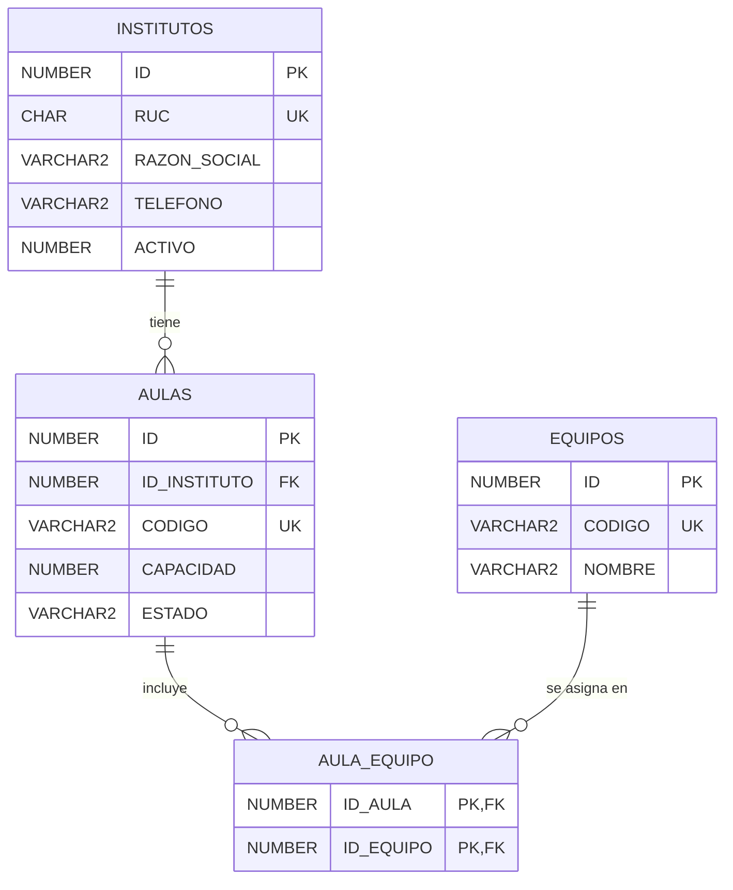

# Examen Final Práctico Individual de LP2 · Variante 3

*Por: Angel Sullon Macalupu @asullom - 2026*

## 1. Propósito

Comprueba que sabes **hacer**: construir un módulo nuevo, con base de datos, backend y SPA (*Single Page Application*, aplicación de una sola página), **dentro de tu proyecto grupal** y con el patrón de cabecera y detalles que practicaste en clase. El módulo `academia` no existe todavía en tu proyecto, así que no hay nada que memorizar. Es la forma práctica de la [evaluación final individual](../sesiones/S16_Evaluacion_Final_Individual.md#2-evaluacion-final-individual-teorico-practica-s1-s14).

## 2. Reglas

- **Duración:** 120 minutos. **Puntaje:** 20 puntos.
- **Construye sobre tu proyecto:** abre tu proyecto grupal (backend y SPA) y agrega el módulo `academia` dentro de él. No se acepta un proyecto nuevo ni una copia vacía.
- **Permitido:** la guía de las sesiones, el código de tu proyecto grupal y el código de BomERP.
- **No permitido:** IA ni chat de ningún tipo, ni ayuda de otras personas.
- **Cada funcionalidad se demuestra desde tu SPA** (Angular, Vue o React, la que usaste en tu proyecto). Si solo funciona desde el backend (Swagger o Postman), vale **la mitad** de sus puntos. El ítem de base de datos no se reduce.
- **Revisión en vivo:** al terminar los 120 minutos, el docente pasa por cada puesto y te pide demostrar cada ítem funcionando, en tu navegador o, si es de base de datos, en PowerShell o tu IDE (sección 7). Deja tu backend y tu SPA en ejecución y no modifiques código durante la revisión.
- **Antes de empezar:** tu backend y tu SPA deben estar funcionando. El tiempo corre desde que el docente da la señal de inicio.

## 3. Preparar tu esquema de base de datos

Ejecuta estos dos bloques en PowerShell, uno tras otro. Si usas un IDE de Oracle, copia solo el SQL de dentro de las comillas y ejecútalo como script, conectado como `system` al servicio `FREEPDB1`.

Cada bloque empieza con `$DB = 'bomerp-oracle'`: **cambia ese valor por el nombre del contenedor Oracle de tu entorno de desarrollo** (`docker ps` te lo muestra). Si tu `system` tiene otra contraseña, ajústala también. Si tu proyecto usa PostgreSQL en lugar de Oracle, usa los scripts del [Anexo B](#anexo-b-scripts-para-postgresql).

El esquema `EXA_ACADEMIA` tiene cuatro tablas (Figura 1). `AULA_EQUIPO` es la tabla intermedia de la relación muchos a muchos: su clave primaria es compuesta y cada una de sus dos columnas es clave foránea.

**Figura 1. Diagrama de la base de datos del módulo**



`PK` es clave primaria, `FK` clave foránea y `UK` valor único. En cada relación, el extremo con doble barra es el lado «uno» y el extremo con pata de gallo es el lado «muchos».

**Script 1. Esquema**

```powershell
$DB = 'bomerp-oracle'   # nombre de TU contenedor Oracle en dev (míralo con: docker ps)
@'
CREATE USER EXA_ACADEMIA IDENTIFIED BY "123456" QUOTA UNLIMITED ON USERS;
GRANT CREATE SESSION, CREATE TABLE, CREATE VIEW, CREATE PROCEDURE, CREATE TRIGGER TO EXA_ACADEMIA;
EXIT
'@ | docker exec -i $DB sqlplus -s system/123456@//localhost:1521/FREEPDB1
```

**Script 2. Tablas, semillas y permisos**

Incluye las cuatro tablas, la tabla intermedia `AULA_EQUIPO`, los datos de ejemplo y los permisos para el usuario de la aplicación. No tienes que modificarlo.

```powershell
$DB = 'bomerp-oracle'   # nombre de TU contenedor Oracle en dev (míralo con: docker ps)
@'
CREATE TABLE EXA_ACADEMIA.INSTITUTOS (
    ID            NUMBER GENERATED BY DEFAULT AS IDENTITY PRIMARY KEY,
    RUC           CHAR(11)      NOT NULL,
    RAZON_SOCIAL  VARCHAR2(150) NOT NULL,
    TELEFONO      VARCHAR2(20),
    ACTIVO        NUMBER(1)     DEFAULT 1 NOT NULL,
    CONSTRAINT UQ_INSTITUTO_RUC UNIQUE (RUC),
    CONSTRAINT CK_INSTITUTO_ACTIVO CHECK (ACTIVO IN (0, 1))
);

CREATE TABLE EXA_ACADEMIA.AULAS (
    ID            NUMBER GENERATED BY DEFAULT AS IDENTITY PRIMARY KEY,
    ID_INSTITUTO  NUMBER        NOT NULL,
    CODIGO        VARCHAR2(10)  NOT NULL,
    CAPACIDAD  NUMBER(4)  NOT NULL,
    ESTADO        VARCHAR2(20)  DEFAULT 'DISPONIBLE' NOT NULL,
    CONSTRAINT FK_AULA_INSTITUTO FOREIGN KEY (ID_INSTITUTO)
        REFERENCES EXA_ACADEMIA.INSTITUTOS(ID),
    CONSTRAINT UQ_AULA_CODIGO UNIQUE (CODIGO),
    CONSTRAINT CK_AULA_CAPACIDAD CHECK (CAPACIDAD > 0),
    CONSTRAINT CK_AULA_ESTADO CHECK (ESTADO IN ('DISPONIBLE', 'OCUPADA', 'MANTENIMIENTO'))
);

CREATE TABLE EXA_ACADEMIA.EQUIPOS (
    ID      NUMBER GENERATED BY DEFAULT AS IDENTITY PRIMARY KEY,
    CODIGO  VARCHAR2(10)  NOT NULL,
    NOMBRE  VARCHAR2(100) NOT NULL,
    CONSTRAINT UQ_EQUIPO_CODIGO UNIQUE (CODIGO)
);

INSERT INTO EXA_ACADEMIA.INSTITUTOS (RUC, RAZON_SOCIAL, TELEFONO, ACTIVO) VALUES ('20159357486', 'Instituto Altiplano SAC', '951593574', 1);
INSERT INTO EXA_ACADEMIA.INSTITUTOS (RUC, RAZON_SOCIAL, TELEFONO, ACTIVO) VALUES ('20258147369', 'Academia del Sur EIRL', '952581473', 1);
INSERT INTO EXA_ACADEMIA.INSTITUTOS (RUC, RAZON_SOCIAL, TELEFONO, ACTIVO) VALUES ('20357951468', 'Instituto Titicaca SRL', '953579514', 0);

INSERT INTO EXA_ACADEMIA.AULAS (ID_INSTITUTO, CODIGO, CAPACIDAD, ESTADO)
    SELECT ID, 'AUL-101', 40, 'DISPONIBLE' FROM EXA_ACADEMIA.INSTITUTOS WHERE RUC = '20159357486';
INSERT INTO EXA_ACADEMIA.AULAS (ID_INSTITUTO, CODIGO, CAPACIDAD, ESTADO)
    SELECT ID, 'AUL-102', 25, 'OCUPADA' FROM EXA_ACADEMIA.INSTITUTOS WHERE RUC = '20159357486';
INSERT INTO EXA_ACADEMIA.AULAS (ID_INSTITUTO, CODIGO, CAPACIDAD, ESTADO)
    SELECT ID, 'AUL-201', 60, 'DISPONIBLE' FROM EXA_ACADEMIA.INSTITUTOS WHERE RUC = '20258147369';
INSERT INTO EXA_ACADEMIA.AULAS (ID_INSTITUTO, CODIGO, CAPACIDAD, ESTADO)
    SELECT ID, 'AUL-202', 100, 'MANTENIMIENTO' FROM EXA_ACADEMIA.INSTITUTOS WHERE RUC = '20258147369';

INSERT INTO EXA_ACADEMIA.EQUIPOS (CODIGO, NOMBRE) VALUES ('EQ-01', 'Proyector');
INSERT INTO EXA_ACADEMIA.EQUIPOS (CODIGO, NOMBRE) VALUES ('EQ-02', 'Pizarra digital');
INSERT INTO EXA_ACADEMIA.EQUIPOS (CODIGO, NOMBRE) VALUES ('EQ-03', 'Aire acondicionado');
INSERT INTO EXA_ACADEMIA.EQUIPOS (CODIGO, NOMBRE) VALUES ('EQ-04', 'Laptops');
INSERT INTO EXA_ACADEMIA.EQUIPOS (CODIGO, NOMBRE) VALUES ('EQ-05', 'Sistema de sonido');
COMMIT;

CREATE TABLE EXA_ACADEMIA.AULA_EQUIPO (
    ID_AULA  NUMBER NOT NULL,
    ID_EQUIPO  NUMBER NOT NULL,
    CONSTRAINT PK_AULA_EQUIPO PRIMARY KEY (ID_AULA, ID_EQUIPO),
    CONSTRAINT FK_AE_AULA FOREIGN KEY (ID_AULA) REFERENCES EXA_ACADEMIA.AULAS(ID),
    CONSTRAINT FK_AE_EQUIPO FOREIGN KEY (ID_EQUIPO) REFERENCES EXA_ACADEMIA.EQUIPOS(ID)
);

INSERT INTO EXA_ACADEMIA.AULA_EQUIPO (ID_AULA, ID_EQUIPO)
    SELECT c.ID, k.ID FROM EXA_ACADEMIA.AULAS c, EXA_ACADEMIA.EQUIPOS k
    WHERE (c.CODIGO, k.CODIGO) IN (('AUL-101', 'EQ-01'), ('AUL-101', 'EQ-02'), ('AUL-102', 'EQ-03'));
COMMIT;

CREATE INDEX EXA_ACADEMIA.IDX_AULA_INSTITUTO ON EXA_ACADEMIA.AULAS(ID_INSTITUTO);

GRANT SELECT, INSERT, UPDATE, DELETE ON EXA_ACADEMIA.INSTITUTOS  TO BOMERP_APP;
GRANT SELECT, INSERT, UPDATE, DELETE ON EXA_ACADEMIA.AULAS       TO BOMERP_APP;
GRANT SELECT, INSERT, UPDATE, DELETE ON EXA_ACADEMIA.EQUIPOS     TO BOMERP_APP;
GRANT SELECT, INSERT, UPDATE, DELETE ON EXA_ACADEMIA.AULA_EQUIPO TO BOMERP_APP;
EXIT
'@ | docker exec -i $DB sqlplus -s system/123456@//localhost:1521/FREEPDB1
```

**Script 3. Verificar** (debe listar 4 tablas: `INSTITUTOS`, `AULAS`, `AULA_EQUIPO` y `EQUIPOS`)

```powershell
$DB = 'bomerp-oracle'   # nombre de TU contenedor Oracle en dev (míralo con: docker ps)
@'
SELECT table_name FROM dba_tables WHERE owner='EXA_ACADEMIA' ORDER BY 1;
EXIT
'@ | docker exec -i $DB sqlplus -s system/123456@//localhost:1521/FREEPDB1
```

Para repetir desde cero, ejecuta `DROP USER EXA_ACADEMIA CASCADE;` como `system` y vuelve a correr los scripts 1 y 2.

## 4. Prototipos de las pantallas

Tu SPA no tiene que ser idéntica a estas figuras, pero sí debe tener estas pantallas y estas acciones.

Las Figuras 2 y 3 corresponden a la pregunta 1. En las Figuras 4, 5 y 6 el aula es la cabecera y los equipos son sus líneas, igual que la cabecera con detalles que practicaste en clase, como una venta con sus productos.

**Figura 2. Institutos: listado**

```text
+- Institutos -----------------------------------------------------------------------------+
|                                                                   [ + Nuevo instituto ]  |
|                                                                                          |
| +-------------+----------------------------+-----------+--------+---------------------+  |
| | RUC         | Razón social               | Teléfono  | Activo | Acciones            |  |
| +-------------+----------------------------+-----------+--------+---------------------+  |
| | 20159357486 | Instituto Altiplano SAC    | 951593574 | Sí     | [Editar] [Eliminar] |  |
| | 20258147369 | Academia del Sur EIRL      | 952581473 | Sí     | [Editar] [Eliminar] |  |
| | 20357951468 | Instituto Titicaca SRL     | 953579514 | No     | [Editar] [Eliminar] |  |
| +-------------+----------------------------+-----------+--------+---------------------+  |
+------------------------------------------------------------------------------------------+
```

**Figura 3. Instituto: formulario para crear y editar, con los errores visibles**

```text
+- Nuevo instituto  (la misma pantalla sirve para editar) ---------------+
| RUC            [ 2015935 ]          × El RUC debe tener 11 dígitos     |
| Razón social   [ ______________ ]   × La razón social es obligatoria   |
| Teléfono       [ ______________ ]                                      |
| Activo         [x]                                                     |
|                                                                        |
|                                           [ Cancelar ]   [ Guardar ]   |
+------------------------------------------------------------------------+
```

**Figura 4. Aulas: listado**

```text
+- Aulas --------------------------------------------------------------------------------+
|                                                                      [ + Nueva aula ]  |
|                                                                                        |
| +---------+----------------------------+---------+---------------+------------------+  |
| | Código  | Instituto                  | Capac.  | Estado        | Acciones         |  |
| +---------+----------------------------+---------+---------------+------------------+  |
| | AUL-101 | Instituto Altiplano SAC    | 40      | DISPONIBLE    | [Ver] [Eliminar] |  |
| | AUL-102 | Instituto Altiplano SAC    | 25      | OCUPADA       | [Ver] [Eliminar] |  |
| | AUL-201 | Academia del Sur EIRL      | 60      | DISPONIBLE    | [Ver] [Eliminar] |  |
| +---------+----------------------------+---------+---------------+------------------+  |
+----------------------------------------------------------------------------------------+
```

**Figura 5. Nueva aula, con la asignación de equipos**

```text
+- Nueva aula -----------------------------------------------------------------+
| Instituto  [ Instituto Altiplano SAC v ]    Código [ ________ ]              |
| Capacidad (alumnos) [ ______ ]      Estado [ DISPONIBLE v ]                  |
|                                                                              |
| Equipos del aula   [ Proyector v ] [ Agregar ]                               |
|                                                                              |
| +--------+----------------------+----------+                                 |
| | EQ-01  | Proyector            | [Quitar] |                                 |
| | EQ-03  | Aire acondicionado   | [Quitar] |                                 |
| +--------+----------------------+----------+                                 |
|                                                                              |
|                                               [ Cancelar ]   [ Guardar ]     |
+------------------------------------------------------------------------------+
```

**Figura 6. Ver aula, con sus equipos (solo lectura)**

```text
+- Aula AUL-101 ---------------------------------------------------------------+
| Instituto: Instituto Altiplano SAC     Capacidad: 40                         |
| Estado:    DISPONIBLE                                                        |
|                                                                              |
| Equipos asignados:                                                           |
| +--------+----------------------+                                            |
| | EQ-01  | Proyector            |                                            |
| | EQ-02  | Pizarra digital      |                                            |
| +--------+----------------------+                                            |
|                                                                              |
|                                                               [ Volver ]     |
+------------------------------------------------------------------------------+
```

## 5. Preguntas

**1. (7 pts)** Crea el módulo `academia` en tu backend y el CRUD (*Create, Read, Update, Delete*) de `INSTITUTOS` (Figuras 2 y 3).

- DB: crea el esquema de tu nuevo módulo ejecutando los scripts de la sección 3 y lista las tablas del esquema mediante PowerShell o tu IDE. **(2 pts)**
- CRUD funcionando desde la SPA: listar, crear, editar y eliminar. **(4 pts)**
- RUC (Registro Único de Contribuyentes) de 11 dígitos y razón social obligatoria, con el error visible en el formulario. **(1 pt)**

**2. (13 pts)** Ahora `AULAS` con sus `EQUIPOS`, igual que la cabecera con detalles que practicaste en clase, como una venta con sus productos (Figuras 4, 5 y 6). El aula es la cabecera y los equipos son sus líneas.

- Equipos: listar (vienen precargados). **(1 pt)**
- Crear un aula: instituto elegido desde una lista desplegable, código, capacidad y estado como enumerado. **(3 pts)**
- Asignar equipos al crear el aula: eliges un equipo de la lista, lo agregas a la tabla de equipos asignados, puedes quitarlo y, al guardar, queda registrado. **(4 pts)**
- Listar las aulas y ver el detalle de un aula, con su tabla de equipos asignados. **(3 pts)**
- Eliminar un aula desde el listado. **(2 pts)**

## 6. Calificación

**Tabla 1. Puntaje por ítem según dónde funciona**

| Ítem | Pregunta | Desde la SPA | Solo desde el backend |
|---|---|---:|---:|
| Esquema creado y tablas listadas | 1 | 2 | 2 |
| CRUD de institutos | 1 | 4 | 2 |
| Validaciones de instituto | 1 | 1 | 0.5 |
| Equipos: listar | 2 | 1 | 0.5 |
| Crear un aula | 2 | 3 | 1.5 |
| Asignar equipos al crear el aula | 2 | 4 | 2 |
| Listar y ver el detalle del aula con sus equipos | 2 | 3 | 1.5 |
| Eliminar un aula | 2 | 2 | 1 |
| **Total** | | **20** | |

Un ítem vale su puntaje completo solo si lo muestras funcionando. Si el código existe pero falla, vale 0.

**Tabla 2. Distribución sugerida del tiempo**

| Bloque | Minutos |
|---|---:|
| Pregunta 1 | 50 |
| Pregunta 2 | 65 |
| Cierre: dejar todo en ejecución para la revisión | 5 |
| **Total** | **120** |

Los ítems se califican por separado: si te atascas en uno, pasa al siguiente.

## 7. Revisión en vivo

Al terminar los 120 minutos, el docente revisa tu puesto en unos 5 minutos. Para cada ítem te pedirá hacer esto, en vivo y sin ayuda:

**Tabla 3. Qué demuestras en la revisión**

| Ítem | Qué te pide el docente |
|---|---|
| Esquema creado y tablas listadas | Ejecutar el script 3 y mostrar las 4 tablas. |
| CRUD de institutos | Crear un instituto, editarlo y eliminarlo desde la SPA. |
| Validaciones de instituto | Guardar un instituto con un RUC de menos de 11 dígitos y con la razón social vacía: los errores deben verse en el formulario. |
| Equipos: listar | Mostrar los 5 equipos precargados. |
| Crear un aula | Crear un aula eligiendo el instituto de la lista desplegable, con código, capacidad y estado. |
| Asignar equipos al crear el aula | En un aula nueva, agregar 2 equipos, quitar 1 y guardar. |
| Listar y ver el detalle del aula con sus equipos | Encontrar esa aula en el listado, abrirla y ver el equipo que quedó asignado. |
| Eliminar un aula | Eliminar esa aula desde el listado. |

Lo que falla durante la revisión se califica como no logrado: no se corrige en ese momento.

## Anexo A. Opcional: usar PostgreSQL en lugar de Oracle

Si tu proyecto en desarrollo usa PostgreSQL, o prefieres usarlo en el examen, haz estos tres cambios. Con Oracle no tienes que tocar nada.

**1. `compose-dev.yml`.** Reemplaza el servicio `oracle` y el volumen `oracle-data` por esto:

```yaml
services:
  postgres:
    image: postgres:17-alpine
    container_name: bomerp-postgres
    restart: unless-stopped
    ports:
      - "35433:5432"
    environment:
      POSTGRES_DB: bomerp
      POSTGRES_USER: bomerp_app
      POSTGRES_PASSWORD: 123456
      TZ: America/Lima
    volumes:
      - postgres-data:/var/lib/postgresql/data
    healthcheck:
      test: ["CMD-SHELL", "pg_isready -U bomerp_app -d bomerp"]
      interval: 10s
      timeout: 5s
      retries: 10
      start_period: 15s

volumes:
  postgres-data:
```

El puerto `35433` es solo un ejemplo: usa cualquiera que esté libre en tu máquina. Levántalo con:

```powershell
docker compose -f compose-dev.yml up -d postgres
```

**2. `pom.xml`.** Reemplaza la dependencia `ojdbc11` por el controlador de PostgreSQL:

```xml
<dependency>
    <groupId>org.postgresql</groupId>
    <artifactId>postgresql</artifactId>
    <scope>runtime</scope>
</dependency>
```

**3. `application-dev.yml`.** Reemplaza el bloque `datasource`:

```yaml
spring:
  datasource:
    url: jdbc:postgresql://localhost:35433/bomerp
    username: bomerp_app
    password: 123456
    driver-class-name: org.postgresql.Driver
```

Tus entidades siguen usando `@Table(schema = "EXA_ACADEMIA")`: PostgreSQL lee ese nombre sin distinguir mayúsculas.

## Anexo B. Scripts para PostgreSQL

Son los mismos scripts de la sección 3, con la sintaxis de PostgreSQL y los mismos datos. En PostgreSQL el esquema es el equivalente al usuario de Oracle, y `bomerp_app` es el mismo usuario con el que corre tu backend, por lo que no hacen falta permisos adicionales. Cambia `$DB` por el nombre del contenedor PostgreSQL de tu entorno de desarrollo (`docker ps`), y ajusta el usuario (`-U`) y la base (`-d`) si tu entorno usa otros.

**Script 1 (PostgreSQL). Esquema**

```powershell
$DB = 'bomerp-postgres'   # nombre de TU contenedor PostgreSQL en dev (míralo con: docker ps)
@'
CREATE SCHEMA EXA_ACADEMIA;
'@ | docker exec -i $DB psql -U bomerp_app -d bomerp -v ON_ERROR_STOP=1
```

**Script 2 (PostgreSQL). Tablas y semillas**

```powershell
$DB = 'bomerp-postgres'   # nombre de TU contenedor PostgreSQL en dev (míralo con: docker ps)
@'
CREATE TABLE EXA_ACADEMIA.INSTITUTOS (
    ID            BIGINT GENERATED BY DEFAULT AS IDENTITY PRIMARY KEY,
    RUC           CHAR(11)      NOT NULL,
    RAZON_SOCIAL  VARCHAR(150) NOT NULL,
    TELEFONO      VARCHAR(20),
    ACTIVO        SMALLINT     DEFAULT 1 NOT NULL,
    CONSTRAINT UQ_INSTITUTO_RUC UNIQUE (RUC),
    CONSTRAINT CK_INSTITUTO_ACTIVO CHECK (ACTIVO IN (0, 1))
);

CREATE TABLE EXA_ACADEMIA.AULAS (
    ID            BIGINT GENERATED BY DEFAULT AS IDENTITY PRIMARY KEY,
    ID_INSTITUTO  BIGINT        NOT NULL,
    CODIGO        VARCHAR(10)  NOT NULL,
    CAPACIDAD  INTEGER  NOT NULL,
    ESTADO        VARCHAR(20)  DEFAULT 'DISPONIBLE' NOT NULL,
    CONSTRAINT FK_AULA_INSTITUTO FOREIGN KEY (ID_INSTITUTO)
        REFERENCES EXA_ACADEMIA.INSTITUTOS(ID),
    CONSTRAINT UQ_AULA_CODIGO UNIQUE (CODIGO),
    CONSTRAINT CK_AULA_CAPACIDAD CHECK (CAPACIDAD > 0),
    CONSTRAINT CK_AULA_ESTADO CHECK (ESTADO IN ('DISPONIBLE', 'OCUPADA', 'MANTENIMIENTO'))
);

CREATE TABLE EXA_ACADEMIA.EQUIPOS (
    ID      BIGINT GENERATED BY DEFAULT AS IDENTITY PRIMARY KEY,
    CODIGO  VARCHAR(10)  NOT NULL,
    NOMBRE  VARCHAR(100) NOT NULL,
    CONSTRAINT UQ_EQUIPO_CODIGO UNIQUE (CODIGO)
);

INSERT INTO EXA_ACADEMIA.INSTITUTOS (RUC, RAZON_SOCIAL, TELEFONO, ACTIVO) VALUES ('20159357486', 'Instituto Altiplano SAC', '951593574', 1);
INSERT INTO EXA_ACADEMIA.INSTITUTOS (RUC, RAZON_SOCIAL, TELEFONO, ACTIVO) VALUES ('20258147369', 'Academia del Sur EIRL', '952581473', 1);
INSERT INTO EXA_ACADEMIA.INSTITUTOS (RUC, RAZON_SOCIAL, TELEFONO, ACTIVO) VALUES ('20357951468', 'Instituto Titicaca SRL', '953579514', 0);

INSERT INTO EXA_ACADEMIA.AULAS (ID_INSTITUTO, CODIGO, CAPACIDAD, ESTADO)
    SELECT ID, 'AUL-101', 40, 'DISPONIBLE' FROM EXA_ACADEMIA.INSTITUTOS WHERE RUC = '20159357486';
INSERT INTO EXA_ACADEMIA.AULAS (ID_INSTITUTO, CODIGO, CAPACIDAD, ESTADO)
    SELECT ID, 'AUL-102', 25, 'OCUPADA' FROM EXA_ACADEMIA.INSTITUTOS WHERE RUC = '20159357486';
INSERT INTO EXA_ACADEMIA.AULAS (ID_INSTITUTO, CODIGO, CAPACIDAD, ESTADO)
    SELECT ID, 'AUL-201', 60, 'DISPONIBLE' FROM EXA_ACADEMIA.INSTITUTOS WHERE RUC = '20258147369';
INSERT INTO EXA_ACADEMIA.AULAS (ID_INSTITUTO, CODIGO, CAPACIDAD, ESTADO)
    SELECT ID, 'AUL-202', 100, 'MANTENIMIENTO' FROM EXA_ACADEMIA.INSTITUTOS WHERE RUC = '20258147369';

INSERT INTO EXA_ACADEMIA.EQUIPOS (CODIGO, NOMBRE) VALUES ('EQ-01', 'Proyector');
INSERT INTO EXA_ACADEMIA.EQUIPOS (CODIGO, NOMBRE) VALUES ('EQ-02', 'Pizarra digital');
INSERT INTO EXA_ACADEMIA.EQUIPOS (CODIGO, NOMBRE) VALUES ('EQ-03', 'Aire acondicionado');
INSERT INTO EXA_ACADEMIA.EQUIPOS (CODIGO, NOMBRE) VALUES ('EQ-04', 'Laptops');
INSERT INTO EXA_ACADEMIA.EQUIPOS (CODIGO, NOMBRE) VALUES ('EQ-05', 'Sistema de sonido');

CREATE TABLE EXA_ACADEMIA.AULA_EQUIPO (
    ID_AULA  BIGINT NOT NULL,
    ID_EQUIPO  BIGINT NOT NULL,
    CONSTRAINT PK_AULA_EQUIPO PRIMARY KEY (ID_AULA, ID_EQUIPO),
    CONSTRAINT FK_AE_AULA FOREIGN KEY (ID_AULA) REFERENCES EXA_ACADEMIA.AULAS(ID),
    CONSTRAINT FK_AE_EQUIPO FOREIGN KEY (ID_EQUIPO) REFERENCES EXA_ACADEMIA.EQUIPOS(ID)
);

INSERT INTO EXA_ACADEMIA.AULA_EQUIPO (ID_AULA, ID_EQUIPO)
    SELECT c.ID, k.ID FROM EXA_ACADEMIA.AULAS c, EXA_ACADEMIA.EQUIPOS k
    WHERE (c.CODIGO, k.CODIGO) IN (('AUL-101', 'EQ-01'), ('AUL-101', 'EQ-02'), ('AUL-102', 'EQ-03'));

CREATE INDEX IDX_AULA_INSTITUTO ON EXA_ACADEMIA.AULAS(ID_INSTITUTO);
'@ | docker exec -i $DB psql -U bomerp_app -d bomerp -v ON_ERROR_STOP=1
```

**Script 3 (PostgreSQL). Verificar** (debe listar 4 tablas)

```powershell
$DB = 'bomerp-postgres'   # nombre de TU contenedor PostgreSQL en dev (míralo con: docker ps)
@'
SELECT table_name FROM information_schema.tables WHERE table_schema = 'exa_academia' ORDER BY 1;
'@ | docker exec -i $DB psql -U bomerp_app -d bomerp
```

Para repetir desde cero, ejecuta `DROP SCHEMA EXA_ACADEMIA CASCADE;` y vuelve a correr los scripts 1 y 2.
