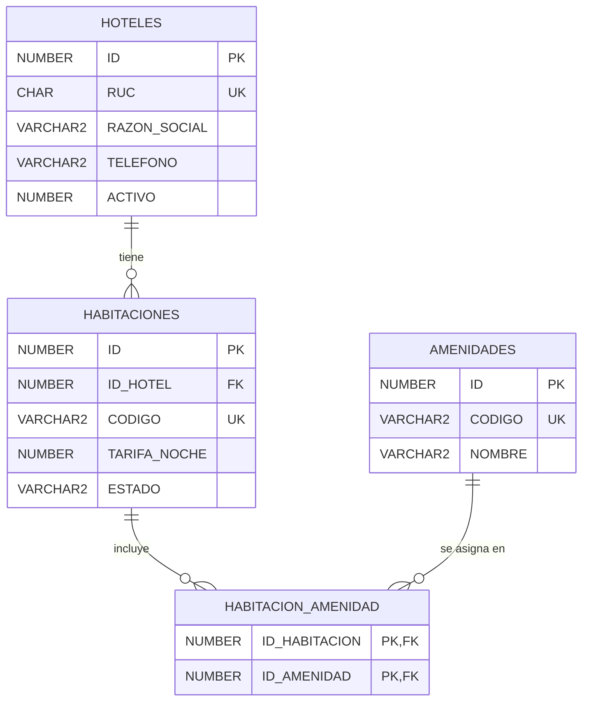

# Examen Final Práctico Individual de LP2 · Variante 4

*Por: Angel Sullon Macalupu @asullom - 2026*

## 1. Propósito

Comprueba que sabes **hacer**: construir un módulo nuevo, con base de datos, backend y SPA (*Single Page Application*, aplicación de una sola página), **dentro de tu proyecto grupal** y con el patrón de cabecera y detalles que practicaste en clase. El módulo `hotel` no existe todavía en tu proyecto, así que no hay nada que memorizar. Es la forma práctica de la [evaluación final individual](../sesiones/S16_Evaluacion_Final_Individual.md#2-evaluacion-final-individual-teorico-practica-s1-s14).

## 2. Reglas

- **Duración:** 120 minutos. **Puntaje:** 20 puntos.
- **Construye sobre tu proyecto:** abre tu proyecto grupal (backend y SPA) y agrega el módulo `hotel` dentro de él. No se acepta un proyecto nuevo ni una copia vacía.
- **Permitido:** la guía de las sesiones, el código de tu proyecto grupal y el código de BomERP.
- **No permitido:** IA ni chat de ningún tipo, ni ayuda de otras personas.
- **Cada funcionalidad se demuestra desde tu SPA** (Angular, Vue o React, la que usaste en tu proyecto). Si solo funciona desde el backend (Swagger o Postman), vale **la mitad** de sus puntos. El ítem de base de datos no se reduce.
- **Revisión en vivo:** al terminar los 120 minutos, el docente pasa por cada puesto y te pide demostrar cada ítem funcionando, en tu navegador o, si es de base de datos, en PowerShell o tu IDE (sección 7). Deja tu backend y tu SPA en ejecución y no modifiques código durante la revisión.
- **Antes de empezar:** tu backend y tu SPA deben estar funcionando. El tiempo corre desde que el docente da la señal de inicio.

## 3. Preparar tu esquema de base de datos

Ejecuta estos dos bloques en PowerShell, uno tras otro. Si usas un IDE de Oracle, copia solo el SQL de dentro de las comillas y ejecútalo como script, conectado como `system` al servicio `FREEPDB1`.

Cada bloque empieza con `$DB = 'bomerp-oracle'`: **cambia ese valor por el nombre del contenedor Oracle de tu entorno de desarrollo** (`docker ps` te lo muestra). Si tu `system` tiene otra contraseña, ajústala también. Si tu proyecto usa PostgreSQL en lugar de Oracle, usa los scripts del [Anexo B](#anexo-b-scripts-para-postgresql).

El esquema `EXA_HOTEL` tiene cuatro tablas (Figura 1). `HABITACION_AMENIDAD` es la tabla intermedia de la relación muchos a muchos: su clave primaria es compuesta y cada una de sus dos columnas es clave foránea.

**Figura 1. Diagrama de la base de datos del módulo**



`PK` es clave primaria, `FK` clave foránea y `UK` valor único. En cada relación, el extremo con doble barra es el lado «uno» y el extremo con pata de gallo es el lado «muchos».

**Script 1. Esquema**

```powershell
$DB = 'bomerp-oracle'   # nombre de TU contenedor Oracle en dev (míralo con: docker ps)
@'
CREATE USER EXA_HOTEL IDENTIFIED BY "123456" QUOTA UNLIMITED ON USERS;
GRANT CREATE SESSION, CREATE TABLE, CREATE VIEW, CREATE PROCEDURE, CREATE TRIGGER TO EXA_HOTEL;
EXIT
'@ | docker exec -i $DB sqlplus -s system/123456@//localhost:1521/FREEPDB1
```

**Script 2. Tablas, semillas y permisos**

Incluye las cuatro tablas, la tabla intermedia `HABITACION_AMENIDAD`, los datos de ejemplo y los permisos para el usuario de la aplicación. No tienes que modificarlo.

```powershell
$DB = 'bomerp-oracle'   # nombre de TU contenedor Oracle en dev (míralo con: docker ps)
@'
CREATE TABLE EXA_HOTEL.HOTELES (
    ID            NUMBER GENERATED BY DEFAULT AS IDENTITY PRIMARY KEY,
    RUC           CHAR(11)      NOT NULL,
    RAZON_SOCIAL  VARCHAR2(150) NOT NULL,
    TELEFONO      VARCHAR2(20),
    ACTIVO        NUMBER(1)     DEFAULT 1 NOT NULL,
    CONSTRAINT UQ_HOTEL_RUC UNIQUE (RUC),
    CONSTRAINT CK_HOTEL_ACTIVO CHECK (ACTIVO IN (0, 1))
);

CREATE TABLE EXA_HOTEL.HABITACIONES (
    ID            NUMBER GENERATED BY DEFAULT AS IDENTITY PRIMARY KEY,
    ID_HOTEL  NUMBER        NOT NULL,
    CODIGO        VARCHAR2(10)  NOT NULL,
    TARIFA_NOCHE  NUMBER(8,2)  NOT NULL,
    ESTADO        VARCHAR2(20)  DEFAULT 'DISPONIBLE' NOT NULL,
    CONSTRAINT FK_HABITACION_HOTEL FOREIGN KEY (ID_HOTEL)
        REFERENCES EXA_HOTEL.HOTELES(ID),
    CONSTRAINT UQ_HABITACION_CODIGO UNIQUE (CODIGO),
    CONSTRAINT CK_HABITACION_TARIFA CHECK (TARIFA_NOCHE > 0),
    CONSTRAINT CK_HABITACION_ESTADO CHECK (ESTADO IN ('DISPONIBLE', 'OCUPADA', 'MANTENIMIENTO'))
);

CREATE TABLE EXA_HOTEL.AMENIDADES (
    ID      NUMBER GENERATED BY DEFAULT AS IDENTITY PRIMARY KEY,
    CODIGO  VARCHAR2(10)  NOT NULL,
    NOMBRE  VARCHAR2(100) NOT NULL,
    CONSTRAINT UQ_AMENIDAD_CODIGO UNIQUE (CODIGO)
);

INSERT INTO EXA_HOTEL.HOTELES (RUC, RAZON_SOCIAL, TELEFONO, ACTIVO) VALUES ('20114477880', 'Hotel Altiplano SAC', '951144778', 1);
INSERT INTO EXA_HOTEL.HOTELES (RUC, RAZON_SOCIAL, TELEFONO, ACTIVO) VALUES ('20225588991', 'Hospedajes del Sur EIRL', '952255889', 1);
INSERT INTO EXA_HOTEL.HOTELES (RUC, RAZON_SOCIAL, TELEFONO, ACTIVO) VALUES ('20336699002', 'Hotel Titicaca SRL', '953366990', 0);

INSERT INTO EXA_HOTEL.HABITACIONES (ID_HOTEL, CODIGO, TARIFA_NOCHE, ESTADO)
    SELECT ID, 'HAB-101', 150.00, 'DISPONIBLE' FROM EXA_HOTEL.HOTELES WHERE RUC = '20114477880';
INSERT INTO EXA_HOTEL.HABITACIONES (ID_HOTEL, CODIGO, TARIFA_NOCHE, ESTADO)
    SELECT ID, 'HAB-102', 220.00, 'OCUPADA' FROM EXA_HOTEL.HOTELES WHERE RUC = '20114477880';
INSERT INTO EXA_HOTEL.HABITACIONES (ID_HOTEL, CODIGO, TARIFA_NOCHE, ESTADO)
    SELECT ID, 'HAB-201', 120.00, 'DISPONIBLE' FROM EXA_HOTEL.HOTELES WHERE RUC = '20225588991';
INSERT INTO EXA_HOTEL.HABITACIONES (ID_HOTEL, CODIGO, TARIFA_NOCHE, ESTADO)
    SELECT ID, 'HAB-202', 300.00, 'MANTENIMIENTO' FROM EXA_HOTEL.HOTELES WHERE RUC = '20225588991';

INSERT INTO EXA_HOTEL.AMENIDADES (CODIGO, NOMBRE) VALUES ('A-01', 'Wifi');
INSERT INTO EXA_HOTEL.AMENIDADES (CODIGO, NOMBRE) VALUES ('A-02', 'Desayuno incluido');
INSERT INTO EXA_HOTEL.AMENIDADES (CODIGO, NOMBRE) VALUES ('A-03', 'Aire acondicionado');
INSERT INTO EXA_HOTEL.AMENIDADES (CODIGO, NOMBRE) VALUES ('A-04', 'Frigobar');
INSERT INTO EXA_HOTEL.AMENIDADES (CODIGO, NOMBRE) VALUES ('A-05', 'Vista al lago');
COMMIT;

CREATE TABLE EXA_HOTEL.HABITACION_AMENIDAD (
    ID_HABITACION  NUMBER NOT NULL,
    ID_AMENIDAD  NUMBER NOT NULL,
    CONSTRAINT PK_HABITACION_AMENIDAD PRIMARY KEY (ID_HABITACION, ID_AMENIDAD),
    CONSTRAINT FK_HA_HABITACION FOREIGN KEY (ID_HABITACION) REFERENCES EXA_HOTEL.HABITACIONES(ID),
    CONSTRAINT FK_HA_AMENIDAD FOREIGN KEY (ID_AMENIDAD) REFERENCES EXA_HOTEL.AMENIDADES(ID)
);

INSERT INTO EXA_HOTEL.HABITACION_AMENIDAD (ID_HABITACION, ID_AMENIDAD)
    SELECT c.ID, k.ID FROM EXA_HOTEL.HABITACIONES c, EXA_HOTEL.AMENIDADES k
    WHERE (c.CODIGO, k.CODIGO) IN (('HAB-101', 'A-01'), ('HAB-101', 'A-02'), ('HAB-102', 'A-03'));
COMMIT;

CREATE INDEX EXA_HOTEL.IDX_HABITACION_HOTEL ON EXA_HOTEL.HABITACIONES(ID_HOTEL);

GRANT SELECT, INSERT, UPDATE, DELETE ON EXA_HOTEL.HOTELES             TO BOMERP_APP;
GRANT SELECT, INSERT, UPDATE, DELETE ON EXA_HOTEL.HABITACIONES        TO BOMERP_APP;
GRANT SELECT, INSERT, UPDATE, DELETE ON EXA_HOTEL.AMENIDADES          TO BOMERP_APP;
GRANT SELECT, INSERT, UPDATE, DELETE ON EXA_HOTEL.HABITACION_AMENIDAD TO BOMERP_APP;
EXIT
'@ | docker exec -i $DB sqlplus -s system/123456@//localhost:1521/FREEPDB1
```

**Script 3. Verificar** (debe listar 4 tablas: `HOTELES`, `HABITACIONES`, `HABITACION_AMENIDAD` y `AMENIDADES`)

```powershell
$DB = 'bomerp-oracle'   # nombre de TU contenedor Oracle en dev (míralo con: docker ps)
@'
SELECT table_name FROM dba_tables WHERE owner='EXA_HOTEL' ORDER BY 1;
EXIT
'@ | docker exec -i $DB sqlplus -s system/123456@//localhost:1521/FREEPDB1
```

Para repetir desde cero, ejecuta `DROP USER EXA_HOTEL CASCADE;` como `system` y vuelve a correr los scripts 1 y 2.

## 4. Prototipos de las pantallas

Tu SPA no tiene que ser idéntica a estas figuras, pero sí debe tener estas pantallas y estas acciones.

Las Figuras 2 y 3 corresponden a la pregunta 1. En las Figuras 4, 5 y 6 la habitación es la cabecera y las amenidades son sus líneas, igual que la cabecera con detalles que practicaste en clase, como una venta con sus productos.

**Figura 2. Hoteles: listado**

```text
+- Hoteles --------------------------------------------------------------------------------+
|                                                                       [ + Nuevo hotel ]  |
|                                                                                          |
| +-------------+----------------------------+-----------+--------+---------------------+  |
| | RUC         | Razón social               | Teléfono  | Activo | Acciones            |  |
| +-------------+----------------------------+-----------+--------+---------------------+  |
| | 20114477880 | Hotel Altiplano SAC        | 951144778 | Sí     | [Editar] [Eliminar] |  |
| | 20225588991 | Hospedajes del Sur EIRL    | 952255889 | Sí     | [Editar] [Eliminar] |  |
| | 20336699002 | Hotel Titicaca SRL         | 953366990 | No     | [Editar] [Eliminar] |  |
| +-------------+----------------------------+-----------+--------+---------------------+  |
+------------------------------------------------------------------------------------------+
```

**Figura 3. Hotel: formulario para crear y editar, con los errores visibles**

```text
+- Nuevo hotel  (la misma pantalla sirve para editar) -------------------+
| RUC            [ 2011447 ]          × El RUC debe tener 11 dígitos     |
| Razón social   [ ______________ ]   × La razón social es obligatoria   |
| Teléfono       [ ______________ ]                                      |
| Activo         [x]                                                     |
|                                                                        |
|                                           [ Cancelar ]   [ Guardar ]   |
+------------------------------------------------------------------------+
```

**Figura 4. Habitaciones: listado**

```text
+- Habitaciones -------------------------------------------------------------------------+
|                                                                [ + Nueva habitación ]  |
|                                                                                        |
| +---------+----------------------------+---------+---------------+------------------+  |
| | Código  | Hotel                      | Tarifa  | Estado        | Acciones         |  |
| +---------+----------------------------+---------+---------------+------------------+  |
| | HAB-101 | Hotel Altiplano SAC        | 150.00  | DISPONIBLE    | [Ver] [Eliminar] |  |
| | HAB-102 | Hotel Altiplano SAC        | 220.00  | OCUPADA       | [Ver] [Eliminar] |  |
| | HAB-201 | Hospedajes del Sur EIRL    | 120.00  | DISPONIBLE    | [Ver] [Eliminar] |  |
| +---------+----------------------------+---------+---------------+------------------+  |
+----------------------------------------------------------------------------------------+
```

**Figura 5. Nueva habitación, con la asignación de amenidades**

```text
+- Nueva habitación -----------------------------------------------------------+
| Hotel  [ Hotel Altiplano SAC v ]    Código [ ________ ]                      |
| Tarifa por noche (S/) [ ______ ]      Estado [ DISPONIBLE v ]                |
|                                                                              |
| Amenidades de la habitación   [ Wifi v ] [ Agregar ]                         |
|                                                                              |
| +--------+----------------------+----------+                                 |
| | A-01   | Wifi                 | [Quitar] |                                 |
| | A-03   | Aire acondicionado   | [Quitar] |                                 |
| +--------+----------------------+----------+                                 |
|                                                                              |
|                                               [ Cancelar ]   [ Guardar ]     |
+------------------------------------------------------------------------------+
```

**Figura 6. Ver habitación, con sus amenidades (solo lectura)**

```text
+- Habitación HAB-101 ---------------------------------------------------------+
| Hotel: Hotel Altiplano SAC     Tarifa por noche: 150.00                      |
| Estado:    DISPONIBLE                                                        |
|                                                                              |
| Amenidades asignadas:                                                        |
| +--------+----------------------+                                            |
| | A-01   | Wifi                 |                                            |
| | A-02   | Desayuno incluido    |                                            |
| +--------+----------------------+                                            |
|                                                                              |
|                                                               [ Volver ]     |
+------------------------------------------------------------------------------+
```

## 5. Preguntas

**1. (7 pts)** Crea el módulo `hotel` en tu backend y el CRUD (*Create, Read, Update, Delete*) de `HOTELES` (Figuras 2 y 3).

- DB: crea el esquema de tu nuevo módulo ejecutando los scripts de la sección 3 y lista las tablas del esquema mediante PowerShell o tu IDE. **(2 pts)**
- CRUD funcionando desde la SPA: listar, crear, editar y eliminar. **(4 pts)**
- RUC (Registro Único de Contribuyentes) de 11 dígitos y razón social obligatoria, con el error visible en el formulario. **(1 pt)**

**2. (13 pts)** Ahora `HABITACIONES` con sus `AMENIDADES`, igual que la cabecera con detalles que practicaste en clase, como una venta con sus productos (Figuras 4, 5 y 6). La habitación es la cabecera y las amenidades son sus líneas.

- Amenidades: listar (vienen precargadas). **(1 pt)**
- Crear una habitación: hotel elegido desde una lista desplegable, código, tarifa por noche y estado como enumerado. **(3 pts)**
- Asignar amenidades al crear la habitación: eliges una amenidad de la lista, la agregas a la tabla de amenidades asignadas, puedes quitarla y, al guardar, queda registrada. **(4 pts)**
- Listar las habitaciones y ver el detalle de una habitación, con su tabla de amenidades asignadas. **(3 pts)**
- Eliminar una habitación desde el listado. **(2 pts)**

## 6. Calificación

**Tabla 1. Puntaje por ítem según dónde funciona**

| Ítem | Pregunta | Desde la SPA | Solo desde el backend |
|---|---|---:|---:|
| Esquema creado y tablas listadas | 1 | 2 | 2 |
| CRUD de hoteles | 1 | 4 | 2 |
| Validaciones de hotel | 1 | 1 | 0.5 |
| Amenidades: listar | 2 | 1 | 0.5 |
| Crear una habitación | 2 | 3 | 1.5 |
| Asignar amenidades al crear la habitación | 2 | 4 | 2 |
| Listar y ver el detalle de la habitación con sus amenidades | 2 | 3 | 1.5 |
| Eliminar una habitación | 2 | 2 | 1 |
| **Total** | | **20** | |

Un ítem vale su puntaje completo solo si lo muestras funcionando. Si el código existe pero falla, vale 0.

**Tabla 2. Distribución sugerida del tiempo**

| Bloque | Minutos |
|---|---:|
| Pregunta 1 | 50 |
| Pregunta 2 | 65 |
| Cierre: dejar todo en ejecución para la revisión | 5 |
| **Total** | **120** |

Los ítems se califican por separado: si te atascas en uno, pasa al siguiente.

## 7. Revisión en vivo

Al terminar los 120 minutos, el docente revisa tu puesto en unos 5 minutos. Para cada ítem te pedirá hacer esto, en vivo y sin ayuda:

**Tabla 3. Qué demuestras en la revisión**

| Ítem | Qué te pide el docente |
|---|---|
| Esquema creado y tablas listadas | Ejecutar el script 3 y mostrar las 4 tablas. |
| CRUD de hoteles | Crear un hotel, editarlo y eliminarlo desde la SPA. |
| Validaciones de hotel | Guardar un hotel con un RUC de menos de 11 dígitos y con la razón social vacía: los errores deben verse en el formulario. |
| Amenidades: listar | Mostrar las 5 amenidades precargadas. |
| Crear una habitación | Crear una habitación eligiendo el hotel de la lista desplegable, con código, tarifa por noche y estado. |
| Asignar amenidades al crear la habitación | En una habitación nueva, agregar 2 amenidades, quitar 1 y guardar. |
| Listar y ver el detalle de la habitación con sus amenidades | Encontrar esa habitación en el listado, abrirla y ver la amenidad que quedó asignada. |
| Eliminar una habitación | Eliminar esa habitación desde el listado. |

Lo que falla durante la revisión se califica como no logrado: no se corrige en ese momento.

## Anexo A. Opcional: usar PostgreSQL en lugar de Oracle

Si tu proyecto en desarrollo usa PostgreSQL, o prefieres usarlo en el examen, haz estos tres cambios. Con Oracle no tienes que tocar nada.

**1. `compose-dev.yml`.** Reemplaza el servicio `oracle` y el volumen `oracle-data` por esto:

```yaml
services:
  postgres:
    image: postgres:17-alpine
    container_name: bomerp-postgres
    restart: unless-stopped
    ports:
      - "35433:5432"
    environment:
      POSTGRES_DB: bomerp
      POSTGRES_USER: bomerp_app
      POSTGRES_PASSWORD: 123456
      TZ: America/Lima
    volumes:
      - postgres-data:/var/lib/postgresql/data
    healthcheck:
      test: ["CMD-SHELL", "pg_isready -U bomerp_app -d bomerp"]
      interval: 10s
      timeout: 5s
      retries: 10
      start_period: 15s

volumes:
  postgres-data:
```

El puerto `35433` es solo un ejemplo: usa cualquiera que esté libre en tu máquina. Levántalo con:

```powershell
docker compose -f compose-dev.yml up -d postgres
```

**2. `pom.xml`.** Reemplaza la dependencia `ojdbc11` por el controlador de PostgreSQL:

```xml
<dependency>
    <groupId>org.postgresql</groupId>
    <artifactId>postgresql</artifactId>
    <scope>runtime</scope>
</dependency>
```

**3. `application-dev.yml`.** Reemplaza el bloque `datasource`:

```yaml
spring:
  datasource:
    url: jdbc:postgresql://localhost:35433/bomerp
    username: bomerp_app
    password: 123456
    driver-class-name: org.postgresql.Driver
```

Tus entidades siguen usando `@Table(schema = "EXA_HOTEL")`: PostgreSQL lee ese nombre sin distinguir mayúsculas.

## Anexo B. Scripts para PostgreSQL

Son los mismos scripts de la sección 3, con la sintaxis de PostgreSQL y los mismos datos. En PostgreSQL el esquema es el equivalente al usuario de Oracle, y `bomerp_app` es el mismo usuario con el que corre tu backend, por lo que no hacen falta permisos adicionales. Cambia `$DB` por el nombre del contenedor PostgreSQL de tu entorno de desarrollo (`docker ps`), y ajusta el usuario (`-U`) y la base (`-d`) si tu entorno usa otros.

**Script 1 (PostgreSQL). Esquema**

```powershell
$DB = 'bomerp-postgres'   # nombre de TU contenedor PostgreSQL en dev (míralo con: docker ps)
@'
CREATE SCHEMA EXA_HOTEL;
'@ | docker exec -i $DB psql -U bomerp_app -d bomerp -v ON_ERROR_STOP=1
```

**Script 2 (PostgreSQL). Tablas y semillas**

```powershell
$DB = 'bomerp-postgres'   # nombre de TU contenedor PostgreSQL en dev (míralo con: docker ps)
@'
CREATE TABLE EXA_HOTEL.HOTELES (
    ID            BIGINT GENERATED BY DEFAULT AS IDENTITY PRIMARY KEY,
    RUC           CHAR(11)      NOT NULL,
    RAZON_SOCIAL  VARCHAR(150) NOT NULL,
    TELEFONO      VARCHAR(20),
    ACTIVO        SMALLINT     DEFAULT 1 NOT NULL,
    CONSTRAINT UQ_HOTEL_RUC UNIQUE (RUC),
    CONSTRAINT CK_HOTEL_ACTIVO CHECK (ACTIVO IN (0, 1))
);

CREATE TABLE EXA_HOTEL.HABITACIONES (
    ID            BIGINT GENERATED BY DEFAULT AS IDENTITY PRIMARY KEY,
    ID_HOTEL  BIGINT        NOT NULL,
    CODIGO        VARCHAR(10)  NOT NULL,
    TARIFA_NOCHE  NUMERIC(8,2)  NOT NULL,
    ESTADO        VARCHAR(20)  DEFAULT 'DISPONIBLE' NOT NULL,
    CONSTRAINT FK_HABITACION_HOTEL FOREIGN KEY (ID_HOTEL)
        REFERENCES EXA_HOTEL.HOTELES(ID),
    CONSTRAINT UQ_HABITACION_CODIGO UNIQUE (CODIGO),
    CONSTRAINT CK_HABITACION_TARIFA CHECK (TARIFA_NOCHE > 0),
    CONSTRAINT CK_HABITACION_ESTADO CHECK (ESTADO IN ('DISPONIBLE', 'OCUPADA', 'MANTENIMIENTO'))
);

CREATE TABLE EXA_HOTEL.AMENIDADES (
    ID      BIGINT GENERATED BY DEFAULT AS IDENTITY PRIMARY KEY,
    CODIGO  VARCHAR(10)  NOT NULL,
    NOMBRE  VARCHAR(100) NOT NULL,
    CONSTRAINT UQ_AMENIDAD_CODIGO UNIQUE (CODIGO)
);

INSERT INTO EXA_HOTEL.HOTELES (RUC, RAZON_SOCIAL, TELEFONO, ACTIVO) VALUES ('20114477880', 'Hotel Altiplano SAC', '951144778', 1);
INSERT INTO EXA_HOTEL.HOTELES (RUC, RAZON_SOCIAL, TELEFONO, ACTIVO) VALUES ('20225588991', 'Hospedajes del Sur EIRL', '952255889', 1);
INSERT INTO EXA_HOTEL.HOTELES (RUC, RAZON_SOCIAL, TELEFONO, ACTIVO) VALUES ('20336699002', 'Hotel Titicaca SRL', '953366990', 0);

INSERT INTO EXA_HOTEL.HABITACIONES (ID_HOTEL, CODIGO, TARIFA_NOCHE, ESTADO)
    SELECT ID, 'HAB-101', 150.00, 'DISPONIBLE' FROM EXA_HOTEL.HOTELES WHERE RUC = '20114477880';
INSERT INTO EXA_HOTEL.HABITACIONES (ID_HOTEL, CODIGO, TARIFA_NOCHE, ESTADO)
    SELECT ID, 'HAB-102', 220.00, 'OCUPADA' FROM EXA_HOTEL.HOTELES WHERE RUC = '20114477880';
INSERT INTO EXA_HOTEL.HABITACIONES (ID_HOTEL, CODIGO, TARIFA_NOCHE, ESTADO)
    SELECT ID, 'HAB-201', 120.00, 'DISPONIBLE' FROM EXA_HOTEL.HOTELES WHERE RUC = '20225588991';
INSERT INTO EXA_HOTEL.HABITACIONES (ID_HOTEL, CODIGO, TARIFA_NOCHE, ESTADO)
    SELECT ID, 'HAB-202', 300.00, 'MANTENIMIENTO' FROM EXA_HOTEL.HOTELES WHERE RUC = '20225588991';

INSERT INTO EXA_HOTEL.AMENIDADES (CODIGO, NOMBRE) VALUES ('A-01', 'Wifi');
INSERT INTO EXA_HOTEL.AMENIDADES (CODIGO, NOMBRE) VALUES ('A-02', 'Desayuno incluido');
INSERT INTO EXA_HOTEL.AMENIDADES (CODIGO, NOMBRE) VALUES ('A-03', 'Aire acondicionado');
INSERT INTO EXA_HOTEL.AMENIDADES (CODIGO, NOMBRE) VALUES ('A-04', 'Frigobar');
INSERT INTO EXA_HOTEL.AMENIDADES (CODIGO, NOMBRE) VALUES ('A-05', 'Vista al lago');

CREATE TABLE EXA_HOTEL.HABITACION_AMENIDAD (
    ID_HABITACION  BIGINT NOT NULL,
    ID_AMENIDAD  BIGINT NOT NULL,
    CONSTRAINT PK_HABITACION_AMENIDAD PRIMARY KEY (ID_HABITACION, ID_AMENIDAD),
    CONSTRAINT FK_HA_HABITACION FOREIGN KEY (ID_HABITACION) REFERENCES EXA_HOTEL.HABITACIONES(ID),
    CONSTRAINT FK_HA_AMENIDAD FOREIGN KEY (ID_AMENIDAD) REFERENCES EXA_HOTEL.AMENIDADES(ID)
);

INSERT INTO EXA_HOTEL.HABITACION_AMENIDAD (ID_HABITACION, ID_AMENIDAD)
    SELECT c.ID, k.ID FROM EXA_HOTEL.HABITACIONES c, EXA_HOTEL.AMENIDADES k
    WHERE (c.CODIGO, k.CODIGO) IN (('HAB-101', 'A-01'), ('HAB-101', 'A-02'), ('HAB-102', 'A-03'));

CREATE INDEX IDX_HABITACION_HOTEL ON EXA_HOTEL.HABITACIONES(ID_HOTEL);
'@ | docker exec -i $DB psql -U bomerp_app -d bomerp -v ON_ERROR_STOP=1
```

**Script 3 (PostgreSQL). Verificar** (debe listar 4 tablas)

```powershell
$DB = 'bomerp-postgres'   # nombre de TU contenedor PostgreSQL en dev (míralo con: docker ps)
@'
SELECT table_name FROM information_schema.tables WHERE table_schema = 'exa_hotel' ORDER BY 1;
'@ | docker exec -i $DB psql -U bomerp_app -d bomerp
```

Para repetir desde cero, ejecuta `DROP SCHEMA EXA_HOTEL CASCADE;` y vuelve a correr los scripts 1 y 2.
