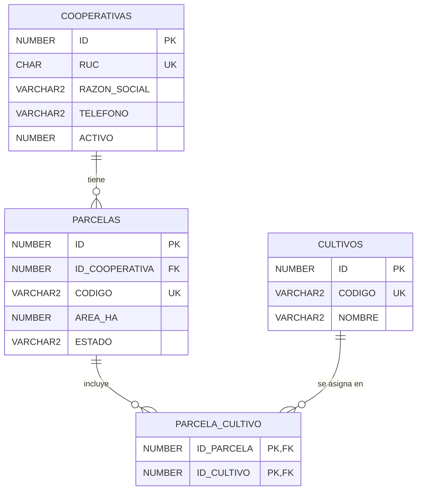

# Examen Final Práctico Individual de LP2 · Variante 5

*Por: Angel Sullon Macalupu @asullom - 2026*

## 1. Propósito

Comprueba que sabes **hacer**: construir un módulo nuevo, con base de datos, backend y SPA (*Single Page Application*, aplicación de una sola página), **dentro de tu proyecto grupal** y con el patrón de cabecera y detalles que practicaste en clase. El módulo `agro` no existe todavía en tu proyecto, así que no hay nada que memorizar. Es la forma práctica de la [evaluación final individual](../sesiones/S16_Evaluacion_Final_Individual.md#2-evaluacion-final-individual-teorico-practica-s1-s14).

## 2. Reglas

- **Duración:** 120 minutos. **Puntaje:** 20 puntos.
- **Construye sobre tu proyecto:** abre tu proyecto grupal (backend y SPA) y agrega el módulo `agro` dentro de él. No se acepta un proyecto nuevo ni una copia vacía.
- **Permitido:** la guía de las sesiones, el código de tu proyecto grupal y el código de BomERP.
- **No permitido:** IA ni chat de ningún tipo, ni ayuda de otras personas.
- **Cada funcionalidad se demuestra desde tu SPA** (Angular, Vue o React, la que usaste en tu proyecto). Si solo funciona desde el backend (Swagger o Postman), vale **la mitad** de sus puntos. El ítem de base de datos no se reduce.
- **Revisión en vivo:** al terminar los 120 minutos, el docente pasa por cada puesto y te pide demostrar cada ítem funcionando, en tu navegador o, si es de base de datos, en PowerShell o tu IDE (sección 7). Deja tu backend y tu SPA en ejecución y no modifiques código durante la revisión.
- **Antes de empezar:** tu backend y tu SPA deben estar funcionando. El tiempo corre desde que el docente da la señal de inicio.

## 3. Preparar tu esquema de base de datos

Ejecuta estos dos bloques en PowerShell, uno tras otro. Si usas un IDE de Oracle, copia solo el SQL de dentro de las comillas y ejecútalo como script, conectado como `system` al servicio `FREEPDB1`.

Cada bloque empieza con `$DB = 'bomerp-oracle'`: **cambia ese valor por el nombre del contenedor Oracle de tu entorno de desarrollo** (`docker ps` te lo muestra). Si tu `system` tiene otra contraseña, ajústala también. Si tu proyecto usa PostgreSQL en lugar de Oracle, usa los scripts del [Anexo B](#anexo-b-scripts-para-postgresql).

El esquema `EXA_AGRO` tiene cuatro tablas (Figura 1). `PARCELA_CULTIVO` es la tabla intermedia de la relación muchos a muchos: su clave primaria es compuesta y cada una de sus dos columnas es clave foránea.

**Figura 1. Diagrama de la base de datos del módulo**



`PK` es clave primaria, `FK` clave foránea y `UK` valor único. En cada relación, el extremo con doble barra es el lado «uno» y el extremo con pata de gallo es el lado «muchos».

**Script 1. Esquema**

```powershell
$DB = 'bomerp-oracle'   # nombre de TU contenedor Oracle en dev (míralo con: docker ps)
@'
CREATE USER EXA_AGRO IDENTIFIED BY "123456" QUOTA UNLIMITED ON USERS;
GRANT CREATE SESSION, CREATE TABLE, CREATE VIEW, CREATE PROCEDURE, CREATE TRIGGER TO EXA_AGRO;
EXIT
'@ | docker exec -i $DB sqlplus -s system/123456@//localhost:1521/FREEPDB1
```

**Script 2. Tablas, semillas y permisos**

Incluye las cuatro tablas, la tabla intermedia `PARCELA_CULTIVO`, los datos de ejemplo y los permisos para el usuario de la aplicación. No tienes que modificarlo.

```powershell
$DB = 'bomerp-oracle'   # nombre de TU contenedor Oracle en dev (míralo con: docker ps)
@'
CREATE TABLE EXA_AGRO.COOPERATIVAS (
    ID            NUMBER GENERATED BY DEFAULT AS IDENTITY PRIMARY KEY,
    RUC           CHAR(11)      NOT NULL,
    RAZON_SOCIAL  VARCHAR2(150) NOT NULL,
    TELEFONO      VARCHAR2(20),
    ACTIVO        NUMBER(1)     DEFAULT 1 NOT NULL,
    CONSTRAINT UQ_COOPERATIVA_RUC UNIQUE (RUC),
    CONSTRAINT CK_COOPERATIVA_ACTIVO CHECK (ACTIVO IN (0, 1))
);

CREATE TABLE EXA_AGRO.PARCELAS (
    ID            NUMBER GENERATED BY DEFAULT AS IDENTITY PRIMARY KEY,
    ID_COOPERATIVA  NUMBER        NOT NULL,
    CODIGO        VARCHAR2(10)  NOT NULL,
    AREA_HA  NUMBER(8,2)  NOT NULL,
    ESTADO        VARCHAR2(20)  DEFAULT 'LIBRE' NOT NULL,
    CONSTRAINT FK_PARCELA_COOPERATIVA FOREIGN KEY (ID_COOPERATIVA)
        REFERENCES EXA_AGRO.COOPERATIVAS(ID),
    CONSTRAINT UQ_PARCELA_CODIGO UNIQUE (CODIGO),
    CONSTRAINT CK_PARCELA_AREA CHECK (AREA_HA > 0),
    CONSTRAINT CK_PARCELA_ESTADO CHECK (ESTADO IN ('LIBRE', 'SEMBRADA', 'EN_DESCANSO'))
);

CREATE TABLE EXA_AGRO.CULTIVOS (
    ID      NUMBER GENERATED BY DEFAULT AS IDENTITY PRIMARY KEY,
    CODIGO  VARCHAR2(10)  NOT NULL,
    NOMBRE  VARCHAR2(100) NOT NULL,
    CONSTRAINT UQ_CULTIVO_CODIGO UNIQUE (CODIGO)
);

INSERT INTO EXA_AGRO.COOPERATIVAS (RUC, RAZON_SOCIAL, TELEFONO, ACTIVO) VALUES ('20119955773', 'Cooperativa Agraria Altiplano', '951199557', 1);
INSERT INTO EXA_AGRO.COOPERATIVAS (RUC, RAZON_SOCIAL, TELEFONO, ACTIVO) VALUES ('20228866884', 'Agroindustrias del Sur EIRL', '952288668', 1);
INSERT INTO EXA_AGRO.COOPERATIVAS (RUC, RAZON_SOCIAL, TELEFONO, ACTIVO) VALUES ('20337755995', 'Cooperativa Titicaca SRL', '953377559', 0);

INSERT INTO EXA_AGRO.PARCELAS (ID_COOPERATIVA, CODIGO, AREA_HA, ESTADO)
    SELECT ID, 'PAR-101', 12.50, 'LIBRE' FROM EXA_AGRO.COOPERATIVAS WHERE RUC = '20119955773';
INSERT INTO EXA_AGRO.PARCELAS (ID_COOPERATIVA, CODIGO, AREA_HA, ESTADO)
    SELECT ID, 'PAR-102', 8.00, 'SEMBRADA' FROM EXA_AGRO.COOPERATIVAS WHERE RUC = '20119955773';
INSERT INTO EXA_AGRO.PARCELAS (ID_COOPERATIVA, CODIGO, AREA_HA, ESTADO)
    SELECT ID, 'PAR-201', 20.00, 'LIBRE' FROM EXA_AGRO.COOPERATIVAS WHERE RUC = '20228866884';
INSERT INTO EXA_AGRO.PARCELAS (ID_COOPERATIVA, CODIGO, AREA_HA, ESTADO)
    SELECT ID, 'PAR-202', 5.75, 'EN_DESCANSO' FROM EXA_AGRO.COOPERATIVAS WHERE RUC = '20228866884';

INSERT INTO EXA_AGRO.CULTIVOS (CODIGO, NOMBRE) VALUES ('CU-01', 'Papa');
INSERT INTO EXA_AGRO.CULTIVOS (CODIGO, NOMBRE) VALUES ('CU-02', 'Quinua');
INSERT INTO EXA_AGRO.CULTIVOS (CODIGO, NOMBRE) VALUES ('CU-03', 'Canihua');
INSERT INTO EXA_AGRO.CULTIVOS (CODIGO, NOMBRE) VALUES ('CU-04', 'Cebada');
INSERT INTO EXA_AGRO.CULTIVOS (CODIGO, NOMBRE) VALUES ('CU-05', 'Habas');
COMMIT;

CREATE TABLE EXA_AGRO.PARCELA_CULTIVO (
    ID_PARCELA  NUMBER NOT NULL,
    ID_CULTIVO  NUMBER NOT NULL,
    CONSTRAINT PK_PARCELA_CULTIVO PRIMARY KEY (ID_PARCELA, ID_CULTIVO),
    CONSTRAINT FK_PC_PARCELA FOREIGN KEY (ID_PARCELA) REFERENCES EXA_AGRO.PARCELAS(ID),
    CONSTRAINT FK_PC_CULTIVO FOREIGN KEY (ID_CULTIVO) REFERENCES EXA_AGRO.CULTIVOS(ID)
);

INSERT INTO EXA_AGRO.PARCELA_CULTIVO (ID_PARCELA, ID_CULTIVO)
    SELECT c.ID, k.ID FROM EXA_AGRO.PARCELAS c, EXA_AGRO.CULTIVOS k
    WHERE (c.CODIGO, k.CODIGO) IN (('PAR-101', 'CU-01'), ('PAR-101', 'CU-02'), ('PAR-102', 'CU-03'));
COMMIT;

CREATE INDEX EXA_AGRO.IDX_PARCELA_COOPERATIVA ON EXA_AGRO.PARCELAS(ID_COOPERATIVA);

GRANT SELECT, INSERT, UPDATE, DELETE ON EXA_AGRO.COOPERATIVAS    TO BOMERP_APP;
GRANT SELECT, INSERT, UPDATE, DELETE ON EXA_AGRO.PARCELAS        TO BOMERP_APP;
GRANT SELECT, INSERT, UPDATE, DELETE ON EXA_AGRO.CULTIVOS        TO BOMERP_APP;
GRANT SELECT, INSERT, UPDATE, DELETE ON EXA_AGRO.PARCELA_CULTIVO TO BOMERP_APP;
EXIT
'@ | docker exec -i $DB sqlplus -s system/123456@//localhost:1521/FREEPDB1
```

**Script 3. Verificar** (debe listar 4 tablas: `COOPERATIVAS`, `PARCELAS`, `PARCELA_CULTIVO` y `CULTIVOS`)

```powershell
$DB = 'bomerp-oracle'   # nombre de TU contenedor Oracle en dev (míralo con: docker ps)
@'
SELECT table_name FROM dba_tables WHERE owner='EXA_AGRO' ORDER BY 1;
EXIT
'@ | docker exec -i $DB sqlplus -s system/123456@//localhost:1521/FREEPDB1
```

Para repetir desde cero, ejecuta `DROP USER EXA_AGRO CASCADE;` como `system` y vuelve a correr los scripts 1 y 2.

## 4. Prototipos de las pantallas

Tu SPA no tiene que ser idéntica a estas figuras, pero sí debe tener estas pantallas y estas acciones.

Las Figuras 2 y 3 corresponden a la pregunta 1. En las Figuras 4, 5 y 6 la parcela es la cabecera y los cultivos son sus líneas, igual que la cabecera con detalles que practicaste en clase, como una venta con sus productos.

**Figura 2. Cooperativas: listado**

```text
+- Cooperativas ------------------------------------------------------------------------------+
|                                                                    [ + Nueva cooperativa ]  |
|                                                                                             |
| +-------------+-------------------------------+-----------+--------+---------------------+  |
| | RUC         | Razón social                  | Teléfono  | Activa | Acciones            |  |
| +-------------+-------------------------------+-----------+--------+---------------------+  |
| | 20119955773 | Cooperativa Agraria Altiplano | 951199557 | Sí     | [Editar] [Eliminar] |  |
| | 20228866884 | Agroindustrias del Sur EIRL   | 952288668 | Sí     | [Editar] [Eliminar] |  |
| | 20337755995 | Cooperativa Titicaca SRL      | 953377559 | No     | [Editar] [Eliminar] |  |
| +-------------+-------------------------------+-----------+--------+---------------------+  |
+---------------------------------------------------------------------------------------------+
```

**Figura 3. Cooperativa: formulario para crear y editar, con los errores visibles**

```text
+- Nueva cooperativa  (la misma pantalla sirve para editar) -------------+
| RUC            [ 2011995 ]          × El RUC debe tener 11 dígitos     |
| Razón social   [ ______________ ]   × La razón social es obligatoria   |
| Teléfono       [ ______________ ]                                      |
| Activa         [x]                                                     |
|                                                                        |
|                                           [ Cancelar ]   [ Guardar ]   |
+------------------------------------------------------------------------+
```

**Figura 4. Parcelas: listado**

```text
+- Parcelas --------------------------------------------------------------------------------+
|                                                                      [ + Nueva parcela ]  |
|                                                                                           |
| +---------+-------------------------------+---------+---------------+------------------+  |
| | Código  | Cooperativa                   | Área    | Estado        | Acciones         |  |
| +---------+-------------------------------+---------+---------------+------------------+  |
| | PAR-101 | Cooperativa Agraria Altiplano | 12.50   | LIBRE         | [Ver] [Eliminar] |  |
| | PAR-102 | Cooperativa Agraria Altiplano | 8.00    | SEMBRADA      | [Ver] [Eliminar] |  |
| | PAR-201 | Agroindustrias del Sur EIRL   | 20.00   | LIBRE         | [Ver] [Eliminar] |  |
| +---------+-------------------------------+---------+---------------+------------------+  |
+-------------------------------------------------------------------------------------------+
```

**Figura 5. Nueva parcela, con la asignación de cultivos**

```text
+- Nueva parcela --------------------------------------------------------------+
| Cooperativa  [ Cooperativa Agraria Altiplano v ]    Código [ ________ ]      |
| Área (hectáreas) [ ______ ]      Estado [ LIBRE v ]                          |
|                                                                              |
| Cultivos de la parcela   [ Papa v ] [ Agregar ]                              |
|                                                                              |
| +--------+-----------+----------+                                            |
| | CU-01  | Papa      | [Quitar] |                                            |
| | CU-03  | Canihua   | [Quitar] |                                            |
| +--------+-----------+----------+                                            |
|                                                                              |
|                                               [ Cancelar ]   [ Guardar ]     |
+------------------------------------------------------------------------------+
```

**Figura 6. Ver parcela, con sus cultivos (solo lectura)**

```text
+- Parcela PAR-101 ------------------------------------------------------------+
| Cooperativa: Cooperativa Agraria Altiplano     Área: 12.50                   |
| Estado:    LIBRE                                                             |
|                                                                              |
| Cultivos asignados:                                                          |
| +--------+-----------+                                                       |
| | CU-01  | Papa      |                                                       |
| | CU-02  | Quinua    |                                                       |
| +--------+-----------+                                                       |
|                                                                              |
|                                                               [ Volver ]     |
+------------------------------------------------------------------------------+
```

## 5. Preguntas

**1. (7 pts)** Crea el módulo `agro` en tu backend y el CRUD (*Create, Read, Update, Delete*) de `COOPERATIVAS` (Figuras 2 y 3).

- DB: crea el esquema de tu nuevo módulo ejecutando los scripts de la sección 3 y lista las tablas del esquema mediante PowerShell o tu IDE. **(2 pts)**
- CRUD funcionando desde la SPA: listar, crear, editar y eliminar. **(4 pts)**
- RUC (Registro Único de Contribuyentes) de 11 dígitos y razón social obligatoria, con el error visible en el formulario. **(1 pt)**

**2. (13 pts)** Ahora `PARCELAS` con sus `CULTIVOS`, igual que la cabecera con detalles que practicaste en clase, como una venta con sus productos (Figuras 4, 5 y 6). La parcela es la cabecera y los cultivos son sus líneas.

- Cultivos: listar (vienen precargados). **(1 pt)**
- Crear una parcela: cooperativa elegida desde una lista desplegable, código, área y estado como enumerado. **(3 pts)**
- Asignar cultivos al crear la parcela: eliges un cultivo de la lista, lo agregas a la tabla de cultivos asignados, puedes quitarlo y, al guardar, queda registrado. **(4 pts)**
- Listar las parcelas y ver el detalle de una parcela, con su tabla de cultivos asignados. **(3 pts)**
- Eliminar una parcela desde el listado. **(2 pts)**

## 6. Calificación

**Tabla 1. Puntaje por ítem según dónde funciona**

| Ítem | Pregunta | Desde la SPA | Solo desde el backend |
|---|---|---:|---:|
| Esquema creado y tablas listadas | 1 | 2 | 2 |
| CRUD de cooperativas | 1 | 4 | 2 |
| Validaciones de cooperativa | 1 | 1 | 0.5 |
| Cultivos: listar | 2 | 1 | 0.5 |
| Crear una parcela | 2 | 3 | 1.5 |
| Asignar cultivos al crear la parcela | 2 | 4 | 2 |
| Listar y ver el detalle de la parcela con sus cultivos | 2 | 3 | 1.5 |
| Eliminar una parcela | 2 | 2 | 1 |
| **Total** | | **20** | |

Un ítem vale su puntaje completo solo si lo muestras funcionando. Si el código existe pero falla, vale 0.

**Tabla 2. Distribución sugerida del tiempo**

| Bloque | Minutos |
|---|---:|
| Pregunta 1 | 50 |
| Pregunta 2 | 65 |
| Cierre: dejar todo en ejecución para la revisión | 5 |
| **Total** | **120** |

Los ítems se califican por separado: si te atascas en uno, pasa al siguiente.

## 7. Revisión en vivo

Al terminar los 120 minutos, el docente revisa tu puesto en unos 5 minutos. Para cada ítem te pedirá hacer esto, en vivo y sin ayuda:

**Tabla 3. Qué demuestras en la revisión**

| Ítem | Qué te pide el docente |
|---|---|
| Esquema creado y tablas listadas | Ejecutar el script 3 y mostrar las 4 tablas. |
| CRUD de cooperativas | Crear una cooperativa, editarla y eliminarla desde la SPA. |
| Validaciones de cooperativa | Guardar una cooperativa con un RUC de menos de 11 dígitos y con la razón social vacía: los errores deben verse en el formulario. |
| Cultivos: listar | Mostrar los 5 cultivos precargados. |
| Crear una parcela | Crear una parcela eligiendo la cooperativa de la lista desplegable, con código, área y estado. |
| Asignar cultivos al crear la parcela | En una parcela nueva, agregar 2 cultivos, quitar 1 y guardar. |
| Listar y ver el detalle de la parcela con sus cultivos | Encontrar esa parcela en el listado, abrirla y ver el cultivo que quedó asignado. |
| Eliminar una parcela | Eliminar esa parcela desde el listado. |

Lo que falla durante la revisión se califica como no logrado: no se corrige en ese momento.

## Anexo A. Opcional: usar PostgreSQL en lugar de Oracle

Si tu proyecto en desarrollo usa PostgreSQL, o prefieres usarlo en el examen, haz estos tres cambios. Con Oracle no tienes que tocar nada.

**1. `compose-dev.yml`.** Reemplaza el servicio `oracle` y el volumen `oracle-data` por esto:

```yaml
services:
  postgres:
    image: postgres:17-alpine
    container_name: bomerp-postgres
    restart: unless-stopped
    ports:
      - "35433:5432"
    environment:
      POSTGRES_DB: bomerp
      POSTGRES_USER: bomerp_app
      POSTGRES_PASSWORD: 123456
      TZ: America/Lima
    volumes:
      - postgres-data:/var/lib/postgresql/data
    healthcheck:
      test: ["CMD-SHELL", "pg_isready -U bomerp_app -d bomerp"]
      interval: 10s
      timeout: 5s
      retries: 10
      start_period: 15s

volumes:
  postgres-data:
```

El puerto `35433` es solo un ejemplo: usa cualquiera que esté libre en tu máquina. Levántalo con:

```powershell
docker compose -f compose-dev.yml up -d postgres
```

**2. `pom.xml`.** Reemplaza la dependencia `ojdbc11` por el controlador de PostgreSQL:

```xml
<dependency>
    <groupId>org.postgresql</groupId>
    <artifactId>postgresql</artifactId>
    <scope>runtime</scope>
</dependency>
```

**3. `application-dev.yml`.** Reemplaza el bloque `datasource`:

```yaml
spring:
  datasource:
    url: jdbc:postgresql://localhost:35433/bomerp
    username: bomerp_app
    password: 123456
    driver-class-name: org.postgresql.Driver
```

Tus entidades siguen usando `@Table(schema = "EXA_AGRO")`: PostgreSQL lee ese nombre sin distinguir mayúsculas.

## Anexo B. Scripts para PostgreSQL

Son los mismos scripts de la sección 3, con la sintaxis de PostgreSQL y los mismos datos. En PostgreSQL el esquema es el equivalente al usuario de Oracle, y `bomerp_app` es el mismo usuario con el que corre tu backend, por lo que no hacen falta permisos adicionales. Cambia `$DB` por el nombre del contenedor PostgreSQL de tu entorno de desarrollo (`docker ps`), y ajusta el usuario (`-U`) y la base (`-d`) si tu entorno usa otros.

**Script 1 (PostgreSQL). Esquema**

```powershell
$DB = 'bomerp-postgres'   # nombre de TU contenedor PostgreSQL en dev (míralo con: docker ps)
@'
CREATE SCHEMA EXA_AGRO;
'@ | docker exec -i $DB psql -U bomerp_app -d bomerp -v ON_ERROR_STOP=1
```

**Script 2 (PostgreSQL). Tablas y semillas**

```powershell
$DB = 'bomerp-postgres'   # nombre de TU contenedor PostgreSQL en dev (míralo con: docker ps)
@'
CREATE TABLE EXA_AGRO.COOPERATIVAS (
    ID            BIGINT GENERATED BY DEFAULT AS IDENTITY PRIMARY KEY,
    RUC           CHAR(11)      NOT NULL,
    RAZON_SOCIAL  VARCHAR(150) NOT NULL,
    TELEFONO      VARCHAR(20),
    ACTIVO        SMALLINT     DEFAULT 1 NOT NULL,
    CONSTRAINT UQ_COOPERATIVA_RUC UNIQUE (RUC),
    CONSTRAINT CK_COOPERATIVA_ACTIVO CHECK (ACTIVO IN (0, 1))
);

CREATE TABLE EXA_AGRO.PARCELAS (
    ID            BIGINT GENERATED BY DEFAULT AS IDENTITY PRIMARY KEY,
    ID_COOPERATIVA  BIGINT        NOT NULL,
    CODIGO        VARCHAR(10)  NOT NULL,
    AREA_HA  NUMERIC(8,2)  NOT NULL,
    ESTADO        VARCHAR(20)  DEFAULT 'LIBRE' NOT NULL,
    CONSTRAINT FK_PARCELA_COOPERATIVA FOREIGN KEY (ID_COOPERATIVA)
        REFERENCES EXA_AGRO.COOPERATIVAS(ID),
    CONSTRAINT UQ_PARCELA_CODIGO UNIQUE (CODIGO),
    CONSTRAINT CK_PARCELA_AREA CHECK (AREA_HA > 0),
    CONSTRAINT CK_PARCELA_ESTADO CHECK (ESTADO IN ('LIBRE', 'SEMBRADA', 'EN_DESCANSO'))
);

CREATE TABLE EXA_AGRO.CULTIVOS (
    ID      BIGINT GENERATED BY DEFAULT AS IDENTITY PRIMARY KEY,
    CODIGO  VARCHAR(10)  NOT NULL,
    NOMBRE  VARCHAR(100) NOT NULL,
    CONSTRAINT UQ_CULTIVO_CODIGO UNIQUE (CODIGO)
);

INSERT INTO EXA_AGRO.COOPERATIVAS (RUC, RAZON_SOCIAL, TELEFONO, ACTIVO) VALUES ('20119955773', 'Cooperativa Agraria Altiplano', '951199557', 1);
INSERT INTO EXA_AGRO.COOPERATIVAS (RUC, RAZON_SOCIAL, TELEFONO, ACTIVO) VALUES ('20228866884', 'Agroindustrias del Sur EIRL', '952288668', 1);
INSERT INTO EXA_AGRO.COOPERATIVAS (RUC, RAZON_SOCIAL, TELEFONO, ACTIVO) VALUES ('20337755995', 'Cooperativa Titicaca SRL', '953377559', 0);

INSERT INTO EXA_AGRO.PARCELAS (ID_COOPERATIVA, CODIGO, AREA_HA, ESTADO)
    SELECT ID, 'PAR-101', 12.50, 'LIBRE' FROM EXA_AGRO.COOPERATIVAS WHERE RUC = '20119955773';
INSERT INTO EXA_AGRO.PARCELAS (ID_COOPERATIVA, CODIGO, AREA_HA, ESTADO)
    SELECT ID, 'PAR-102', 8.00, 'SEMBRADA' FROM EXA_AGRO.COOPERATIVAS WHERE RUC = '20119955773';
INSERT INTO EXA_AGRO.PARCELAS (ID_COOPERATIVA, CODIGO, AREA_HA, ESTADO)
    SELECT ID, 'PAR-201', 20.00, 'LIBRE' FROM EXA_AGRO.COOPERATIVAS WHERE RUC = '20228866884';
INSERT INTO EXA_AGRO.PARCELAS (ID_COOPERATIVA, CODIGO, AREA_HA, ESTADO)
    SELECT ID, 'PAR-202', 5.75, 'EN_DESCANSO' FROM EXA_AGRO.COOPERATIVAS WHERE RUC = '20228866884';

INSERT INTO EXA_AGRO.CULTIVOS (CODIGO, NOMBRE) VALUES ('CU-01', 'Papa');
INSERT INTO EXA_AGRO.CULTIVOS (CODIGO, NOMBRE) VALUES ('CU-02', 'Quinua');
INSERT INTO EXA_AGRO.CULTIVOS (CODIGO, NOMBRE) VALUES ('CU-03', 'Canihua');
INSERT INTO EXA_AGRO.CULTIVOS (CODIGO, NOMBRE) VALUES ('CU-04', 'Cebada');
INSERT INTO EXA_AGRO.CULTIVOS (CODIGO, NOMBRE) VALUES ('CU-05', 'Habas');

CREATE TABLE EXA_AGRO.PARCELA_CULTIVO (
    ID_PARCELA  BIGINT NOT NULL,
    ID_CULTIVO  BIGINT NOT NULL,
    CONSTRAINT PK_PARCELA_CULTIVO PRIMARY KEY (ID_PARCELA, ID_CULTIVO),
    CONSTRAINT FK_PC_PARCELA FOREIGN KEY (ID_PARCELA) REFERENCES EXA_AGRO.PARCELAS(ID),
    CONSTRAINT FK_PC_CULTIVO FOREIGN KEY (ID_CULTIVO) REFERENCES EXA_AGRO.CULTIVOS(ID)
);

INSERT INTO EXA_AGRO.PARCELA_CULTIVO (ID_PARCELA, ID_CULTIVO)
    SELECT c.ID, k.ID FROM EXA_AGRO.PARCELAS c, EXA_AGRO.CULTIVOS k
    WHERE (c.CODIGO, k.CODIGO) IN (('PAR-101', 'CU-01'), ('PAR-101', 'CU-02'), ('PAR-102', 'CU-03'));

CREATE INDEX IDX_PARCELA_COOPERATIVA ON EXA_AGRO.PARCELAS(ID_COOPERATIVA);
'@ | docker exec -i $DB psql -U bomerp_app -d bomerp -v ON_ERROR_STOP=1
```

**Script 3 (PostgreSQL). Verificar** (debe listar 4 tablas)

```powershell
$DB = 'bomerp-postgres'   # nombre de TU contenedor PostgreSQL en dev (míralo con: docker ps)
@'
SELECT table_name FROM information_schema.tables WHERE table_schema = 'exa_agro' ORDER BY 1;
'@ | docker exec -i $DB psql -U bomerp_app -d bomerp
```

Para repetir desde cero, ejecuta `DROP SCHEMA EXA_AGRO CASCADE;` y vuelve a correr los scripts 1 y 2.
