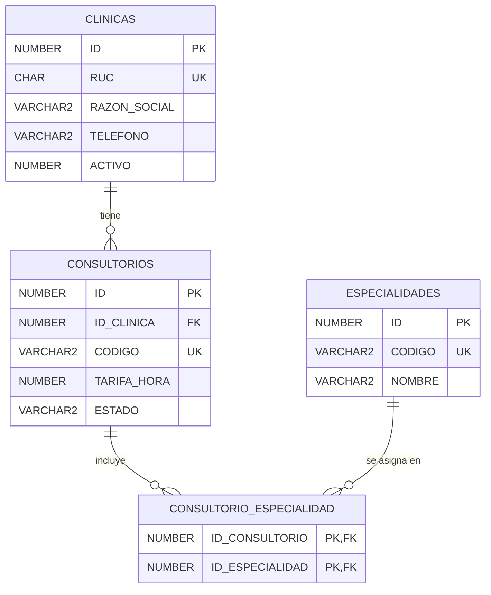

# Examen Final Práctico Individual de LP2 · Variante 7

*Por: Angel Sullon Macalupu @asullom - 2026*

## 1. Propósito

Comprobar que sabes **hacer**, de forma autónoma, lo que practicaste durante el curso: construir un módulo nuevo sobre tu propio proyecto, con base de datos, backend y SPA (*Single Page Application*, aplicación de una sola página). Es la forma práctica de la evaluación final individual descrita en [S16](../sesiones/S16_Evaluacion_Final_Individual.md#2-evaluacion-final-individual-teorico-practica-s1-s14).

**Todo se construye sobre tu proyecto grupal.** El módulo nuevo se agrega dentro de tu backend y de tu SPA existentes (mismo repositorio, misma estructura de paquetes y carpetas, mismo Keycloak). No crees un proyecto aparte: lo que se evalúa es que sepas extender lo que ya tienes.

El módulo del examen, `clinica`, no existe todavía en tu proyecto. Por eso no hay nada que memorizar ni copiar: tienes que **aplicar el patrón** que ya dominas (el de la cabecera con sus detalles, como `Venta` con sus productos en clase) a un dominio nuevo, dentro de tu propio backend y de tu propia SPA.

## 2. Reglas

- **Duración:** 120 minutos. **Puntaje:** 20 puntos.
- **Construye sobre tu proyecto:** abre tu proyecto grupal (backend y SPA) y agrega el módulo `clinica` dentro de él. No se acepta un proyecto nuevo ni una copia vacía.
- **Permitido:** la guía de las sesiones, el código de tu proyecto grupal y el código de BomERP.
- **No permitido:** IA ni chat de ningún tipo, ni ayuda de otras personas.
- **Cada funcionalidad se demuestra desde tu SPA** (Angular, Vue o React, la que usaste en tu proyecto). Si solo funciona desde el backend (Swagger o Postman), vale **la mitad** de sus puntos. El ítem de base de datos no se reduce.
- **Revisión en vivo:** al terminar los 120 minutos, el docente pasa por cada puesto y te pide demostrar cada ítem funcionando, en tu navegador o, si es de base de datos, en PowerShell o tu IDE (sección 7). Deja tu backend, Keycloak y tu SPA en ejecución y no modifiques código durante la revisión.
- **Antes de empezar:** tu backend, Keycloak y tu SPA deben estar funcionando. El tiempo corre desde que el docente da la señal de inicio.

## 3. Preparar tu esquema de base de datos

Ejecuta estos dos bloques en PowerShell, uno tras otro. Si usas un IDE de Oracle, copia solo el SQL de dentro de las comillas y ejecútalo como script, conectado como `system` al servicio `FREEPDB1`.

Cada bloque empieza con `$DB = 'bomerp-oracle'`: **cambia ese valor por el nombre del contenedor Oracle de tu entorno de desarrollo** (`docker ps` te lo muestra). Si tu `system` tiene otra contraseña, ajústala también. Si tu proyecto usa PostgreSQL en lugar de Oracle, usa los scripts del [Anexo B](#anexo-b-scripts-para-postgresql).

El esquema `EXA_CLINICA` tiene cuatro tablas (Figura 1). `CONSULTORIO_ESPECIALIDAD` es la tabla intermedia de la relación muchos a muchos: su clave primaria es compuesta y cada una de sus dos columnas es clave foránea.

**Figura 1. Diagrama de la base de datos del módulo**



`PK` es clave primaria, `FK` clave foránea y `UK` valor único. En cada relación, el extremo con doble barra es el lado «uno» y el extremo con pata de gallo es el lado «muchos».

**Script 1. Esquema**

```powershell
$DB = 'bomerp-oracle'   # nombre de TU contenedor Oracle en dev (míralo con: docker ps)
@'
CREATE USER EXA_CLINICA IDENTIFIED BY "123456" QUOTA UNLIMITED ON USERS;
GRANT CREATE SESSION, CREATE TABLE, CREATE VIEW, CREATE PROCEDURE, CREATE TRIGGER TO EXA_CLINICA;
EXIT
'@ | docker exec -i $DB sqlplus -s system/123456@//localhost:1521/FREEPDB1
```

**Script 2. Tablas, semillas y permisos**

Incluye las cuatro tablas, la tabla intermedia `CONSULTORIO_ESPECIALIDAD`, los datos de ejemplo y los permisos para el usuario de la aplicación. No tienes que modificarlo.

```powershell
$DB = 'bomerp-oracle'   # nombre de TU contenedor Oracle en dev (míralo con: docker ps)
@'
CREATE TABLE EXA_CLINICA.CLINICAS (
    ID            NUMBER GENERATED BY DEFAULT AS IDENTITY PRIMARY KEY,
    RUC           CHAR(11)      NOT NULL,
    RAZON_SOCIAL  VARCHAR2(150) NOT NULL,
    TELEFONO      VARCHAR2(20),
    ACTIVO        NUMBER(1)     DEFAULT 1 NOT NULL,
    CONSTRAINT UQ_CLINICA_RUC UNIQUE (RUC),
    CONSTRAINT CK_CLINICA_ACTIVO CHECK (ACTIVO IN (0, 1))
);

CREATE TABLE EXA_CLINICA.CONSULTORIOS (
    ID            NUMBER GENERATED BY DEFAULT AS IDENTITY PRIMARY KEY,
    ID_CLINICA  NUMBER        NOT NULL,
    CODIGO        VARCHAR2(10)  NOT NULL,
    TARIFA_HORA  NUMBER(8,2)  NOT NULL,
    ESTADO        VARCHAR2(20)  DEFAULT 'DISPONIBLE' NOT NULL,
    CONSTRAINT FK_CONSULTORIO_CLINICA FOREIGN KEY (ID_CLINICA)
        REFERENCES EXA_CLINICA.CLINICAS(ID),
    CONSTRAINT UQ_CONSULTORIO_CODIGO UNIQUE (CODIGO),
    CONSTRAINT CK_CONSULTORIO_TARIFA CHECK (TARIFA_HORA > 0),
    CONSTRAINT CK_CONSULTORIO_ESTADO CHECK (ESTADO IN ('DISPONIBLE', 'OCUPADO', 'MANTENIMIENTO'))
);

CREATE TABLE EXA_CLINICA.ESPECIALIDADES (
    ID      NUMBER GENERATED BY DEFAULT AS IDENTITY PRIMARY KEY,
    CODIGO  VARCHAR2(10)  NOT NULL,
    NOMBRE  VARCHAR2(100) NOT NULL,
    CONSTRAINT UQ_ESPECIALIDAD_CODIGO UNIQUE (CODIGO)
);

INSERT INTO EXA_CLINICA.CLINICAS (RUC, RAZON_SOCIAL, TELEFONO, ACTIVO) VALUES ('20135792468', 'Clinica Altiplano SAC', '951357924', 1);
INSERT INTO EXA_CLINICA.CLINICAS (RUC, RAZON_SOCIAL, TELEFONO, ACTIVO) VALUES ('20246813579', 'Centro Medico del Sur EIRL', '952468135', 1);
INSERT INTO EXA_CLINICA.CLINICAS (RUC, RAZON_SOCIAL, TELEFONO, ACTIVO) VALUES ('20369258147', 'Salud Titicaca SRL', '953692581', 0);

INSERT INTO EXA_CLINICA.CONSULTORIOS (ID_CLINICA, CODIGO, TARIFA_HORA, ESTADO)
    SELECT ID, 'CON-101', 80.00, 'DISPONIBLE' FROM EXA_CLINICA.CLINICAS WHERE RUC = '20135792468';
INSERT INTO EXA_CLINICA.CONSULTORIOS (ID_CLINICA, CODIGO, TARIFA_HORA, ESTADO)
    SELECT ID, 'CON-102', 120.00, 'OCUPADO' FROM EXA_CLINICA.CLINICAS WHERE RUC = '20135792468';
INSERT INTO EXA_CLINICA.CONSULTORIOS (ID_CLINICA, CODIGO, TARIFA_HORA, ESTADO)
    SELECT ID, 'CON-201', 60.00, 'DISPONIBLE' FROM EXA_CLINICA.CLINICAS WHERE RUC = '20246813579';
INSERT INTO EXA_CLINICA.CONSULTORIOS (ID_CLINICA, CODIGO, TARIFA_HORA, ESTADO)
    SELECT ID, 'CON-202', 150.00, 'MANTENIMIENTO' FROM EXA_CLINICA.CLINICAS WHERE RUC = '20246813579';

INSERT INTO EXA_CLINICA.ESPECIALIDADES (CODIGO, NOMBRE) VALUES ('E-01', 'Medicina general');
INSERT INTO EXA_CLINICA.ESPECIALIDADES (CODIGO, NOMBRE) VALUES ('E-02', 'Pediatria');
INSERT INTO EXA_CLINICA.ESPECIALIDADES (CODIGO, NOMBRE) VALUES ('E-03', 'Cardiologia');
INSERT INTO EXA_CLINICA.ESPECIALIDADES (CODIGO, NOMBRE) VALUES ('E-04', 'Odontologia');
INSERT INTO EXA_CLINICA.ESPECIALIDADES (CODIGO, NOMBRE) VALUES ('E-05', 'Nutricion');
COMMIT;

CREATE TABLE EXA_CLINICA.CONSULTORIO_ESPECIALIDAD (
    ID_CONSULTORIO  NUMBER NOT NULL,
    ID_ESPECIALIDAD  NUMBER NOT NULL,
    CONSTRAINT PK_CONSULTORIO_ESPECIALIDAD PRIMARY KEY (ID_CONSULTORIO, ID_ESPECIALIDAD),
    CONSTRAINT FK_CE_CONSULTORIO FOREIGN KEY (ID_CONSULTORIO) REFERENCES EXA_CLINICA.CONSULTORIOS(ID),
    CONSTRAINT FK_CE_ESPECIALIDAD FOREIGN KEY (ID_ESPECIALIDAD) REFERENCES EXA_CLINICA.ESPECIALIDADES(ID)
);

INSERT INTO EXA_CLINICA.CONSULTORIO_ESPECIALIDAD (ID_CONSULTORIO, ID_ESPECIALIDAD)
    SELECT c.ID, k.ID FROM EXA_CLINICA.CONSULTORIOS c, EXA_CLINICA.ESPECIALIDADES k
    WHERE (c.CODIGO, k.CODIGO) IN (('CON-101', 'E-01'), ('CON-101', 'E-02'), ('CON-102', 'E-03'));
COMMIT;

CREATE INDEX EXA_CLINICA.IDX_CONSULTORIO_CLINICA ON EXA_CLINICA.CONSULTORIOS(ID_CLINICA);

GRANT SELECT, INSERT, UPDATE, DELETE ON EXA_CLINICA.CLINICAS                 TO BOMERP_APP;
GRANT SELECT, INSERT, UPDATE, DELETE ON EXA_CLINICA.CONSULTORIOS             TO BOMERP_APP;
GRANT SELECT, INSERT, UPDATE, DELETE ON EXA_CLINICA.ESPECIALIDADES           TO BOMERP_APP;
GRANT SELECT, INSERT, UPDATE, DELETE ON EXA_CLINICA.CONSULTORIO_ESPECIALIDAD TO BOMERP_APP;
EXIT
'@ | docker exec -i $DB sqlplus -s system/123456@//localhost:1521/FREEPDB1
```

**Script 3. Verificar** (debe listar 4 tablas: `CLINICAS`, `CONSULTORIOS`, `CONSULTORIO_ESPECIALIDAD` y `ESPECIALIDADES`)

```powershell
$DB = 'bomerp-oracle'   # nombre de TU contenedor Oracle en dev (míralo con: docker ps)
@'
SELECT table_name FROM dba_tables WHERE owner='EXA_CLINICA' ORDER BY 1;
EXIT
'@ | docker exec -i $DB sqlplus -s system/123456@//localhost:1521/FREEPDB1
```

Para repetir desde cero, ejecuta `DROP USER EXA_CLINICA CASCADE;` como `system` y vuelve a correr los scripts 1 y 2.

## 4. Prototipos de las pantallas

Tu SPA no tiene que ser idéntica a estas figuras, pero sí debe tener estas pantallas y estas acciones.

Las Figuras 2 y 3 corresponden a la pregunta 1. En las Figuras 4, 5 y 6 el consultorio es la cabecera y las especialidades son sus líneas, igual que la cabecera con detalles que practicaste en clase, como una venta con sus productos.

**Figura 2. Clínicas: listado**

```
┌─ Clínicas ───────────────────────────────────────────────────────────────────────────────┐
│                                                                     [ + Nueva clínica ]  │
│                                                                                          │
│ ┌─────────────┬────────────────────────────┬───────────┬────────┬─────────────────────┐  │
│ │ RUC         │ Razón social               │ Teléfono  │ Activa │ Acciones            │  │
│ ├─────────────┼────────────────────────────┼───────────┼────────┼─────────────────────┤  │
│ │ 20135792468 │ Clinica Altiplano SAC      │ 951357924 │ Sí     │ [Editar] [Eliminar] │  │
│ │ 20246813579 │ Centro Medico del Sur EIRL │ 952468135 │ Sí     │ [Editar] [Eliminar] │  │
│ │ 20369258147 │ Salud Titicaca SRL         │ 953692581 │ No     │ [Editar] [Eliminar] │  │
│ └─────────────┴────────────────────────────┴───────────┴────────┴─────────────────────┘  │
└──────────────────────────────────────────────────────────────────────────────────────────┘
```

**Figura 3. Clínica: formulario para crear y editar, con los errores visibles**

```
┌─ Nueva clínica  (la misma pantalla sirve para editar) ─────────────────┐
│ RUC            [ 2013579 ]          ✗ El RUC debe tener 11 dígitos     │
│ Razón social   [ ______________ ]   ✗ La razón social es obligatoria   │
│ Teléfono       [ ______________ ]                                      │
│ Activa         [x]                                                     │
│                                                                        │
│                                           [ Cancelar ]   [ Guardar ]   │
└────────────────────────────────────────────────────────────────────────┘
```

**Figura 4. Consultorios: listado**

```
┌─ Consultorios ─────────────────────────────────────────────────────────────────────────┐
│                                                               [ + Nuevo consultorio ]  │
│                                                                                        │
│ ┌─────────┬────────────────────────────┬─────────┬───────────────┬──────────────────┐  │
│ │ Código  │ Clínica                    │ Tarifa  │ Estado        │ Acciones         │  │
│ ├─────────┼────────────────────────────┼─────────┼───────────────┼──────────────────┤  │
│ │ CON-101 │ Clinica Altiplano SAC      │ 80.00   │ DISPONIBLE    │ [Ver] [Eliminar] │  │
│ │ CON-102 │ Clinica Altiplano SAC      │ 120.00  │ OCUPADO       │ [Ver] [Eliminar] │  │
│ │ CON-201 │ Centro Medico del Sur EIRL │ 60.00   │ DISPONIBLE    │ [Ver] [Eliminar] │  │
│ └─────────┴────────────────────────────┴─────────┴───────────────┴──────────────────┘  │
└────────────────────────────────────────────────────────────────────────────────────────┘
```

**Figura 5. Nuevo consultorio, con la asignación de especialidades**

```
┌─ Nuevo consultorio ──────────────────────────────────────────────────────────┐
│ Clínica  [ Clinica Altiplano SAC ▼ ]    Código [ ________ ]                  │
│ Tarifa por hora (S/) [ ______ ]      Estado [ DISPONIBLE ▼ ]                 │
│                                                                              │
│ Especialidades del consultorio   [ Medicina general ▼ ] [ Agregar ]          │
│                                                                              │
│ ┌────────┬────────────────────┬──────────┐                                   │
│ │ E-01   │ Medicina general   │ [Quitar] │                                   │
│ │ E-03   │ Cardiologia        │ [Quitar] │                                   │
│ └────────┴────────────────────┴──────────┘                                   │
│                                                                              │
│                                               [ Cancelar ]   [ Guardar ]     │
└──────────────────────────────────────────────────────────────────────────────┘
```

**Figura 6. Ver consultorio, con sus especialidades (solo lectura)**

```
┌─ Consultorio CON-101 ────────────────────────────────────────────────────────┐
│ Clínica: Clinica Altiplano SAC     Tarifa por hora: 80.00                    │
│ Estado:    DISPONIBLE                                                        │
│                                                                              │
│ Especialidades asignadas:                                                    │
│ ┌────────┬────────────────────┐                                              │
│ │ E-01   │ Medicina general   │                                              │
│ │ E-02   │ Pediatria          │                                              │
│ └────────┴────────────────────┘                                              │
│                                                                              │
│                                                               [ Volver ]     │
└──────────────────────────────────────────────────────────────────────────────┘
```

## 5. Preguntas

**1. (7 pts)** Crea el módulo `clinica` en tu backend y el CRUD (*Create, Read, Update, Delete*) de `CLINICAS` (Figuras 2 y 3).

- DB: crea el esquema de tu nuevo módulo ejecutando los scripts de la sección 3 y lista las tablas del esquema mediante PowerShell o tu IDE. **(2 pts)**
- CRUD funcionando desde la SPA: listar, crear, editar y eliminar. **(4 pts)**
- RUC (Registro Único de Contribuyentes) de 11 dígitos y razón social obligatoria, con el error visible en el formulario. **(1 pt)**

**2. (13 pts)** Ahora `CONSULTORIOS` con sus `ESPECIALIDADES`, igual que la cabecera con detalles que practicaste en clase, como una venta con sus productos (Figuras 4, 5 y 6). El consultorio es la cabecera y las especialidades son sus líneas.

- Especialidades: listar (vienen precargadas). **(1 pt)**
- Crear un consultorio: clínica elegida desde una lista desplegable, código, tarifa por hora y estado como enumerado. **(3 pts)**
- Asignar especialidades al crear el consultorio: eliges una especialidad de la lista, la agregas a la tabla de especialidades asignadas, puedes quitarla y, al guardar, queda registrada. **(4 pts)**
- Listar los consultorios y ver el detalle de un consultorio, con su tabla de especialidades asignadas. **(3 pts)**
- Eliminar un consultorio desde el listado. **(2 pts)**

## 6. Calificación

**Tabla 1. Puntaje por ítem según dónde funciona**

| Ítem | Pregunta | Desde la SPA | Solo desde el backend |
|---|---|---:|---:|
| Esquema creado y tablas listadas | 1 | 2 | 2 |
| CRUD de clínicas | 1 | 4 | 2 |
| Validaciones de clínica | 1 | 1 | 0.5 |
| Especialidades: listar | 2 | 1 | 0.5 |
| Crear un consultorio | 2 | 3 | 1.5 |
| Asignar especialidades al crear el consultorio | 2 | 4 | 2 |
| Listar y ver el detalle del consultorio con sus especialidades | 2 | 3 | 1.5 |
| Eliminar un consultorio | 2 | 2 | 1 |
| **Total** | | **20** | |

Un ítem vale su puntaje completo solo si lo muestras funcionando. Si el código existe pero falla, vale 0.

**Tabla 2. Distribución sugerida del tiempo**

| Bloque | Minutos |
|---|---:|
| Pregunta 1 | 50 |
| Pregunta 2 | 65 |
| Cierre: dejar todo en ejecución para la revisión | 5 |
| **Total** | **120** |

Los ítems se califican por separado: si te atascas en uno, pasa al siguiente.

## 7. Revisión en vivo

Al terminar los 120 minutos, el docente revisa tu puesto en unos 5 minutos. Para cada ítem te pedirá hacer esto, en vivo y sin ayuda:

**Tabla 3. Qué demuestras en la revisión**

| Ítem | Qué te pide el docente |
|---|---|
| Esquema creado y tablas listadas | Ejecutar el script 3 y mostrar las 4 tablas. |
| CRUD de clínicas | Crear una clínica, editarla y eliminarla desde la SPA. |
| Validaciones de clínica | Guardar una clínica con un RUC de menos de 11 dígitos y con la razón social vacía: los errores deben verse en el formulario. |
| Especialidades: listar | Mostrar las 5 especialidades precargadas. |
| Crear un consultorio | Crear un consultorio eligiendo la clínica de la lista desplegable, con código, tarifa por hora y estado. |
| Asignar especialidades al crear el consultorio | En un consultorio nuevo, agregar 2 especialidades, quitar 1 y guardar. |
| Listar y ver el detalle del consultorio con sus especialidades | Encontrar ese consultorio en el listado, abrirlo y ver la especialidad que quedó asignada. |
| Eliminar un consultorio | Eliminar ese consultorio desde el listado. |

Lo que falla durante la revisión se califica como no logrado: no se corrige en ese momento.

## Anexo A. Opcional: usar PostgreSQL en lugar de Oracle

Si tu proyecto en desarrollo usa PostgreSQL, o prefieres usarlo en el examen, haz estos tres cambios. Con Oracle no tienes que tocar nada.

**1. `compose-dev.yml`.** Reemplaza el servicio `oracle` y el volumen `oracle-data` por esto:

```yaml
services:
  postgres:
    image: postgres:17-alpine
    container_name: bomerp-postgres
    restart: unless-stopped
    ports:
      - "35433:5432"
    environment:
      POSTGRES_DB: bomerp
      POSTGRES_USER: bomerp_app
      POSTGRES_PASSWORD: 123456
      TZ: America/Lima
    volumes:
      - postgres-data:/var/lib/postgresql/data
    healthcheck:
      test: ["CMD-SHELL", "pg_isready -U bomerp_app -d bomerp"]
      interval: 10s
      timeout: 5s
      retries: 10
      start_period: 15s

volumes:
  postgres-data:
```

El puerto `35433` evita chocar con la base de Keycloak (`35432`) de tu mismo `compose-dev.yml`. Si usas otro, ajústalo. Levántalo con:

```powershell
docker compose -f compose-dev.yml up -d postgres
```

**2. `pom.xml`.** Reemplaza la dependencia `ojdbc11` por el controlador de PostgreSQL:

```xml
<dependency>
    <groupId>org.postgresql</groupId>
    <artifactId>postgresql</artifactId>
    <scope>runtime</scope>
</dependency>
```

**3. `application-dev.yml`.** Reemplaza el bloque `datasource`:

```yaml
spring:
  datasource:
    url: jdbc:postgresql://localhost:35433/bomerp
    username: bomerp_app
    password: 123456
    driver-class-name: org.postgresql.Driver
```

Tus entidades siguen usando `@Table(schema = "EXA_CLINICA")`: PostgreSQL lee ese nombre sin distinguir mayúsculas.

## Anexo B. Scripts para PostgreSQL

Son los mismos scripts de la sección 3, con la sintaxis de PostgreSQL y los mismos datos. En PostgreSQL el esquema es el equivalente al usuario de Oracle, y `bomerp_app` es el mismo usuario con el que corre tu backend, por lo que no hacen falta permisos adicionales. Cambia `$DB` por el nombre del contenedor PostgreSQL de tu entorno de desarrollo (`docker ps`), y ajusta el usuario (`-U`) y la base (`-d`) si tu entorno usa otros.

**Script 1 (PostgreSQL). Esquema**

```powershell
$DB = 'bomerp-postgres'   # nombre de TU contenedor PostgreSQL en dev (míralo con: docker ps)
@'
CREATE SCHEMA EXA_CLINICA;
'@ | docker exec -i $DB psql -U bomerp_app -d bomerp -v ON_ERROR_STOP=1
```

**Script 2 (PostgreSQL). Tablas y semillas**

```powershell
$DB = 'bomerp-postgres'   # nombre de TU contenedor PostgreSQL en dev (míralo con: docker ps)
@'
CREATE TABLE EXA_CLINICA.CLINICAS (
    ID            BIGINT GENERATED BY DEFAULT AS IDENTITY PRIMARY KEY,
    RUC           CHAR(11)      NOT NULL,
    RAZON_SOCIAL  VARCHAR(150) NOT NULL,
    TELEFONO      VARCHAR(20),
    ACTIVO        SMALLINT     DEFAULT 1 NOT NULL,
    CONSTRAINT UQ_CLINICA_RUC UNIQUE (RUC),
    CONSTRAINT CK_CLINICA_ACTIVO CHECK (ACTIVO IN (0, 1))
);

CREATE TABLE EXA_CLINICA.CONSULTORIOS (
    ID            BIGINT GENERATED BY DEFAULT AS IDENTITY PRIMARY KEY,
    ID_CLINICA  BIGINT        NOT NULL,
    CODIGO        VARCHAR(10)  NOT NULL,
    TARIFA_HORA  NUMERIC(8,2)  NOT NULL,
    ESTADO        VARCHAR(20)  DEFAULT 'DISPONIBLE' NOT NULL,
    CONSTRAINT FK_CONSULTORIO_CLINICA FOREIGN KEY (ID_CLINICA)
        REFERENCES EXA_CLINICA.CLINICAS(ID),
    CONSTRAINT UQ_CONSULTORIO_CODIGO UNIQUE (CODIGO),
    CONSTRAINT CK_CONSULTORIO_TARIFA CHECK (TARIFA_HORA > 0),
    CONSTRAINT CK_CONSULTORIO_ESTADO CHECK (ESTADO IN ('DISPONIBLE', 'OCUPADO', 'MANTENIMIENTO'))
);

CREATE TABLE EXA_CLINICA.ESPECIALIDADES (
    ID      BIGINT GENERATED BY DEFAULT AS IDENTITY PRIMARY KEY,
    CODIGO  VARCHAR(10)  NOT NULL,
    NOMBRE  VARCHAR(100) NOT NULL,
    CONSTRAINT UQ_ESPECIALIDAD_CODIGO UNIQUE (CODIGO)
);

INSERT INTO EXA_CLINICA.CLINICAS (RUC, RAZON_SOCIAL, TELEFONO, ACTIVO) VALUES ('20135792468', 'Clinica Altiplano SAC', '951357924', 1);
INSERT INTO EXA_CLINICA.CLINICAS (RUC, RAZON_SOCIAL, TELEFONO, ACTIVO) VALUES ('20246813579', 'Centro Medico del Sur EIRL', '952468135', 1);
INSERT INTO EXA_CLINICA.CLINICAS (RUC, RAZON_SOCIAL, TELEFONO, ACTIVO) VALUES ('20369258147', 'Salud Titicaca SRL', '953692581', 0);

INSERT INTO EXA_CLINICA.CONSULTORIOS (ID_CLINICA, CODIGO, TARIFA_HORA, ESTADO)
    SELECT ID, 'CON-101', 80.00, 'DISPONIBLE' FROM EXA_CLINICA.CLINICAS WHERE RUC = '20135792468';
INSERT INTO EXA_CLINICA.CONSULTORIOS (ID_CLINICA, CODIGO, TARIFA_HORA, ESTADO)
    SELECT ID, 'CON-102', 120.00, 'OCUPADO' FROM EXA_CLINICA.CLINICAS WHERE RUC = '20135792468';
INSERT INTO EXA_CLINICA.CONSULTORIOS (ID_CLINICA, CODIGO, TARIFA_HORA, ESTADO)
    SELECT ID, 'CON-201', 60.00, 'DISPONIBLE' FROM EXA_CLINICA.CLINICAS WHERE RUC = '20246813579';
INSERT INTO EXA_CLINICA.CONSULTORIOS (ID_CLINICA, CODIGO, TARIFA_HORA, ESTADO)
    SELECT ID, 'CON-202', 150.00, 'MANTENIMIENTO' FROM EXA_CLINICA.CLINICAS WHERE RUC = '20246813579';

INSERT INTO EXA_CLINICA.ESPECIALIDADES (CODIGO, NOMBRE) VALUES ('E-01', 'Medicina general');
INSERT INTO EXA_CLINICA.ESPECIALIDADES (CODIGO, NOMBRE) VALUES ('E-02', 'Pediatria');
INSERT INTO EXA_CLINICA.ESPECIALIDADES (CODIGO, NOMBRE) VALUES ('E-03', 'Cardiologia');
INSERT INTO EXA_CLINICA.ESPECIALIDADES (CODIGO, NOMBRE) VALUES ('E-04', 'Odontologia');
INSERT INTO EXA_CLINICA.ESPECIALIDADES (CODIGO, NOMBRE) VALUES ('E-05', 'Nutricion');

CREATE TABLE EXA_CLINICA.CONSULTORIO_ESPECIALIDAD (
    ID_CONSULTORIO  BIGINT NOT NULL,
    ID_ESPECIALIDAD  BIGINT NOT NULL,
    CONSTRAINT PK_CONSULTORIO_ESPECIALIDAD PRIMARY KEY (ID_CONSULTORIO, ID_ESPECIALIDAD),
    CONSTRAINT FK_CE_CONSULTORIO FOREIGN KEY (ID_CONSULTORIO) REFERENCES EXA_CLINICA.CONSULTORIOS(ID),
    CONSTRAINT FK_CE_ESPECIALIDAD FOREIGN KEY (ID_ESPECIALIDAD) REFERENCES EXA_CLINICA.ESPECIALIDADES(ID)
);

INSERT INTO EXA_CLINICA.CONSULTORIO_ESPECIALIDAD (ID_CONSULTORIO, ID_ESPECIALIDAD)
    SELECT c.ID, k.ID FROM EXA_CLINICA.CONSULTORIOS c, EXA_CLINICA.ESPECIALIDADES k
    WHERE (c.CODIGO, k.CODIGO) IN (('CON-101', 'E-01'), ('CON-101', 'E-02'), ('CON-102', 'E-03'));

CREATE INDEX IDX_CONSULTORIO_CLINICA ON EXA_CLINICA.CONSULTORIOS(ID_CLINICA);
'@ | docker exec -i $DB psql -U bomerp_app -d bomerp -v ON_ERROR_STOP=1
```

**Script 3 (PostgreSQL). Verificar** (debe listar 4 tablas)

```powershell
$DB = 'bomerp-postgres'   # nombre de TU contenedor PostgreSQL en dev (míralo con: docker ps)
@'
SELECT table_name FROM information_schema.tables WHERE table_schema = 'exa_clinica' ORDER BY 1;
'@ | docker exec -i $DB psql -U bomerp_app -d bomerp
```

Para repetir desde cero, ejecuta `DROP SCHEMA EXA_CLINICA CASCADE;` y vuelve a correr los scripts 1 y 2.
