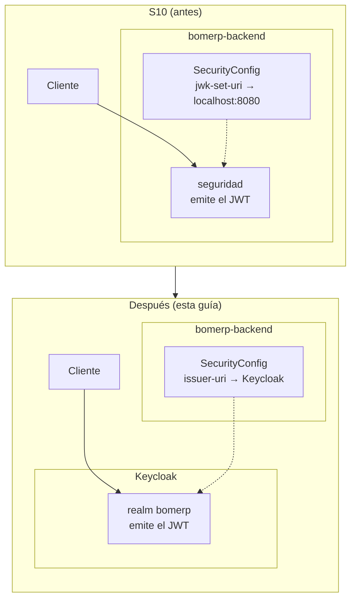
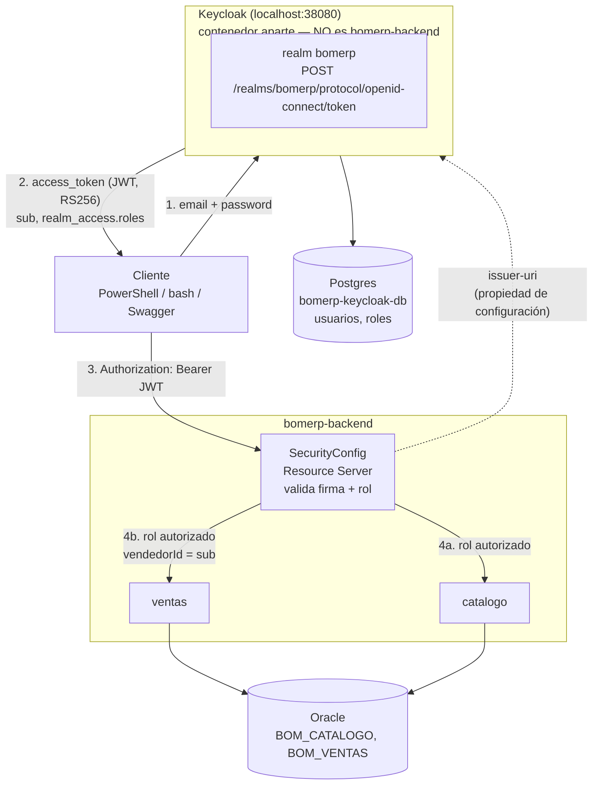

# S10 - Reemplazo del módulo `seguridad` por Keycloak (guía de referencia)

*Por: Angel Sullon Macalupu @asullom - 2026*

## 0. Qué es esta guía y qué no es

Esta guía **no** es una sesión del sílabo: ninguna fila de `silabo_lp2_2026_2.md` ni de `docs/lp2/index.md` la pide, no tiene metodología, caso de motivación, actividad autónoma ni rúbrica, y no se evalúa. Es la continuación directa de [S10_Seguridad_Backend_JWT_Roles.md](S10_Seguridad_Backend_JWT_Roles.md) — la sesión real y evaluada —, que construyó el módulo `seguridad` deliberadamente temporal y "listo para reemplazo" ([ADR-005](../adr/ADR-005-seguridad-jwt-propio-listo-para-reemplazo.md), 2.6 de esa guía, Tabla 4). Esta guía documenta, paso a paso y verificado, el reemplazo que esa ADR dejó como dirección arquitectónica sin construir: **desde descargar Keycloak hasta que `bomerp-backend` valide tokens suyos en vez de los propios**.

Úsala si tu equipo decide adoptar Keycloak en U3 o después — no antes, y no como parte de la evaluación de S10 o S11. La sesión S10 real queda exactamente como está; esta guía no le resta ni le agrega alcance.

La guía está dividida en tres partes, en el orden en que de verdad hace falta tocar cada pieza:

- **Parte A** (secciones 2-6) construye y prueba Keycloak solo — realm, cliente, usuarios, un token real inspeccionado, y hasta el flujo completo de login con redirect (6.1). **Nada de esto toca `bomerp-backend`** — ni un archivo, ni un reinicio.
- **Parte B** (7.1-7.2) es el mínimo que deja a `bomerp-backend` validando tokens de Keycloak: cambiar la propiedad de validación, y —si nunca construiste `seguridad`— el `pom.xml` y el `SecurityConfig`/`OpenApiConfig` completos. Si ya construiste `seguridad` (3.14-3.15 de S10 ya te dejaron `vendedorId`/RN8 funcionando), **con esto ya alcanza para la sesión**: `catalogo` y `ventas` quedan protegidos por Keycloak de punta a punta. Si fuiste directo a Keycloak, sigue a 7.3.
- **Parte C** (7.3 en adelante) profundiza: 7.3 es indispensable si fuiste directo a Keycloak — agrega `vendedorId` a `Venta` y el filtro por dueño (RN8), que en tu camino nunca se construyó. De 7.4 en adelante, confirma que nada de `catalogo`/`ventas` cambió si ya tenías `seguridad`, migra los datos viejos si aplica, retira lo que sobra, y verifica con la matriz completa que cada `VENDEDOR` sigue viendo solo sus propias ventas mientras `SUPERVISOR`/`ADMIN` las ven todas — ahora con tokens de Keycloak en vez de `seguridad`.

**Requisito real:** no necesitas tener `seguridad` construido ni corriendo — nunca coexiste con Keycloak, uno reemplaza al otro. Lo indispensable de S10 es la lógica de autorización que vive en `bomerp-backend` y no depende de quién emite el token:

- **3.2** — la columna `VENDEDOR_ID VARCHAR2(36)` en `VENTAS` (el `ALTER TABLE`; la parte de Postgres/`seguridad` de ese mismo punto no aplica aquí). **Verifica el tipo antes de asumir que ya la tienes**: la rama congelada `s10-seguridad-jwt-roles` la guardó como `NUMBER` (diseño previo a [ADR-005](../adr/ADR-005-seguridad-jwt-propio-listo-para-reemplazo.md), antes de decidir que `vendedorId` sería texto listo para un UUID) — si es tu caso, el Anexo al final de esta guía trae el código para corregirla, antes de seguir.
- **3.3** — solo 2 de las 4 dependencias de `pom.xml`: `spring-boot-starter-security` y `spring-boot-starter-security-oauth2-resource-server`. **No** agregues `spring-security-oauth2-jose` (firma JWT — la hace Keycloak, no `bomerp-backend`) ni el driver `postgresql` (era para la BD propia de `seguridad`). Si nunca construiste `seguridad`, 7.2 trae el bloque exacto a pegar.
- **3.11** — solo el bloque de `OpenApiConfig` (el candado *Authorize* de Swagger). El `SecurityConfig` de ese mismo punto (con `PasswordEncoder`, `AuthenticationManager`, `jwk-set-uri`, y los `permitAll` de `/api/v1/auth/**`/`/.well-known/jwks.json`) **no** aplica tal cual — esos *beans* y rutas son específicos de `seguridad`, que nunca existe en tu camino; 7.2 trae la versión directa a Keycloak, sin esos dos `permitAll`, con las reglas de `catalogo`/`ventas` de 3.13/3.15 ya incluidas.
- **3.13** — las reglas de `catalogo` por rol en `SecurityConfig`.
- **3.14** — `vendedorId` como `String` en `Venta`, leído de `jwt.getSubject()` en `VentaController.crear`.
- **3.15** — las reglas de `ventas` por rol (`buscar`/`obtener`/`esVendedor`, `resumen`/`anular`).

Si ya construiste `seguridad` completo (3.1-3.12, 3.16-3.17) y vas a reemplazarlo paso a paso, parte de ese estado: esta guía lo asume y lo retira en 7.6-7.7 (incluida la migración de datos viejos de 7.5) — 7.3 tampoco aplica, porque S10 (3.14-3.15) ya te lo dejó construido. Si en cambio vas a ir directo a Keycloak sin construir `seguridad` nunca, las secciones 7.3, 7.5, 7.6 y 7.7 traen notas explícitas de qué aplica y qué no — no hay `seguridad`/Postgres propio que migrar ni retirar, y los cuatro puntos de arriba se resuelven directo en 7.2-7.3.

Las secciones 1 y 2 de S10 (teoría de JWT/RBAC) y 4-5 (actividad autónoma, cierre) son independientes de cuál camino tomes: se evalúan igual en ambos casos.

## 1. Qué cambia y qué no

**Figura 1. Antes y después del reemplazo**



### 1.1 Arquitectura de la sesión

**Figura 2. Keycloak vive fuera de `bomerp-backend`, en su propio contenedor; `SecurityConfig` lo consume por configuración, no por código**



La diferencia con la Figura 2 de S10 (2.1) no es solo el nombre de la caja: ahí `seguridad` vivía **dentro** del mismo proceso Spring Boot que `ventas`/`catalogo` (un recuadro más, mismo deploy, mismo JVM). Keycloak nunca entra a ese recuadro — es un contenedor aparte, con su propio ciclo de vida y su propio Postgres, y `bomerp-backend` solo lo conoce por una URL (`issuer-uri`). Eso es justo lo que vuelve el reemplazo una propiedad de configuración y no un cambio de código: `SecurityConfig` nunca importa nada de Keycloak, solo le pregunta por HTTP si una firma es válida.

Confirmando lo que ya decía la Tabla 4 de S10 (2.6), ahora con el detalle que faltaba:

**Tabla 1. Qué cambia exactamente en `bomerp-backend`**

| Pieza | Cambia |
|---|---|
| `SecurityConfig` (propiedad `jwk-set-uri` → `issuer-uri`) | Sí — una línea de `application-dev.yml` |
| `JwtAuthenticationConverter` (lee `realm_access.roles`) | **No** — Keycloak emite el claim con el mismo nombre |
| `catalogo`, `ventas` (controllers, services, reglas `hasRole`) | **No** |
| Cómo se lee `vendedorId` en `VentaController` | **No** — sigue siendo `jwt.getSubject()`, sin tocar (detalle abajo) |
| Paquete `seguridad` (`AuthController`, `JwtService`, `JwksController`, `JwtKeyConfig`, entidades) | Se retira si existía — queda sin uso, ver 7.7 |
| Contenedor `bomerp-seguridad-db` (Postgres) | Se retira si existía — Keycloak trae su propio almacenamiento |

Ningún punto de la tabla exige cambiar código — y eso no es casualidad, es la razón por la que `vendedorId` se diseñó como `String` desde S10 (3.2, 3.14), no como `Long`: el `sub` que emite `seguridad` hoy es el `id` numérico de `Usuario` convertido a texto (ej. `"3"`); el que emite Keycloak es un UUID (*Universally Unique Identifier*) propio del realm (ej. `"3fa85f64-5717-4562-b3fc-2c963f66afa6"`) — dos formatos de texto distintos, pero `VentaController` nunca los interpreta como número, solo los guarda tal cual. A diferencia de DIST, que sí necesita un **atributo de usuario** + **protocol mapper** para `idCliente` (S07, Tabla 6, porque `idCliente` identifica a una entidad de negocio aparte del usuario), aquí `vendedorId` **es** literalmente `sub` — no hace falta configurar nada nuevo en Keycloak para que viaje en el token, porque `sub` viaja siempre, en cualquier token, sin configuración. Lo único real que exige este cambio de emisor, si ya tenías ventas creadas bajo `seguridad`, es **migrar los datos que ya existen** — 7.5 lo resuelve.

## Parte A — Keycloak, sin tocar `bomerp-backend`

Las secciones 2 a 6 levantan, configuran y prueban Keycloak de punta a punta. En ningún momento se edita, reinicia ni recompila `bomerp-backend` — todo lo que sigue hasta el final de la sección 6 se verifica contra Keycloak directamente, con PowerShell/`curl`/el navegador.

## 2. Descargar y levantar Keycloak

**Producto del paso:** Keycloak corriendo en modo desarrollo, con su propio Postgres (no el H2 embebido por defecto) y consola de administración accesible.

Agrega los dos servicios a `lp2/bomerp-backend/compose-dev.yml` — un Postgres propio para Keycloak, igual en espíritu al que S10 ya usó para `seguridad` (3.2), y el propio Keycloak apuntando a él:

```yaml
  keycloak-db:
    image: postgres:17-alpine
    container_name: bomerp-keycloak-db
    restart: unless-stopped
    ports:
      - "35432:5432"
    environment:
      POSTGRES_DB: bomerp_keycloak
      POSTGRES_USER: bomerp_keycloak
      POSTGRES_PASSWORD: 123456
    volumes:
      - keycloak-db-data:/var/lib/postgresql/data
    healthcheck:
      test: ["CMD-SHELL", "pg_isready -U bomerp_keycloak -d bomerp_keycloak"]
      interval: 10s
      timeout: 5s
      retries: 10
      start_period: 15s

  keycloak:
    image: quay.io/keycloak/keycloak:26.8.0
    container_name: bomerp-keycloak
    restart: unless-stopped
    command: start-dev
    depends_on:
      keycloak-db:
        condition: service_healthy
    ports:
      - "38080:8080"
    environment:
      KC_BOOTSTRAP_ADMIN_USERNAME: admin
      KC_BOOTSTRAP_ADMIN_PASSWORD: admin123
      KC_DB: postgres
      KC_DB_URL: jdbc:postgresql://keycloak-db:5432/bomerp_keycloak
      KC_DB_USERNAME: bomerp_keycloak
      KC_DB_PASSWORD: 123456
    volumes:
      - keycloak-data:/opt/keycloak/data
```

Y agrega `keycloak-data:` y `keycloak-db-data:` junto a `oracle-data:`, bajo `volumes:` — `seguridad-db-data:` solo aparece ahí si seguiste S10 y construiste `seguridad` (Parte C lo retira en 7.6; si fuiste directo a Keycloak, nunca existió):

```yaml
volumes:
  oracle-data:
  keycloak-data:
  keycloak-db-data:
```

```powershell
cd lp2\bomerp-backend
docker compose -f compose-dev.yml up -d keycloak-db keycloak
```

```bash
cd lp2/bomerp-backend
docker compose -f compose-dev.yml up -d keycloak-db keycloak
```

`KC_DB_URL` usa `keycloak-db` (el nombre del servicio, no `localhost`) como host: Keycloak y su Postgres se hablan **dentro** de la red de Docker Compose, por el puerto **interno** `5432` — el `35432` publicado hacia el host es solo para que tú, desde fuera (`psql`, una herramienta gráfica), puedas inspeccionarlo si hace falta; `bomerp-backend` nunca se conecta a `keycloak-db` directamente. `depends_on: condition: service_healthy` evita el mismo error que S10 ya documentó para `bomerp-seguridad-db` (3.2): si Keycloak intenta conectarse antes de que Postgres esté listo, falla al arrancar.

El puerto externo de Keycloak es **38080**, no 8080: `bomerp-backend` ya usa el 8080 en DEV (S1), y Keycloak escucha internamente también en el 8080 de su propio contenedor — anteponer `3` (bomerp) distingue este puerto de cualquier otro servicio similar en otro curso que corra en la misma laptop (mismo criterio ya aplicado a los puertos Postgres entre repos, y ahora también al puerto de `keycloak-db`, `35432`). `start-dev` es el modo de arranque rápido para desarrollo: no pide configurar TLS ni un *hostname* explícito — pero con `KC_DB` apuntando a Postgres, los datos (realm, usuarios, clients) ya **no** dependen del H2 embebido ni del volumen `keycloak-data`: viven en `keycloak-db-data`, igual que `oracle-data`/`seguridad-db-data` lo hacen para los otros dos motores. El volumen `keycloak-data` igual se conserva (Keycloak guarda ahí configuración local propia, no el realm), pero ya no es el único lugar que importa para no perder el trabajo de las secciones 3-6. **En producción real** sigue faltando un paso más: `start` (modo *production*, que exige TLS) en vez de `start-dev` — el motor de base de datos ya queda resuelto desde esta guía, lo único pendiente para producción real es TLS y el *hostname* explícito.

`KC_BOOTSTRAP_ADMIN_USERNAME`/`KC_BOOTSTRAP_ADMIN_PASSWORD` (Keycloak 26+; versiones anteriores usaban `KEYCLOAK_ADMIN`/`KEYCLOAK_ADMIN_PASSWORD`, ya retiradas) solo crean el usuario administrador la **primera** vez que arranca — cambiarlas después, con el usuario ya creado, no tiene efecto.

Confirma que levantó accediendo a `http://localhost:38080` — debe aparecer la pantalla de bienvenida de Keycloak. Entra a la consola de administración (`Administration Console`) con `admin` / `admin123`.

## 3. Configurar el realm `bomerp`

**Producto del paso:** un realm propio (no el `master` por defecto, reservado para administrar Keycloak mismo), con los tres roles que `ventas` ya usa.

### 3.0 (Opcional) Español en el Admin Console

Conviene hacer esto **antes** de crear `bomerp`, para ver el resto de esta guía ya en español. El Admin Console es una sola aplicación compartida por todo Keycloak, no por realm — su idioma sigue la configuración de **`master`**, nunca la de `bomerp`. Con `master` como realm activo (el único que existe por ahora) → **Realm settings** → **Localization** → **Locales** → activa **Internationalization**, agrega `Spanish` a *Supported locales*, elige `Spanish` en *Default locale* → **Save**. Recarga la página.

Esto solo cambia el menú y los botones que ves tú como administrador — no afecta la pantalla de login que verán tus usuarios (ej. `vendedor1@bomerp.com`, al autenticarse); esa se configura por separado, en 3.2, una vez creado el realm `bomerp`. Si solo quieres el Admin Console en español, basta con este paso; si además quieres que la pantalla de login de tus usuarios finales aparezca en español, haz también 3.2.

### 3.1 Crear el realm y los roles

De aquí en adelante, cada referencia a un botón o pestaña de la consola trae el término en inglés (el que usa la documentación oficial de Keycloak) seguido de su traducción aproximada entre paréntesis — si tu consola está en español y el texto exacto no calza del todo, guíate por la posición/ícono, no por la traducción literal: no verifiqué cada cadena contra una consola real en español.

1. En el menú lateral izquierdo, entra a **Manage realms** (*Administrar realms*) → clic en **Create realm** (*Crear realm*).
2. *Realm name*: `bomerp`. Deja **Resource file** vacío (es solo para importar un realm ya exportado como JSON, no aplica aquí). Crear.

Al crearlo, Keycloak cambia solo el realm activo al que acabas de crear — lo ves en la esquina superior izquierda, donde antes decía `master` ahora dice `bomerp` (`Current realm`). No hace falta ningún paso extra para "entrar" a `bomerp`: todo lo que sigue ya ocurre ahí.

3. Con `bomerp` como realm activo, ve a **Realm roles** → **Create role**, y crea los tres, uno por uno: `VENDEDOR`, `SUPERVISOR`, `ADMIN`.

Estos son **realm roles** (no *client roles*) a propósito: Keycloak los agrega al token bajo el claim `realm_access.roles` — el mismo nombre que `JwtService` de `seguridad` ya usaba (S10, 3.8) y que `JwtAuthenticationConverter` ya sabe leer (S10, 3.11). Es el primer punto donde se confirma la promesa de la Tabla 4: cero cambios en ese conversor.

### 3.2 (Opcional) Español para la pantalla de login de `bomerp`

Con `bomerp` como realm activo (no `master`): **Realm settings** → **Localization** → **Locales** → activa **Internationalization**, agrega `Spanish` a *Supported locales*, elige `Spanish` en *Default locale* → **Save**. Es exactamente la misma pantalla de 3.0, pero ahora sobre `bomerp` — y afecta algo distinto: esta es la que ven tus usuarios al autenticarse, no el Admin Console.

## 4. Crear el cliente para pruebas

**Producto del paso:** un *client* en el realm `bomerp` que permita pedir un token para probar la integración antes de construir la SPA real (S11).

1. **Clients** (*Clientes*) → **Create client** (*Crear cliente*).
2. Paso **General settings** (*Configuraciones generales*): *Client type* (*Tipo de cliente*): `OpenID Connect`. *Client ID* (*ID de cliente*): `bomerp-frontend`. *Name*/*Description* (*Nombre*/*Descripción*): opcionales, déjalos vacíos. **Always display in UI** (*Mostrar siempre en la interfaz de usuario*): déjalo **desactivado** — solo importa si quieres que este cliente aparezca listado en el *Account Console* de Keycloak incluso sin sesión activa, algo que no necesitas para un cliente de prueba. Siguiente.
3. Paso **Capability config** (*Configuración de capacidades*) — todo en una sola pantalla:
    - **Client authentication** (*Autenticación del cliente*): **desactivado** (es un *public client* — la SPA de S11 no puede guardar un secreto, 2.6 de S10).
    - **Authorization** (*Autorización*): desactivado — no aplica a esta guía (son los *fine-grained authorization services* de Keycloak, otra funcionalidad aparte).
    - **Authentication flow** (*Flujo de autenticación*): deja marcado **Standard flow** (*Flujo estándar*, viene activado por defecto — es el que usará S11 con *Authorization Code* + PKCE) y marca además **Direct access grants** (*Concesiones de acceso directo*). Deja el resto de casillas sin marcar.
    - **Require PKCE** (*Requiere PKCE*) y **Require DPoP-bound tokens** (*Requerir tokens vinculados a DPoP*): déjalos en su valor por defecto (desactivado) — ninguno de los dos aplica todavía, porque esta guía no usa el *Standard flow* para pedir tokens (eso llega en S11); el icono de advertencia junto a *Require PKCE* es una recomendación general de seguridad de Keycloak, no un error de esta configuración.
    - Siguiente.
4. Paso **Login settings** (*Configuraciones de inicio de sesión*): estos campos son para el *Standard flow* (redirección de navegador) que usará la SPA real en S11 — *Direct access grants*, el flujo que prueba esta guía, no pasa por el navegador y no los necesita. Aun así, déjalos ya apuntando a donde correrá la SPA (mismo origen que `bomerp.cors.allowed-origins` en `application-dev.yml`, S1):
    - **Root URL**/**Home URL** (*URL raíz*/*URL de inicio*): vacío.
    - **Valid redirect URIs** (*URIs de redirección válidos*): `http://localhost:4200/*`.
    - **Valid post logout redirect URIs** (*URI de redirección de post cierre de sesión válidos*): `http://localhost:4200/*`.
    - **Web origins** (*Orígenes web*): `http://localhost:4200`.
    - Guardar.

**Error frecuente, y por qué es intencional dejarlo así documentado**: *Direct access grants* corresponde al mismo flujo que la RFC 9700 desaconseja (S10, 2.6, cita textual: *"MUST NOT be used"*) — la razón por la que `seguridad` también lo usaba era la misma: es un atajo de laboratorio, no el diseño final. Úsalo aquí únicamente para verificar que Keycloak emite tokens válidos antes de construir el flujo real; S11 reconfigura este mismo cliente para *Authorization Code* + PKCE (*Proof Key for Code Exchange*) y **desactiva** *Direct access grants* como parte de ese trabajo — no antes.

## 5. Crear los usuarios semilla

**Producto del paso:** los mismos cuatro usuarios de S10 (3.10), ahora en Keycloak. `vendedorId` no necesita ningún paso aparte — es literalmente `sub` (1, Tabla 1), y `sub` viaja en cualquier token sin configurar nada.

Por cada uno de `vendedor1@bomerp.com`, `vendedor2@bomerp.com`, `supervisor@bomerp.com`, `admin@bomerp.com`:

1. **Users** (*Usuarios*) → **Add user** (*Agregar usuario*) → **Crear usuario**.
    - **Required user actions** (*Acciones de usuario requeridas*): déjalo **vacío**, sin seleccionar ninguna. Si marcas algo aquí (ej. *Update Password*), Keycloak lo exige en el primer login — rompe el flujo de *Direct access grants* de la sección 6, igual que dejar la contraseña como *Temporary* (paso 2 de abajo).
    - **Email verified** (*Correo electrónico verificado*): activado (para no complicar el flujo con verificación de correo en esta guía).
    - **Select a locale** (*Seleccionar una configuración regional*): opcional, es el idioma de **ese usuario en particular** (distinto de 3.0/3.2, que son el idioma por defecto del realm) — déjalo en *Idioma predeterminado* o elige `Español` si quieres forzarlo para este usuario puntual.
    - **Username** (*Nombre de usuario*): el nombre corto, sin dominio (ej. `vendedor1`) — es el identificador que usarás al pedir un token (6), no el email.
    - **Email** (*Correo electrónico*): el email completo (ej. `vendedor1@bomerp.com`).
    - **First name**/**Last name** (*Nombre*/*Apellido*): **no los dejes vacíos** — pon cualquier valor real (ej. `Vendedor`/`Uno`). No son cosméticos: el realm trae activa `VERIFY_PROFILE` (*Verify Profile*, ver "Error frecuente" abajo), que Keycloak evalúa en cada login — con estos dos campos vacíos, el perfil nunca se considera completo y el login falla, aunque la contraseña sea correcta.
    - *Grupos*: opcional, déjalo vacío.
    - **Crear**.
2. Pestaña **Credentials** (*Credenciales*) → **Set password** (*Establecer contraseña*): `Bomerp2026!`, *Temporary* (*Temporal*): **desactivado** (si queda activado, Keycloak exige cambiarla en el primer login, lo que rompe el flujo de *Direct access grants* de la sección 6).
3. Pestaña **Role mapping** (*Mapeo de roles*) → **Assign role** (*Asignar rol*) → en el dropdown, elige **Realm roles** (*Roles de realm*, no *Roles de cliente*) — ahí aparece la lista del paso 3 de la sección 3 (`ADMIN`, `SUPERVISOR`, `VENDEDOR`, más dos roles propios de Keycloak: `offline_access`, `uma_authorization`, que no tocas). Marca `VENDEDOR` para los dos primeros usuarios, `SUPERVISOR` y `ADMIN` para los otros dos, respectivamente, y **Asignar** — el mismo criterio de promoción manual que S10 ya aplicaba a mano sobre Postgres (3.10), ahora sobre la consola de Keycloak.

**Error frecuente**: login en la sección 6 responde `{"error":"invalid_grant","error_description":"Account is not fully set up"}`, aunque el usuario no tenga ninguna *required action* explícita en la pestaña **Details**, la contraseña no sea *Temporary*, y ningún *required action* del realm esté marcado como *default* (`SELECT ... FROM required_action_provider` da `default_action = f` en todas). La causa real: `VERIFY_PROFILE` (*Verify Profile*) viene `enabled` en este realm, y esa acción se calcula **dinámicamente en cada login**, no como fila guardada — revisa si `first_name`/`last_name` quedaron vacíos (si usaste la consola en vez de la API, puede pasar aunque los hayas escrito):

```bash
docker exec -i bomerp-keycloak-db psql -U bomerp_keycloak -d bomerp_keycloak -c "SELECT email, first_name, last_name, email_verified FROM user_entity WHERE email = 'vendedor1@bomerp.com';"
```

**(Opcional, solo si el `SELECT` de arriba muestra algo vacío)** — si seguiste el paso 1 tal cual (`First name`/`Last name` ya llenos), esto no debería hacer falta. Corrige lo que falte (ejemplo con los cuatro usuarios — ajusta los nombres):

```bash
docker exec -i bomerp-keycloak-db psql -U bomerp_keycloak -d bomerp_keycloak -c "
UPDATE user_entity SET first_name = 'Vendedor', last_name = 'Uno', email_verified = true WHERE email = 'vendedor1@bomerp.com';
UPDATE user_entity SET first_name = 'Vendedor', last_name = 'Dos', email_verified = true WHERE email = 'vendedor2@bomerp.com';
UPDATE user_entity SET first_name = 'Supervisor', last_name = 'Uno', email_verified = true WHERE email = 'supervisor@bomerp.com';
UPDATE user_entity SET first_name = 'Admin', last_name = 'Uno', email_verified = true WHERE email = 'admin@bomerp.com';
"
```

```powershell
docker exec -i bomerp-keycloak-db psql -U bomerp_keycloak -d bomerp_keycloak -c "UPDATE user_entity SET first_name = 'Vendedor', last_name = 'Uno', email_verified = true WHERE email = 'vendedor1@bomerp.com'; UPDATE user_entity SET first_name = 'Vendedor', last_name = 'Dos', email_verified = true WHERE email = 'vendedor2@bomerp.com'; UPDATE user_entity SET first_name = 'Supervisor', last_name = 'Uno', email_verified = true WHERE email = 'supervisor@bomerp.com'; UPDATE user_entity SET first_name = 'Admin', last_name = 'Uno', email_verified = true WHERE email = 'admin@bomerp.com';"
```

**(Opcional, solo si corriste el `UPDATE` directo por SQL de arriba)** — crear o editar un usuario desde la consola nunca necesita esto, Keycloak lo aplica al instante; el reinicio es solo por precaución tras tocar `keycloak-db` por fuera de la aplicación (no confirmé si cachea en memoria o no, pero es gratis hacerlo y evita dudarlo):

```bash
docker restart bomerp-keycloak
```

## 6. Verificar el token antes de tocar `bomerp-backend`

**Producto del paso:** confirmación, con un token real, de que `realm_access.roles` llega con el formato esperado y `sub` es el UUID del usuario — antes de cambiar nada en el código.

```powershell
$login = Invoke-RestMethod -Method Post -Uri "http://localhost:38080/realms/bomerp/protocol/openid-connect/token" `
  -ContentType "application/x-www-form-urlencoded" `
  -Body "grant_type=password&client_id=bomerp-frontend&username=vendedor1&password=Bomerp2026!"
$login.access_token
```

```bash
curl -X POST http://localhost:38080/realms/bomerp/protocol/openid-connect/token \
  -H "Content-Type: application/x-www-form-urlencoded" \
  -d "grant_type=password&client_id=bomerp-frontend&username=vendedor1&password=Bomerp2026!"
```

Pega el `access_token` recibido en [jwt.io](https://jwt.io) (inspección visual únicamente, 2.3 de S10) y confirma dos cosas: `realm_access.roles` trae `["VENDEDOR"]`; y `sub` es un UUID, no el `"3"` de antes — exactamente la diferencia que la sección 1 anticipó.

`POST /realms/bomerp/protocol/openid-connect/token` es el endpoint estándar de token de Keycloak (OAuth 2.0/OpenID Connect, S10 2.6) — equivalente a `POST /api/v1/auth/login` de `seguridad`, pero ya no es un endpoint propio de BomERP.

**Error frecuente**: comparar el `expires_in` de este token con el de `seguridad` y asumir que algo está mal. Por defecto, el realm nuevo trae el *access token* del propio Keycloak (*Realm settings* → *Tokens* → *Access Token Lifespan*) en **5 minutos**, no en la hora que `jwt.expiracion-segundos` dejaba en S10 (3.8) — token expirado a mitad de una prueba no es un bug de la integración, solo un valor por defecto distinto. Ajusta ese campo en el realm si las pruebas de la sección 8 te quedan cortas de tiempo.

### 6.1 (Opcional) Simular el login real, con redirect

**Producto del paso:** ver, con tus propios ojos, el flujo *Authorization Code* que usará la SPA en S11 — el que **sí** redirige al navegador a la pantalla de Keycloak, en vez del *Direct Access Grant* (atajo de laboratorio) que usaste en el resto de esta guía. Sigue sin tocar `bomerp-backend`.

No hace falta construir la SPA para verlo: el cliente `bomerp-frontend` ya tiene **Standard flow** activado (4, paso 3) y `http://localhost:4200/*` como *redirect URI* válido (4, paso 4), aunque todavía no haya nada corriendo ahí.

1. Arma la URL de autorización a mano y ábrela en el navegador:

```text
http://localhost:38080/realms/bomerp/protocol/openid-connect/auth?client_id=bomerp-frontend&redirect_uri=http://localhost:4200/callback&response_type=code&scope=openid
```

2. Verás la pantalla de login del realm **`bomerp`** (no `master` — si te aparece pidiendo `admin`, revisa que la URL diga `/realms/bomerp/...`, no `/realms/master/...`). Entra con `vendedor1@bomerp.com` / `Bomerp2026!`.

**Figura 3. Pantalla de login de Keycloak para el realm `bomerp`**


Nota la URL de la barra de direcciones: `localhost:38080/realms/bomerp/...` — confirma que el formulario lo sirve Keycloak, no `bomerp-backend` ni ninguna SPA propia (a diferencia del login de `seguridad`, S10 3.10, que era un formulario de BomERP).

3. El navegador intenta redirigir a `http://localhost:4200/callback?code=...&state=...` — como ahí no hay ninguna SPA corriendo todavía, la pestaña muestra error de conexión. Eso es **esperado**: lo que importa es la URL a la que llegó. Cópiala de la barra de direcciones y mira el parámetro `code` — esa es la prueba de que el flujo completo (login en Keycloak → redirect de vuelta con un código) ya funciona de punta a punta, sin que `bomerp-backend` ni ninguna SPA hayan intervenido todavía.

4. (Opcional) Cambia ese `code` por un token real, a mano, antes de que expire (son pocos segundos a minutos):

```powershell
$code = "<pega aquí el valor de code de la URL>"
$login2 = Invoke-RestMethod -Method Post -Uri "http://localhost:38080/realms/bomerp/protocol/openid-connect/token" `
  -ContentType "application/x-www-form-urlencoded" `
  -Body "grant_type=authorization_code&client_id=bomerp-frontend&redirect_uri=http://localhost:4200/callback&code=$code"
$login2.access_token
```

```bash
curl -X POST http://localhost:38080/realms/bomerp/protocol/openid-connect/token \
  -H "Content-Type: application/x-www-form-urlencoded" \
  -d "grant_type=authorization_code&client_id=bomerp-frontend&redirect_uri=http://localhost:4200/callback&code=<pega aquí el code>"
```

Lo que S11 construye de verdad es que la SPA, corriendo en `localhost:4200`, capture ese `code` sola (sin que tú lo copies a mano) y haga este último intercambio automáticamente, además de agregar PKCE (4, paso 3, *Require PKCE*) — esta sección solo demuestra que el mecanismo de fondo ya está activo desde ahora, sin tocar ni una línea de `bomerp-backend`.

5. (Opcional) Cambiar de usuario o cerrar sesión. Si repites la URL del paso 1 tal cual, Keycloak reconoce la cookie de sesión que ya tienes y te deja pasar **sin pedir login de nuevo** (es SSO funcionando, no un error) — para probar con otro usuario necesitas una de estas dos:

Cerrar la sesión de Keycloak:

```text
http://localhost:38080/realms/bomerp/protocol/openid-connect/logout?client_id=bomerp-frontend&post_logout_redirect_uri=http://localhost:4200
```

O forzar un login nuevo sin cerrar la sesión existente, agregando `&prompt=login` a la URL del paso 1:

```text
http://localhost:38080/realms/bomerp/protocol/openid-connect/auth?client_id=bomerp-frontend&redirect_uri=http://localhost:4200/callback&response_type=code&scope=openid&prompt=login
```

6. (Opcional) Probar el *refresh token*. Tanto el paso 4 de aquí (*Authorization Code*) como el token de la sección 6 (*Direct Access Grant*) ya incluyen un `refresh_token` en la respuesta, sin configurar nada extra en Keycloak — revísalo:

```powershell
$login2 | ConvertTo-Json
```

Cámbialo por un `access_token` nuevo, sin volver a pedir usuario/contraseña — es justo lo que una SPA real hace sola, en segundo plano, poco antes de que el token actual expire:

```powershell
$refreshed = Invoke-RestMethod -Method Post -Uri "http://localhost:38080/realms/bomerp/protocol/openid-connect/token" `
  -ContentType "application/x-www-form-urlencoded" `
  -Body "grant_type=refresh_token&client_id=bomerp-frontend&refresh_token=$($login2.refresh_token)"
$refreshed.access_token
```

```bash
refreshedAccessToken=$(curl -s -X POST http://localhost:38080/realms/bomerp/protocol/openid-connect/token \
  -H "Content-Type: application/x-www-form-urlencoded" \
  -d "grant_type=refresh_token&client_id=bomerp-frontend&refresh_token=$refreshToken" | jq -r '.access_token')
```

`bomerp-backend` nunca ve ni usa el `refresh_token` — es un *Resource Server*, solo valida `access_token` en cada request. El refresco es trabajo exclusivo del cliente (la SPA en S11, vía `keycloak-js`/`angular-oauth2-oidc`), nunca del backend.

## Parte B — Integrar `bomerp-backend` con Keycloak

A partir de aquí sí se edita, recompila y reinicia `bomerp-backend` — todo sobre el Keycloak que la Parte A ya dejó funcionando y verificado. Parte B termina en 7.2: con la propiedad de validación cambiada y (si aplica) `pom.xml`/`SecurityConfig`/`OpenApiConfig` en su lugar, `bomerp-backend` ya valida tokens de Keycloak — **ya alcanza para la sesión** si ya construiste `seguridad` (3.14-3.15 de S10 ya te dejaron `vendedorId`/RN8 funcionando). Si vas directo a Keycloak, sigue hasta 7.3: ahí es indispensable, es donde `ventas` aprende por primera vez de quién es cada venta. De 7.4 en adelante, Parte C es la profundización: confirmar, migrar, retirar lo que sobra, y verificar con la matriz completa que `ventas` sigue filtrando por dueño.

## 7. Integrar `bomerp-backend` con Keycloak

**Producto del paso:** `SecurityConfig` valida tokens de Keycloak; `catalogo` y `ventas` siguen funcionando sin que se les toque una línea.

### 7.1 Cambiar la propiedad de validación

Si ya construiste `seguridad` y tenías `jwk-set-uri` configurado (S10, 3.11), reemplaza ese bloque en `lp2/bomerp-backend/src/main/resources/application-dev.yml`:

```yaml
spring:
  security:
    oauth2:
      resourceserver:
        jwt:
          jwk-set-uri: http://localhost:8080/.well-known/jwks.json
```

por:

```yaml
spring:
  security:
    oauth2:
      resourceserver:
        jwt:
          issuer-uri: http://localhost:38080/realms/bomerp
```

Si nunca construiste `seguridad`, no hay nada que reemplazar — agrega el bloque de `issuer-uri` directamente, es la única propiedad de seguridad que `application-dev.yml` necesita.

Con `issuer-uri` (en vez de `jwk-set-uri`), Spring no solo descubre dónde están las claves — además valida que el claim `iss` (*issuer*, emisor) de cada token coincida exactamente con esta URL, y descarga la configuración del realm (incluida su ubicación de JWKS) del documento de descubrimiento estándar de OpenID Connect (`/.well-known/openid-configuration`) que Keycloak sí publica (a diferencia de `seguridad`, que no lo implementaba — S10, 2.6).

### 7.2 Agregar las dependencias y escribir `SecurityConfig`/`OpenApiConfig` (si vas directo a Keycloak)

**Solo si nunca construiste `seguridad`.** Si ya la tenías y la estás reemplazando paso a paso, ya tienes `pom.xml` (S10, 3.3), `SecurityConfig` (S10, 3.11) y `vendedorId`/RN8 (S10, 3.14-3.15) — salta directo a 7.4, y pasa por 7.7 más abajo para limpiar lo que sobra.

**`pom.xml`** — agrega, dentro de `<dependencies>`, solo estas dos (sin `<version>`, las gestiona `spring-boot-starter-parent`, ADR-003):

```xml
<dependency>
    <groupId>org.springframework.boot</groupId>
    <artifactId>spring-boot-starter-security</artifactId>
</dependency>
<dependency>
    <groupId>org.springframework.boot</groupId>
    <artifactId>spring-boot-starter-security-oauth2-resource-server</artifactId>
</dependency>
```

**No** agregues `spring-security-oauth2-jose` (sirve para **firmar** JWT; Keycloak firma los suyos, `bomerp-backend` nunca firma nada) ni el driver `postgresql` (era solo para la BD propia de `seguridad`, que nunca existe en este camino).

**`lp2/bomerp-backend/src/main/java/pe/edu/upeu/bomerp/SecurityConfig.java`** (archivo nuevo):

```java
package pe.edu.upeu.bomerp;

import org.springframework.context.annotation.Bean;
import org.springframework.context.annotation.Configuration;
import org.springframework.http.HttpMethod;
import org.springframework.security.config.annotation.web.builders.HttpSecurity;
import org.springframework.security.config.http.SessionCreationPolicy;
import org.springframework.security.core.GrantedAuthority;
import org.springframework.security.core.authority.SimpleGrantedAuthority;
import org.springframework.security.oauth2.server.resource.authentication.JwtAuthenticationConverter;
import org.springframework.security.web.SecurityFilterChain;

import java.util.Collection;
import java.util.List;
import java.util.Map;

@Configuration
public class SecurityConfig {

    @Bean
    public JwtAuthenticationConverter jwtAuthenticationConverter() {
        JwtAuthenticationConverter converter = new JwtAuthenticationConverter();
        converter.setJwtGrantedAuthoritiesConverter(jwt -> {
            Map<String, Object> realmAccess = jwt.getClaimAsMap("realm_access");
            Object roles = realmAccess == null ? null : realmAccess.get("roles");
            if (!(roles instanceof Collection<?> lista)) {
                return List.<GrantedAuthority>of();
            }
            return lista.stream()
                    .map(rol -> (GrantedAuthority) new SimpleGrantedAuthority("ROLE_" + rol))
                    .toList();
        });
        return converter;
    }

    @Bean
    public SecurityFilterChain securityFilterChain(HttpSecurity http,
                                                     JwtAuthenticationConverter jwtAuthenticationConverter) throws Exception {
        http
                .csrf(csrf -> csrf.disable())
                .sessionManagement(session -> session.sessionCreationPolicy(SessionCreationPolicy.STATELESS))
                .authorizeHttpRequests(auth -> auth
                        .requestMatchers("/actuator/**", "/swagger-ui.html", "/swagger-ui/**", "/v3/api-docs/**").permitAll()
                        .requestMatchers(HttpMethod.GET, "/api/v1/productos/**", "/api/v1/categorias/**").authenticated()
                        .requestMatchers(HttpMethod.POST, "/api/v1/productos/**", "/api/v1/categorias/**").hasRole("ADMIN")
                        .requestMatchers(HttpMethod.PUT, "/api/v1/productos/**", "/api/v1/categorias/**").hasRole("ADMIN")
                        .requestMatchers(HttpMethod.DELETE, "/api/v1/productos/**", "/api/v1/categorias/**").hasRole("ADMIN")
                        .requestMatchers(HttpMethod.POST, "/api/v1/ventas").hasAnyRole("VENDEDOR", "SUPERVISOR")
                        .requestMatchers(HttpMethod.GET, "/api/v1/ventas/resumen").hasAnyRole("SUPERVISOR", "ADMIN")
                        .requestMatchers(HttpMethod.PATCH, "/api/v1/ventas/*/anular").hasAnyRole("SUPERVISOR", "ADMIN")
                        .requestMatchers("/api/v1/ventas/**").hasAnyRole("VENDEDOR", "SUPERVISOR", "ADMIN")
                        .anyRequest().authenticated()
                )
                .oauth2ResourceServer(oauth2 -> oauth2
                        .jwt(jwt -> jwt.jwtAuthenticationConverter(jwtAuthenticationConverter)));
        return http.build();
    }
}
```

Compara esta versión con la de S10 (3.11): no hay `PasswordEncoder` ni `AuthenticationManager` (nadie hace login contra una base local), y no hay `permitAll` para `/api/v1/auth/**` ni `/.well-known/jwks.json` — ninguno de los dos existe en este camino, no hay nada que dejar abierto ahí. Las reglas por rol de `catalogo` (S10, 3.13) y `ventas` (S10, 3.15) ya están ahí, **antes** de `.anyRequest().authenticated()`, exactamente como en S10 — copiadas tal cual, sin que el cambio de emisor les toque una línea. Con esto, Parte B ya protege de verdad por rol, no solo exige un token válido: Parte C (RN8) prueba precisamente esa distinción con tokens de Keycloak.

**`lp2/bomerp-backend/src/main/java/pe/edu/upeu/bomerp/OpenApiConfig.java`** (archivo nuevo — el candado de Swagger, mismo patrón que `pagatu-orden-ms` en DIST S07):

```java
package pe.edu.upeu.bomerp;

import io.swagger.v3.oas.models.Components;
import io.swagger.v3.oas.models.OpenAPI;
import io.swagger.v3.oas.models.info.Info;
import io.swagger.v3.oas.models.security.SecurityRequirement;
import io.swagger.v3.oas.models.security.SecurityScheme;
import org.springframework.context.annotation.Bean;
import org.springframework.context.annotation.Configuration;

@Configuration
public class OpenApiConfig {

    private static final String ESQUEMA_JWT = "bearerAuth";

    @Bean
    OpenAPI bomErpOpenApi() {
        return new OpenAPI()
                .info(new Info()
                        .title("BomERP API")
                        .version("v1")
                        .description("Contrato REST del backend unico de LP2"))
                .components(new Components().addSecuritySchemes(ESQUEMA_JWT,
                        new SecurityScheme()
                                .type(SecurityScheme.Type.HTTP)
                                .scheme("bearer")
                                .bearerFormat("JWT")))
                .addSecurityItem(new SecurityRequirement().addList(ESQUEMA_JWT));
    }
}
```

Con esto, Swagger UI (`http://localhost:8080/swagger-ui.html`) muestra el botón **Authorize** arriba a la derecha — pega ahí el `access_token` de la sección 6 (sin el prefijo `Bearer `, Swagger lo agrega solo) y cada "Try it out" manda el header automáticamente, incluso contra rutas protegidas.

## Parte C — Profundizar: cerrar la migración y verificar que `ventas` filtra por dueño

Lo construido hasta 7.2 deja a `bomerp-backend` validando tokens de Keycloak, pero `ventas` todavía no sabe de quién es cada venta. **7.3 sí es indispensable si vas directo a Keycloak** (sección 0 ya lo marca: 3.14-3.15 de S10) — sin ella, `crear` nunca guarda `vendedorId`, y RN8 no existe. De 7.4 en adelante, en cambio, es la profundización que confirma que el reemplazo no rompió nada y verifica RN8 (`VENDEDOR` ve solo sus propias ventas, `SUPERVISOR`/`ADMIN` las ven todas) con tokens reales de Keycloak en vez de los de `seguridad`.

### 7.3 Agregar `vendedorId` a `Venta` y filtrar `ventas` por dueño (si vas directo a Keycloak)

**Solo si nunca construiste `seguridad`.** Si ya la tenías, S10 (3.14-3.15) ya dejó esto construido exactamente igual — salta a 7.4.

**Producto del paso:** `VENTAS` gana la columna `VENDEDOR_ID`; `Venta` tiene `vendedorId`; `crear` lo toma del claim `sub` del JWT ya validado (RN5, ADS S8); `buscar`/`obtener` filtran por dueño cuando el rol es `VENDEDOR` (RN8); un `VENDEDOR` que pide, por `id`, una venta ajena recibe `403`, no `404`.

Primero, la columna — si ya la verificaste en el Anexo (porque salió `NUMBER` en tu rama), sáltate esto, ya quedó en `VARCHAR2(36)`:

```powershell
@'
ALTER TABLE VENTAS ADD VENDEDOR_ID VARCHAR2(36);
'@ | docker exec -i bomerp-oracle bash -c "sqlplus -s BOM_VENTAS/123456@localhost:1521/FREEPDB1"
```

```bash
docker exec -i bomerp-oracle bash -c "sqlplus -s BOM_VENTAS/123456@localhost:1521/FREEPDB1" <<'EOF'
ALTER TABLE VENTAS ADD VENDEDOR_ID VARCHAR2(36);
EOF
```

Sin `NOT NULL` a propósito: las ventas creadas en S4-S9 (antes de que existiera cualquier autenticación) quedan con esta columna en `NULL`, y eso está bien — no se reescribe el pasado. Toda venta creada desde hoy en adelante sí la trae, porque el propio servicio la completa (más abajo).

**`lp2/bomerp-backend/.../ventas/venta/entity/Venta.java`** — agrega el campo:

```java
@Column(name = "VENDEDOR_ID", length = 36)
private String vendedorId;
```

**`VentaController.crear`** — reemplaza la firma del método:

```java
@PostMapping
@ResponseStatus(HttpStatus.CREATED)
public VentaResponse crear(@Valid @RequestBody VentaRequest request, @AuthenticationPrincipal Jwt jwt) {
    String vendedorId = jwt.getSubject();
    return ventaService.crear(request, vendedorId);
}
```

Agrega los imports:

```java
import org.springframework.security.core.annotation.AuthenticationPrincipal;
import org.springframework.security.oauth2.jwt.Jwt;
```

**`VentaService`** — actualiza la firma:

```java
VentaResponse crear(VentaRequest request, String vendedorId);
```

**`VentaServiceImpl.crear`** — recibe `vendedorId` aparte y lo asigna a la cabecera; el resto del método (validar cada línea, descontar stock, calcular el total) no tiene ninguna relación con `vendedorId` y queda intacto:

```java
@Override
@Transactional
public VentaResponse crear(VentaRequest request, String vendedorId) {
    Venta venta = new Venta();
    venta.setFecha(LocalDateTime.now());
    venta.setEstado(EstadoVenta.REGISTRADA);
    venta.setVendedorId(vendedorId);

    // el resto del método sigue exactamente igual que en S9
```

`jwt.getSubject()` entrega el claim `sub` como texto, directo del UUID que emite Keycloak — `vendedorId` se guarda **tal cual**, sin convertir a número. `VentaRequest` **nunca** tiene un campo `vendedorId` (a diferencia de `idCliente` en DIST, que sí hay que quitar de `OrdenRequest`): este dato nunca llega por un canal que el cliente controle, siempre por el claim del token.

RN8 (un `VENDEDOR` solo ve sus propias ventas) no se resuelve por ruta — las tres roles pueden llamar a `buscar`/`obtener`, pero el **contenido** que cada uno ve depende de su identidad, no solo de su rol (ABAC). Eso se resuelve dentro del servicio. **`VentaController`** — agrega `@AuthenticationPrincipal Jwt jwt` a `buscar` y `obtener`, y pasa el rol/`vendedorId` al servicio:

```java
@GetMapping
public ResponseEntity<List<VentaResponse>> buscar(
        @RequestParam(required = false) EstadoVenta estado,
        @RequestParam(required = false) @DateTimeFormat(iso = DateTimeFormat.ISO.DATE_TIME) LocalDateTime desde,
        @RequestParam(required = false) @DateTimeFormat(iso = DateTimeFormat.ISO.DATE_TIME) LocalDateTime hasta,
        @RequestParam(defaultValue = "fecha") String ordenarPor,
        @RequestParam(defaultValue = "DESC") String direccion,
        @AuthenticationPrincipal Jwt jwt) {
    String vendedorId = esVendedor(jwt) ? jwt.getSubject() : null;
    return ResponseEntity.ok(ventaService.buscar(estado, desde, hasta, ordenarPor, direccion, vendedorId));
}

@GetMapping("/{id}")
public ResponseEntity<VentaResponse> obtener(@PathVariable Long id, @AuthenticationPrincipal Jwt jwt) {
    String vendedorId = esVendedor(jwt) ? jwt.getSubject() : null;
    return ResponseEntity.ok(ventaService.obtener(id, vendedorId));
}

private boolean esVendedor(Jwt jwt) {
    Map<String, Object> realmAccess = jwt.getClaim("realm_access");
    Object roles = realmAccess == null ? null : realmAccess.get("roles");
    return roles instanceof Collection<?> lista && lista.contains("VENDEDOR");
}
```

**Diferencia real con S10 (3.15), no cosmética**: ahí `esVendedor` exigía además `lista.size() == 1` — funcionaba porque `JwtService` de `seguridad` (3.8) solo agregaba el rol real, nada más. Keycloak no: `realm_access.roles` de **cualquier** usuario trae, además de `VENDEDOR`, los roles propios del realm (`offline_access`, `uma_authorization`, sección 5) — el tamaño de la lista nunca es `1`. Con esa condición, `esVendedor` devolvería `false` siempre, `vendedorId` quedaría `null` para todos, y RN8 dejaría de filtrar nada — un `VENDEDOR` vería todas las ventas, en silencio, sin ningún error que lo delate. `lista.contains("VENDEDOR")` solo pregunta por el rol que importa, sin importar qué más traiga la lista.

Agrega los imports que faltan (`AuthenticationPrincipal`/`Jwt` ya quedaron arriba; `Map`/`Collection` son nuevos en este archivo, los necesita `esVendedor`):

```java
import java.util.Collection;
import java.util.Map;
```

`vendedorId` llega `null` para `SUPERVISOR`/`ADMIN` (ven todas) y con un valor real solo para `VENDEDOR`. Actualiza `VentaService`/`VentaServiceImpl`:

```java
List<VentaResponse> buscar(EstadoVenta estado, LocalDateTime desde, LocalDateTime hasta,
                            String ordenarPor, String direccion, String vendedorId);
VentaResponse obtener(Long id, String vendedorId);
```

```java
@Override
@Transactional(readOnly = true)
public List<VentaResponse> buscar(EstadoVenta estado, LocalDateTime desde, LocalDateTime hasta,
                                   String ordenarPor, String direccion, String vendedorId) {
    Sort.Direction dir = "ASC".equalsIgnoreCase(direccion) ? Sort.Direction.ASC : Sort.Direction.DESC;
    Sort sort = Sort.by(dir, ordenarPor);
    return ventaRepository.buscar(estado, desde, hasta, vendedorId, sort).stream()
            .map(ventaMapper::toResponse).toList();
}

@Override
@Transactional(readOnly = true)
public VentaResponse obtener(Long id, String vendedorId) {
    Venta venta = ventaRepository.findById(id)
            .orElseThrow(() -> new ResourceNotFoundException("Venta no encontrada: " + id));
    if (vendedorId != null && !vendedorId.equals(venta.getVendedorId())) {
        throw new AccesoDenegadoException("No tienes acceso a esta venta");
    }
    return ventaMapper.toResponse(venta);
}
```

`VentaRepository.buscar` gana un parámetro `String vendedorId` (`null` = sin filtrar), condición opcional dentro del propio `@Query`:

```java
@EntityGraph(attributePaths = "detalles")
@Query("""
    SELECT v FROM Venta v
    WHERE (:estado IS NULL OR v.estado = :estado)
      AND (:desde IS NULL OR v.fecha >= :desde)
      AND (:hasta IS NULL OR v.fecha <= :hasta)
      AND (:vendedorId IS NULL OR v.vendedorId = :vendedorId)
    """)
List<Venta> buscar(@Param("estado") EstadoVenta estado,
                    @Param("desde") LocalDateTime desde,
                    @Param("hasta") LocalDateTime hasta,
                    @Param("vendedorId") String vendedorId,
                    Sort sort);
```

Con `vendedorId = null` (`SUPERVISOR`/`ADMIN`) la condición `:vendedorId IS NULL OR ...` siempre es verdadera y no filtra nada — ven todas las ventas. Con un valor real (`VENDEDOR`), filtra solo las suyas. `resumen` **no** necesita este parámetro: ya está restringido a `SUPERVISOR`/`ADMIN` en `SecurityConfig` (7.2), ningún `VENDEDOR` llega a llamarlo.

Crea `AccesoDenegadoException` (en `pe.edu.upeu.bomerp.exception`, mismo paquete que `ResourceNotFoundException`) y su manejador en `GlobalExceptionHandler`, respondiendo `403`:

**`lp2/bomerp-backend/src/main/java/pe/edu/upeu/bomerp/exception/AccesoDenegadoException.java`:**

```java
package pe.edu.upeu.bomerp.exception;

public class AccesoDenegadoException extends RuntimeException {
    public AccesoDenegadoException(String mensaje) {
        super(mensaje);
    }
}
```

```java
@ExceptionHandler(AccesoDenegadoException.class)
public ResponseEntity<Map<String, Object>> handleAccesoDenegado(AccesoDenegadoException ex) {
    Map<String, Object> body = new HashMap<>();
    body.put("timestamp", Instant.now().toString());
    body.put("status", HttpStatus.FORBIDDEN.value());
    body.put("error", "Forbidden");
    body.put("message", ex.getMessage());
    return ResponseEntity.status(HttpStatus.FORBIDDEN).body(body);
}
```

Mismo patrón que el resto de `GlobalExceptionHandler` (`Map<String, Object>` con `timestamp`/`status`/`error`/`message`), no uno nuevo de un solo campo. Responder `403` (y no `404`) cuando un `VENDEDOR` pide, por `id`, una venta ajena es deliberado: `403` le dice "existe, pero no es tuya"; `404` escondería incluso esa información.

### 7.4 Confirmar que `catalogo` y `ventas` no se tocan

Revisa `SecurityConfig.securityFilterChain`, `CategoriaController`/`ProductoController` y **todo** `VentaController`, incluido `crear`/`buscar`/`obtener`: ningún `hasRole`, ningún `requestMatchers`, ninguna línea de código cambia por el solo hecho de que el emisor del token sea distinto — `jwt.getSubject()` sigue ahí exactamente igual que en S10 (3.14-3.15), porque `vendedorId` nunca se interpretó como número (1). Si ya construiste `seguridad` y encuentras que necesitas tocar algo ahí, la migración se desvió de lo que esta guía describe — revisa 7.1.

### 7.5 Migrar las ventas ya registradas al nuevo `sub`

**Solo si ya construiste `seguridad` y tiene ventas reales creadas bajo ese módulo.** Si fuiste directo a Keycloak (7.2-7.3), no hay ningún dato viejo que migrar — salta a 7.6.

**Producto del paso:** las ventas que `vendedor1`/`vendedor2` ya crearon bajo `seguridad` (S10) siguen asociadas a su dueño real, ahora con el `sub` nuevo de Keycloak.

`vendedorId` no necesita ningún atributo ni *protocol mapper* — es `jwt.getSubject()` tal cual (1). Pero eso no resuelve solo el dato que **ya existe**: cada fila de `VENTAS` creada hasta hoy tiene `VENDEDOR_ID` con el `id` numérico-como-texto que `seguridad` usaba (ej. `"3"`), y el `sub` que Keycloak va a emitir para ese mismo usuario es un UUID distinto (ej. `"3fa85f64-5717-4562-b3fc-2c963f66afa6"`) — nadie los conecta solo. Sin este paso, esas ventas viejas siguen existiendo, pero `obtener`/`buscar` (S10, 3.15) ya no las reconoce como propias de ese vendedor.

1. Obtén el `id` viejo de cada usuario (todavía en `bomerp-seguridad-db`, antes de 7.6):

```bash
docker exec -i bomerp-seguridad-db psql -U bomerp_seguridad -d bomerp_seguridad -c "SELECT id, email FROM usuarios WHERE email IN ('vendedor1@bomerp.com','vendedor2@bomerp.com','supervisor@bomerp.com','admin@bomerp.com');"
```

2. Obtén el UUID nuevo de cada usuario, directo de `keycloak-db` (el Postgres que armamos en la sección 2):

```bash
docker exec -i bomerp-keycloak-db psql -U bomerp_keycloak -d bomerp_keycloak -c "SELECT u.id, u.email FROM user_entity u JOIN realm r ON r.id = u.realm_id WHERE r.name = 'bomerp' AND u.email IN ('vendedor1@bomerp.com','vendedor2@bomerp.com','supervisor@bomerp.com','admin@bomerp.com');"
```

`user_entity`/`realm` son los nombres reales (verificado contra una instancia real de Keycloak 26.8) — si en otra versión no calzan, lista las tablas con `\dt` dentro de `psql` y ajusta la consulta; el resto del procedimiento no cambia.

3. Con ambos resultados en mano (un `id` viejo y un UUID nuevo por cada email), actualiza Oracle — un `UPDATE` por usuario, solo para los que realmente tengan ventas. Ejemplo real (los valores van a ser distintos en tu base):

```text
bomerp-seguridad-db          keycloak-db
id | email                   id (UUID)                             | email
---|-------------------      --------------------------------------|----------------------
3  | vendedor1@bomerp.com     516ef047-ffbc-470f-b397-6d4a3fe8fbfa  | vendedor1@bomerp.com
4  | vendedor2@bomerp.com     0c265d28-60e9-4954-b7e7-36006cb8c2c5  | vendedor2@bomerp.com
```

```powershell
@'
UPDATE VENTAS SET VENDEDOR_ID = '516ef047-ffbc-470f-b397-6d4a3fe8fbfa' WHERE VENDEDOR_ID = '3';
UPDATE VENTAS SET VENDEDOR_ID = '0c265d28-60e9-4954-b7e7-36006cb8c2c5' WHERE VENDEDOR_ID = '4';
COMMIT;
'@ | docker exec -i bomerp-oracle bash -c "sqlplus -s BOM_VENTAS/123456@localhost:1521/FREEPDB1"
```

```bash
docker exec -i bomerp-oracle bash -c "sqlplus -s BOM_VENTAS/123456@localhost:1521/FREEPDB1" <<'EOF'
UPDATE VENTAS SET VENDEDOR_ID = '516ef047-ffbc-470f-b397-6d4a3fe8fbfa' WHERE VENDEDOR_ID = '3';
UPDATE VENTAS SET VENDEDOR_ID = '0c265d28-60e9-4954-b7e7-36006cb8c2c5' WHERE VENDEDOR_ID = '4';
COMMIT;
EOF
```

Reemplaza el `WHERE VENDEDOR_ID = '<id-viejo>'` y el valor nuevo con los que te devolvieron tus propias consultas de los pasos 1-2 — no copies los de este ejemplo. Confirma el resultado:

```powershell
@'
SELECT ID, VENDEDOR_ID FROM VENTAS WHERE VENDEDOR_ID IS NOT NULL ORDER BY ID;
'@ | docker exec -i bomerp-oracle bash -c "sqlplus -s BOM_VENTAS/123456@localhost:1521/FREEPDB1"
```

```bash
docker exec -i bomerp-oracle bash -c "sqlplus -s BOM_VENTAS/123456@localhost:1521/FREEPDB1" <<'EOF'
SELECT ID, VENDEDOR_ID FROM VENTAS WHERE VENDEDOR_ID IS NOT NULL ORDER BY ID;
EOF
```

Filtra solo las que tienen `VENDEDOR_ID` (el resto de S4-S9 sigue en `NULL`, no hace falta verlas). Resultado esperado: cada venta migrada muestra ya el UUID nuevo, no el `id` numérico viejo.

Es una migración de **un solo dato, una sola vez** — no una dependencia permanente entre Keycloak y la base vieja. `SUPERVISOR`/`ADMIN` no necesitan este paso: ven todas las ventas sin filtrar por `vendedorId` (RN8 solo aplica a `VENDEDOR`).

### 7.6 Retirar `seguridad-db`

**Solo si construiste `seguridad`.** Si fuiste directo a Keycloak, nunca existió este contenedor — salta a 7.7.

**Producto del paso:** `bomerp-backend` corre sin el Postgres de `seguridad` — Keycloak es, desde este punto, el único almacén de identidad.

Con 7.1-7.4 confirmados y la migración de 7.5 ya hecha, `seguridad-db` ya no tiene ningún lector: nadie en el código vigente lo consulta, y las ventas viejas ya apuntan al `sub` nuevo. No lo dejes corriendo "por si acaso" — si Keycloak es de verdad el reemplazo, el sistema tiene que demostrar que funciona sin él **antes** de la prueba final de la sección 8, no después.

```powershell
cd lp2\bomerp-backend
docker compose -f compose-dev.yml stop seguridad-db
docker compose -f compose-dev.yml rm -f seguridad-db
```

```bash
cd lp2/bomerp-backend
docker compose -f compose-dev.yml stop seguridad-db
docker compose -f compose-dev.yml rm -f seguridad-db
```

Quita también el bloque `seguridad-db:` completo de `compose-dev.yml` (el que agregó S10, 3.2) y la línea `seguridad-db-data:` de `volumes:` al final del archivo — ya ningún servicio la usa. Si quieres conservar los datos históricos antes de liberar el volumen (los `vendedorId` migrados ya quedaron a salvo en Oracle, 7.5; esto es solo por si quieres consultar algo más del Postgres viejo), identifica el volumen real y bórralo:

```powershell
docker volume ls | Select-String seguridad
docker volume rm <nombre-exacto-que-aparezca>
```

```bash
docker volume ls | grep seguridad
docker volume rm <nombre-exacto-que-aparezca>
```

El nombre real sigue el patrón `<nombre-del-proyecto-compose>_<nombre-del-volumen>` — por ejemplo, `bomerp-backend-dev_seguridad-db-data` (el prefijo `bomerp-backend-dev` viene de `name:` en `compose-dev.yml`, 1). Usa el que te devuelva tu propio `Select-String`/`grep`, no copies este literal.

### 7.7 Limpiar el código de `seguridad`

**Solo si construiste `seguridad`.** Si fuiste directo a Keycloak, ninguna de estas cinco piezas existe en tu proyecto — no hay nada que limpiar, salta directo a la sección 8.

**Producto del paso:** `bomerp-backend` sin ningún archivo que ya nadie invoca — no solo sin el contenedor.

Son cuatro piezas, no solo la carpeta `seguridad` — dos se borran, una se queda, una se edita:

1. **Borra la carpeta completa** `lp2/bomerp-backend/src/main/java/pe/edu/upeu/bomerp/seguridad/` — de un solo golpe, con todo lo que tiene adentro (`AuthController`, `JwksController`, `JwtService`, `AuthService`/`AuthServiceImpl`, los DTO: `LoginRequest`/`LoginResponse`/`RegistroRequest`/`RegistroResponse`, las entidades `Usuario`/`Rol`, sus repositorios, `UsuarioDetailsService` y `SeguridadDataSourceConfig`). Nada de `catalogo`/`ventas` depende de este paquete:

```powershell
Remove-Item -Recurse -Force "lp2\bomerp-backend\src\main\java\pe\edu\upeu\bomerp\seguridad"
```

```bash
rm -rf lp2/bomerp-backend/src/main/java/pe/edu/upeu/bomerp/seguridad
```

2. **Borra también `JwtKeyConfig.java`** — vive en el paquete raíz (`pe.edu.upeu.bomerp`), **no** dentro de `seguridad/`, así que el paso 1 no lo toca solo. Nadie necesita generar un par RSA propio: Keycloak administra sus propias claves.

```powershell
Remove-Item -Force "lp2\bomerp-backend\src\main\java\pe\edu\upeu\bomerp\JwtKeyConfig.java"
```

```bash
rm lp2/bomerp-backend/src/main/java/pe/edu/upeu/bomerp/JwtKeyConfig.java
```

3. **`SecurityConfig.java` (paquete raíz) NO se borra** — ahí sigue el `securityFilterChain` real que protege `catalogo`/`ventas`, y el `JwtAuthenticationConverter` que lee `realm_access.roles` sin que le importe quién firmó el token (7.4). Lo único que queda huérfano ahí son los *beans* `passwordEncoder()` y `authenticationManager()` — ya nadie los inyecta sin `AuthServiceImpl`; puedes quitarlos o dejarlos, ninguna de las dos rompe nada.
4. **`pom.xml`** — quita estos dos bloques (los que agregó S10, 3.3):

```xml
<dependency>
    <groupId>org.springframework.security</groupId>
    <artifactId>spring-security-oauth2-jose</artifactId>
</dependency>
<dependency>
    <groupId>org.postgresql</groupId>
    <artifactId>postgresql</artifactId>
    <scope>runtime</scope>
</dependency>
```

`spring-security-oauth2-jose` solo servía para **firmar** el JWT propio con `NimbusJwtEncoder`; Keycloak firma los suyos, `bomerp-backend` nunca firma nada. `org.postgresql:postgresql` queda huérfano porque nada más en `bomerp-backend` usa Postgres hoy (revisa primero que ningún otro módulo lo necesite antes de quitarlo). **No** quites `spring-boot-starter-security-oauth2-resource-server` — ese sigue validando tokens, ahora contra Keycloak.

5. **(Opcional) Simplifica `OracleDataSourceConfig.java`.** Esa clase existe desde 3.4 de S10 por una sola razón: desambiguar **dos** `DataSource` (`@Primary`/`@Qualifier`, S10 3.4 "Error frecuente"). Con `SeguridadDataSourceConfig` borrado (punto 1), vuelve a haber uno solo — exactamente la situación de antes de S10, cuando Spring Boot autoconfiguraba todo él solo a partir de `spring.datasource.*` (`application-dev.yml`, que ya tiene esas propiedades y no cambia). Puedes borrar el archivo completo:

```powershell
Remove-Item -Force "lp2\bomerp-backend\src\main\java\pe\edu\upeu\bomerp\OracleDataSourceConfig.java"
```

```bash
rm lp2/bomerp-backend/src/main/java/pe/edu/upeu/bomerp/OracleDataSourceConfig.java
```

Spring Boot vuelve a armar `DataSource`/`EntityManagerFactory`/`TransactionManager` solo, y sigue encontrando los repositorios de `catalogo`/`ventas` sin `@EnableJpaRepositories` explícito, porque están en subpaquetes de `pe.edu.upeu.bomerp` (el paquete de `BomerpBackendApplication`) — el escaneo por defecto los cubre igual. **No lo he probado contra tu proyecto real** — recompila y prueba `catalogo`/`ventas` (8) después de borrarlo; si algo falla, lo más seguro es restaurar el archivo (`git checkout` sobre él) en vez de perseguir el error a mitad de la guía.

Recompila (`.\mvnw.cmd spring-boot:run` desde cero) y repite una consulta protegida (8) para confirmar que nada se rompió al borrar.

## 8. Probar de punta a punta

**Producto del paso:** la misma matriz de accesos que S10 verificó (3.16, Tabla 6), ahora contra tokens de Keycloak — con `seguridad-db` ya retirado si aplicaba (7.6), esta prueba confirma que el reemplazo es real, no solo que Keycloak "también funciona" en paralelo.

Reinicia `bomerp-backend` (lee la propiedad nueva de 7.1) y repite las pruebas de S10 (3.16), pero obteniendo cada token de Keycloak en vez de `/api/v1/auth/login`.

1. Un token por rol:

```powershell
$tokenVendedor1 = (Invoke-RestMethod -Method Post -Uri "http://localhost:38080/realms/bomerp/protocol/openid-connect/token" `
  -ContentType "application/x-www-form-urlencoded" `
  -Body "grant_type=password&client_id=bomerp-frontend&username=vendedor1&password=Bomerp2026!").access_token

$tokenVendedor2 = (Invoke-RestMethod -Method Post -Uri "http://localhost:38080/realms/bomerp/protocol/openid-connect/token" `
  -ContentType "application/x-www-form-urlencoded" `
  -Body "grant_type=password&client_id=bomerp-frontend&username=vendedor2&password=Bomerp2026!").access_token

$tokenSupervisor = (Invoke-RestMethod -Method Post -Uri "http://localhost:38080/realms/bomerp/protocol/openid-connect/token" `
  -ContentType "application/x-www-form-urlencoded" `
  -Body "grant_type=password&client_id=bomerp-frontend&username=supervisor&password=Bomerp2026!").access_token
```

```bash
tokenVendedor1=$(curl -s -X POST http://localhost:38080/realms/bomerp/protocol/openid-connect/token \
  -H "Content-Type: application/x-www-form-urlencoded" \
  -d "grant_type=password&client_id=bomerp-frontend&username=vendedor1&password=Bomerp2026!" | jq -r '.access_token')

tokenVendedor2=$(curl -s -X POST http://localhost:38080/realms/bomerp/protocol/openid-connect/token \
  -H "Content-Type: application/x-www-form-urlencoded" \
  -d "grant_type=password&client_id=bomerp-frontend&username=vendedor2&password=Bomerp2026!" | jq -r '.access_token')

tokenSupervisor=$(curl -s -X POST http://localhost:38080/realms/bomerp/protocol/openid-connect/token \
  -H "Content-Type: application/x-www-form-urlencoded" \
  -d "grant_type=password&client_id=bomerp-frontend&username=supervisor&password=Bomerp2026!" | jq -r '.access_token')
```

2. La venta que ya migraste en 7.5 (`vendedor1`) es la prueba de dueño perfecta — sustituye `$ventaId` por su `ID` real en Oracle (ej. `2261`). Si fuiste directo a Keycloak y no tienes ninguna venta migrada, crea una venta nueva con `vendedor1` (S10, 3.16) y usa su `ID`:

```powershell
$ventaId = 2261
try {
  Invoke-RestMethod -Method Get -Uri "http://localhost:8080/api/v1/ventas/$ventaId" `
    -Headers @{ Authorization = "Bearer $tokenVendedor2" }
} catch {
  $_.Exception.Response.StatusCode.value__
}
```

```bash
ventaId=2261
curl -s -o /dev/null -w "%{http_code}\n" http://localhost:8080/api/v1/ventas/$ventaId \
  -H "Authorization: Bearer $tokenVendedor2"
```

Resultado esperado: `403` (no es de `vendedor2`). Con `$tokenSupervisor` en el mismo header, `200 OK` con la venta completa.

3. `resumen`, igual que en S10 — `403` con `vendedor1`, `200` con `supervisor`:

```powershell
try {
  Invoke-RestMethod -Method Get -Uri "http://localhost:8080/api/v1/ventas/resumen" `
    -Headers @{ Authorization = "Bearer $tokenVendedor1" }
} catch {
  $_.Exception.Response.StatusCode.value__
}
```

```bash
curl -s -o /dev/null -w "%{http_code}\n" http://localhost:8080/api/v1/ventas/resumen \
  -H "Authorization: Bearer $tokenVendedor1"
```

Resultado esperado: la misma Tabla 6 de S10 (3.16) — mismos códigos HTTP, para los mismos casos, con tokens que ahora vienen de un proceso distinto.

**Error frecuente**: `403` donde S10 esperaba `200`, con un token que en jwt.io se ve correcto. Causa más común: el usuario de Keycloak no tiene el *realm role* asignado (sección 5), o la venta que estás consultando todavía tiene el `VENDEDOR_ID` viejo porque 7.5 no se corrió (o se corrió con el `id`/UUID equivocado) para ese usuario.

## 9. Qué queda pendiente

- **S11** reconfigura el cliente `bomerp-frontend` para *Authorization Code* + PKCE (S10, 2.6) — el flujo real que usará la SPA, desactivando *Direct access grants* (sección 4) y activando **Require PKCE**. El login deja de ser un formulario propio de BomERP: redirige a la pantalla de Keycloak, igual que viste en 6.1, pero capturado y completado por la SPA en vez de a mano.
- **Producción real**: el motor de base de datos ya queda resuelto desde la sección 2 (`keycloak-db`, Postgres). Lo que falta es `start-dev` (sección 2) en sí — no es apto para producción, exige modo `start` y TLS, ninguno de los dos configurado aquí (ver la nota de la sección 2).

## Anexo: Convertir `VENDEDOR_ID` de `NUMBER` a `VARCHAR2` (si tu rama quedó con el diseño anterior)

No todas las ramas llegan a esta guía en el mismo estado. La rama congelada `s10-seguridad-jwt-roles` guardó `VENDEDOR_ID` como `NUMBER` (diseño previo a [ADR-005](../adr/ADR-005-seguridad-jwt-propio-listo-para-reemplazo.md), antes de decidir que `vendedorId` sería texto listo para un UUID) — no `VARCHAR2(36)`, que es lo que S10 (3.2) y esta guía dan por hecho. Este Anexo es condicional: solo lo necesitas si tu columna salió como `NUMBER`, y lo resuelves **antes** de 3.2/Parte A, no al final.

Confirma el tipo real de la columna:

```powershell
@'
DESC VENTAS;
'@ | docker exec -i bomerp-oracle bash -c "sqlplus -s BOM_VENTAS/123456@localhost:1521/FREEPDB1"
```

```bash
docker exec -i bomerp-oracle bash -c "sqlplus -s BOM_VENTAS/123456@localhost:1521/FREEPDB1" <<'EOF'
DESC VENTAS;
EOF
```

Si `VENDEDOR_ID` sale como `NUMBER`, el `ALTER TABLE ... ADD` de 3.2 va a fallar porque la columna ya existe — conviértela en vez de agregarla. Oracle no deja cambiar el tipo de una columna con datos (`ORA-01439`), así que el camino seguro es: columna nueva, copiar convirtiendo a texto, borrar la vieja, renombrar:

```powershell
@'
ALTER TABLE VENTAS ADD VENDEDOR_ID_TMP VARCHAR2(36);
UPDATE VENTAS SET VENDEDOR_ID_TMP = TO_CHAR(VENDEDOR_ID) WHERE VENDEDOR_ID IS NOT NULL;
ALTER TABLE VENTAS DROP COLUMN VENDEDOR_ID;
ALTER TABLE VENTAS RENAME COLUMN VENDEDOR_ID_TMP TO VENDEDOR_ID;
'@ | docker exec -i bomerp-oracle bash -c "sqlplus -s BOM_VENTAS/123456@localhost:1521/FREEPDB1"
```

```bash
docker exec -i bomerp-oracle bash -c "sqlplus -s BOM_VENTAS/123456@localhost:1521/FREEPDB1" <<'EOF'
ALTER TABLE VENTAS ADD VENDEDOR_ID_TMP VARCHAR2(36);
UPDATE VENTAS SET VENDEDOR_ID_TMP = TO_CHAR(VENDEDOR_ID) WHERE VENDEDOR_ID IS NOT NULL;
ALTER TABLE VENTAS DROP COLUMN VENDEDOR_ID;
ALTER TABLE VENTAS RENAME COLUMN VENDEDOR_ID_TMP TO VENDEDOR_ID;
EOF
```

Repite el `DESC VENTAS` de arriba: `VENDEDOR_ID` debe quedar como `VARCHAR2(36)`, sin `NOT NULL`. Los valores que ya tenía (el `id` numérico-como-texto de `usuarios`, ej. `"3"`) sobreviven la conversión — 7.5 los reemplaza por el UUID nuevo de Keycloak, y es justo la razón por la que `vendedorId` necesitaba quedar en texto desde el principio: sin esta conversión, ni siquiera se podría intentar filtrar las ventas por vendedor una vez que `sub` empiece a llegar como UUID en vez de número.

## Bibliografía

1. Krebs, B. (2019, 24 de mayo). *First American Financial Corp. Leaked Hundreds of Millions of Title Insurance Records*. KrebsOnSecurity. https://krebsonsecurity.com/2019/05/first-american-financial-corp-leaked-hundreds-of-millions-of-title-insurance-records/ — mismo caso citado en S10 (1.6), relevante aquí porque un `vendedorId` tomado de un claim mal configurado reabre el mismo problema de fondo.
2. Keycloak. (2026). *Getting Started with Docker*. https://www.keycloak.org/getting-started/getting-started-docker
3. Keycloak. (2026). *Server Administration Guide: User-defined attributes*. https://www.keycloak.org/docs/latest/server_admin/#_user-attributes
4. Keycloak. (2026). *Server Administration Guide: Mapping token claims*. https://www.keycloak.org/docs/latest/server_admin/#_protocol-mappers
