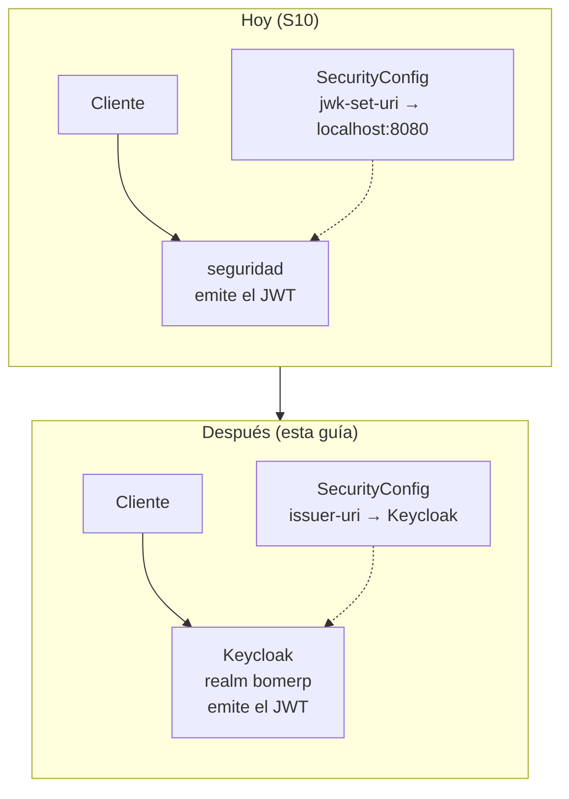
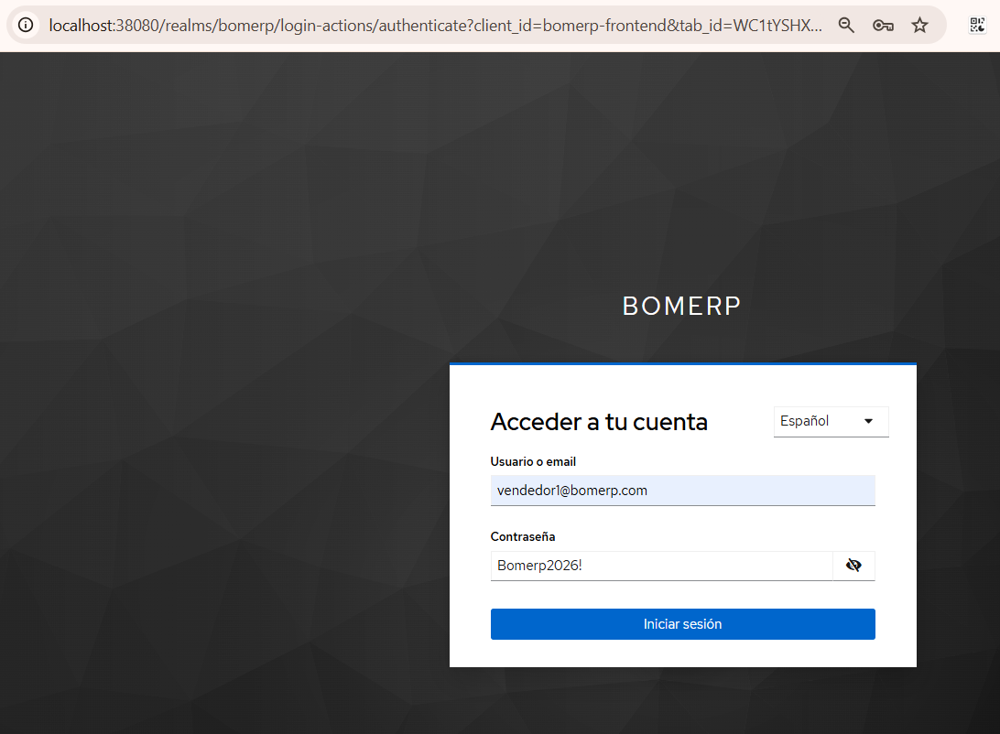

# S10 - Reemplazo del módulo `seguridad` por Keycloak (guía de referencia)

*Por: Angel Sullon Macalupu @asullom - 2026*

## 0. Qué es esta guía y qué no es

Esta guía **no** es una sesión del sílabo: ninguna fila de `silabo_lp2_2026_2.md` ni de `docs/lp2/index.md` la pide, no tiene metodología, caso de motivación, actividad autónoma ni rúbrica, y no se evalúa. Es la continuación directa de [S10_Seguridad_Backend_JWT_Roles.md](S10_Seguridad_Backend_JWT_Roles.md) — la sesión real y evaluada —, que construyó el módulo `seguridad` deliberadamente temporal y "listo para reemplazo" ([ADR-005](../adr/ADR-005-seguridad-jwt-propio-listo-para-reemplazo.md), 2.6 de esa guía, Tabla 4). Esta guía documenta, paso a paso y verificado, el reemplazo que esa ADR dejó como dirección arquitectónica sin construir: **desde descargar Keycloak hasta que `bomerp-backend` valide tokens suyos en vez de los propios**.

Úsala si tu equipo decide adoptar Keycloak en U3 o después — no antes, y no como parte de la evaluación de S10 o S11. La sesión S10 real queda exactamente como está; esta guía no le resta ni le agrega alcance.

**Requisito:** haber completado S10 (`seguridad` funcionando, con Postgres propio y `SecurityConfig` validando por `jwk-set-uri`) — esta guía parte de ese estado y lo reemplaza.

## 1. Qué cambia y qué no

**Figura 1. Antes y después del reemplazo**



Confirmando lo que ya decía la Tabla 4 de S10 (2.6), ahora con el detalle que faltaba:

**Tabla 1. Qué cambia exactamente en `bomerp-backend`**

| Pieza | Cambia |
|---|---|
| `SecurityConfig` (propiedad `jwk-set-uri` → `issuer-uri`) | Sí — una línea de `application-dev.yml` |
| `JwtAuthenticationConverter` (lee `realm_access.roles`) | **No** — Keycloak emite el claim con el mismo nombre |
| `catalogo`, `ventas` (controllers, services, reglas `hasRole`) | **No** |
| Cómo se lee `vendedorId` en `VentaController` | **No** — sigue siendo `jwt.getSubject()`, sin tocar (detalle abajo) |
| Paquete `seguridad` (`AuthController`, `JwtService`, `JwksController`, `JwtKeyConfig`, entidades) | Se retira — queda sin uso, ver sección 7 |
| Contenedor `bomerp-seguridad-db` (Postgres) | Se retira — Keycloak trae su propio almacenamiento |

Ningún punto de la tabla exige cambiar código — y eso no es casualidad, es la razón por la que `vendedorId` se diseñó como `String` desde S10 (3.2, 3.14), no como `Long`: el `sub` que emite `seguridad` hoy es el `id` numérico de `Usuario` convertido a texto (ej. `"3"`); el que emite Keycloak es un UUID (*Universally Unique Identifier*) propio del realm (ej. `"3fa85f64-5717-4562-b3fc-2c963f66afa6"`) — dos formatos de texto distintos, pero `VentaController` nunca los interpreta como número, solo los guarda tal cual. A diferencia de DIST, que sí necesita un **atributo de usuario** + **protocol mapper** para `idCliente` (S07, Tabla 6, porque `idCliente` identifica a una entidad de negocio aparte del usuario), aquí `vendedorId` **es** literalmente `sub` — no hace falta configurar nada nuevo en Keycloak para que viaje en el token, porque `sub` viaja siempre, en cualquier token, sin configuración. Lo único real que exige este cambio de emisor es **migrar los datos que ya existen**: las ventas creadas bajo `seguridad` tienen `VENDEDOR_ID` con el `id` numérico viejo, no con el UUID nuevo — la sección 5 lo resuelve.

## 2. Descargar y levantar Keycloak

**Producto del paso:** Keycloak corriendo en modo desarrollo, con su propio Postgres (no el H2 embebido por defecto) y consola de administración accesible.

Agrega los dos servicios a `lp2/bomerp-backend/compose-dev.yml` — un Postgres propio para Keycloak, igual en espíritu al que S10 ya usó para `seguridad` (3.2), y el propio Keycloak apuntando a él:

```yaml
  keycloak-db:
    image: postgres:17-alpine
    container_name: bomerp-keycloak-db
    restart: unless-stopped
    ports:
      - "35432:5432"
    environment:
      POSTGRES_DB: bomerp_keycloak
      POSTGRES_USER: bomerp_keycloak
      POSTGRES_PASSWORD: 123456
    volumes:
      - keycloak-db-data:/var/lib/postgresql/data
    healthcheck:
      test: ["CMD-SHELL", "pg_isready -U bomerp_keycloak -d bomerp_keycloak"]
      interval: 10s
      timeout: 5s
      retries: 10
      start_period: 15s

  keycloak:
    image: quay.io/keycloak/keycloak:26.8.0
    container_name: bomerp-keycloak
    restart: unless-stopped
    command: start-dev
    depends_on:
      keycloak-db:
        condition: service_healthy
    ports:
      - "38080:8080"
    environment:
      KC_BOOTSTRAP_ADMIN_USERNAME: admin
      KC_BOOTSTRAP_ADMIN_PASSWORD: admin123
      KC_DB: postgres
      KC_DB_URL: jdbc:postgresql://keycloak-db:5432/bomerp_keycloak
      KC_DB_USERNAME: bomerp_keycloak
      KC_DB_PASSWORD: 123456
    volumes:
      - keycloak-data:/opt/keycloak/data
```

Y agrega `keycloak-db-data:` y `keycloak-data:` junto a `oracle-data:`/`seguridad-db-data:`, bajo `volumes:`.

```powershell
cd lp2\bomerp-backend
docker compose -f compose-dev.yml up -d keycloak-db keycloak
```

```bash
cd lp2/bomerp-backend
docker compose -f compose-dev.yml up -d keycloak-db keycloak
```

`KC_DB_URL` usa `keycloak-db` (el nombre del servicio, no `localhost`) como host: Keycloak y su Postgres se hablan **dentro** de la red de Docker Compose, por el puerto **interno** `5432` — el `35432` publicado hacia el host es solo para que tú, desde fuera (`psql`, una herramienta gráfica), puedas inspeccionarlo si hace falta; `bomerp-backend` nunca se conecta a `keycloak-db` directamente. `depends_on: condition: service_healthy` evita el mismo error que S10 ya documentó para `bomerp-seguridad-db` (3.2): si Keycloak intenta conectarse antes de que Postgres esté listo, falla al arrancar.

El puerto externo de Keycloak es **38080**, no 8080: `bomerp-backend` ya usa el 8080 en DEV (S1), y Keycloak escucha internamente también en el 8080 de su propio contenedor — anteponer `3` (bomerp) distingue este puerto de cualquier otro servicio similar en otro curso que corra en la misma laptop (mismo criterio ya aplicado a los puertos Postgres entre repos, y ahora también al puerto de `keycloak-db`, `35432`). `start-dev` es el modo de arranque rápido para desarrollo: no pide configurar TLS ni un `hostname` explícito — pero con `KC_DB` apuntando a Postgres, los datos (realm, usuarios, clients) ya **no** dependen del H2 embebido ni del volumen `keycloak-data`: viven en `keycloak-db-data`, igual que `oracle-data`/`seguridad-db-data` lo hacen para los otros dos motores. El volumen `keycloak-data` igual se conserva (Keycloak guarda ahí configuración local propia, no el realm), pero ya no es el único lugar que importa para no perder el trabajo de las secciones 3-5. **En producción real** sigue faltando un paso más: `start` (modo *production*, que exige TLS) en vez de `start-dev` — el motor de base de datos ya queda resuelto desde esta guía, lo único pendiente para producción real es TLS y el *hostname* explícito.

`KC_BOOTSTRAP_ADMIN_USERNAME`/`KC_BOOTSTRAP_ADMIN_PASSWORD` (Keycloak 26+; versiones anteriores usaban `KEYCLOAK_ADMIN`/`KEYCLOAK_ADMIN_PASSWORD`, ya retiradas) solo crean el usuario administrador la **primera** vez que arranca — cambiarlas después, con el usuario ya creado, no tiene efecto.

Confirma que levantó accediendo a `http://localhost:38080` — debe aparecer la pantalla de bienvenida de Keycloak. Entra a la consola de administración (`Administration Console`) con `admin` / `admin123`.

## 3. Configurar el realm `bomerp`

**Producto del paso:** un realm propio (no el `master` por defecto, reservado para administrar Keycloak mismo), con los tres roles que `ventas` ya usa.

### 3.0 (Opcional) Español — dos configuraciones distintas, no una

Son dos cosas separadas, cada una en un realm distinto; esta es la primera y conviene hacerla **antes** de crear `bomerp`, para ver el resto de esta guía ya en español:

**A. Idioma del Admin Console (el menú, los botones — lo que ves tú como administrador):** el Admin Console es una sola aplicación compartida por todo Keycloak, no por realm — su idioma sigue la configuración de **`master`**, nunca la de `bomerp`. Con `master` como realm activo (el único que existe por ahora) → **Realm settings** → **Localization** → **Locales** → activa **Internationalization**, agrega `Spanish` a *Supported locales*, elige `Spanish` en *Default locale* → **Save**. Recarga la página.

**B. Idioma de la pantalla de login (lo que verán tus usuarios, ej. `vendedor1@bomerp.com`, al autenticarse):** esta se configura en `bomerp`, no en `master` — se hace más abajo, en 3.2, una vez creado el realm. No afecta el Admin Console, solo el formulario de login que Keycloak sirve en `/realms/bomerp/...` (relevante recién cuando S11 construya el flujo real de login contra Keycloak).

Si solo quieres el Admin Console en español, basta con A. Si además quieres que la pantalla de login de tus usuarios finales aparezca en español, haz también 3.2.

De aquí en adelante, cada referencia a un botón o pestaña de la consola trae el término en inglés (el que usa la documentación oficial de Keycloak) seguido de su traducción aproximada entre paréntesis — si tu consola está en español y el texto exacto no calza del todo, guíate por la posición/ícono, no por la traducción literal: no verifiqué cada cadena contra una consola real en español.

1. En el menú lateral izquierdo, entra a **Manage realms** (*Administrar realms*) → clic en **Create realm** (*Crear realm*).
2. *Realm name*: `bomerp`. Deja **Resource file** vacío (es solo para importar un realm ya exportado como JSON, no aplica aquí). Crear.

Al crearlo, Keycloak cambia solo el realm activo al que acabas de crear — lo ves en la esquina superior izquierda, donde antes decía `master` ahora dice `bomerp` (`Current realm`). No hace falta ningún paso extra para "entrar" a `bomerp`: todo lo que sigue ya ocurre ahí.

3. Con `bomerp` como realm activo, ve a **Realm roles** → **Create role**, y crea los tres, uno por uno: `VENDEDOR`, `SUPERVISOR`, `ADMIN`.

Estos son **realm roles** (no *client roles*) a propósito: Keycloak los agrega al token bajo el claim `realm_access.roles` — el mismo nombre que `JwtService` de `seguridad` ya usaba (S10, 3.8) y que `JwtAuthenticationConverter` ya sabe leer (S10, 3.11). Es el primer punto donde se confirma la promesa de la Tabla 4: cero cambios en ese conversor.

### 3.2 (Opcional) Español para la pantalla de login de `bomerp`

Con `bomerp` como realm activo (no `master`): **Realm settings** → **Localization** → **Locales** → activa **Internationalization**, agrega `Spanish` a *Supported locales*, elige `Spanish` en *Default locale* → **Save**. Es exactamente la misma pantalla de 3.0.A, pero ahora sobre `bomerp` — y afecta algo distinto (3.0.B).

## 4. Crear el cliente para pruebas

**Producto del paso:** un *client* en el realm `bomerp` que permita pedir un token para probar la integración antes de construir la SPA real (S11).

1. **Clients** (*Clientes*) → **Create client** (*Crear cliente*).
2. Paso **General settings** (*Configuraciones generales*): *Client type* (*Tipo de cliente*): `OpenID Connect`. *Client ID* (*ID de cliente*): `bomerp-frontend`. *Name*/*Description* (*Nombre*/*Descripción*): opcionales, déjalos vacíos. **Always display in UI** (*Mostrar siempre en la interfaz de usuario*): déjalo **desactivado** — solo importa si quieres que este cliente aparezca listado en el *Account Console* de Keycloak incluso sin sesión activa, algo que no necesitas para un cliente de prueba. Siguiente.
3. Paso **Capability config** (*Configuración de capacidades*) — todo en una sola pantalla:
    - **Client authentication** (*Autenticación del cliente*): **desactivado** (es un *public client* — la SPA de S11 no puede guardar un secreto, 2.6 de S10).
    - **Authorization** (*Autorización*): desactivado — no aplica a esta guía (son los *fine-grained authorization services* de Keycloak, otra funcionalidad aparte).
    - **Authentication flow** (*Flujo de autenticación*): deja marcado **Standard flow** (*Flujo estándar*, viene activado por defecto — es el que usará S11 con *Authorization Code* + PKCE) y marca además **Direct access grants** (*Concesiones de acceso directo*). Deja el resto de casillas sin marcar.
    - **Require PKCE** (*Requiere PKCE*) y **Require DPoP-bound tokens** (*Requerir tokens vinculados a DPoP*): déjalos en su valor por defecto (desactivado) — ninguno de los dos aplica todavía, porque esta guía no usa el *Standard flow* para pedir tokens (eso llega en S11); el icono de advertencia junto a *Require PKCE* es una recomendación general de seguridad de Keycloak, no un error de esta configuración.
    - Siguiente.
4. Paso **Login settings** (*Configuraciones de inicio de sesión*): estos campos son para el *Standard flow* (redirección de navegador) que usará la SPA real en S11 — *Direct access grants*, el flujo que prueba esta guía, no pasa por el navegador y no los necesita. Aun así, déjalos ya apuntando a donde correrá la SPA (mismo origen que `bomerp.cors.allowed-origins` en `application-dev.yml`, S1):
    - **Root URL**/**Home URL** (*URL raíz*/*URL de inicio*): vacío.
    - **Valid redirect URIs** (*URIs de redirección válidos*): `http://localhost:4200/*`.
    - **Valid post logout redirect URIs** (*URI de redirección de post cierre de sesión válidos*): `http://localhost:4200/*`.
    - **Web origins** (*Orígenes web*): `http://localhost:4200`.
    - Guardar.

**Error frecuente, y por qué es intencional dejarlo así documentado**: *Direct access grants* corresponde al mismo flujo que la RFC 9700 desaconseja (S10, 2.6, cita textual: *"MUST NOT be used"*) — la razón por la que `seguridad` también lo usaba era la misma: es un atajo de laboratorio, no el diseño final. Úsalo aquí únicamente para verificar que Keycloak emite tokens válidos antes de construir el flujo real; S11 reconfigura este mismo cliente para *Authorization Code* + PKCE (*Proof Key for Code Exchange*) y **desactiva** *Direct access grants* como parte de ese trabajo — no antes.

## 5. Crear los usuarios semilla

**Producto del paso:** los mismos cuatro usuarios de S10 (3.10), ahora en Keycloak. `vendedorId` no necesita ningún paso aparte — es literalmente `sub` (1, Tabla 1), y `sub` viaja en cualquier token sin configurar nada.

### 5.1 Crear los usuarios y asignarles rol

Por cada uno de `vendedor1@bomerp.com`, `vendedor2@bomerp.com`, `supervisor@bomerp.com`, `admin@bomerp.com`:

1. **Users** (*Usuarios*) → **Add user** (*Agregar usuario*) → **Crear usuario**.
    - **Required user actions** (*Acciones de usuario requeridas*): déjalo **vacío**, sin seleccionar ninguna. Si marcas algo aquí (ej. *Update Password*), Keycloak lo exige en el primer login — rompe el flujo de *Direct access grants* de la sección 6, igual que dejar la contraseña como *Temporary* (paso 2 de abajo).
    - **Email verified** (*Correo electrónico verificado*): activado (para no complicar el flujo con verificación de correo en esta guía).
    - **Select a locale** (*Seleccionar una configuración regional*): opcional, es el idioma de **ese usuario en particular** (distinto de 3.0/3.2, que son el idioma por defecto del realm) — déjalo en *Idioma predeterminado* o elige `Español` si quieres forzarlo para este usuario puntual.
    - **Username** (*Nombre de usuario*): el email completo (ej. `vendedor1@bomerp.com`).
    - **Email** (*Correo electrónico*): el mismo email, repetido en este campo aparte.
    - **First name**/**Last name** (*Nombre*/*Apellido*): **no los dejes vacíos** — pon cualquier valor real (ej. `Vendedor`/`Uno`). No son cosméticos: el realm trae activa `VERIFY_PROFILE` (*Verify Profile*, ver "Error frecuente" abajo), que Keycloak evalúa en cada login — con estos dos campos vacíos, el perfil nunca se considera completo y el login falla, aunque la contraseña sea correcta.
    - *Grupos*: opcional, déjalo vacío.
    - **Crear**.
2. Pestaña **Credentials** (*Credenciales*) → **Set password** (*Establecer contraseña*): `Bomerp2026!`, *Temporary* (*Temporal*): **desactivado** (si queda activado, Keycloak exige cambiarla en el primer login, lo que rompe el flujo de *Direct access grants* de la sección 6).
3. Pestaña **Role mapping** (*Mapeo de roles*) → **Assign role** (*Asignar rol*) → en el dropdown, elige **Realm roles** (*Roles de realm*, no *Roles de cliente*) — ahí aparece la lista del paso 3 de la sección 3 (`ADMIN`, `SUPERVISOR`, `VENDEDOR`, más dos roles propios de Keycloak: `offline_access`, `uma_authorization`, que no tocas). Marca `VENDEDOR` para los dos primeros usuarios, `SUPERVISOR` y `ADMIN` para los otros dos, respectivamente, y **Asignar** — el mismo criterio de promoción manual que S10 ya aplicaba a mano sobre Postgres (3.10), ahora sobre la consola de Keycloak.

**Error frecuente**: login en la sección 6 responde `{"error":"invalid_grant","error_description":"Account is not fully set up"}`, aunque el usuario no tenga ninguna *required action* explícita en la pestaña **Details**, la contraseña no sea *Temporary*, y ningún *required action* del realm esté marcado como *default* (`SELECT ... FROM required_action_provider` da `default_action = f` en todas). La causa real: `VERIFY_PROFILE` (*Verify Profile*) viene `enabled` en este realm, y esa acción se calcula **dinámicamente en cada login**, no como fila guardada — revisa si `first_name`/`last_name` quedaron vacíos (si usaste la consola en vez de la API, puede pasar aunque los hayas escrito):

```bash
docker exec -i bomerp-keycloak-db psql -U bomerp_keycloak -d bomerp_keycloak -c "SELECT email, first_name, last_name, email_verified FROM user_entity WHERE email = 'vendedor1@bomerp.com';"
```

Corrige lo que falte (ejemplo con los cuatro usuarios — ajusta los nombres):

```bash
docker exec -i bomerp-keycloak-db psql -U bomerp_keycloak -d bomerp_keycloak -c "
UPDATE user_entity SET first_name = 'Vendedor', last_name = 'Uno', email_verified = true WHERE email = 'vendedor1@bomerp.com';
UPDATE user_entity SET first_name = 'Vendedor', last_name = 'Dos', email_verified = true WHERE email = 'vendedor2@bomerp.com';
UPDATE user_entity SET first_name = 'Supervisor', last_name = 'Uno', email_verified = true WHERE email = 'supervisor@bomerp.com';
UPDATE user_entity SET first_name = 'Admin', last_name = 'Uno', email_verified = true WHERE email = 'admin@bomerp.com';
"
```

```powershell
docker exec -i bomerp-keycloak-db psql -U bomerp_keycloak -d bomerp_keycloak -c "UPDATE user_entity SET first_name = 'Vendedor', last_name = 'Uno', email_verified = true WHERE email = 'vendedor1@bomerp.com'; UPDATE user_entity SET first_name = 'Vendedor', last_name = 'Dos', email_verified = true WHERE email = 'vendedor2@bomerp.com'; UPDATE user_entity SET first_name = 'Supervisor', last_name = 'Uno', email_verified = true WHERE email = 'supervisor@bomerp.com'; UPDATE user_entity SET first_name = 'Admin', last_name = 'Uno', email_verified = true WHERE email = 'admin@bomerp.com';"
```

Reinicia Keycloak después de cualquier cambio directo por SQL contra `keycloak-db` (no confirmé si cachea en memoria o no, pero es gratis hacerlo y evita dudarlo):

```bash
docker restart bomerp-keycloak
```

### 5.2 Migrar las ventas ya registradas al nuevo `sub`

**Producto del paso:** las ventas que `vendedor1`/`vendedor2` ya crearon bajo `seguridad` (S10) siguen asociadas a su dueño real, ahora con el `sub` nuevo de Keycloak.

`vendedorId` no necesita ningún atributo ni *protocol mapper* — es `jwt.getSubject()` tal cual (1). Pero eso no resuelve solo el dato que **ya existe**: cada fila de `VENTAS` creada hasta hoy tiene `VENDEDOR_ID` con el `id` numérico-como-texto que `seguridad` usaba (ej. `"3"`), y el `sub` que Keycloak va a emitir para ese mismo usuario es un UUID distinto (ej. `"3fa85f64-5717-4562-b3fc-2c963f66afa6"`) — nadie los conecta solo. Sin este paso, esas ventas viejas siguen existiendo, pero `obtener`/`buscar` (S10, 3.15) ya no las reconoce como propias de ese vendedor.

1. Obtén el `id` viejo de cada usuario (todavía en `bomerp-seguridad-db`, antes de 7.3):

```bash
docker exec -i bomerp-seguridad-db psql -U bomerp_seguridad -d bomerp_seguridad -c "SELECT id, email FROM usuarios WHERE email IN ('vendedor1@bomerp.com','vendedor2@bomerp.com','supervisor@bomerp.com','admin@bomerp.com');"
```

2. Obtén el UUID nuevo de cada usuario, directo de `keycloak-db` (el Postgres que armamos en la sección 2):

```bash
docker exec -i bomerp-keycloak-db psql -U bomerp_keycloak -d bomerp_keycloak -c "SELECT u.id, u.email FROM user_entity u JOIN realm r ON r.id = u.realm_id WHERE r.name = 'bomerp' AND u.email IN ('vendedor1@bomerp.com','vendedor2@bomerp.com','supervisor@bomerp.com','admin@bomerp.com');"
```

`user_entity`/`realm` son los nombres reales (verificado contra una instancia real de Keycloak 26.8) — si en otra versión no calzan, lista las tablas con `\dt` dentro de `psql` y ajusta la consulta; el resto del procedimiento no cambia.

3. Con ambos resultados en mano (un `id` viejo y un UUID nuevo por cada email), actualiza Oracle — un `UPDATE` por usuario, solo para los que realmente tengan ventas. Ejemplo real (los valores van a ser distintos en tu base):

```text
bomerp-seguridad-db          keycloak-db
id | email                   id (UUID)                             | email
---|-------------------      --------------------------------------|----------------------
3  | vendedor1@bomerp.com     516ef047-ffbc-470f-b397-6d4a3fe8fbfa  | vendedor1@bomerp.com
4  | vendedor2@bomerp.com     0c265d28-60e9-4954-b7e7-36006cb8c2c5  | vendedor2@bomerp.com
```

```powershell
@'
UPDATE VENTAS SET VENDEDOR_ID = '516ef047-ffbc-470f-b397-6d4a3fe8fbfa' WHERE VENDEDOR_ID = '3';
UPDATE VENTAS SET VENDEDOR_ID = '0c265d28-60e9-4954-b7e7-36006cb8c2c5' WHERE VENDEDOR_ID = '4';
COMMIT;
'@ | docker exec -i bomerp-oracle bash -c "sqlplus -s BOM_VENTAS/123456@localhost:1521/FREEPDB1"
```

```bash
docker exec -i bomerp-oracle bash -c "sqlplus -s BOM_VENTAS/123456@localhost:1521/FREEPDB1" <<'EOF'
UPDATE VENTAS SET VENDEDOR_ID = '516ef047-ffbc-470f-b397-6d4a3fe8fbfa' WHERE VENDEDOR_ID = '3';
UPDATE VENTAS SET VENDEDOR_ID = '0c265d28-60e9-4954-b7e7-36006cb8c2c5' WHERE VENDEDOR_ID = '4';
COMMIT;
EOF
```

Reemplaza el `WHERE VENDEDOR_ID = '<id-viejo>'` y el valor nuevo con los que te devolvieron tus propias consultas de los pasos 1-2 — no copies los de este ejemplo. Confirma el resultado:

```powershell
@'
SELECT ID, VENDEDOR_ID FROM VENTAS WHERE VENDEDOR_ID IS NOT NULL ORDER BY ID;
'@ | docker exec -i bomerp-oracle bash -c "sqlplus -s BOM_VENTAS/123456@localhost:1521/FREEPDB1"
```

```bash
docker exec -i bomerp-oracle bash -c "sqlplus -s BOM_VENTAS/123456@localhost:1521/FREEPDB1" <<'EOF'
SELECT ID, VENDEDOR_ID FROM VENTAS WHERE VENDEDOR_ID IS NOT NULL ORDER BY ID;
EOF
```

Filtra solo las que tienen `VENDEDOR_ID` (el resto de S4-S9 sigue en `NULL`, no hace falta verlas). Resultado esperado: cada venta migrada muestra ya el UUID nuevo, no el `id` numérico viejo.

Es una migración de **un solo dato, una sola vez** — no una dependencia permanente entre Keycloak y la base vieja. `SUPERVISOR`/`ADMIN` no necesitan este paso: ven todas las ventas sin filtrar por `vendedorId` (RN8 solo aplica a `VENDEDOR`).

## 6. Verificar el token antes de tocar `bomerp-backend`

**Producto del paso:** confirmación, con un token real, de que `realm_access.roles` llega con el formato esperado y `sub` es el UUID del usuario — antes de cambiar nada en el código.

```powershell
$login = Invoke-RestMethod -Method Post -Uri "http://localhost:38080/realms/bomerp/protocol/openid-connect/token" `
  -ContentType "application/x-www-form-urlencoded" `
  -Body "grant_type=password&client_id=bomerp-frontend&username=vendedor1@bomerp.com&password=Bomerp2026!"
$login.access_token
```

```bash
curl -X POST http://localhost:38080/realms/bomerp/protocol/openid-connect/token \
  -H "Content-Type: application/x-www-form-urlencoded" \
  -d "grant_type=password&client_id=bomerp-frontend&username=vendedor1@bomerp.com&password=Bomerp2026!"
```

Pega el `access_token` recibido en [jwt.io](https://jwt.io) (inspección visual únicamente, 2.3 de S10) y confirma dos cosas: `realm_access.roles` trae `["VENDEDOR"]`; y `sub` es un UUID, no el `"3"` de antes — exactamente la diferencia que la sección 1 anticipó, y la razón por la que 5.2 migró las ventas viejas a ese nuevo valor.

`POST /realms/bomerp/protocol/openid-connect/token` es el endpoint estándar de token de Keycloak (OAuth 2.0/OpenID Connect, S10 2.4) — equivalente a `POST /api/v1/auth/login` de `seguridad`, pero ya no es un endpoint propio de BomERP.

**Error frecuente**: comparar el `expires_in` de este token con el de `seguridad` y asumir que algo está mal. Por defecto, el realm nuevo trae el *access token* del propio Keycloak (*Realm settings* → *Tokens* → *Access Token Lifespan*) en **5 minutos**, no en la hora que `jwt.expiracion-segundos` dejaba en S10 (3.8) — token expirado a mitad de una prueba no es un bug de la integración, solo un valor por defecto distinto. Ajusta ese campo en el realm si las pruebas de la sección 8 te quedan cortas de tiempo.

## 7. Integrar `bomerp-backend` con Keycloak

**Producto del paso:** `SecurityConfig` valida tokens de Keycloak; `catalogo` y `ventas` siguen funcionando sin que se les toque una línea.

### 7.1 Cambiar la propiedad de validación

En `lp2/bomerp-backend/src/main/resources/application-dev.yml`, reemplaza el bloque que S10 dejó (3.11):

```yaml
spring:
  security:
    oauth2:
      resourceserver:
        jwt:
          jwk-set-uri: http://localhost:8080/.well-known/jwks.json
```

por:

```yaml
spring:
  security:
    oauth2:
      resourceserver:
        jwt:
          issuer-uri: http://localhost:38080/realms/bomerp
```

Con `issuer-uri` (en vez de `jwk-set-uri`), Spring no solo descubre dónde están las claves — además valida que el claim `iss` (*issuer*, emisor) de cada token coincida exactamente con esta URL, y descarga la configuración del realm (incluida su ubicación de JWKS) del documento de descubrimiento estándar de OpenID Connect (`/.well-known/openid-configuration`) que Keycloak sí publica (a diferencia de `seguridad`, que no lo implementaba — S10, 2.6). Es la única propiedad que cambia; `JwtAuthenticationConverter` (S10, 3.11) no se toca.

### 7.2 Confirmar que `catalogo` y `ventas` no se tocan

Revisa `SecurityConfig.securityFilterChain`, `CategoriaController`/`ProductoController` y **todo** `VentaController`, incluido `crear`/`buscar`/`obtener`: ningún `hasRole`, ningún `requestMatchers`, ninguna línea de código cambia — `jwt.getSubject()` sigue ahí exactamente igual que en S10 (3.14-3.15), porque `vendedorId` nunca se interpretó como número (1). Si encuentras que necesitas tocar algo ahí, la migración se desvió de lo que esta guía describe — revisa el paso anterior.

### 7.3 Retirar `seguridad-db`

**Producto del paso:** `bomerp-backend` corre sin el Postgres de `seguridad` — Keycloak es, desde este punto, el único almacén de identidad.

Con 7.1-7.2 confirmados y la migración de 5.2 ya hecha, `seguridad-db` ya no tiene ningún lector: nadie en el código vigente lo consulta, y las ventas viejas ya apuntan al `sub` nuevo. No lo dejes corriendo "por si acaso" — si Keycloak es de verdad el reemplazo, el sistema tiene que demostrar que funciona sin él **antes** de la prueba final de la sección 8, no después.

```powershell
cd lp2\bomerp-backend
docker compose -f compose-dev.yml stop seguridad-db
docker compose -f compose-dev.yml rm -f seguridad-db
```

```bash
cd lp2/bomerp-backend
docker compose -f compose-dev.yml stop seguridad-db
docker compose -f compose-dev.yml rm -f seguridad-db
```

Quita también el bloque `seguridad-db:` completo de `compose-dev.yml` (el que agregó S10, 3.2) y la línea `seguridad-db-data:` de `volumes:` al final del archivo — ya ningún servicio la usa. Si quieres conservar los datos históricos antes de liberar el volumen (los `vendedorId` ya están a salvo en los atributos de usuario de Keycloak; esto es solo por si quieres consultar algo más adelante), identifica el volumen real y bórralo:

```bash
docker volume ls | grep seguridad
docker volume rm <nombre-exacto-que-aparezca>
```

## 8. Probar de punta a punta

**Producto del paso:** la misma matriz de accesos que S10 verificó (3.16, Tabla 6), ahora contra tokens de Keycloak — con `seguridad-db` ya retirado (7.3), esta prueba confirma que el reemplazo es real, no solo que Keycloak "también funciona" en paralelo.

Reinicia `bomerp-backend` (lee la propiedad nueva de 7.1) y repite las pruebas de S10 (3.16), pero obteniendo cada token de Keycloak en vez de `/api/v1/auth/login`.

1. Un token por rol:

```powershell
$tokenVendedor1 = (Invoke-RestMethod -Method Post -Uri "http://localhost:38080/realms/bomerp/protocol/openid-connect/token" `
  -ContentType "application/x-www-form-urlencoded" `
  -Body "grant_type=password&client_id=bomerp-frontend&username=vendedor1@bomerp.com&password=Bomerp2026!").access_token

$tokenVendedor2 = (Invoke-RestMethod -Method Post -Uri "http://localhost:38080/realms/bomerp/protocol/openid-connect/token" `
  -ContentType "application/x-www-form-urlencoded" `
  -Body "grant_type=password&client_id=bomerp-frontend&username=vendedor2@bomerp.com&password=Bomerp2026!").access_token

$tokenSupervisor = (Invoke-RestMethod -Method Post -Uri "http://localhost:38080/realms/bomerp/protocol/openid-connect/token" `
  -ContentType "application/x-www-form-urlencoded" `
  -Body "grant_type=password&client_id=bomerp-frontend&username=supervisor@bomerp.com&password=Bomerp2026!").access_token
```

```bash
tokenVendedor1=$(curl -s -X POST http://localhost:38080/realms/bomerp/protocol/openid-connect/token \
  -H "Content-Type: application/x-www-form-urlencoded" \
  -d "grant_type=password&client_id=bomerp-frontend&username=vendedor1@bomerp.com&password=Bomerp2026!" | jq -r '.access_token')

tokenVendedor2=$(curl -s -X POST http://localhost:38080/realms/bomerp/protocol/openid-connect/token \
  -H "Content-Type: application/x-www-form-urlencoded" \
  -d "grant_type=password&client_id=bomerp-frontend&username=vendedor2@bomerp.com&password=Bomerp2026!" | jq -r '.access_token')

tokenSupervisor=$(curl -s -X POST http://localhost:38080/realms/bomerp/protocol/openid-connect/token \
  -H "Content-Type: application/x-www-form-urlencoded" \
  -d "grant_type=password&client_id=bomerp-frontend&username=supervisor@bomerp.com&password=Bomerp2026!" | jq -r '.access_token')
```

2. La venta que ya migraste en 5.2 (`vendedor1`) es la prueba de dueño perfecta — sustituye `$ventaId` por su `ID` real en Oracle (ej. `2261`):

```powershell
$ventaId = 2261
try {
  Invoke-RestMethod -Method Get -Uri "http://localhost:8080/api/v1/ventas/$ventaId" `
    -Headers @{ Authorization = "Bearer $tokenVendedor2" }
} catch {
  $_.Exception.Response.StatusCode.value__
}
```

```bash
ventaId=2261
curl -s -o /dev/null -w "%{http_code}\n" http://localhost:8080/api/v1/ventas/$ventaId \
  -H "Authorization: Bearer $tokenVendedor2"
```

Resultado esperado: `403` (no es de `vendedor2`). Con `$tokenSupervisor` en el mismo header, `200 OK` con la venta completa.

3. `resumen`, igual que en S10 — `403` con `vendedor1`, `200` con `supervisor`:

```powershell
try {
  Invoke-RestMethod -Method Get -Uri "http://localhost:8080/api/v1/ventas/resumen" `
    -Headers @{ Authorization = "Bearer $tokenVendedor1" }
} catch {
  $_.Exception.Response.StatusCode.value__
}
```

```bash
curl -s -o /dev/null -w "%{http_code}\n" http://localhost:8080/api/v1/ventas/resumen \
  -H "Authorization: Bearer $tokenVendedor1"
```

Resultado esperado: la misma Tabla 6 de S10 (3.16) — mismos códigos HTTP, para los mismos casos, con tokens que ahora vienen de un proceso distinto.

**Error frecuente**: `403` donde S10 esperaba `200`, con un token que en jwt.io se ve correcto. Causa más común: el usuario de Keycloak no tiene el *realm role* asignado (5.1), o la venta que estás consultando todavía tiene el `VENDEDOR_ID` viejo porque 5.2 no se corrió (o se corrió con el `id`/UUID equivocado) para ese usuario.

### 8.1 (Opcional) Simular el login real, con redirect

**Producto del paso:** ver, con tus propios ojos, el flujo *Authorization Code* que usará la SPA en S11 — el que **sí** redirige al navegador a la pantalla de Keycloak, en vez del *Direct Access Grant* (atajo de laboratorio) que usaste en toda esta guía.

No hace falta construir la SPA para verlo: el cliente `bomerp-frontend` ya tiene **Standard flow** activado (4, paso 3) y `http://localhost:4200/*` como *redirect URI* válido (4, paso 4), aunque todavía no haya nada corriendo ahí.

1. Arma la URL de autorización a mano y ábrela en el navegador:

```text
http://localhost:38080/realms/bomerp/protocol/openid-connect/auth?client_id=bomerp-frontend&redirect_uri=http://localhost:4200/callback&response_type=code&scope=openid
```

2. Verás la pantalla de login del realm **`bomerp`** (no `master` — si te aparece pidiendo `admin`, revisa que la URL diga `/realms/bomerp/...`, no `/realms/master/...`). Entra con `vendedor1@bomerp.com` / `Bomerp2026!`.

**Figura 2. Pantalla de login de Keycloak para el realm `bomerp`**



Nota la URL de la barra de direcciones: `localhost:38080/realms/bomerp/...` — confirma que el formulario lo sirve Keycloak, no `bomerp-backend` ni ninguna SPA propia (a diferencia del login de `seguridad`, S10 3.10, que era un formulario de BomERP).

3. El navegador intenta redirigir a `http://localhost:4200/callback?code=...&state=...` — como ahí no hay ninguna SPA corriendo todavía, la pestaña muestra error de conexión. Eso es **esperado**: lo que importa es la URL a la que llegó. Cópiala de la barra de direcciones y mira el parámetro `code` — esa es la prueba de que el flujo completo (login en Keycloak → redirect de vuelta con un código) ya funciona de punta a punta, sin que `bomerp-backend` ni ninguna SPA hayan intervenido todavía.

4. (Opcional) Cambia ese `code` por un token real, a mano, antes de que expire (son pocos segundos a minutos):

```powershell
$code = "<pega aquí el valor de code de la URL>"
$login2 = Invoke-RestMethod -Method Post -Uri "http://localhost:38080/realms/bomerp/protocol/openid-connect/token" `
  -ContentType "application/x-www-form-urlencoded" `
  -Body "grant_type=authorization_code&client_id=bomerp-frontend&redirect_uri=http://localhost:4200/callback&code=$code"
$login2.access_token
```

```bash
curl -X POST http://localhost:38080/realms/bomerp/protocol/openid-connect/token \
  -H "Content-Type: application/x-www-form-urlencoded" \
  -d "grant_type=authorization_code&client_id=bomerp-frontend&redirect_uri=http://localhost:4200/callback&code=<pega aquí el code>"
```

Lo que S11 construye de verdad es que la SPA, corriendo en `localhost:4200`, capture ese `code` sola (sin que tú lo copies a mano) y haga este último intercambio automáticamente, además de agregar PKCE (4, paso 3, *Require PKCE*) — esta sección solo demuestra que el mecanismo de fondo ya está activo desde ahora, sin tocar ni una línea de `bomerp-backend`.

5. (Opcional) Cambiar de usuario o cerrar sesión. Si repites la URL del paso 1 tal cual, Keycloak reconoce la cookie de sesión que ya tienes y te deja pasar **sin pedir login de nuevo** (es SSO funcionando, no un error) — para probar con otro usuario necesitas una de estas dos:

Cerrar la sesión de Keycloak:

```text
http://localhost:38080/realms/bomerp/protocol/openid-connect/logout?client_id=bomerp-frontend&post_logout_redirect_uri=http://localhost:4200
```

O forzar un login nuevo sin cerrar la sesión existente, agregando `&prompt=login` a la URL del paso 1:

```text
http://localhost:38080/realms/bomerp/protocol/openid-connect/auth?client_id=bomerp-frontend&redirect_uri=http://localhost:4200/callback&response_type=code&scope=openid&prompt=login
```

## 9. Qué queda pendiente

- **S11** reconfigura el cliente `bomerp-frontend` para *Authorization Code* + PKCE (S10, 2.6) — el flujo real que usará la SPA, desactivando *Direct access grants* (sección 4) y activando **Require PKCE**. El login deja de ser un formulario propio de BomERP: redirige a la pantalla de Keycloak, igual que viste en 8.1, pero capturado y completado por la SPA en vez de a mano.
- **Limpieza del paquete `seguridad`**: `AuthController`, `JwtService`, `JwksController`, `JwtKeyConfig`, `SecurityConfig` (las piezas de `seguridad`, no `OracleDataSourceConfig`), `SeguridadDataSourceConfig` y las entidades `Usuario`/`Rol` quedan sin ningún código que los invoque — pueden borrarse de `bomerp-backend` en un commit aparte, sin que eso afecte a `catalogo` ni a `ventas` (la discusión de por qué esto es una limpieza de archivos y no una migración se documentó en el chat de diseño de S10, no en una guía).
- **`compose-dev.yml`**: `seguridad-db` ya se retiró en 7.3 — este punto queda aquí solo como referencia, no como pendiente.
- **`pom.xml`**: `spring-security-oauth2-jose` (firmaba el JWT propio) deja de hacer falta; `spring-boot-starter-security-oauth2-resource-server` **sigue haciendo falta** (sigue validando, ahora contra Keycloak); el driver `org.postgresql:postgresql` se retira solo si ningún otro módulo de BomERP usa Postgres.
- **Producción real**: el motor de base de datos ya queda resuelto desde la sección 2 (`keycloak-db`, Postgres). Lo que falta es `start-dev` (sección 2) en sí — no es apto para producción, exige modo `start` y TLS, ninguno de los dos configurado aquí (ver la nota de la sección 2).
- **`vendedorId` para usuarios nuevos: resuelto por el propio rediseño**: con `vendedorId = sub` (texto, no número — S10, 3.2/3.14), un vendedor creado **después** de este reemplazo no necesita ningún paso manual — Keycloak le genera su UUID solo, al crearlo, y ese UUID es automáticamente su `vendedorId` desde la primera venta que registre. Esto era un problema real con el diseño anterior (un `vendedorId` numérico no tenía de dónde salir sin una tabla aparte); dejó de serlo en cuanto `vendedorId` se diseñó como texto desde S10.

## Bibliografía

1. Krebs, B. (2019, 24 de mayo). *First American Financial Corp. Leaked Hundreds of Millions of Title Insurance Records*. KrebsOnSecurity. https://krebsonsecurity.com/2019/05/first-american-financial-corp-leaked-hundreds-of-millions-of-title-insurance-records/ — mismo caso citado en S10 (1.6), relevante aquí porque un `vendedorId` tomado de un claim mal configurado reabre el mismo problema de fondo.
2. Keycloak. (2026). *Getting Started with Docker*. https://www.keycloak.org/getting-started/getting-started-docker
3. Keycloak. (2026). *Server Administration Guide: User-defined attributes*. https://www.keycloak.org/docs/latest/server_admin/#_user-attributes
4. Keycloak. (2026). *Server Administration Guide: Mapping token claims*. https://www.keycloak.org/docs/latest/server_admin/#_protocol-mappers
