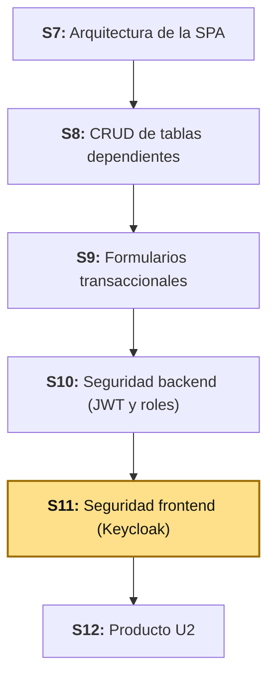
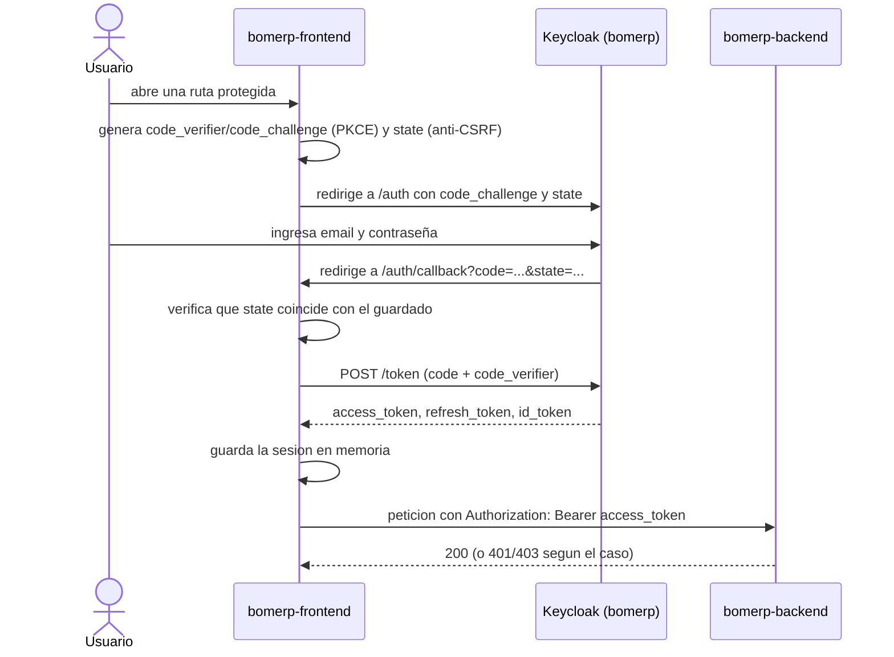
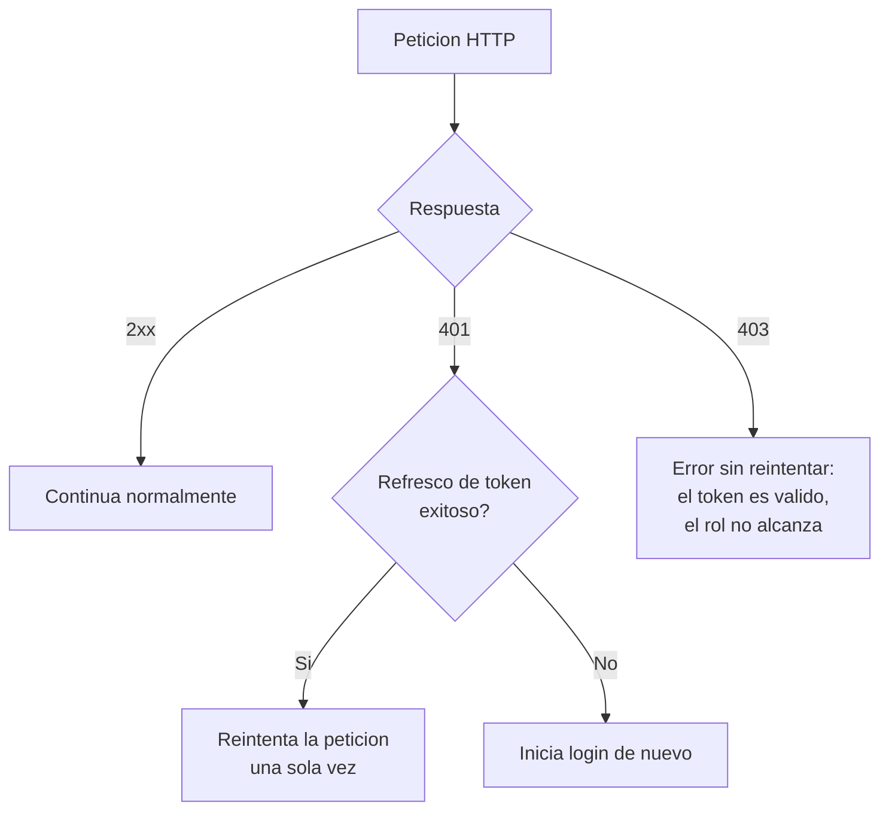

# S11 - Seguridad Frontend: Autenticación con Keycloak y Rutas Protegidas

## 1. Introducción

Tiempo: 20 min.

### 1.1 Presentación de la sesión

S10 protegió el backend: `catalogo` y `ventas` ya exigen un JWT (*JSON Web Token*) válido y, según el endpoint, un rol específico. Pero esa protección hoy solo se prueba desde Swagger o `curl` — `bomerp-frontend`, la SPA (*Single Page Application*) que S7-S9 construyeron, no sabe que existe. `layout.html` muestra un `<span class="user">Usuario</span>` fijo, nunca un nombre real; el sidebar lista "Nueva venta" y "Categorías" al mismo tiempo para cualquiera que abra la aplicación, sin importar si esa persona tiene sesión o no; y cada llamada HTTP sale sin ningún encabezado `Authorization` — si el backend las rechaza hoy con `401`, es solo porque S10 ya las protegió, no porque la SPA haga nada al respecto. Esta sesión cierra esa brecha.

Con una diferencia importante frente a lo que el sílabo original anticipaba: S10 construyó `seguridad` como un módulo deliberadamente temporal ([ADR-005](../adr/ADR-005-seguridad-jwt-propio-listo-para-reemplazo.md)), y [S10b](S10b_Seguridad_Backend_Keycloak.md) ya ejecutó ese reemplazo — `bomerp-backend` valida tokens de **Keycloak**, no de `seguridad`, desde antes de esta sesión. S11 nunca construye un formulario de login propio de BomERP: la SPA redirige al navegador a la pantalla de login de Keycloak y recibe de vuelta un código que intercambia por un token — el flujo *Authorization Code* con PKCE (*Proof Key for Code Exchange*) que S10 (2.6) y S10b (sección 4) ya dejaron anticipado, y que hoy se construye de verdad.

### 1.2 Índice

1. *Authorization Code* + PKCE: por qué una SPA no puede usar el flujo que S10b usó solo para probar.
2. Dónde vive el token en el navegador: la decisión de almacenamiento.
3. Expiración de 5 minutos: por qué hace falta refrescar, no solo esperar un error.
4. *Guards* funcionales: autenticación y autorización por rol.
5. Interceptor: adjuntar el token a cada petición, refrescar en `401`, denegar en `403`.
6. Menú dinámico por rol — las mismas reglas de `SecurityConfig` (S10), ahora también en la SPA.

### 1.3 Propósito de aprendizaje

Al concluir la clase, estarás en condiciones de:

- **Implementar** el flujo *Authorization Code* con PKCE desde una SPA pública (sin secreto de cliente), **decidir con criterio** dónde almacenar un token en el navegador según su exposición real a robo, **construir** *guards* e interceptores funcionales que protejan rutas y peticiones, y **distinguir**, también en el frontend, cuándo una sesión vencida exige refrescar el token (`401`) y cuándo un rol insuficiente exige negar el acceso sin reintentar nada (`403`).

### 1.4 Producto de sesión

`bomerp-frontend` iniciando sesión contra el realm `bomerp` de Keycloak con *Authorization Code* + PKCE (sin contraseñas pasando nunca por código propio de BomERP), el token guardado en memoria —nunca en `localStorage`— con el `code_verifier` de PKCE como única excepción temporal en `sessionStorage`, un *guard* de autenticación y uno de rol protegiendo las rutas de escritura, un interceptor que adjunta el token a cada petición HTTP y refresca la sesión una sola vez ante un `401` antes de forzar un nuevo login, el menú lateral y el botón "Anular" del reporte de ventas mostrándose solo a quien el backend ya autoriza de verdad, el nombre real del usuario autenticado reemplazando el `"Usuario"` fijo de hoy, y cierre de sesión real contra Keycloak (*RP-Initiated Logout*, *Relying Party*).

### 1.5 Metodología

**Tabla 1. Metodología de la sesión**

| Actividades a Realizar en el Periodo | Orientaciones generales (Orientaciones Metodológicas) | Material de estudio recomendado |
|---|---|---|
| Revisión previa individual | Repasar S10 (2.6, Tabla 4) y S10b completa — en particular la sección 4 (el cliente `bomerp-frontend` ya creado en Keycloak) y la sección 9 (el pendiente que esta sesión resuelve). Confirmar que `bomerp-backend` y Keycloak siguen corriendo. Trabajo individual, antes de clase. | S10 (2.6), S10b (secciones 2-7 y 9). |
| Clase presencial | Reconfiguración guiada del cliente de Keycloak, construcción del flujo PKCE completo, los *guards*, el interceptor, el menú por rol y el cierre de sesión — todo sobre `bomerp-frontend` real. Trabajo individual en la propia laptop, siguiendo al docente paso a paso. | Contenedores `bomerp-oracle`, `bomerp-keycloak`, `bomerp-backend` corriendo; Pasos 3.1 a 3.10 de esta guía. |
| Evaluación formativa | Revisión en clase de la matriz de accesos de la SPA: login con cada rol, un menú distinto por rol, y un `401`/`403` provocado y manejado correctamente. La evidencia se completa y sustenta de forma individual, fuera del aula, según los criterios mínimos de la sección 4.4. | Indicaciones de entrega (4.3), rúbrica de evaluación (4.6). |

### 1.6 Motivación de la sesión

#### 1.6.1 Caso: 22 líneas de JavaScript, 380 000 clientes, y la pregunta de dónde vive un token

El 21 de agosto de 2018, el grupo conocido como Magecart modificó un archivo real y ya existente del sitio web de British Airways: `modernizr-2.6.2.min.js`, una librería que nadie en el equipo de seguridad tenía motivo para sospechar — tenía años en producción. El cambio fue mínimo: 22 líneas de JavaScript, insertadas en la página de información de equipaje, que copiaban en silencio los datos de pago y personales que cada cliente tecleaba, y los enviaban como JSON a `baways.com` — un dominio registrado días antes, diseñado para parecerse al legítimo de la aerolínea. Entre el 21 de agosto y el 5 de septiembre, 380 000 clientes que usaron el sitio o la aplicación móvil quedaron expuestos (Security Affairs, 2018).

Fuente: Security Affairs. (2018, 11 de septiembre). *MageCart crime gang is behind the British Airways data breach*. https://securityaffairs.com/76108/data-breach/british-airways-hack-details.html

El punto no es que una SPA (*Single Page Application*) sea más insegura que un sitio tradicional — es que **cualquier** JavaScript que corre en el navegador de un usuario, sea el que escribiste tú o el que un atacante logró inyectar, tiene acceso a exactamente lo mismo: el DOM (*Document Object Model*), las peticiones HTTP salientes, y —si decidiste ponerlo ahí— `localStorage` y `sessionStorage` completos. Esas 22 líneas no necesitaron ningún privilegio especial: corrían en el mismo origen que el sitio real, con el mismo acceso que cualquier script legítimo. Si BomERP guardara el `accessToken` de un `VENDEDOR` en `localStorage` y un script de terceros (una librería de analítica comprometida, un `CDN` intervenido, cualquier dependencia de `npm` con una versión maliciosa) se ejecutara en esa misma página, ese script leería el token exactamente igual que lo hace el código propio de BomERP — sin necesitar robar ninguna contraseña. 2.3 desarrolla, con esta pregunta ya planteada, dónde conviene guardar un token y por qué.

**Preguntas de análisis**

**Activación de conocimientos previos**

1. ¿Por qué un atacante no necesitó robar ninguna contraseña para obtener los datos de pago de 380 000 clientes?

**Comprensión del caso aplicado al almacenamiento de tokens**

1. Si BomERP guardara el `accessToken` en `localStorage`, ¿qué tendría que lograr un atacante para leerlo? ¿Y si lo guardara en memoria, en una variable de JavaScript que nunca se persiste?
2. ¿Por qué ni `localStorage` ni la memoria protegen completamente contra un script malicioso que ya logró ejecutarse en la misma página?

### 1.7 Ubicación en el curso

- Producto del curso: backend único de BomERP, con frontend SPA modular.
- Producto de unidad: SPA modular segura e integrada con la aplicación Spring Boot y los módulos funcionales de BomERP.
- Avance del producto en esta sesión: SPA autenticada contra Keycloak con *Authorization Code* + PKCE, navegación y menú protegidos por rol, interceptor con refresco automático de sesión.

**Figura 1. Roadmap del producto de la unidad**



**Sobre el proveedor de identidad de esta sesión.** El sílabo original describe esta sesión contra el módulo `seguridad` de S10. Esa ruta cambió: `seguridad` ya fue reemplazado por Keycloak ([S10b](S10b_Seguridad_Backend_Keycloak.md), con el realm `bomerp`, el cliente `bomerp-frontend` y los cuatro usuarios semilla ya creados) antes de que esta sesión empiece. S11 construye directamente contra ese Keycloak — ningún paso de esta guía pasa por `seguridad`, y ninguno construye un formulario de login propio.

## 2. Explica

Tiempo: 40 min.

### 2.1 Arquitectura de la sesión

**Figura 2. El flujo completo: redirección a Keycloak, código, intercambio, token en memoria**



Ningún paso de este diagrama pasa por un servidor propio de BomERP: la pantalla de login (el paso donde el usuario escribe su contraseña) la sirve Keycloak, no `bomerp-frontend` — la SPA nunca ve ni maneja una contraseña en texto plano, exactamente la misma garantía que S10 (2.3) ya exigía para `seguridad`. Cada apartado siguiente desarrolla una pieza de este diagrama, en el mismo orden del Índice (1.2).

### 2.2 *Authorization Code* + PKCE: por qué una SPA no puede usar lo que S10b usó para probar

S10b (sección 4) creó el cliente `bomerp-frontend` con dos flujos activos a la vez: *Standard flow* (el que usa esta sesión) y *Direct access grants* (el que S10b usó para probar rápido, con `curl`, sin construir ningún frontend todavía). Esa misma sección ya lo advirtió: *Direct access grants* es el mismo flujo que RFC 9700 — ya citada en S10, 2.6 — desaconseja explícitamente (*"MUST NOT be used"*) para clientes públicos. 3.1 retira ese flujo del cliente; esta sesión nunca lo vuelve a usar.

La razón de fondo, con más detalle del que S10b necesitaba dar: *Direct access grants* exige que el cliente reciba el usuario y la contraseña directamente y los reenvíe — eso significa que **la SPA tendría que mostrar su propio formulario de login**, con la contraseña pasando por JavaScript que corre en el navegador del usuario, exactamente el mismo código que el caso de 1.6 demuestra que un atacante puede intervenir. *Authorization Code* evita esto por diseño: la contraseña se escribe **dentro del dominio de Keycloak** (`localhost:38080`), nunca dentro del dominio de BomERP (`localhost:4200`) — ni siquiera un script malicioso corriendo en `bomerp-frontend` podría leerla, porque nunca pasa por ahí.

Pero *Authorization Code* por sí solo tiene un hueco: el código que Keycloak devuelve en la URL de retorno (`?code=...`) viaja por el navegador, y un atacante que lograra interceptar esa redirección (un proxy malicioso, una app con el mismo *custom URL scheme* en móvil, un historial de navegador compartido) podría robar ese código y cambiarlo por un token él mismo — **si el cliente no tuviera que demostrar nada más**. Ahí entra PKCE (*Proof Key for Code Exchange*, RFC 7636): antes de redirigir, la SPA genera un secreto aleatorio (`code_verifier`), lo transforma con SHA-256 en un `code_challenge`, y manda solo el `challenge` en la redirección inicial. Para cambiar el código por un token, hay que presentar el `code_verifier` original — algo que nunca viajó por la URL, y que un atacante que solo interceptó el código no tiene. RFC 7636 lo exige para cualquier cliente público (uno que, como una SPA, no puede guardar un secreto de cliente sin exponerlo); RFC 10017 (2026), específica para aplicaciones de navegador, lo confirma como obligatorio.

PKCE protege el intercambio del código por un token — pero no protege contra un ataque distinto: CSRF (*Cross-Site Request Forgery*), donde un atacante induce al navegador de la víctima a completar un flujo de login que el atacante inició, no la víctima. El parámetro `state` (parte del estándar OAuth 2.0 desde su origen, no una adición de PKCE) resuelve esto: la SPA genera un valor aleatorio antes de redirigir, lo manda en la URL de autorización, y Keycloak lo devuelve intacto en la redirección de vuelta — si el valor que vuelve no coincide exactamente con el que la SPA generó (guardado en `sessionStorage`, igual que `code_verifier`, 2.3), la SPA rechaza el intercambio sin intentarlo. RFC 9700 (ya citada en S10, 2.6) exige validar `state` explícitamente; no hacerlo es uno de los errores de diseño más comunes en clientes OAuth 2.0 reales — 3.3 lo construye junto con PKCE, no por separado.

**Tabla 2. Qué cambia entre el flujo de prueba de S10b y el flujo real de hoy**

| | *Direct access grants* (S10b, solo para probar) | *Authorization Code* + PKCE (hoy) |
|---|---|---|
| ¿Dónde se escribe la contraseña? | En un formulario que el *client* controla | En la pantalla de Keycloak, fuera del dominio de BomERP |
| ¿Puede usarlo un cliente público (sin secreto)? | Sí, pero RFC 9700 lo desaconseja | Sí — es el flujo que RFC 9700 y RFC 10017 recomiendan para SPA |
| ¿Qué protege contra un código interceptado? | No aplica (no hay código, el token llega directo) | El `code_verifier`, nunca expuesto en la URL |
| ¿Quién lo usa en esta guía? | `curl`/Postman, en S10b | `bomerp-frontend`, desde hoy |

### 2.3 Dónde vive el token: la decisión de almacenamiento

El caso de 1.6 ya adelantó la pregunta: si cualquier script que corre en la página tiene el mismo acceso que el código propio de BomERP, ¿qué tan expuesto queda un token según dónde se guarde? RFC 10017 (sección 8, verificada contra el texto real de la especificación) compara las opciones sin recomendar una sola para todos los casos — describe, en cambio, qué tan expuesto queda el token en cada una:

**Tabla 3. Dónde guardar un token en el navegador, según RFC 10017 (sección 8)**

| Opción | Sobrevive un *reload* | Expuesta a JavaScript malicioso del mismo origen | Nota |
|---|---|---|---|
| `localStorage` | Sí, y entre pestañas | Sí — ninguna protección adicional | RFC 10017, 8.5: *"does not protect against unauthorized access from malicious JavaScript"*. |
| `sessionStorage` | Sí, solo esa pestaña | Sí — igual de legible por un script del mismo origen | Reduce la ventana de exposición frente a `localStorage`, no la elimina. |
| Memoria (variable de JavaScript, nunca persistida) | No | Expuesta solo mientras ese contexto de ejecución existe | RFC 10017, 8.4: limita la exposición "al contexto de ejecución actual", pero no sobrevive un *reload*. |
| *Backend-for-Frontend* (cookie `HttpOnly`, token nunca llega al navegador) | Sí, de forma segura | No — el token nunca es accesible desde JavaScript | RFC 10017, 6.1: *"current best practice"* real, fuera del alcance de esta sesión (nota abajo). |

Ninguna opción accesible desde JavaScript elimina el riesgo por completo — RFC 10017 lo dice explícitamente: *"none of these options can fully mitigate token exfiltration when the attacker can execute malicious code in the application's execution environment"*. La decisión real es cuánta ventana de exposición aceptar.

**Decisión de esta sesión: el `accessToken` y el `refreshToken` viven en memoria** (un campo privado de `AuthService`, nunca en `localStorage` ni `sessionStorage`) — la opción de menor exposición que no exige un *Backend-for-Frontend*. La única excepción, deliberada y acotada: el `code_verifier` de PKCE (2.2) sí se guarda un instante en `sessionStorage`, porque la redirección completa a Keycloak **recarga la página** — el JavaScript de la SPA, con todo lo que tenía en memoria, desaparece y se reconstruye desde cero al volver. Ese valor no es el token: por sí solo, sin el código de un solo uso que Keycloak emitió para esa sesión de login específica, no sirve para nada — y se borra inmediatamente después de usarse una vez (3.4).

**El costo honesto de esta decisión**: guardar el token en memoria significa que un `F5` (recargar la página) pierde la sesión — la SPA vuelve a pedir login. Un *Backend-for-Frontend* (RFC 10017, 6.1) resolvería esto sin exponer el token al navegador en absoluto, igual que una renovación silenciosa contra Keycloak (un `iframe` oculto con `prompt=none`); ninguna de las dos se construye en esta sesión — queda documentado como el mismo tipo de límite honesto que BD2 S10 documentó para AWR (*Automatic Workload Repository*) en Oracle Database Free: no es que esta guía no sepa que existe una opción mejor, es que esa opción es alcance de otra sesión (o de un curso de arquitecturas distribuidas).

### 2.4 Expiración de 5 minutos: por qué hace falta refrescar, no solo esperar un error

S10b (sección 6) ya documentó que el *Access Token Lifespan* por defecto de un realm nuevo de Keycloak es **5 minutos** — mucho más corto que lo que `seguridad` dejaba en S10 (3.8, una hora). Una sesión de trabajo real en BomERP dura más que eso: sin ningún mecanismo de renovación, un `VENDEDOR` registrando una venta a los 6 minutos de haber iniciado sesión recibiría un `401` en medio de su trabajo, sin ninguna explicación.

La respuesta no es alargar el *Access Token Lifespan* (eso solo pospone el problema, y un token de vida larga es más valioso si alguien lo roba) — es usar el `refresh_token` que Keycloak ya entrega junto al `access_token` en el mismo intercambio (2.1, Figura 2). Un `refresh_token` tiene una vida más larga (el *SSO Session Idle* del realm, minutos u horas según la configuración) y sirve para pedir un `access_token` nuevo sin que el usuario vuelva a escribir su contraseña — el mismo patrón que cualquier sesión "recuérdame" de una aplicación real, pero con el token real rotando cada pocos minutos en vez de quedarse fijo. 2.6 y 3.8 construyen el mecanismo que detecta un `401` y pide ese token nuevo antes de rendirse.

### 2.5 *Guards* funcionales: autenticación y rol

Angular 22 resuelve la protección de rutas con *guards* funcionales (`CanActivateFn`) — funciones simples, no clases, que el *router* ejecuta antes de activar una ruta; si devuelven `false` (o redirigen a otra URL), la navegación original no continúa. `bomerp-frontend` ya usa el patrón funcional equivalente para interceptores (`traceIdInterceptor`, S1) — un *guard* es la misma idea aplicada a rutas en vez de peticiones HTTP.

Esta sesión construye dos *guards*, con una distinción que repite, ahora en el frontend, la misma que S10 (2.7, 3.17) ya estableció para `401` frente a `403`:

**Tabla 4. Los dos *guards*, y a qué pregunta responde cada uno**

| *Guard* | Pregunta que responde | Qué hace si la respuesta es "no" |
|---|---|---|
| `authGuard` | ¿Hay una sesión activa, con un token que todavía no venció? | Inicia el flujo de login (2.1) — la persona ni siquiera se identificó todavía. |
| `rolGuard(...roles)` | Con sesión activa, ¿el usuario tiene alguno de los roles que esta ruta exige? | Redirige a una pantalla de acceso denegado — no tiene sentido pedirle que inicie sesión de nuevo: ya lo hizo, el problema es otro. |

`authGuard` protege la ruta raíz de la SPA (todo lo que cuelga de `Layout`, S7) — nadie navega ninguna pantalla de BomERP sin sesión. `rolGuard` se agrega, además, a las rutas específicas que ya exigen un rol en el backend (3.13, 3.15 de S10): crear o editar un producto/categoría, registrar una venta nueva.

### 2.6 Interceptor: adjuntar el token, refrescar en `401`, denegar en `403`

Un interceptor funcional (`HttpInterceptorFn`) envuelve cada petición HTTP saliente — `bomerp-frontend` ya tiene uno (`traceIdInterceptor`, agrega `X-Trace-ID` a cada petición, S1). El de esta sesión hace dos cosas, en dos momentos distintos:

1. **Antes de enviar la petición**: si hay un token en memoria, lo adjunta como `Authorization: Bearer <token>` — automático, ninguna llamada de `VentaService`/`CategoriaService`/`ProductoService` (S7-S9) necesita cambiar una sola línea para incluirlo.
2. **Si la respuesta llega con error**: distingue `401` de `403`, con el mismo criterio de S10 (2.7) aplicado ahora del lado del cliente.

**Figura 3. Qué hace el interceptor según el código de error**



`401` significa "no sé quién eres, o tu identificación venció" — vale la pena intentar renovar silenciosamente con el `refresh_token` (2.4) y reintentar la petición original una sola vez; si el refresco también falla (el `refresh_token` también venció), ahí sí hace falta un login completo. `403` significa "sé exactamente quién eres, y no te alcanza" — ningún refresco de token agrega un rol que el usuario no tiene en Keycloak; reintentar sería repetir el mismo error indefinidamente. **Reintentar solo una vez** (no en un bucle) es deliberado: si la petición reintentada con un token ya renovado *sigue* devolviendo `401`, el problema ya no es de token vencido — seguir reintentando solo escondería un error real.

### 2.7 Menú por permisos: las mismas reglas de `SecurityConfig`, ahora también en la SPA

El sidebar de `layout.html` (S7) hoy muestra los mismos cuatro enlaces a cualquiera que abra la aplicación. El backend ya decide, desde S10 (3.13, 3.15), quién puede hacer qué — la SPA de hoy no inventa ninguna regla nueva, solo refleja, en el menú, las que ya existen:

**Tabla 5. Las reglas de `SecurityConfig` (S10), reflejadas en el menú de la SPA**

| Enlace o acción en la SPA | Regla real en `SecurityConfig` (S10) | Visible para |
|---|---|---|
| "Categorías" / "Productos" (ver listado) | `GET /api/v1/productos\|categorias/**` → `authenticated()` | `VENDEDOR`, `SUPERVISOR`, `ADMIN` |
| Botón "Nueva categoría" / "Nuevo producto" / "Editar" / "Eliminar" | `POST`/`PUT`/`DELETE` sobre esos recursos → `hasRole("ADMIN")` | Solo `ADMIN` |
| "Nueva venta" | `POST /api/v1/ventas` → `hasAnyRole("VENDEDOR", "SUPERVISOR")` | `VENDEDOR`, `SUPERVISOR` — **no** `ADMIN` |
| "Reporte de ventas" (ver listado) | `GET /api/v1/ventas/**` (resto) → `hasAnyRole("VENDEDOR", "SUPERVISOR", "ADMIN")`, filtrado por dueño para `VENDEDOR` (RN8) | `VENDEDOR`, `SUPERVISOR`, `ADMIN` |
| Botón "Anular" (dentro del reporte) | `PATCH /api/v1/ventas/*/anular` → `hasAnyRole("SUPERVISOR", "ADMIN")` | Solo `SUPERVISOR`, `ADMIN` |

Una fila merece atención: hoy, `venta-reporte.html` (S9) muestra el botón **"Anular" a cualquiera que vea el reporte**, incluido un `VENDEDOR` — que, si lo presiona, hoy mismo recibe un `403` del backend, sin que la SPA le explique nada. No es un bug nuevo de esta sesión: es exactamente el tipo de hueco que esta sesión cierra. 3.9 lo corrige.

**Por qué esto es UX, no seguridad —y por qué igual importa.** Ocultar un botón en el frontend no reemplaza ninguna regla de `SecurityConfig`: un usuario que edite el HTML con las herramientas de desarrollador seguiría sin poder anular nada, porque el backend decide de verdad (S10, 3.15). Lo que el menú por rol evita es mostrarle a alguien una acción que el sistema le va a rechazar — la autorización real nunca se mueve del backend al frontend, pero la experiencia de quien usa la SPA mejora, y de paso se reduce el ruido de `403` que un usuario normal (no alguien intentando saltarse el sistema) generaría sin querer.

## 3. Aplica: actividad práctica guiada

Tiempo: 110 min.

**Actividad:** reconfiguración del cliente de Keycloak para el flujo real, construcción completa del login con *Authorization Code* + PKCE, los *guards*, el interceptor, el menú por rol y el cierre de sesión, sobre `bomerp-frontend` (Producto de la sesión en 1.4).

**Propósito de la actividad:** salir de la sesión con una SPA que inicia sesión contra un proveedor de identidad real, sin manejar jamás una contraseña en código propio, y que distingue en el frontend —como ya lo hace el backend desde S10— cuándo hace falta renovar una sesión y cuándo hace falta negar un acceso.

**Orientaciones metodológicas:** en el laboratorio, el docente construye cada pieza paso a paso frente a la clase, probando cada una contra el Keycloak y el backend reales antes de avanzar a la siguiente; los estudiantes repiten cada paso en su propia instancia y aplican después el mismo criterio a su propio proyecto (ver sección 4).

**Actividades para realizar:**

- **3.1** Reconfigurar el cliente de Keycloak para el flujo real.
- **3.2** Configurar el entorno y construir el generador de PKCE.
- **3.3** Construir `AuthService`: iniciar el login y guardar la sesión en memoria.
- **3.4** Construir la ruta de retorno (`/auth/callback`) y completar el intercambio.
- **3.5** Decodificar el token: claims, roles y expiración.
- **3.6** Construir el *guard* de autenticación.
- **3.7** Construir el *guard* de rol y proteger las rutas de escritura.
- **3.8** Construir el interceptor: token automático y refresco en `401`.
- **3.9** Menú dinámico, usuario real, botón "Anular" protegido y cierre de sesión.
- **3.10** Probar la matriz de accesos completa.

### 3.1 Reconfigurar el cliente de Keycloak para el flujo real

**Producto del paso:** el cliente `bomerp-frontend` listo para el flujo real — sin el atajo de prueba de S10b.

En la consola de administración de Keycloak (`http://localhost:38080`, realm `bomerp`) → **Clients** → `bomerp-frontend` → pestaña **Capability config**:

1. **Direct access grants**: **desactiva** la casilla — era el atajo de prueba de S10b (sección 4), termina su propósito aquí (2.2).
2. **Standard flow**: déjalo activado (ya lo estaba).
3. **Require PKCE**: cámbialo a **S256** (antes estaba en su valor por defecto, desactivado) — este es el lado del servidor de la misma garantía que 3.2 construye del lado del cliente: Keycloak va a **rechazar** cualquier intercambio de código que no incluya un `code_verifier` válido, sin importar lo que la SPA intente.
4. Guardar.

**Error frecuente**: desactivar *Direct access grants* y olvidar activar *Require PKCE*. El flujo seguiría funcionando si la SPA ya envía PKCE correctamente (3.2-3.4), pero sin esta casilla, Keycloak no lo **exige** — un cliente mal configurado (el tuyo en una futura sesión, o cualquier otro que se registre con el mismo *Client ID* en otro ambiente) podría saltarse la protección sin que nada lo impida. 3.1 cierra el mismo hueco en el servidor que 3.2-3.4 cierran en el cliente.

### 3.2 Configurar el entorno y construir el generador de PKCE

**Producto del paso:** la configuración de Keycloak disponible como `environment`, y las dos funciones que generan el `code_verifier` y el `code_challenge` (RFC 7636).

**`lp2/bomerp-frontend/src/environments/environment.ts`** — agrega la configuración de Keycloak, junto a la que ya existe:

```typescript
export const environment = {
  apiBaseUrl: 'http://localhost:8080',
  keycloak: {
    issuer: 'http://localhost:38080/realms/bomerp',
    clientId: 'bomerp-frontend',
    redirectUri: 'http://localhost:4200/auth/callback',
    postLogoutRedirectUri: 'http://localhost:4200/',
  },
};
```

**`lp2/bomerp-frontend/src/app/core/auth/pkce.ts`** (archivo nuevo):

```typescript
function base64UrlEncode(bytes: Uint8Array): string {
  let binario = '';
  bytes.forEach((byte) => (binario += String.fromCharCode(byte)));
  return btoa(binario).replace(/\+/g, '-').replace(/\//g, '_').replace(/=+$/, '');
}

export function generarCodeVerifier(): string {
  const aleatorios = crypto.getRandomValues(new Uint8Array(32));
  return base64UrlEncode(aleatorios);
}

export async function generarCodeChallenge(verifier: string): Promise<string> {
  const datos = new TextEncoder().encode(verifier);
  const hash = await crypto.subtle.digest('SHA-256', datos);
  return base64UrlEncode(new Uint8Array(hash));
}

export function generarState(): string {
  return base64UrlEncode(crypto.getRandomValues(new Uint8Array(16)));
}
```

`crypto.getRandomValues` (Web Crypto API, nativa del navegador, sin ninguna librería) genera los 32 bytes aleatorios del `code_verifier` — el mínimo de entropía que RFC 7636 exige para que no sea adivinable. `crypto.subtle.digest('SHA-256', ...)` es asíncrono porque el cálculo real ocurre fuera del hilo principal de JavaScript; por eso `generarCodeChallenge` devuelve una `Promise`, no un valor directo. `generarState` reusa el mismo `base64UrlEncode` para un propósito distinto (2.2): no se transforma con SHA-256 porque `state` no necesita demostrarse después — solo necesita ser impredecible y compararse tal cual al volver.

### 3.3 Construir `AuthService`: iniciar el login y guardar la sesión en memoria

**Producto del paso:** el servicio central de autenticación, con la sesión completa viviendo en un `signal` privado (2.3) y el método que arranca el flujo de login.

**`lp2/bomerp-frontend/src/app/core/auth/auth-service.ts`** (archivo nuevo):

```typescript
import { Injectable, computed, signal } from '@angular/core';
import { environment } from '../../../environments/environment';
import { generarCodeChallenge, generarCodeVerifier, generarState } from './pkce';
import { decodeJwtPayload } from './jwt';

interface SesionKeycloak {
  accessToken: string;
  refreshToken: string;
  idToken: string;
  expiraEn: number;
}

interface TokenResponse {
  access_token: string;
  refresh_token: string;
  id_token: string;
  expires_in: number;
}

const CLAVE_CODE_VERIFIER = 'bomerp_pkce_code_verifier';
const CLAVE_STATE = 'bomerp_pkce_state';
const CLAVE_DESTINO = 'bomerp_pkce_destino';

@Injectable({ providedIn: 'root' })
export class AuthService {
  private readonly sesion = signal<SesionKeycloak | null>(null);

  readonly autenticado = computed(() => {
    const actual = this.sesion();
    return actual !== null && actual.expiraEn > Date.now();
  });

  readonly roles = computed<string[]>(() => {
    const token = this.sesion()?.accessToken;
    if (!token) return [];
    return decodeJwtPayload(token)?.realm_access?.roles ?? [];
  });

  readonly usuario = computed(() => {
    const token = this.sesion()?.accessToken;
    if (!token) return null;
    const payload = decodeJwtPayload(token);
    if (!payload) return null;
    return { nombre: payload.name ?? payload.preferred_username ?? 'Usuario', email: payload.email ?? '' };
  });

  tieneRol(...rolesPermitidos: string[]): boolean {
    return rolesPermitidos.some((rol) => this.roles().includes(rol));
  }

  accessToken(): string | null {
    return this.sesion()?.accessToken ?? null;
  }

  async iniciarLogin(destino = location.pathname): Promise<void> {
    const verifier = generarCodeVerifier();
    const state = generarState();
    const challenge = await generarCodeChallenge(verifier);
    sessionStorage.setItem(CLAVE_CODE_VERIFIER, verifier);
    sessionStorage.setItem(CLAVE_STATE, state);
    sessionStorage.setItem(CLAVE_DESTINO, destino);

    const parametros = new URLSearchParams({
      client_id: environment.keycloak.clientId,
      response_type: 'code',
      redirect_uri: environment.keycloak.redirectUri,
      scope: 'openid profile email',
      state,
      code_challenge: challenge,
      code_challenge_method: 'S256',
    });
    location.href = `${environment.keycloak.issuer}/protocol/openid-connect/auth?${parametros}`;
  }

  private guardarSesion(datos: TokenResponse): void {
    this.sesion.set({
      accessToken: datos.access_token,
      refreshToken: datos.refresh_token,
      idToken: datos.id_token,
      expiraEn: Date.now() + datos.expires_in * 1000,
    });
  }
}
```

`sesion` es la única fuente de verdad, y vive en memoria (2.3) — nada de lo que `AuthService` guarda ahí sobrevive un *reload*. `autenticado`, `roles` y `usuario` son `computed`: se recalculan solos cada vez que `sesion` cambia, sin que ninguna otra parte de la SPA tenga que sincronizar nada a mano. `iniciarLogin` guarda el `code_verifier`, el `state` (2.2) y la ruta a la que el usuario quería ir (`destino`) en `sessionStorage` — la misma excepción acotada ya justificada en 2.3, ahora con tres valores en vez de uno, ninguno de los tres el token — y redirige el navegador completo a Keycloak; `guardarSesion` queda privado por ahora, 3.4 es quien primero la usa.

### 3.4 Construir la ruta de retorno (`/auth/callback`) y completar el intercambio

**Producto del paso:** el componente que recibe la redirección de Keycloak, cambia el código por un token, y manda al usuario de vuelta exactamente a donde quería ir.

Primero, completa `AuthService` con el método que hace el intercambio — agrégalo después de `iniciarLogin`:

```typescript
  async completarLogin(code: string, stateRecibido: string): Promise<void> {
    const stateEsperado = sessionStorage.getItem(CLAVE_STATE);
    const verifier = sessionStorage.getItem(CLAVE_CODE_VERIFIER);
    sessionStorage.removeItem(CLAVE_STATE);
    if (!verifier || stateRecibido !== stateEsperado) {
      throw new Error('state o code_verifier invalido: posible CSRF, inicia el login de nuevo');
    }
    const cuerpo = new URLSearchParams({
      grant_type: 'authorization_code',
      client_id: environment.keycloak.clientId,
      redirect_uri: environment.keycloak.redirectUri,
      code,
      code_verifier: verifier,
    });
    const respuesta = await fetch(`${environment.keycloak.issuer}/protocol/openid-connect/token`, {
      method: 'POST',
      headers: { 'Content-Type': 'application/x-www-form-urlencoded' },
      body: cuerpo,
    });
    sessionStorage.removeItem(CLAVE_CODE_VERIFIER);
    if (!respuesta.ok) {
      throw new Error('No se pudo intercambiar el codigo por un token');
    }
    this.guardarSesion(await respuesta.json());
  }

  destinoPendiente(): string {
    const destino = sessionStorage.getItem(CLAVE_DESTINO) ?? '/';
    sessionStorage.removeItem(CLAVE_DESTINO);
    return destino;
  }
```

`completarLogin` revisa `state` **antes** de confiar en el `code_verifier` (2.2): si el valor que Keycloak devolvió no coincide con el que la SPA guardó antes de redirigir, lanza un error y nunca llega a intentar el intercambio — sin importar si el `code_verifier` guardado era correcto. Usa `fetch`, no `HttpClient` — a propósito: este intercambio nunca debe pasar por el interceptor de 3.8 (que adjunta `Authorization` a las peticiones hacia `bomerp-backend`), y Keycloak no es `bomerp-backend`. `sessionStorage.removeItem(CLAVE_CODE_VERIFIER)` ocurre **antes** de revisar si la respuesta fue exitosa, a propósito: el `code_verifier` es de un solo uso — si el intercambio falla, la solución es reiniciar el login completo (`iniciarLogin`, con un `code_verifier` nuevo), nunca reintentar con el mismo.

**`lp2/bomerp-frontend/src/app/core/auth/auth-callback.ts`** (archivo nuevo):

```typescript
import { Component, inject } from '@angular/core';
import { ActivatedRoute, Router } from '@angular/router';
import { AuthService } from './auth-service';

@Component({
  selector: 'app-auth-callback',
  template: `<p>Completando inicio de sesion...</p>`,
})
export class AuthCallback {
  constructor() {
    const route = inject(ActivatedRoute);
    const router = inject(Router);
    const auth = inject(AuthService);

    const codigo = route.snapshot.queryParamMap.get('code');
    const state = route.snapshot.queryParamMap.get('state');
    const error = route.snapshot.queryParamMap.get('error');

    if (error || !codigo || !state) {
      router.navigateByUrl('/');
      return;
    }

    auth
      .completarLogin(codigo, state)
      .then(() => router.navigateByUrl(auth.destinoPendiente()))
      .catch(() => router.navigateByUrl('/'));
  }
}
```

**`lp2/bomerp-frontend/src/app/app.routes.ts`** — agrega la ruta, **fuera** del grupo que cuelga de `Layout` (no necesita sidebar ni header, y tampoco debe pasar por `authGuard`, 3.6 — es, precisamente, la ruta que completa el login):

```typescript
{
  path: 'auth/callback',
  loadComponent: () => import('./core/auth/auth-callback').then((m) => m.AuthCallback),
},
```

### 3.5 Decodificar el token: claims, roles y expiración

**Producto del paso:** la función que lee el contenido de un JWT sin verificar su firma — la SPA nunca valida un token (eso lo hace `bomerp-backend`, S10, 3.11/7.1), solo lee los *claims* que ya confió en Keycloak para decidir qué mostrar.

**`lp2/bomerp-frontend/src/app/core/auth/jwt.ts`** (archivo nuevo):

```typescript
export interface JwtPayload {
  sub: string;
  exp: number;
  name?: string;
  email?: string;
  preferred_username?: string;
  realm_access?: { roles: string[] };
}

export function decodeJwtPayload(token: string): JwtPayload | null {
  const partes = token.split('.');
  if (partes.length !== 3) return null;
  try {
    const base64 = partes[1].replace(/-/g, '+').replace(/_/g, '/');
    const json = decodeURIComponent(
      atob(base64)
        .split('')
        .map((caracter) => '%' + caracter.charCodeAt(0).toString(16).padStart(2, '0'))
        .join(''),
    );
    return JSON.parse(json) as JwtPayload;
  } catch {
    return null;
  }
}
```

Es la misma operación que hiciste a mano en S10 (3.8) y en S10b (sección 6) al pegar un token en [jwt.io](https://jwt.io) para inspeccionarlo — esta función automatiza exactamente esa lectura, sin verificar la firma (`atob` decodifica Base64URL, no valida criptografía). `AuthService.roles` y `AuthService.usuario` (3.3) ya la usan.

### 3.6 Construir el *guard* de autenticación

**Producto del paso:** `authGuard`, protegiendo toda la navegación que cuelga de `Layout`.

**`lp2/bomerp-frontend/src/app/core/guards/auth-guard.ts`** (archivo nuevo):

```typescript
import { inject } from '@angular/core';
import { CanActivateFn } from '@angular/router';
import { AuthService } from '../auth/auth-service';

export const authGuard: CanActivateFn = async (_route, state) => {
  const auth = inject(AuthService);
  if (auth.autenticado()) {
    return true;
  }
  await auth.iniciarLogin(state.url);
  return false;
};
```

`authGuard` es `async` porque `iniciarLogin` lo es (3.3, por el `await` a `generarCodeChallenge`) — el `return false` final casi nunca llega a importarle a nadie: para cuando se ejecuta, `location.href` ya empezó a navegar el navegador entero fuera de la SPA, hacia Keycloak.

**`lp2/bomerp-frontend/src/app/app.routes.ts`** — agrégalo a la ruta de `Layout` (protege todo lo que cuelga de ella):

```typescript
{
  path: '',
  loadComponent: () => import('./core/layout/layout').then((m) => m.Layout),
  canActivate: [authGuard],
  children: [
    // ... las rutas que ya existen, sin cambios
  ],
},
```

### 3.7 Construir el *guard* de rol y proteger las rutas de escritura

**Producto del paso:** `rolGuard`, agregado a las rutas que la Tabla 5 (2.7) marca como restringidas por rol.

**`lp2/bomerp-frontend/src/app/core/guards/rol-guard.ts`** (archivo nuevo):

```typescript
import { inject } from '@angular/core';
import { CanActivateFn, Router } from '@angular/router';
import { AuthService } from '../auth/auth-service';

export function rolGuard(...rolesPermitidos: string[]): CanActivateFn {
  return () => {
    const auth = inject(AuthService);
    const router = inject(Router);
    if (auth.tieneRol(...rolesPermitidos)) {
      return true;
    }
    return router.parseUrl('/sin-permiso');
  };
}
```

A diferencia de `authGuard`, `rolGuard` es una **fábrica** de *guards* (devuelve una función, no es una función en sí misma) — necesita saber, por cada ruta, qué roles exigir, y ese dato cambia según la ruta. `router.parseUrl(...)` es la forma correcta de redirigir desde un *guard* funcional: el *router* lo interpreta como "no actives esta ruta, activa esta otra en su lugar", sin el salto en dos pasos de llamar a `router.navigate()` y devolver `false` por separado.

**`lp2/bomerp-frontend/src/app/app.routes.ts`** — agrega `canActivate: [rolGuard(...)]` a las rutas de escritura (déjalas dentro de los hijos de `Layout`, que ya tienen `authGuard` heredado):

```typescript
{
  path: 'catalogo/categorias/nueva',
  loadComponent: () =>
    import('./features/catalogo/categoria/categoria-form').then((m) => m.CategoriaForm),
  canActivate: [rolGuard('ADMIN')],
},
{
  path: 'catalogo/categorias/:id/editar',
  loadComponent: () =>
    import('./features/catalogo/categoria/categoria-form').then((m) => m.CategoriaForm),
  canActivate: [rolGuard('ADMIN')],
},
// el mismo canActivate en catalogo/productos/nuevo y catalogo/productos/:id/editar
{
  path: 'ventas/nueva',
  loadComponent: () =>
    import('./features/ventas/venta/venta-form').then((m) => m.VentaForm),
  canActivate: [rolGuard('VENDEDOR', 'SUPERVISOR')],
},
```

Agrega también una ruta simple para `/sin-permiso` (un componente mínimo, sin lógica — un mensaje y un enlace de vuelta al inicio) y actualízala en el `path: 'sin-permiso'` del mismo archivo de rutas.

**Error frecuente**: aplicar `rolGuard` a `ventas/reporte` por error, copiando el mismo patrón de `ventas/nueva`. La Tabla 5 (2.7) ya lo aclara: el reporte es visible para los tres roles (filtrado por dueño del lado del servidor, RN8) — solo el botón "Anular" **dentro** de esa pantalla exige rol, y eso se resuelve en la plantilla (3.9), no en la ruta.

### 3.8 Construir el interceptor: token automático y refresco en `401`

**Producto del paso:** `authInterceptor`, adjuntando el token a cada petición hacia `bomerp-backend` y resolviendo un `401` con un solo refresco antes de rendirse (2.6, Figura 3).

Primero, completa `AuthService` con el método de refresco — agrégalo después de `completarLogin`:

```typescript
  async refrescar(): Promise<boolean> {
    const refreshToken = this.sesion()?.refreshToken;
    if (!refreshToken) return false;

    const cuerpo = new URLSearchParams({
      grant_type: 'refresh_token',
      client_id: environment.keycloak.clientId,
      refresh_token: refreshToken,
    });
    const respuesta = await fetch(`${environment.keycloak.issuer}/protocol/openid-connect/token`, {
      method: 'POST',
      headers: { 'Content-Type': 'application/x-www-form-urlencoded' },
      body: cuerpo,
    });
    if (!respuesta.ok) {
      this.sesion.set(null);
      return false;
    }
    this.guardarSesion(await respuesta.json());
    return true;
  }
```

**`lp2/bomerp-frontend/src/app/core/interceptors/auth-interceptor.ts`** (archivo nuevo):

```typescript
import { inject } from '@angular/core';
import { HttpErrorResponse, HttpInterceptorFn } from '@angular/common/http';
import { catchError, from, switchMap, throwError } from 'rxjs';
import { AuthService } from '../auth/auth-service';

export const authInterceptor: HttpInterceptorFn = (req, next) => {
  const auth = inject(AuthService);

  const conToken = (token: string | null) =>
    token ? req.clone({ setHeaders: { Authorization: `Bearer ${token}` } }) : req;

  return next(conToken(auth.accessToken())).pipe(
    catchError((error: HttpErrorResponse) => {
      if (error.status === 401) {
        return from(auth.refrescar()).pipe(
          switchMap((renovado) => {
            if (!renovado) {
              auth.iniciarLogin();
              return throwError(() => error);
            }
            return next(conToken(auth.accessToken()));
          }),
        );
      }
      return throwError(() => error);
    }),
  );
};
```

Un `403` **no** entra al `if` de arriba — sigue el camino normal de `throwError`, llega tal cual a quien hizo la petición (un `catchError` propio del componente, o el manejador global de errores de Angular) sin ningún intento de refresco: 2.6 ya explicó por qué reintentar no cambia nada cuando el problema es el rol, no el token. `next(conToken(...))` dentro del `switchMap` es el reintento — ocurre **una sola vez**: si esa segunda petición también falla, el error se propaga tal cual, sin un tercer intento.

**`lp2/bomerp-frontend/src/app/app.config.ts`** — agrégalo junto al interceptor que ya existe:

```typescript
provideHttpClient(withInterceptors([authInterceptor, traceIdInterceptor])),
```

**Error frecuente**: invertir el orden y poner `traceIdInterceptor` antes que `authInterceptor`. No rompe nada funcionalmente (los dos agregan encabezados distintos, sin pisarse), pero si alguna vez agregas un interceptor que dependa de que la petición ya tenga `Authorization`, el orden sí importa — los interceptores de la lista se ejecutan en el orden en que aparecen, cada uno envolviendo al siguiente.

### 3.9 Menú dinámico, usuario real, botón "Anular" protegido y cierre de sesión

**Producto del paso:** `layout.html` mostrando el nombre real del usuario y el menú de la Tabla 5 (2.7), y el botón "Anular" del reporte visible solo para `SUPERVISOR`/`ADMIN`.

Primero, agrega el cierre de sesión a `AuthService` — agrégalo al final de la clase:

```typescript
  cerrarSesion(): void {
    const idToken = this.sesion()?.idToken;
    this.sesion.set(null);
    const parametros = new URLSearchParams({
      post_logout_redirect_uri: environment.keycloak.postLogoutRedirectUri,
      ...(idToken ? { id_token_hint: idToken } : {}),
    });
    location.href = `${environment.keycloak.issuer}/protocol/openid-connect/logout?${parametros}`;
  }
```

`cerrarSesion` limpia la sesión en memoria **antes** de redirigir — si la redirección a Keycloak fallara por cualquier razón de red, la SPA igual queda sin sesión activa del lado del cliente. `id_token_hint` (el `idToken` que Keycloak entregó junto al `accessToken`, 2.1) es lo que le confirma a Keycloak *cuál* sesión cerrar — el *RP-Initiated Logout* (*Relying Party*, el nombre que OpenID Connect le da al cliente en este flujo) de OpenID Connect lo usa para no depender solo de la cookie de sesión del navegador.

**`lp2/bomerp-frontend/src/app/core/layout/layout.ts`** — inyecta `AuthService`:

```typescript
import { Component, inject } from '@angular/core';
import { RouterOutlet, RouterLink, RouterLinkActive } from '@angular/router';
import { MatToolbarModule } from '@angular/material/toolbar';
import { AuthService } from '../auth/auth-service';

@Component({
  selector: 'app-layout',
  imports: [RouterOutlet, RouterLink, RouterLinkActive, MatToolbarModule],
  templateUrl: './layout.html',
  styleUrl: './layout.css',
})
export class Layout {
  protected readonly auth = inject(AuthService);
}
```

**`lp2/bomerp-frontend/src/app/core/layout/layout.html`** — reemplaza el `<span class="user">Usuario</span>` fijo y filtra el sidebar (Tabla 5):

```html
<mat-toolbar class="header">
  <a routerLink="/" class="home-link">
    
    <span>BomERP</span>
  </a>
  <span class="user">{{ auth.usuario()?.nombre }}</span>
  <button type="button" (click)="auth.cerrarSesion()">Cerrar sesión</button>
</mat-toolbar>

<div class="body">
  <nav class="sidebar" aria-label="Menú principal">
    <a routerLink="/catalogo/categorias" routerLinkActive="active">Categorías</a>
    <a routerLink="/catalogo/productos" routerLinkActive="active">Productos</a>
    @if (auth.tieneRol('VENDEDOR', 'SUPERVISOR')) {
      <a routerLink="/ventas/nueva" routerLinkActive="active">Nueva venta</a>
    }
    <a routerLink="/ventas/reporte" routerLinkActive="active">Reporte de ventas</a>
  </nav>

  <main class="content">
    <router-outlet />
  </main>
</div>
```

"Categorías" y "Productos" quedan sin condición — la Tabla 5 ya estableció que su **lectura** es para cualquier autenticado; es el formulario de creación/edición el que `rolGuard('ADMIN')` (3.7) ya protege a nivel de ruta, no el enlace del menú.

Por último, el botón "Anular" del reporte — **`lp2/bomerp-frontend/src/app/features/ventas/venta/venta-reporte.ts`**, inyecta `AuthService` y expónlo a la plantilla:

```typescript
protected readonly auth = inject(AuthService);
```

**`venta-reporte.html`**, línea del botón "Anular":

```html
@if (venta.estado === 'REGISTRADA' && auth.tieneRol('SUPERVISOR', 'ADMIN')) {
  <button type="button" (click)="anular(venta.id)">Anular</button>
}
```

### 3.10 Probar la matriz de accesos completa

**Producto del paso:** verificación real, con los cuatro usuarios de S10b, de que cada pieza construida en 3.1-3.9 funciona junta.

Con `bomerp-oracle`, `bomerp-keycloak` y `bomerp-backend` corriendo, levanta la SPA:

```bash
cd lp2/bomerp-frontend
npm start
```

Abre `http://localhost:4200` sin sesión activa (una ventana nueva de incógnito, o borra las cookies de `localhost:38080`). Prueba, con cada uno de los cuatro usuarios de S10b (`vendedor1@bomerp.com`, `supervisor@bomerp.com`, `admin@bomerp.com`, y un segundo `vendedor2@bomerp.com` para RN8):

**Tabla 6. Matriz de accesos de la SPA, verificada con los cuatro usuarios de S10b**

| Caso | `VENDEDOR` | `SUPERVISOR` | `ADMIN` |
|---|---|---|---|
| Al abrir `/` sin sesión | Redirige a Keycloak | Redirige a Keycloak | Redirige a Keycloak |
| "Nueva venta" en el sidebar | Visible | Visible | **No visible** |
| Entrar a `/ventas/nueva` escribiendo la URL a mano | Permitido | Permitido | Redirige a `/sin-permiso` |
| "Nueva categoría" / "Editar" en Categorías | No visible (ruta protegida igual) | No visible | Visible |
| Botón "Anular" en el reporte | No visible | Visible | Visible |
| Esperar a que el token expire (5 min, o reduce *Access Token Lifespan* temporalmente) y hacer cualquier acción | Refresca sola, sin pedir login de nuevo | Igual | Igual |
| "Cerrar sesión" | Vuelve a la pantalla de login de Keycloak | Igual | Igual |

Verifica también el refresco forzado: con la pestaña de desarrollador abierta (*Network*), espera a que pase el *Access Token Lifespan* del realm y dispara cualquier petición (por ejemplo, recarga el listado de categorías) — debe aparecer una llamada a `/protocol/openid-connect/token` con `grant_type=refresh_token` **antes** de que la petición original se reintente con éxito, sin que la pantalla muestre ningún error al usuario.

**Error frecuente**: probar el caso de `ADMIN` en "Nueva venta" y encontrar que sí puede — normalmente significa que el usuario `admin@bomerp.com` de tu Keycloak también tiene asignado el rol `VENDEDOR` o `SUPERVISOR` (revisa **Users** → `admin@bomerp.com` → **Role mapping** en la consola) — no un error del *guard*. `rolGuard('VENDEDOR', 'SUPERVISOR')` solo refleja los roles reales que Keycloak le dio a ese usuario.

**Evidencia de aprendizaje:**

- Cliente de Keycloak reconfigurado para *Authorization Code* + PKCE, sin *Direct access grants*.
- Login completo funcionando de punta a punta, sin ningún formulario propio de BomERP.
- Token en memoria, con el `code_verifier` como única excepción temporal documentada.
- Los dos *guards* y el interceptor construidos y verificados con los cuatro usuarios.
- Menú y botón "Anular" reflejando exactamente las reglas de `SecurityConfig` (S10, 3.13/3.15).
- Matriz de accesos completa (Tabla 6), con el refresco automático verificado.

## 4. Crea: actividad autónoma

Tiempo: 4h fuera del aula.

### 4.1 Actividad

Construcción autónoma del mismo flujo de autenticación — *Authorization Code* + PKCE contra un proveedor OpenID Connect real — sobre **tu propio proyecto** (el dominio que declaraste en tu `brief.md` de S2, no BomERP).

Tu propio proyecto, en S10 (4.1), construyó un `seguridad` propio con `/api/v1/auth/login` — ese endpoint **no** sirve como proveedor de identidad para esta actividad: no implementa un flujo de redirección ni PKCE, solo recibe credenciales directas (el mismo flujo que 2.2 descartó para esta sesión). El camino más corto es replicar, para tu propio dominio, exactamente lo que S10b hizo para BomERP — un realm y un cliente de Keycloak propios — reusando la misma instancia de Keycloak que ya tienes corriendo (S10b, sección 2): un realm nuevo (ej. `tuproyecto`) es independiente del realm `bomerp`, sin necesidad de un segundo contenedor.

Completa y evidencia estas tareas, sobre tu propio proyecto:

1. Crea un realm propio en tu Keycloak (S10b, sección 3, mismos pasos) con los roles reales de tu dominio, un cliente público con *Standard flow* + PKEC obligatorio (S10b, sección 4; 3.1 de esta guía) y al menos dos usuarios con roles distintos (S10b, sección 5).
2. Construye el flujo completo de login (`AuthService`, PKCE + `state`, la ruta de retorno) contra ese realm, con el token guardado en memoria — no en `localStorage` (2.3).
3. Protege al menos una ruta de escritura con `rolGuard` y confirma que un usuario sin ese rol es redirigido, no solo bloqueado en silencio.
4. Construye el interceptor: el token se adjunta automáticamente a cada petición de tu propio backend, y un `401` dispara un refresco antes de rendirse (2.6).
5. Documenta la matriz de accesos de tu propio proyecto, con el mismo formato de la Tabla 6 (3.10).

### 4.2 Propósito

Que cada estudiante demuestre, de forma individual y fuera del aula, que puede integrar una SPA con un proveedor de identidad OpenID Connect real usando *Authorization Code* + PKCE sobre su **propio proyecto** — no solo replicar lo visto en clase sobre BomERP — y que puede justificar, con criterio propio, dónde vive un token en su aplicación.

### 4.3 Indicaciones

Entrega un PDF con el siguiente nombre:

```text
S11_LP2_Equipo##_ApellidoNombre.pdf
```

Cada captura de pantalla del informe debe mostrar, sin recortar, el reloj del sistema (fecha y hora) y tu usuario o foto de perfil (Windows, VS Code o navegador) visibles en pantalla.

#### 4.3.1 Estructura del informe

**Datos del estudiante**

- Nombre:
- Equipo:
- Sesión: S11 - Seguridad Frontend: Autenticación con Keycloak y Rutas Protegidas
- Rol o aporte realizado:
- Link de GitHub:

**Evidencia técnica**

Incluye capturas con una breve explicación debajo de cada una, organizadas en los mismos 5 bloques de la rúbrica (4.6):

1. *Login con Authorization Code + PKCE*
    - El cliente de tu realm propio configurado (Direct access grants desactivado, Require PKCE activo), y un login real completado de punta a punta.
2. *Guards de autenticación y rol*
    - Un intento de entrar a una ruta protegida sin sesión (redirige a login), y un intento con el rol insuficiente (redirige a acceso denegado).
3. *Interceptor: token y refresco*
    - Una petición con el `Authorization: Bearer` adjunto automáticamente, y un refresco de token capturado en la pestaña *Network*.
4. *Menú por rol*
    - El menú de tu SPA mostrando opciones distintas para al menos dos roles distintos.
5. *Matriz de accesos*
    - La tabla de tu propio proyecto completa, con los casos probados.

**Error o hallazgo**

Describe un error real: un `code_verifier` perdido por navegar a Keycloak en una pestaña distinta, un refresco que entró en un error no manejado, una regla de `rolGuard` en el orden incorrecto, o un menú que mostraba una opción que la ruta real igual bloqueaba.

**Reflexión técnica breve**

Responde en 5 a 8 líneas:

```text
¿Por qué el caso de British Airways (1.6) aplica igual de bien a una SPA
que nunca maneja contraseñas directamente? Relaciona tu respuesta con la
decisión de guardar el token en memoria, y con el costo real que esa
decisión tiene (qué se pierde al recargar la página).
```

### 4.4 Criterios mínimos de aceptación

- El archivo respeta el nombre solicitado.
- Existe un realm y un cliente de Keycloak propios, con *Direct access grants* desactivado y PKCE obligatorio.
- El login completa el intercambio de código por token de punta a punta, sin ningún formulario de login propio de tu aplicación.
- El token (`accessToken`/`refreshToken`) vive en memoria, nunca en `localStorage`.
- Al menos una ruta de escritura está protegida por rol, verificada con un usuario que no lo tiene.
- El interceptor adjunta el token automáticamente y refresca ante un `401` antes de rendirse.
- El menú de tu SPA muestra opciones distintas según el rol del usuario autenticado.
- La matriz de accesos de tu proyecto está completa, sin filas vacías.
- Cada captura de la evidencia técnica muestra el reloj del sistema y el usuario/perfil visible, sin recortar.
- Las fechas y horas de las capturas son coherentes con el historial de commits de su repositorio en GitHub.
- Incluye un error o hallazgo técnico diagnosticado.
- Incluye la reflexión técnica breve solicitada.

### 4.5 Preguntas de defensa

1. ¿Por qué una SPA pública (sin secreto de cliente) no puede usar *Direct access grants* de forma segura, aunque técnicamente funcione?
2. ¿Qué problema concreto resuelve PKCE que *Authorization Code* por sí solo no resuelve?
3. ¿Por qué el `code_verifier` sí se guarda en `sessionStorage`, si el resto de la sesión vive en memoria?
4. ¿Qué pierde tu aplicación al elegir memoria en vez de `localStorage` para el token, y por qué esa pérdida es aceptable para esta sesión?
5. ¿Por qué un `401` dispara un intento de refresco y un `403` no?
6. Si tu *guard* de rol dejara pasar a un usuario sin el rol correcto, ¿seguiría tu backend rechazando la petición? ¿Por qué eso no vuelve innecesario el *guard*?
7. ¿Qué pasaría si tu interceptor reintentara una petición en un bucle, sin límite, cada vez que recibiera un `401`?

### 4.6 Rúbrica de evaluación

**Tabla 7. Rúbrica de evaluación**

| Criterio | Peso (%) | A (20 pts) | B (15 pts) | C (10 pts) | D (5 pts) | Nivel obtenido |
|---|---:|---|---|---|---|---:|
| 1. Login con Authorization Code + PKCE* | 20 | Realm y cliente propios configurados correctamente, login real completado de punta a punta sin formulario propio. | Login funcional, con alguna configuración de Keycloak incompleta (ej. PKCE no obligatorio). | Login funcional solo con un flujo inseguro (ej. Direct access grants). | No presenta login funcional. | |
| 2. Guards de autenticación y rol* | 20 | Ambos guards funcionando, verificados con un usuario sin sesión y uno sin el rol correcto. | Ambos presentes, con algún caso sin verificar. | Solo el guard de autenticación implementado. | No presenta ningún guard. | |
| 3. Interceptor: token y refresco* | 20 | Token adjunto automáticamente, refresco real verificado ante un 401, sin bucle de reintentos. | Funcional, con el refresco no verificado con evidencia real. | Adjunta el token, pero sin manejo de 401. | No presenta interceptor funcional. | |
| 4. Menú por rol* | 20 | Menú dinámico verificado con al menos dos roles distintos, reflejando reglas reales del backend. | Menú dinámico presente, con alguna regla inconsistente con el backend. | Menú estático con alguna condición básica, sin verificar contra el backend. | No presenta menú dinámico. | |
| 5. Error/hallazgo y reflexión* | 20 | Error real diagnosticado con causa y solución claras; reflexión conecta el caso de 1.6 con la decisión de almacenamiento. | Ambos presentes, con alguno superficial. | Solo uno de los dos presentado con profundidad. | No presenta ninguno de los dos. | |

\* Agregado manual.

Nota final = suma de (`Peso` / 100 × `Puntos del nivel obtenido`) = ____ / 20.

Para usar la rúbrica con IA (inteligencia artificial), solicita:

```text
Evalúa el PDF usando la rúbrica de la sesión.
Para cada criterio selecciona el nivel obtenido usando la escala A=20, B=15, C=10, D=5 puntos.
Justifica brevemente cada nivel asignado.
Verifica que cada captura muestre reloj del sistema y usuario/perfil visible, y que las fechas sean coherentes con el historial de commits de GitHub. Si falta esta evidencia o hay inconsistencias, indícalo explícitamente antes de calificar.
Calcula la nota final con la fórmula: suma de (Peso/100 × Puntos del nivel obtenido), directamente sobre 20.
Indica 2 fortalezas y 2 recomendaciones.
```

## 5. Cierre

Tiempo: 5 min.

**Resumen breve:** hoy `bomerp-frontend` dejó de ser una SPA sin identidad — inicia sesión contra Keycloak con *Authorization Code* + PKCE, sin manejar jamás una contraseña en código propio, con el token viviendo en memoria (nunca en `localStorage`) según el criterio que el caso de British Airways (1.6) y RFC 10017 (2.3) ya justificaron. Dos *guards* funcionales protegen rutas por autenticación y por rol, un interceptor adjunta el token a cada petición y refresca la sesión una sola vez ante un `401` antes de rendirse, y el menú —junto con el botón "Anular" que hoy mismo quedó corregido— refleja exactamente las mismas reglas que `SecurityConfig` ya impone en el backend desde S10.

**Dinámica participativa:** en una ronda rápida, cada estudiante comparte en una frase qué decisión de almacenamiento de token eligió para su propio proyecto (memoria, `sessionStorage`, u otra) y por qué.

**Metacognición:** ¿qué te costó más entender hoy: por qué PKCE hace falta incluso con *Authorization Code* ya en uso, o por qué un `401` y un `403` exigen respuestas completamente distintas del lado del cliente?

**Proyección:** S12 integra todo lo construido en esta unidad —autenticación, persistencia, consultas, navegación y control de acceso— en el Producto de Unidad 2: una SPA modular, segura, conectada de punta a punta con `bomerp-backend`.

## Bibliografía

1. Security Affairs. (2018, 11 de septiembre). *MageCart crime gang is behind the British Airways data breach*. https://securityaffairs.com/76108/data-breach/british-airways-hack-details.html
2. Sakimura, N., Bradley, J., & Agarwal, N. (2015). *Proof Key for Code Exchange by OAuth Public Clients* (RFC 7636). IETF. https://www.rfc-editor.org/rfc/rfc7636
3. Parecki, A., De Ryck, P., & Waite, D. (2026). *OAuth 2.0 for Browser-Based Applications* (RFC 10017, BCP 212). IETF. https://www.rfc-editor.org/rfc/rfc10017
4. Lodderstedt, T., Bradley, J., Labunets, A., & Fett, D. (2025). *Best Current Practice for OAuth 2.0 Security* (RFC 9700). IETF. https://datatracker.ietf.org/doc/html/rfc9700
