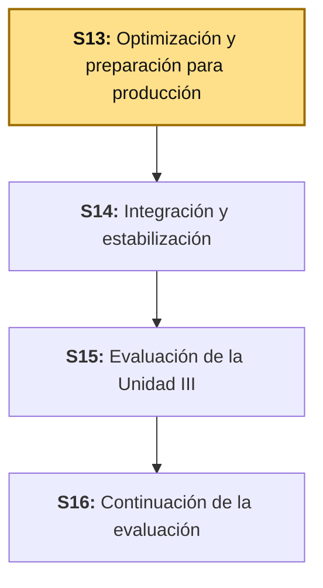
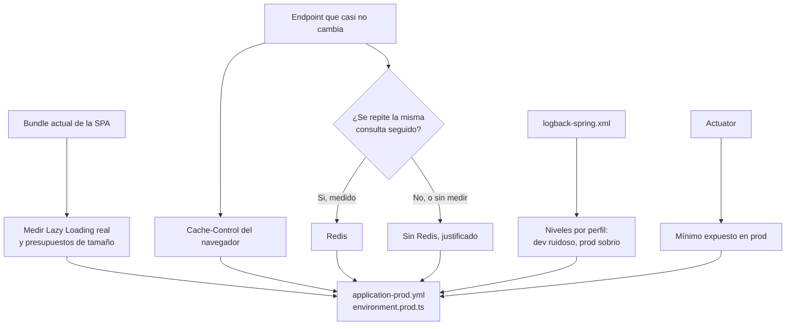

# S13 - Optimización y Preparación para Producción

*Por: Angel Sullon Macalupu @asullom - 2026*

## 1. Introducción

Tiempo: 20 min.

### 1.1 Presentación de la sesión

Unidad 2 cerró con un sistema funcionalmente completo: catálogo, ventas, seguridad con Keycloak, observabilidad con Prometheus/Loki/Grafana. Todo eso corrió siempre con `spring.profiles.active: dev` (S1) y con la SPA servida por `ng serve` — nunca se preguntó qué cambia si alguien más, en otra máquina, tiene que ejecutar o desplegar esto de verdad. Esta sesión abre Unidad 3 respondiendo esa pregunta: qué tan rápido carga la SPA la primera vez (Lazy Loading, Code Splitting), qué no debería repetir trabajo innecesario (caché del navegador, Redis), qué nivel de detalle debe registrar un log en producción frente a uno en desarrollo, qué debe exponer públicamente un endpoint de monitoreo y qué no, y qué necesita `bomerp-backend` para arrancar con un perfil `prod` que S1 (3.9) dejó anunciado, pero deliberadamente vacío. El porqué de tratar "producción" como una preocupación propia, no como "lo mismo de siempre pero en otro servidor", se desarrolla en 1.6, a partir del caso.

### 1.2 Índice

1. Lazy Loading y Code Splitting: medir lo que ya existe.
2. Caché del navegador: `Cache-Control` y validación condicional.
3. Caché con Redis: cuándo se justifica.
4. Logging para producción: niveles por perfil.
5. Monitoreo básico: Actuator seguro para producción.
6. Buenas prácticas de despliegue: perfiles, variables de entorno y build de producción.

### 1.3 Propósito de aprendizaje

Al concluir la clase, estarás en condiciones de:

- **Medir y documentar**, con evidencia antes y después, el tamaño de carga de tu SPA y el uso de Lazy Loading ya existente; **decidir con criterio** —midiendo, no por intuición— si tu proyecto necesita caché con Redis; **ajustar** logging y Actuator para que produzcan información útil sin exponer datos sensibles; y **preparar** una configuración de producción real (`application-prod.yml`, `environment.prod.ts`) con secretos fuera del código fuente.

### 1.4 Producto de sesión

Evidencia de Lazy Loading real por ruta (`ng build` con estadísticas de *chunks*, Network del navegador); presupuestos de bundle (`angular.json`) que fallan el build si una ruta crece de más; `Cache-Control` aplicado a un recurso que no cambia seguido; decisión documentada sobre Redis (implementado y justificado, o explícitamente descartado con la medición que lo sustenta); `logback-spring.xml` con niveles distintos por perfil (`dev` ruidoso, `prod` sobrio); `/actuator` expuesto de forma mínima y segura en `prod`; `application-prod.yml` y `environment.prod.ts` con la configuración real de producción, sin ninguna contraseña ni *secret* escrito en el código; y una guía reproducible de cómo levantar el sistema completo en modo producción local.

### 1.5 Metodología

**Tabla 1. Metodología de la sesión**

| Actividades a Realizar en el Periodo | Orientaciones generales (Orientaciones Metodológicas) | Material de estudio recomendado |
|---|---|---|
| Revisión previa individual | Confirmar que `lp2/bomerp-backend` y `lp2/bomerp-frontend` siguen arrancando en DEV (S1-S11). Revisar `application.yml` (S1, 3.9) y confirmar que `profiles.active: dev` sigue ahí. Trabajo individual, antes de clase. | S1 (3.9), S9 (`environment.ts`), S10b (`compose-dev.yml` de Keycloak). |
| Clase presencial | Medición guiada del bundle actual, configuración de presupuestos, `Cache-Control` sobre un endpoint real, decisión medida sobre Redis, ajuste de logging y Actuator por perfil, y construcción de `application-prod.yml`/`environment.prod.ts`. Trabajo individual en la propia laptop, siguiendo al docente paso a paso. | Contenedores y servicios de S1-S11 corriendo, Pasos 3.1 a 3.11 de esta guía. |
| Evaluación formativa | Revisión en clase del build de producción corriendo localmente, con `Cache-Control` verificado en el navegador y `/actuator` restringido en el perfil `prod`. La evidencia se completa y sustenta de forma individual, fuera del aula, según los criterios mínimos de la sección 4.4. | Indicaciones de entrega (4.3), rúbrica de evaluación (4.6). |

El cierre real de S12, construido con las respuestas del Anexo de feedback de esa sesión, se entrega al inicio de esta clase.

### 1.6 Motivación de la sesión

#### 1.6.1 Caso: el endpoint que nadie decidió exponer

Spring Boot Actuator, desde la versión 2 en adelante, solo expone `/actuator/health` por HTTP de forma predeterminada — el resto de endpoints (`/env`, `/beans`, `/heapdump`, `/configprops`) requieren una decisión explícita del desarrollador (`management.endpoints.web.exposure.include`) para quedar accesibles. Es un patrón de vulnerabilidad real y bien documentado, no hipotético: la propia documentación oficial de Spring Boot advierte explícitamente que "conviene considerar con cuidado qué endpoints exponer", porque varios de ellos exponen información sensible — `/env` puede mostrar variables de entorno completas, incluidas credenciales de base de datos si no se enmascaran; `/heapdump` puede entregar una copia de la memoria del proceso, con cualquier dato que estuviera en ella en ese instante.

Fuente: Spring Boot Reference Documentation. *Production-ready Features — Endpoints*. https://docs.spring.io/spring-boot/reference/actuator/endpoints.html

El problema no es Actuator — es copiar, sin revisar, una configuración de `application.yml` que en DEV usaba `include: "*"` ("expón todo, así no tengo que acordarme de nada") directo a producción. Nadie *decide* exponer `/env`; alguien lo deja así porque nunca lo volvió a mirar después de S1. Esta sesión trata exactamente ese tipo de decisión — qué se expone, qué se cachea, qué se registra en un log — como una configuración propia de cada perfil, no como un olvido que se arrastra de DEV a producción.

**Preguntas de análisis**

**Activación de conocimientos previos**

1. En `application.yml` (S1, 3.9), ¿qué perfil está activo hoy en tu proyecto? ¿Alguna vez lo cambiaste a mano?

**Comprensión de preparación para producción**

1. Si tu backend expusiera hoy `/actuator/env` sin restricción, ¿qué información real de tu propio proyecto podría ver cualquiera que encontrara esa URL?
2. ¿Por qué "funciona en mi laptop con `ng serve`" no es evidencia de que la SPA cargue rápido para un usuario real?

### 1.7 Ubicación en el curso

- Unidad: U3 - Proyecto Integrador Full-Stack.
- Producto del curso: Aplicación Full-Stack empresarial integrada, optimizada, monitoreada, estabilizada y preparada para producción, con evidencias y sustentación técnica.
- Producto de unidad: base Full-Stack modular de BomERP integrada, optimizada, monitoreada y estabilizada (`lp2-producto.md`, Unidad 3).
- Avance del producto en esta sesión: Lazy Loading y Code Splitting medidos y documentados, caché del navegador aplicado, decisión medida sobre Redis, logging y Actuator ajustados por perfil, y configuración real de producción (`application-prod.yml`, `environment.prod.ts`).

Roadmap del producto de la unidad:

**Figura 1. Roadmap del producto de la unidad**



## 2. Explica

Tiempo: 40 min.

### 2.1 Arquitectura de la sesión

**Figura 2. De una aplicación que funciona a una lista verificada de producción**



Lectura del diagrama: ninguna de las cinco piezas (Lazy Loading, caché del navegador, Redis, logging, Actuator) es un tema aislado — todas convergen en la misma pregunta de cierre, la configuración real de producción. Cada apartado siguiente desarrolla una pieza, en el mismo orden del Índice (1.2).

### 2.2 Lazy Loading y Code Splitting: medir lo que ya existe

**Lazy Loading** es la técnica de cargar el código de una pantalla solo cuando el usuario navega a ella, en vez de descargar toda la aplicación de una sola vez al abrir el sitio (Angular, 2026a). **Code Splitting** es el mecanismo del empaquetador (*bundler*) que hace eso posible: en vez de un único archivo JavaScript con toda la aplicación, genera varios archivos más pequeños — un **chunk** (literalmente "trozo" o "fragmento"; en adelante, un fragmento de código JavaScript independiente, con su propio nombre de archivo) por cada punto de carga diferida.

**Esto no es contenido nuevo — ya está construido desde S7.** Cada ruta de `app.routes.ts` usa `loadComponent: () => import(...)` (S7, 3.6-3.7), y `import()` dinámico es, precisamente, la sintaxis que le indica al compilador de Angular dónde cortar un *chunk* nuevo (Angular, 2026b). Lo que esta sesión agrega no es la técnica — es la **medición**: confirmar con evidencia real que el *chunk* de `Ventas` no se descarga cuando el usuario solo visita `Categorías`, y poner un límite (presupuesto) que impida que una ruta crezca sin que nadie se dé cuenta.

**Tabla 2. Qué ya existe (S7-S11) frente a qué agrega esta sesión**

| | Ya construido (S7-S11) | Esta sesión agrega |
|---|---|---|
| Mecanismo | `loadComponent` por ruta, en cada *feature* | — (no cambia) |
| Evidencia | Ninguna, se asumía que funcionaba | *Chunks* medidos con `ng build` y con el Network del navegador |
| Límite | Ninguno | Presupuestos (`budgets`) en `angular.json` que fallan el build si se exceden |

**Error frecuente**: confundir "mi aplicación tiene pocas pantallas" con "no necesito medir esto". El problema no es cuántas rutas tiene la SPA hoy — es que, sin un presupuesto, nada evita que una ruta crezca sin control más adelante (una librería agregada sin pensar, un componente que importa todo un módulo de Angular Material) y nadie lo note hasta que la aplicación ya se siente lenta en producción.

### 2.3 Caché del navegador: `Cache-Control` y validación condicional

El navegador puede evitar una petición HTTP completa si el servidor ya le dijo, en una respuesta anterior, cuánto tiempo puede reutilizar ese mismo recurso sin volver a pedirlo. Esa instrucción viaja en la cabecera `Cache-Control` (IETF, 2014) — `max-age=<segundos>` dice cuánto tiempo el navegador puede servir la respuesta guardada sin preguntarle nada al servidor; `no-cache` permite guardarla, pero exige revalidar con el servidor antes de reusarla; `no-store` prohíbe guardarla por completo.

**Tabla 3. Qué `Cache-Control` conviene según el tipo de recurso**

| Tipo de recurso | Cambia con qué frecuencia | `Cache-Control` recomendado |
|---|---|---|
| Archivos estáticos de la SPA ya compilados (JS, CSS con *hash* en el nombre) | Nunca — un build nuevo genera nombres de archivo distintos | `max-age` largo (un año), porque el nombre del archivo ya cambia si el contenido cambia |
| `GET /api/v1/categorias` (catálogo de referencia) | Rara vez, solo cuando alguien administra el catálogo | `max-age` corto a moderado, o validación condicional (`ETag`) |
| `GET /api/v1/ventas` (datos transaccionales propios del usuario) | Constantemente | `no-store` — nunca cachear datos que cambian por cada venta nueva |

**Error frecuente**: aplicar el mismo `Cache-Control` a todos los endpoints "porque ya funcionó en uno". Cachear `GET /api/v1/ventas` con el mismo `max-age` que el catálogo haría que un usuario viera una lista de ventas desactualizada después de registrar una nueva, sin que ningún error se lo avisara — el síntoma sería "mi venta no aparece", no un error técnico claro.

### 2.4 Caché con Redis: cuándo se justifica

**Redis** es un almacén de datos en memoria, separado de la base de datos relacional, que responde en microsegundos porque no tiene que leer disco ni resolver un plan de consultas (Redis Ltd., 2024). Se usa como caché del lado del servidor para evitar repetir, contra Oracle, una consulta cuyo resultado ya se calculó hace poco y probablemente no cambió.

El sílabo dice explícitamente "Redis **cuando corresponda**" — no es obligatorio por sí mismo, y el criterio para decidir es el mismo que ya usó BD2 para un índice (selectividad medida, S5 de BD2): si la mayoría de las peticiones a un endpoint piden exactamente el mismo resultado, en una ventana corta de tiempo, cachearlo ahorra trabajo real; si cada petición es distinta (filtros distintos, datos que cambian por usuario), Redis solo agrega una pieza más que mantener sincronizada, sin beneficio real.

**Tabla 4. Candidatos reales a caché con Redis en BomERP**

| Endpoint | ¿Buen candidato? | Por qué |
|---|---|---|
| `GET /api/v1/categorias` | Sí | Pocas filas, cambia rara vez, se consulta en cada carga de `ProductoForm` (S8) y de cada filtro de `ProductoList`. |
| `GET /api/v1/productos` | Depende del volumen | Si el catálogo es grande y estable, sí; si cambia seguido (stock descontándose en cada venta), el beneficio baja. |
| `GET /api/v1/ventas` | No | Transaccional por naturaleza — cachearlo arriesga mostrar datos desactualizados justo después de una venta nueva. |

**Decisión medida, no por intuición.** Antes de implementar Redis, mide: ¿cuántas veces se repite la misma consulta en un período corto? Si `GET /api/v1/categorias` se llama una vez por carga de pantalla y el catálogo tiene cinco categorías, el ahorro real es marginal — documentar esa medición y decidir **no** usar Redis es una entrega tan válida como implementarlo, siempre que la decisión esté justificada con datos, no con "por si acaso" (mismo criterio que ya aplicó BD2 con el índice sobre `ESTADO`, S5).

**Caso especial: los datos del usuario autenticado.** Un patrón muy común es pedir, justo después de iniciar sesión, "mi perfil" a un endpoint propio para mostrar el nombre o el rol en el encabezado — y volver a pedirlo cada vez que una pantalla lo necesita. En BomERP eso casi nunca hace falta: el JWT que Keycloak ya emitió (S10b, S11) trae, como *claims*, exactamente los datos básicos de perfil que la SPA necesita mostrar — `sub` (identificador), `email` y `realm_access.roles`. La SPA ya decodifica ese token al iniciar sesión para decidir el menú por rol (S11); no hace falta un segundo endpoint HTTP, y menos un caché en Redis, para algo que ya vive en memoria desde el login. Cachear esos mismos datos en Redis sería cachear algo que nunca costó una consulta a Oracle en primer lugar — el problema que Redis resuelve es evitar repetir una consulta **cara**, no evitar leer un valor que el propio navegador ya tiene decodificado.

Redis sí se justifica si tu proyecto agrega un perfil de usuario más rico que el que trae el JWT (preferencias, datos de negocio propios de ese usuario, guardados en tu propio esquema Oracle) — ahí aplica el mismo criterio medido de la Tabla 4: si ese perfil extendido se consulta seguido y cambia poco, mide y decide.

**Invalidación**: el problema que Redis agrega, no el que resuelve. Un caché que nunca se actualiza es peor que no tener caché — si `ProductoService.crear()` guarda una categoría nueva pero el caché de `listar()` sigue sirviendo la lista vieja, el usuario ve datos incorrectos sin ningún error. Por eso cada operación de escritura sobre una entidad cacheada debe invalidar (evict) la entrada correspondiente del caché, en la misma transacción que la escritura.

### 2.5 Logging para producción: niveles por perfil

`logback-spring.xml` (S1) ya escribe logs estructurados a archivo, con `CorrelationIdFilter` agregando el `traceId` a cada línea desde S5. Lo que nunca se revisó es **qué nivel** de detalle corresponde a cada ambiente. Un nivel de log decide qué tan ruidoso es el registro — de más detallado a menos: `TRACE`, `DEBUG`, `INFO`, `WARN`, `ERROR` (Logback, 2024).

**Tabla 5. Nivel de log recomendado por perfil**

| Perfil | Nivel recomendado | Por qué |
|---|---|---|
| `dev` | `DEBUG` | Ayuda a diagnosticar mientras se programa; el volumen de logs no importa en una laptop de desarrollo. |
| `prod` | `INFO` (o `WARN` para librerías de terceros) | `DEBUG` en producción genera un volumen de logs que cuesta espacio y dinero de verdad, y puede llegar a registrar datos sensibles que un nivel más alto omite. |

Spring Boot resuelve esto con **perfiles** dentro del mismo `logback-spring.xml`, usando `<springProfile name="...">` para declarar configuración distinta según `spring.profiles.active` (Spring Boot, 2026a) — el mismo mecanismo de perfiles que `application.yml` ya usa desde S1, aplicado ahora al archivo de logging.

**Error frecuente**: registrar en el log el cuerpo completo de un request que incluye una contraseña o un token — ni siquiera en `DEBUG`. Un nivel de log más bajo reduce el volumen, pero no reemplaza la responsabilidad de nunca loguear un dato sensible en ningún nivel.

### 2.6 Monitoreo básico: Actuator seguro para producción

Spring Boot Actuator ya responde `/actuator/health` desde S1 (3.3) — ese es, de hecho, el único endpoint que Actuator expone por HTTP de forma predeterminada desde la versión 2 (Spring Boot, 2026b). Esta sesión no agrega el endpoint: revisa **qué más** queda expuesto, y decide, por perfil, qué corresponde mostrar.

**Tabla 6. Endpoints de Actuator — exposición recomendada por perfil**

| Endpoint | Qué muestra | DEV | PROD |
|---|---|---|---|
| `/actuator/health` | Estado de salud (`UP`/`DOWN`), con el componente `db` (S1). | Sí | Sí |
| `/actuator/info` | Información del build (versión, commit), sin datos sensibles. | Sí | Sí |
| `/actuator/metrics` | Métricas internas (uso de memoria, conteo de peticiones). | Sí | Opcional, protegido por autenticación |
| `/actuator/env` | Variables de entorno completas, incluidas credenciales si no se enmascaran. | Sí (consulta propia) | **No** |
| `/actuator/heapdump` | Volcado completo de memoria del proceso. | Sí (consulta propia) | **No** |

`management.endpoints.web.exposure.include` en `application-prod.yml` declara explícitamente la lista corta (`health,info`), en vez de heredar lo que `application-dev.yml` tenga configurado — nunca con el valor `"*"` ("todo") en producción, por la misma razón que desarrolla el caso de 1.6.1.

### 2.7 Buenas prácticas de despliegue: perfiles, variables de entorno y build de producción

Un **ambiente de producción** no es "la misma configuración de DEV en otra máquina" — es un perfil propio, con sus propias decisiones: `application-prod.yml` (backend) y `environment.prod.ts` (frontend), ambos anunciados desde S1 (backend) y S9 (frontend) pero vacíos hasta hoy.

**Tabla 7. DEV frente a PROD: qué cambia realmente**

| Decisión | DEV | PROD |
|---|---|---|
| Contraseña de base de datos | Puede vivir en `application-dev.yml`, de uso solo local | Nunca en el archivo — se lee de una variable de entorno (`${DB_PASSWORD}`) |
| `ddl-auto` de Hibernate (S1) | `update` o `validate`, cómodo para iterar | `validate` siempre — producción nunca modifica el esquema sola |
| Nivel de log | `DEBUG` | `INFO`/`WARN` (2.5) |
| Actuator expuesto | Lista amplia | Lista mínima (2.6) |
| URL del backend en la SPA (`environment.ts`, S9) | `http://localhost:8080` | La URL real del servidor de producción |
| Build de Angular | `ng serve` (sin optimizar, recarga en caliente) | `ng build --configuration production` (minificado, *tree-shaking*, sin *source maps* públicos) |
| Cómo arranca el backend | `mvnw spring-boot:run` (recompila y corre directo desde el código fuente) | Imagen Docker ya construida (`Dockerfile`, 3.9), arrancada con `docker compose up` (`compose.yml`, sin sufijo — el nombre que Docker Compose toma por defecto, sin pasar `-f`) |

Una variable que sí viaja en el archivo (como `ddl-auto` o el nivel de log) no es un secreto; una contraseña, una clave de API o un *secret* de firma de JWT **nunca** se escribe directo en un archivo `.yml` que vive en el repositorio — se lee desde una variable de entorno del sistema operativo o del contenedor (`${VARIABLE}` en la sintaxis de Spring), siguiendo el mismo principio de mínimo privilegio que BD2 ya aplicó a los usuarios de Oracle.

**Error frecuente**: subir `application-prod.yml` al repositorio con una contraseña real ya escrita adentro, "solo por ahora, para probar". Una vez que un commit con un secreto llega al historial de Git, ese secreto queda expuesto para siempre, aunque se borre en un commit posterior — el historial lo sigue conservando.

## 3. Aplica: actividad práctica guiada

Tiempo: 120 min.

**Actividad:** medición guiada de Lazy Loading y presupuestos de bundle, `Cache-Control` sobre un endpoint real, decisión medida sobre Redis, ajuste de logging y Actuator por perfil, y construcción de la configuración real de producción (Producto de la sesión en 1.4).

**Propósito de la actividad:** llevar BomERP de "funciona en mi laptop con `ng serve`" a "tiene una configuración de producción real, medida y documentada", con el mismo criterio que cada estudiante aplicará después sobre su propio proyecto.

**Orientaciones metodológicas:** en el laboratorio, el docente mide y configura `bomerp-backend`/`bomerp-frontend` paso a paso frente a la clase; los estudiantes repiten cada paso en su propia instancia y aplican después el mismo criterio a su propio proyecto (ver sección 4).

**Actividades para realizar:**

- **3.1** Verificar el punto de partida.
- **3.2** Verificar y asegurar la conexión a `bomerp-oracle`.
- **3.3** Medir el bundle actual y confirmar Lazy Loading real.
- **3.4** Configurar presupuestos de bundle.
- **3.5** Aplicar `Cache-Control` a un endpoint real.
- **3.6** Medir y decidir sobre Redis.
- **3.7** Ajustar logging por perfil.
- **3.8** Asegurar Actuator para producción.
- **3.9** Construir la configuración de producción completa: backend, Oracle, Keycloak y Redis.
- **3.10** Ejecutar el build de producción y verificar de punta a punta.
- **3.11** Relacionar con ADS y BD2.

### 3.1 Verificar el punto de partida

**Punto de partida común:** todo el equipo debe comenzar exactamente desde donde quedó S11, no desde su propio avance individual — S12 fue evaluación, sin código nuevo. Clona la rama `s11-seguridad-frontend-keycloak` (el snapshot de cierre de S11):

```bash
git clone --branch s11-seguridad-frontend-keycloak https://github.com/262ciclo4/bomerp.git
```

**Producto del paso:** confirmación de que `bomerp-backend` y `bomerp-frontend` siguen arrancando en DEV, punto de partida de toda la sesión.

PowerShell:

```powershell
cd lp2/bomerp-backend
.\mvnw.cmd spring-boot:run
```

macOS/Linux:

```bash
cd lp2/bomerp-backend
./mvnw spring-boot:run
```

En otra terminal:

```bash
cd lp2/bomerp-frontend
ng serve
```

Confirma `http://localhost:8080/actuator/health` (`UP`) y `http://localhost:4200` (la SPA carga con el login de Keycloak, S11).

### 3.2 Verificar y asegurar la conexión a `bomerp-oracle`

**Producto del paso:** `bomerp-oracle` en la imagen con `rman` que BD2 S13 necesita (objetivo del cambio: BD2 respalda la base con RMAN esa misma semana, algo que la imagen `slim` no soporta) y `bomerp-backend` conectando sin error contra esa imagen — condición para todo lo que sigue, incluido el build de producción de 3.10.

`bomerp-oracle` es un único contenedor compartido entre ADS, BD2 y LP2 — lo que cambie cualquiera de los tres lo sienten los demás. BD2, en su propia S13 (misma semana), cambia la imagen de `bomerp-oracle` (de `gvenzl/oracle-free:23-slim` a `:23`, para tener `rman`), y ese cambio rompe, de entrada, la conexión de *cualquier* backend contra esa misma base, incluido `bomerp-backend` — no todos los integrantes del equipo llevan los dos cursos, así que este paso no puede depender de que alguien haya leído la guía de BD2.

Confirma primero que `lp2/bomerp-backend/compose-dev.yml` ya tiene la imagen que trae `rman` (si tu equipo tiene integrante de BD2, puede que ya la haya cambiado; si no, hazlo tú mismo — es el mismo archivo):

```yaml
services:
  oracle:
    image: gvenzl/oracle-free:23   # antes: gvenzl/oracle-free:23-slim
    container_name: bomerp-oracle
    ...
    environment:
      ...
      TZ: America/Lima
```

Si tuviste que cambiarla, aplícala:

```powershell
cd lp2/bomerp-backend
docker compose -f compose-dev.yml pull
docker compose -f compose-dev.yml up -d
```

Y confirma que `src/main/resources/application-dev.yml` sigue exactamente como quedó en S1 — **no hay nada que cambiar aquí**, ningún parámetro de cliente arregla lo que viene a continuación:

```yaml
spring:
  datasource:
    url: jdbc:oracle:thin:@localhost:1521/FREEPDB1
  jpa:
    hibernate:
      ddl-auto: validate
```

Si el arranque de 3.1 falló, o si en cualquier punto posterior de esta sesión aparece este error:

```text
ORA-01804: failure to initialize timezone information
```

— tanto al conectar como más adelante en `hibernate.ddl-auto: validate` (3.9) — no es un problema de tu configuración de LP2, y no se arregla ahí. Diagnostica primero — en PowerShell, un *here-string* evita depender de una sesión interactiva de `sqlplus` (más fácil de copiar/pegar tal cual, y es justo lo que funcionó en el laboratorio real):

PowerShell:

```powershell
@'
SELECT * FROM V$TIMEZONE_FILE;
SELECT property_name, property_value FROM database_properties WHERE property_name LIKE '%VERSION%';
EXIT;
'@ | docker exec -i bomerp-oracle bash -c 'sqlplus -s / as sysdba'
```

macOS/Linux:

```bash
docker exec -i bomerp-oracle sqlplus -s / as sysdba <<'EOF'
SELECT * FROM V$TIMEZONE_FILE;
SELECT property_name, property_value FROM database_properties WHERE property_name LIKE '%VERSION%';
EXIT;
EOF
```

Si `V$TIMEZONE_FILE` no devuelve filas y `DST_PRIMARY_TT_VERSION = 45`: la base espera la versión 45 de datos de zonas horarias, pero la imagen de Oracle que BD2 cambió solo trae instalada la versión 43.

**Esto no es porque la imagen regular `gvenzl/oracle-free:23` necesite siempre `timezlrg_45.dat` para arrancar.** Una base creada de cero directamente con la imagen regular se inicializa limpia en su propia versión nativa (43) y no pide nada más — es justo lo que pasa con el Oracle de `prod` en 3.9, que nace sin este problema. Lo que causa el error aquí es específicamente que el volumen `oracle-data` de `bomerp-oracle` **ya existía de antes**, creado originalmente con la imagen `-slim` (que sí trae instalada la versión 45 por defecto) — su diccionario de datos quedó con la versión 45 grabada como la esperada. Al cambiar solo el contenedor a la imagen regular (que únicamente trae hasta la 43) sin recrear ese volumen, Oracle ya no puede abrir una base que espera una versión de zona horaria que el nuevo `ORACLE_HOME` no tiene instalada. Hay dos formas igualmente válidas de resolverlo:

**Alternativa 1 — recrear los esquemas, usuarios y tablas desde cero.** Borra el volumen `oracle-data` y vuelve a crear todo directamente sobre la imagen regular, con el mismo script que usa esta guía en 3.9 para poblar el Oracle de `prod` (ya actualizado contra las entidades reales, con `VENDEDOR_ID` incluido). Una base así nunca llega a pedir la versión 45, porque nunca existió con ella instalada: no hace falta ningún arreglo de zona horaria. La diferencia frente a `prod`: `oracle-data` es la base compartida de todo el equipo (ADS + BD2 + LP2) en `dev`, así que borrarla se lleva también los datos de los otros dos cursos — coordina con tu equipo antes de hacerlo (o adelante, si de todas formas van a recrear todo desde cero en las tres materias, como en este caso).

Elimina solo el contenedor y el volumen de Oracle — `keycloak`, `keycloak-db` y `redis` no tienen este problema, no hace falta tocarlos:

```bash
docker compose -f compose-dev.yml rm -sf oracle
docker volume rm bomerp-backend-dev_oracle-data
docker compose -f compose-dev.yml up -d oracle
```

Espera a que vuelva a estar `healthy` (`docker ps`, columna `STATUS`) — el primer arranque de un volumen nuevo tarda varios minutos, igual que en S1/S9 — y recrea el esquema. Mismo script que 3.9, cambiando solo el contenedor de destino (`bomerp-oracle-prod` → `bomerp-oracle`; el puerto sigue siendo `1521`, el que expone `compose-dev.yml`):

PowerShell:

```powershell
@'
CREATE USER BOM_CATALOGO IDENTIFIED BY "123456" QUOTA UNLIMITED ON USERS;
GRANT CREATE SESSION, CREATE TABLE, CREATE VIEW, CREATE PROCEDURE, CREATE TRIGGER TO BOM_CATALOGO;

CREATE TABLE BOM_CATALOGO.CATEGORIAS (
    ID NUMBER GENERATED BY DEFAULT AS IDENTITY PRIMARY KEY,
    NOMBRE VARCHAR2(80) NOT NULL UNIQUE,
    DESCRIPCION VARCHAR2(200)
);

CREATE TABLE BOM_CATALOGO.PRODUCTOS (
    ID NUMBER GENERATED BY DEFAULT AS IDENTITY PRIMARY KEY,
    ID_CATEGORIA NUMBER,
    NOMBRE VARCHAR2(120) NOT NULL,
    PRECIO NUMBER(10,2) NOT NULL,
    STOCK NUMBER(10) NOT NULL,
    CONSTRAINT FK_PRODUCTO_CATEGORIA FOREIGN KEY (ID_CATEGORIA)
        REFERENCES BOM_CATALOGO.CATEGORIAS(ID),
    CONSTRAINT CK_PRODUCTO_PRECIO CHECK (PRECIO >= 0),
    CONSTRAINT CK_PRODUCTO_STOCK CHECK (STOCK >= 0)
);

GRANT SELECT, INSERT, UPDATE, DELETE ON BOM_CATALOGO.CATEGORIAS TO BOMERP_APP;
GRANT SELECT, INSERT, UPDATE, DELETE ON BOM_CATALOGO.PRODUCTOS TO BOMERP_APP;

CREATE USER BOM_VENTAS IDENTIFIED BY "123456" QUOTA UNLIMITED ON USERS;
GRANT CREATE SESSION, CREATE TABLE, CREATE VIEW, CREATE PROCEDURE, CREATE TRIGGER TO BOM_VENTAS;

CREATE TABLE BOM_VENTAS.VENTAS (
    ID          NUMBER GENERATED BY DEFAULT AS IDENTITY PRIMARY KEY,
    FECHA       TIMESTAMP NOT NULL,
    ESTADO      VARCHAR2(20) NOT NULL,
    TOTAL       NUMBER(12,2) NOT NULL,
    VENDEDOR_ID VARCHAR2(36),
    CONSTRAINT CK_VENTA_TOTAL CHECK (TOTAL >= 0)
);

CREATE TABLE BOM_VENTAS.DETALLE_VENTAS (
    ID               NUMBER GENERATED BY DEFAULT AS IDENTITY PRIMARY KEY,
    ID_VENTA         NUMBER NOT NULL,
    ID_PRODUCTO      NUMBER NOT NULL,
    NOMBRE_PRODUCTO  VARCHAR2(120) NOT NULL,
    PRECIO_UNITARIO  NUMBER(10,2) NOT NULL,
    CANTIDAD         NUMBER(10) NOT NULL,
    SUBTOTAL         NUMBER(12,2) NOT NULL,
    CONSTRAINT FK_DETALLE_VENTA FOREIGN KEY (ID_VENTA)
        REFERENCES BOM_VENTAS.VENTAS(ID),
    CONSTRAINT CK_DETALLE_CANTIDAD CHECK (CANTIDAD > 0),
    CONSTRAINT CK_DETALLE_SUBTOTAL CHECK (SUBTOTAL >= 0)
);

GRANT SELECT, INSERT, UPDATE, DELETE ON BOM_VENTAS.VENTAS TO BOMERP_APP;
GRANT SELECT, INSERT, UPDATE, DELETE ON BOM_VENTAS.DETALLE_VENTAS TO BOMERP_APP;
EXIT;
'@ | docker exec -i bomerp-oracle bash -c 'sqlplus -s system/123456@localhost:1521/FREEPDB1'
```

macOS/Linux:

```bash
docker exec -i bomerp-oracle sqlplus -s system/123456@localhost:1521/FREEPDB1 <<'EOF'
CREATE USER BOM_CATALOGO IDENTIFIED BY "123456" QUOTA UNLIMITED ON USERS;
GRANT CREATE SESSION, CREATE TABLE, CREATE VIEW, CREATE PROCEDURE, CREATE TRIGGER TO BOM_CATALOGO;

CREATE TABLE BOM_CATALOGO.CATEGORIAS (
    ID NUMBER GENERATED BY DEFAULT AS IDENTITY PRIMARY KEY,
    NOMBRE VARCHAR2(80) NOT NULL UNIQUE,
    DESCRIPCION VARCHAR2(200)
);

CREATE TABLE BOM_CATALOGO.PRODUCTOS (
    ID NUMBER GENERATED BY DEFAULT AS IDENTITY PRIMARY KEY,
    ID_CATEGORIA NUMBER,
    NOMBRE VARCHAR2(120) NOT NULL,
    PRECIO NUMBER(10,2) NOT NULL,
    STOCK NUMBER(10) NOT NULL,
    CONSTRAINT FK_PRODUCTO_CATEGORIA FOREIGN KEY (ID_CATEGORIA)
        REFERENCES BOM_CATALOGO.CATEGORIAS(ID),
    CONSTRAINT CK_PRODUCTO_PRECIO CHECK (PRECIO >= 0),
    CONSTRAINT CK_PRODUCTO_STOCK CHECK (STOCK >= 0)
);

GRANT SELECT, INSERT, UPDATE, DELETE ON BOM_CATALOGO.CATEGORIAS TO BOMERP_APP;
GRANT SELECT, INSERT, UPDATE, DELETE ON BOM_CATALOGO.PRODUCTOS TO BOMERP_APP;

CREATE USER BOM_VENTAS IDENTIFIED BY "123456" QUOTA UNLIMITED ON USERS;
GRANT CREATE SESSION, CREATE TABLE, CREATE VIEW, CREATE PROCEDURE, CREATE TRIGGER TO BOM_VENTAS;

CREATE TABLE BOM_VENTAS.VENTAS (
    ID          NUMBER GENERATED BY DEFAULT AS IDENTITY PRIMARY KEY,
    FECHA       TIMESTAMP NOT NULL,
    ESTADO      VARCHAR2(20) NOT NULL,
    TOTAL       NUMBER(12,2) NOT NULL,
    VENDEDOR_ID VARCHAR2(36),
    CONSTRAINT CK_VENTA_TOTAL CHECK (TOTAL >= 0)
);

CREATE TABLE BOM_VENTAS.DETALLE_VENTAS (
    ID               NUMBER GENERATED BY DEFAULT AS IDENTITY PRIMARY KEY,
    ID_VENTA         NUMBER NOT NULL,
    ID_PRODUCTO      NUMBER NOT NULL,
    NOMBRE_PRODUCTO  VARCHAR2(120) NOT NULL,
    PRECIO_UNITARIO  NUMBER(10,2) NOT NULL,
    CANTIDAD         NUMBER(10) NOT NULL,
    SUBTOTAL         NUMBER(12,2) NOT NULL,
    CONSTRAINT FK_DETALLE_VENTA FOREIGN KEY (ID_VENTA)
        REFERENCES BOM_VENTAS.VENTAS(ID),
    CONSTRAINT CK_DETALLE_CANTIDAD CHECK (CANTIDAD > 0),
    CONSTRAINT CK_DETALLE_SUBTOTAL CHECK (SUBTOTAL >= 0)
);

GRANT SELECT, INSERT, UPDATE, DELETE ON BOM_VENTAS.VENTAS TO BOMERP_APP;
GRANT SELECT, INSERT, UPDATE, DELETE ON BOM_VENTAS.DETALLE_VENTAS TO BOMERP_APP;
EXIT;
EOF
```

`BOMERP_APP` no se vuelve a crear — ya lo creó `APP_USER` de la imagen al arrancar (mismas variables de entorno de `compose-dev.yml`, S1) — y los `GRANT` van en el mismo script. Reinicia el backend después (`docker compose -f compose-dev.yml restart` o tu propio `mvnw`) para confirmar que conecta sin errores de esquema.

**Opcional, libera espacio**: con la Alternativa 1 ya no necesitas la imagen `gvenzl/oracle-free:23-slim` cacheada — solo servía para sacar `timezlrg_45.dat` en la Alternativa 2. Bórrala una vez que confirmes que todo quedó funcionando (si la necesitas de nuevo, Docker la vuelve a descargar):

```bash
docker rmi gvenzl/oracle-free:23-slim
```

**Alternativa 2 — instalar el `timezlrg_45.dat` que falta.** Mantiene el volumen y los datos tal como están; solo copia el archivo de zona horaria correcto dentro del contenedor. Verificado, sin ningún archivo con licencia de Oracle (la imagen `slim` anterior, que sí trae la versión correcta, suele seguir cacheada localmente). **Ojo con la ruta de origen dentro de la imagen `slim`: es `26ai`, no `23ai`** — verificado; con `23ai` el `docker cp` falla con `Could not find the file`.

PowerShell:

```powershell
$cid = docker create --entrypoint bash gvenzl/oracle-free:23-slim -c "true"
docker cp "${cid}:/opt/oracle/product/26ai/dbhomeFree/oracore/zoneinfo/timezlrg_45.dat" .\timezlrg_45.dat
docker rm $cid

docker cp .\timezlrg_45.dat bomerp-oracle:/opt/oracle/product/26ai/dbhomeFree/oracore/zoneinfo/timezlrg_45.dat
docker exec -u root bomerp-oracle chown oracle:oinstall /opt/oracle/product/26ai/dbhomeFree/oracore/zoneinfo/timezlrg_45.dat
docker exec -u root bomerp-oracle chmod 644 /opt/oracle/product/26ai/dbhomeFree/oracore/zoneinfo/timezlrg_45.dat
docker exec bomerp-oracle ls -lh /opt/oracle/product/26ai/dbhomeFree/oracore/zoneinfo/timezlrg_45.dat
```

macOS/Linux:

```bash
cid=$(docker create --entrypoint bash gvenzl/oracle-free:23-slim -c "true")
docker cp "$cid:/opt/oracle/product/26ai/dbhomeFree/oracore/zoneinfo/timezlrg_45.dat" ./timezlrg_45.dat
docker rm "$cid"

docker cp ./timezlrg_45.dat bomerp-oracle:/opt/oracle/product/26ai/dbhomeFree/oracore/zoneinfo/timezlrg_45.dat
docker exec -u root bomerp-oracle chown oracle:oinstall /opt/oracle/product/26ai/dbhomeFree/oracore/zoneinfo/timezlrg_45.dat
docker exec -u root bomerp-oracle chmod 644 /opt/oracle/product/26ai/dbhomeFree/oracore/zoneinfo/timezlrg_45.dat
```

Reinicia — basta con `docker restart`, reinicia el mismo contenedor (misma capa escribible, el archivo que acabas de copiar no se pierde; lo que sí lo pierde es recrear el contenedor, por ejemplo con `docker compose up -d` tras otro cambio) — y espera a que vuelva a estar `healthy` antes de verificar:

PowerShell:

```powershell
docker restart bomerp-oracle

$attempt = 0
do {
    Start-Sleep -Seconds 5
    $status = docker inspect --format '{{.State.Health.Status}}' bomerp-oracle
    $attempt++
} while ($status -ne "healthy" -and $attempt -lt 60)

if ($status -ne "healthy") {
    Write-Host "Oracle todavía no está healthy. Revisa los logs." -ForegroundColor Yellow
    docker logs --tail 60 bomerp-oracle
} else {
    Write-Host "bomerp-oracle healthy" -ForegroundColor Green
}
```

macOS/Linux:

```bash
docker restart bomerp-oracle
until [ "$(docker inspect -f '{{.State.Health.Status}}' bomerp-oracle)" = "healthy" ]; do sleep 5; done
echo "bomerp-oracle healthy"
```

Verifica — mismo *here-string*/heredoc de antes:

PowerShell:

```powershell
@'
-- debe mostrar timezlrg_45.dat
SELECT * FROM V$TIMEZONE_FILE;
-- debe ser > 0 (antes: 0)
SELECT COUNT(*) FROM V$TIMEZONE_NAMES;
EXIT;
'@ | docker exec -i bomerp-oracle bash -c 'sqlplus -s / as sysdba'
```

macOS/Linux:

```bash
docker exec -i bomerp-oracle sqlplus -s / as sysdba <<'EOF'
SELECT * FROM V$TIMEZONE_FILE;          -- debe mostrar timezlrg_45.dat
SELECT COUNT(*) FROM V$TIMEZONE_NAMES;  -- debe ser > 0 (antes: 0)
EXIT;
EOF
```

Resultado real de esta sesión:

```text
FILENAME                 VERSION     CON_ID
----------------------- ---------- ----------
timezlrg_45.dat                 45          0

  COUNT(*)
----------
      2475
```

Vuelve a intentar 3.1 (o la petición que te falló): debe conectar sin error.

**Error frecuente**: intentar arreglar esto bajando `DST_PRIMARY_TT_VERSION` a mano, o apuntando la variable `ORA_TZFILE` a la versión 43 que sí está instalada — ninguna de las dos es soportada por Oracle, y la segunda deja el contenedor en *crash loop* al reiniciar (verificado). El arreglo real siempre es instalar el archivo que coincide con la versión que el diccionario ya tiene registrada.

**Este arreglo se hace una sola vez por sesión del contenedor, no se repite más adelante.** Una vez verificado aquí, tanto el backend en `dev` (el resto de esta guía) como el contenedor de producción que construyes en 3.9-3.10 se conectan a la misma instancia ya corregida — no hace falta volver a tocar esto al llegar a `prod`. Si el contenedor se recrea en algún momento (otro cambio en `compose-dev.yml`, un `docker compose pull`), repite los tres comandos `docker cp`/`chown`/`chmod` de arriba; el archivo extraído puede guardarse y reusarse, sin tener que extraerlo de la imagen `slim` otra vez. Diagnóstico completo, si lo necesitas: [BD2 S13, pasos 3.2-3.3](../../bd2/sesiones/S13_Backup_Recovery_RMAN.md#32-cambiar-a-la-imagen-oracle-con-rman).

### 3.3 Medir el bundle actual y confirmar Lazy Loading real

**Producto del paso:** evidencia real de que cada *feature* de la SPA se descarga como un *chunk* separado, no todo de una vez.

Genera un build de producción con estadísticas:

```bash
cd lp2/bomerp-frontend
ng build --configuration production --stats-json
```

La terminal imprime una tabla con cada *chunk* generado y su tamaño — confirma que existen archivos separados para `catalogo`, `ventas` y `seguridad` (o los nombres reales de tus *features*), no un único archivo gigante con toda la aplicación. `ng build` solo escribe esos archivos en `dist/bomerp-frontend/browser` — no levanta ningún servidor, así que ese `dist/` por sí solo no se puede abrir todavía en el navegador.

**Parte 1 (ahora, contra `dev`):** la división en *chunks* por ruta es una característica de cómo está armado el build (`loadChildren`), no algo exclusivo de la optimización de producción — se puede confirmar en vivo contra el `ng serve` de 3.1, que ya tiene el backend de `dev` funcionando detrás. Abre `http://localhost:4200` con las herramientas de desarrollo (`F12`) en la pestaña **Network**, filtra por `JS`, limpia la lista y navega directo a **Categorías** sin pasar por **Ventas**. Ningún archivo con `ventas` en el nombre debería aparecer en la lista — recién aparece cuando haces clic en el enlace de **Ventas** del sidebar.

**Parte 2 (más adelante, en 3.10, contra `prod`):** esto solo confirma que el *routing* separa los *chunks* — todavía no confirma los tamaños reales optimizados (minificados, sin *source maps*) de la tabla de arriba, porque `dev` nunca sirve ese build. No se puede hacer todavía: necesita el backend de `prod` (3.9), que en este punto de la guía aún no existe. Una vez que lo tengas arriba, sirve el build de producción con la configuración real en el puerto `4300` (Tabla 8):

```bash
ng serve --configuration production --port 4300
```

Repite el mismo chequeo de Network contra `http://localhost:4300`. 3.10 hace exactamente esto (con `http-server` en vez de `ng serve`, para probar el build tal cual se va a desplegar) como parte de su verificación de punta a punta — si ya llegaste hasta ahí, no hace falta repetir el paso aparte, el chequeo de Network se hace sobre ese mismo servidor.

**Error frecuente**: medir el bundle con `ng serve` (modo desarrollo) y quedarse solo con eso. Sirve para confirmar que el *Lazy Loading* existe (Parte 1), pero no mide tamaño real — `ng serve` no aplica las mismas optimizaciones que `ng build --configuration production` (minificación, *tree-shaking*); el tamaño que ves en DEV no representa el tamaño real que descargaría un usuario en producción, por eso hace falta también la Parte 2.

### 3.4 Configurar presupuestos de bundle

**Producto del paso:** `angular.json` con un límite de tamaño que hace fallar el build si una ruta crece sin control.

Un *budget* no limita en tiempo de ejecución lo que puedes escribir, ni hace que el sistema "se caiga" si un *chunk* crece — es un chequeo que corre solo durante el **build**. Si un *chunk* supera `maximumWarning`, `ng build` sigue terminando bien (código `0`), solo imprime una advertencia; si supera `maximumError`, el build **falla** (código distinto de `0`) — no se genera ningún artefacto, no hay nada que desplegar. El código nunca llega a producción, porque el pipeline se detiene antes, en tu laptop o en CI, no cuando ya hay un usuario esperando que cargue. El beneficio real: sin esto, alguien importa sin querer una librería pesada completa (ejemplo clásico: `import * as _ from 'lodash'` en vez de solo la función que necesita) y nadie se entera hasta que un usuario se queja de que la app tarda — ya en producción, con gente afectada. Con el presupuesto, te enteras en el momento exacto en que pasó, con el nombre del *chunk* y el tamaño que lo causó. Si el crecimiento es legítimo (la app de verdad necesita ese peso), el límite no es una pared técnica de Angular — es un número que tú mismo calibras en `angular.json` y subes cuando haga falta.

En `angular.json`, dentro de la configuración `production` del proyecto, agrega o revisa `budgets`:

```json
"budgets": [
  {
    "type": "initial",
    "maximumWarning": "500kB",
    "maximumError": "1MB"
  },
  {
    "type": "anyComponentStyle",
    "maximumWarning": "4kB",
    "maximumError": "8kB"
  }
]
```

`initial` mide el *chunk* que se descarga al abrir la aplicación por primera vez (antes de cualquier Lazy Loading) — ese es el que de verdad afecta cuánto espera un usuario nuevo. Vuelve a correr `ng build --configuration production`: si algún *chunk* supera `maximumError`, el build falla con el archivo y el tamaño exacto que lo causó — una alerta temprana, no un descubrimiento tardío en producción.

### 3.5 Aplicar `Cache-Control` a un endpoint real

**Producto del paso:** `GET /api/v1/categorias` respondiendo con una cabecera `Cache-Control` real, verificada en el navegador.

En `CategoriaController` (S7), agrega la cabecera a la respuesta del listado:

```java
// imports nuevos
import org.springframework.http.CacheControl;
import java.time.Duration;
```

```java
@GetMapping
public ResponseEntity<List<CategoriaResponse>> listar() {
    List<CategoriaResponse> categorias = categoriaService.listar();
    return ResponseEntity.ok()
            .cacheControl(CacheControl.maxAge(Duration.ofMinutes(5)))
            .body(categorias);
}
```

`CacheControl.maxAge(...)` (de `org.springframework.http.CacheControl`) arma la cabecera por ti, sin construir el texto a mano.

Agrega también un log en `CategoriaServiceImpl.listar()` — evidencia del lado del servidor, más confiable que mirar solo el navegador, porque prueba algo que el navegador no puede probar por sí solo: que el backend **nunca llegó a recibir** la segunda petición.

```java
// imports nuevos
import lombok.extern.slf4j.Slf4j;
```

```java
@Slf4j
@Service
@RequiredArgsConstructor
public class CategoriaServiceImpl implements CategoriaService {
    ...
    @Override
    @Transactional(readOnly = true)
    public List<CategoriaResponse> listar() {
        log.info("Listando categorías - consulta real a la base");
        return categoriaRepository.findAll().stream().map(categoriaMapper::toResponse).toList();
    }
```

Verifica con dos fuentes, no solo una:

- **Navegador**: con las herramientas de desarrollo abiertas, pestaña **Network**, haz clic en la petición `categorias` → sub-pestaña **Headers** → **Response Headers**: la cabecera `Cache-Control: max-age=300` debe aparecer ahí. Recarga `CategoriaList` una segunda vez dentro de esos 5 minutos: la fila de la petición sigue apareciendo en la lista, pero su **Size**/**Time** dice `(disk cache)` o `(memory cache)` en vez de un tamaño real — el navegador nunca fue a la red.
- **Terminal del backend** (`mvnw spring-boot:run`): la primera carga imprime `Listando categorías - consulta real a la base`. La segunda carga, dentro de los 5 minutos, **no imprime nada nuevo** — confirmación directa de que la petición nunca llegó al servidor, no solo una inferencia a partir de lo que muestra el navegador.

**Error frecuente**: aplicar la misma cabecera a `VentaController.crear()` o a cualquier endpoint que escribe datos (`POST`/`PUT`/`DELETE`). `Cache-Control` solo tiene sentido sobre respuestas de lectura (`GET`) — cachear la respuesta de una escritura no tiene ningún efecto útil y puede confundir a quien revise el comportamiento más adelante.

### 3.6 Medir y decidir sobre Redis

**Producto del paso:** una decisión documentada sobre Redis para tu propio proyecto — implementado y justificado, o descartado con la medición que lo sustenta.

Antes de escribir una sola línea de código, mide: abre el reporte de uso de `CategoriaService.listar()` (o agrega un contador simple, un `AtomicInteger` incrementado en cada llamada) y observa cuántas veces se invoca en una sesión de prueba normal de 5 minutos navegando la SPA. Documenta ese número — es el dato que justifica (o no) el siguiente paso.

**Si la medición justifica Redis**, agrega las dependencias a `pom.xml` — las dos, no solo la primera: `spring-boot-starter-data-redis` conecta con Redis, pero `@EnableCaching` por sí solo no encuentra ningún `CacheManager` sin `spring-boot-starter-cache` (verificado: sin esta segunda dependencia, el backend ni siquiera arranca — `APPLICATION FAILED TO START`, "no CacheManager bean found"):

```xml
<dependency>
    <groupId>org.springframework.boot</groupId>
    <artifactId>spring-boot-starter-data-redis</artifactId>
</dependency>
<dependency>
    <groupId>org.springframework.boot</groupId>
    <artifactId>spring-boot-starter-cache</artifactId>
</dependency>
```

Agrega Redis a `lp2/bomerp-backend/compose-dev.yml` (mismo criterio de puertos que Keycloak, S10b — prefijo `3` para LP2 DEV):

```yaml
  bomerp-redis:
    image: redis:7.4-alpine
    container_name: bomerp-redis-dev
    ports:
      - "36379:6379"
```

El backend corre fuera de Docker (`mvnw`, S1), así que se conecta por el puerto publicado en el host, no por el nombre del servicio. En `application-dev.yml`:

```yaml
spring:
  data:
    redis:
      host: localhost
      port: 36379
```

Habilita el caché y anota el método a cachear:

```java
@EnableCaching
@SpringBootApplication
public class BomerpBackendApplication { }
```

```java
@Cacheable("categorias")
public List<CategoriaResponse> listar() {
    // la consulta real a Oracle, sin cambios
}
```

E invalida el caché en cada escritura — `crear`, `actualizar` y `eliminar`, no solo la primera:

```java
@CacheEvict(value = "categorias", allEntries = true)
public CategoriaResponse crear(CategoriaRequest request) {
    // igual que antes
}

@CacheEvict(value = "categorias", allEntries = true)
public CategoriaResponse actualizar(Long id, CategoriaRequest request) {
    // igual que antes
}

@CacheEvict(value = "categorias", allEntries = true)
public void eliminar(Long id) {
    // igual que antes
}
```

**`CategoriaResponse` (y cualquier DTO que vayas a cachear) debe implementar `Serializable`** — verificado: sin esto, la primera llamada falla en el momento de guardar en Redis con `NotSerializableException`, porque `RedisCacheManager` usa serialización nativa de Java por defecto, que exige que la clase declare `implements Serializable`:

```java
public class CategoriaResponse implements Serializable {
    // los mismos campos de siempre
}
```

Verifica con dos fuentes, no solo una — el mismo criterio de 3.5:

- **El log de 3.5, reutilizado sin tocarlo**: `@Cacheable` envuelve `listar()` con un *proxy* — en un *cache hit*, la llamada nunca entra al cuerpo del método, así que `log.info("Listando categorías - consulta real a la base")` tampoco se ejecuta. Primera carga: aparece el log. Segunda carga, antes de cualquier escritura: no aparece nada — la misma evidencia de 3.5, ahora probando algo distinto (que ni siquiera Oracle fue consultada, no solo que el navegador no viajó a la red).
- **Dentro de Redis directamente**, no solo inferido desde el backend:

```bash
docker exec -it bomerp-redis-dev redis-cli KEYS "*"
docker exec -it bomerp-redis-dev redis-cli GET "categorias::SimpleKey []"
```

La primera confirma que existe una entrada bajo el caché `categorias`. La segunda no va a mostrar texto legible — la serialización nativa de Java produce bytes binarios, no JSON — pero el solo hecho de que `redis-cli` devuelva contenido (no `(nil)`) confirma que el dato vive ahí de verdad. Después de `crear()` (que dispara `@CacheEvict`), repite `KEYS "*"` — la entrada debe haber desaparecido.

**Error frecuente**: llamar al mismo endpoint dos veces seguidas, sin ninguna pausa, y concluir que el caché no sirvió porque el segundo log sí apareció. Verificado contra `bomerp-redis-dev`: el cliente Redis (Lettuce) escribe de forma asíncrona — entre el `log.info` de la primera llamada y que el valor sea *legible* desde Redis pasan unos cientos de milisegundos. Un humano recargando la página en el navegador nunca nota esa ventana; un script o una prueba automatizada que encadene dos llamadas sin pausa sí puede verla.

**Error frecuente**: verificar Redis solo con el log o solo con `KEYS`, nunca con los dos. El log prueba que el método no se ejecutó; `KEYS`/`GET` prueba que el dato efectivamente vive en Redis y no en memoria de otra forma (ej. un caché de Hibernate de primer nivel, que no sobrevive entre peticiones HTTP distintas y no es lo que esta sesión mide).

**Si la medición no lo justifica**, documenta la decisión igual (el número medido en 3.6, y por qué no alcanza para justificar una pieza nueva de infraestructura) — es una entrega tan válida como implementarlo (2.4).

### 3.7 Ajustar logging por perfil

**Producto del paso:** `logback-spring.xml` con `DEBUG` en `dev` e `INFO` en `prod`, verificado con el mismo log real en los dos perfiles.

Envuelve el nivel del paquete propio del proyecto (`pe.edu.upeu.bomerp`) con `springProfile`:

```xml
<springProfile name="dev">
    <logger name="pe.edu.upeu.bomerp" level="DEBUG"/>
</springProfile>

<springProfile name="prod">
    <logger name="pe.edu.upeu.bomerp" level="INFO"/>
</springProfile>
```

Arranca en `dev` (como siempre, S1) y confirma el volumen del log al ejecutar el mismo flujo (listar categorías, registrar una venta):

```powershell
.\mvnw.cmd spring-boot:run "-Dspring-boot.run.profiles=dev"
```

La comparación contra `prod` se hace en 3.10, sobre el contenedor real — `mvnw spring-boot:run` es una herramienta de desarrollo (recompila y arranca directo desde el código fuente); no es como corre un `prod` real, que arranca desde un JAR ya empaquetado dentro de una imagen Docker.

### 3.8 Asegurar Actuator para producción

**Producto del paso:** `/actuator/env` y `/actuator/heapdump` accesibles en `dev`, bloqueados en `prod`.

En `application-dev.yml` (ya existe desde S1):

```yaml
management:
  endpoints:
    web:
      exposure:
        include: "*"
```

En `application-prod.yml` (3.9, nuevo hoy):

```yaml
management:
  endpoints:
    web:
      exposure:
        include: health,info
```

La verificación real (`curl http://localhost:48088/actuator/env`) se hace en 3.10, sobre el contenedor de `prod` — verificado: responde `401`, no `404` — la seguridad JWT de Keycloak (S10/S10b) rechaza la petición sin token antes de que Actuator llegue a decidir si el endpoint existe. Dos capas independientes bloquean `/env` en `prod`: la que exige un token válido, y la que ni siquiera lo expone (`include: health,info`) — la misma protección por omisión que el caso de 1.6.1 describe, aplicada explícitamente en tu propio `application-prod.yml`, no heredada por accidente.

### 3.9 Construir la configuración de producción completa: backend, Oracle, Keycloak y Redis

**Producto del paso:** la configuración de producción real, con secretos leídos de variables de entorno; la imagen Docker que empaqueta `bomerp-backend` para correr como correría de verdad (nunca con `mvnw`); y un stack de infraestructura propio de `prod` — Oracle, Keycloak y Redis separados de los de `dev`, con su propio esquema y su propio realm, corriendo en paralelo sin chocar puertos.

**Puertos: `dev` y `prod` corren al mismo tiempo, en la misma laptop — ningún puerto se repite.**

**Tabla 8. Puertos de `dev` frente a `prod`**

| Servicio | DEV (ya existe) | PROD (nuevo, prefijo `4` en vez de `3`) |
|---|---|---|
| Oracle (listener) | `1521` | `41521` |
| Oracle (Enterprise Manager Express) | `5500` | `45500` |
| Keycloak-DB (Postgres interno de Keycloak) | `35432` | `45432` |
| Keycloak | `38080` | `48080` |
| Redis | `36379` | `46379` |
| `bomerp-backend` | `8080` (`mvnw`, sin Docker) | `48088` (no `48080` — chocaría con Keycloak, que también parte de `8080` por defecto) |
| `bomerp-frontend` | `4200` (`ng serve`, sin Docker) | `4300` (`http-server` sobre el build estático de 3.10) |

`bomerp-frontend` es la excepción a la columna del prefijo: `4200` ya es el puerto por defecto de `ng serve` (Angular CLI, sin relación con `3xxxx`/`4xxxx` de este proyecto), así que `prod` no le antepone un `4` — solo se eligió `4300`, libre y fácil de distinguir de `4200`.

`lp2/bomerp-backend/src/main/resources/application-prod.yml` (completo — incluye Redis, si 3.6 lo justificó para tu proyecto; si no, omite el bloque `data.redis`). Ningún dato de conexión va escrito directo en el YAML — todo llega por variable de entorno, el mismo criterio que `pagatu-catalogo-ms-prod.yml` ya aplica en `infra/pagatu-config/config-repo` (ahí hasta `DB_HOST`/`DB_PORT`/`DB_NAME` son `${...}`, no solo usuario/contraseña):

```yaml
spring:
  security:
    oauth2:
      resourceserver:
        jwt:
          issuer-uri: http://${KEYCLOAK_HOST}:${KEYCLOAK_PORT}/realms/bomerp
  datasource:
    url: jdbc:oracle:thin:@${DB_HOST}:${DB_PORT}/${DB_NAME}
    username: ${DB_USERNAME}
    password: ${DB_PASSWORD}
  jpa:
    hibernate:
      ddl-auto: validate
  data:
    redis:
      host: ${REDIS_HOST}
      port: ${REDIS_PORT}

bomerp:
  cors:
    allowed-origins: ${CORS_ALLOWED_ORIGINS:http://localhost:4300}

management:
  endpoints:
    web:
      exposure:
        include: health,info
```

**Error frecuente**: olvidar `bomerp.cors.allowed-origins` en `application-prod.yml` — verificado: el backend arranca, pasa la validación de esquema, y recién al crear el bean `corsConfig` falla con `Could not resolve placeholder 'bomerp.cors.allowed-origins'`. `application-dev.yml` ya lo tiene (S1); `prod` necesita su propio valor, apuntando al puerto real donde sirves el frontend compilado (`4300`, 3.10).

Los valores en sí — a dónde apunta cada variable — los define `compose.yml`, no `application-prod.yml`: `DB_HOST`/`DB_PORT`/`DB_NAME`/`REDIS_HOST`/`REDIS_PORT`/`KEYCLOAK_HOST`/`KEYCLOAK_PORT` son estables (nombres de servicio y puertos internos, no secretos), así que van escritos directo en `compose.yml`; solo `DB_USERNAME`/`DB_PASSWORD` siguen viniendo de `.env` — igual que en `pagatu-catalogo-ms`, donde `DB_HOST`/`DB_PORT` están fijos en `compose.yml` pero `DB_NAME`/`DB_USER`/`DB_PASS` sí vienen de `.env`.

`lp2/bomerp-backend/Dockerfile` (*multi-stage*: compila en una imagen con Maven, y el contenedor final solo lleva el JAR ya construido y el JRE, sin el código fuente ni Maven) — sin cambios:

```dockerfile
FROM maven:3.9-eclipse-temurin-21 AS build
WORKDIR /app
COPY . .
RUN ./mvnw clean package -DskipTests

FROM eclipse-temurin:21-jre-alpine
WORKDIR /app
COPY --from=build /app/target/*.jar app.jar
EXPOSE 8080
ENTRYPOINT ["java", "-jar", "app.jar"]
```

`lp2/bomerp-backend/compose.yml` (sin sufijo — es PROD; solo DEV lleva sufijo, `compose-dev.yml`, el mismo criterio que pagatu ya usa en `pagatu-catalogo-ms`: el nombre sin sufijo es el que Docker Compose toma por defecto, así `prod` arranca con un simple `docker compose up`, sin `-f`). Completo — Oracle, Keycloak-DB, Keycloak, Redis (si tu proyecto lo implementó en 3.6; si no, quita el servicio `redis` y `REDIS_HOST`/`REDIS_PORT` del backend, y el bloque `data.redis` de `application-prod.yml`) y el backend, los cinco en el mismo archivo, con nombres de contenedor, volúmenes y puertos propios de `prod`, ninguno compartido con `dev`. Ninguna contraseña queda escrita en el archivo — todas salen de `.env` (3.10), el mismo criterio que ya usa `bomerp-backend` para `DB_USERNAME`/`DB_PASSWORD`; de hecho `APP_USER`/`APP_USER_PASSWORD` de Oracle son el mismo usuario, así que reusan esas mismas dos variables en vez de duplicarlas:

```yaml
services:
  oracle:
    image: gvenzl/oracle-free:23
    container_name: bomerp-oracle-prod
    restart: unless-stopped
    ports:
      - "41521:1521"
      - "45500:5500"
    environment:
      ORACLE_PASSWORD: ${ORACLE_PASSWORD}
      APP_USER: ${DB_USERNAME}
      APP_USER_PASSWORD: ${DB_PASSWORD}
      TZ: America/Lima
    volumes:
      - oracle-data-prod:/opt/oracle/oradata
    healthcheck:
      test: ["CMD", "healthcheck.sh"]
      interval: 10s
      timeout: 5s
      retries: 10
      start_period: 60s

  keycloak-db:
    image: postgres:17-alpine
    container_name: bomerp-keycloak-db-prod
    restart: unless-stopped
    ports:
      - "45432:5432"
    environment:
      POSTGRES_DB: bomerp_keycloak
      POSTGRES_USER: bomerp_keycloak
      POSTGRES_PASSWORD: ${KEYCLOAK_DB_PASSWORD}
    volumes:
      - keycloak-db-data-prod:/var/lib/postgresql/data
    healthcheck:
      test: ["CMD-SHELL", "pg_isready -U bomerp_keycloak -d bomerp_keycloak"]
      interval: 10s
      timeout: 5s
      retries: 10
      start_period: 15s

  keycloak:
    image: quay.io/keycloak/keycloak:26.8.0
    container_name: bomerp-keycloak-prod
    restart: unless-stopped
    command: start-dev --import-realm
    depends_on:
      keycloak-db:
        condition: service_healthy
    ports:
      - "48080:8080"
    environment:
      KC_BOOTSTRAP_ADMIN_USERNAME: ${KEYCLOAK_ADMIN_USERNAME}
      KC_BOOTSTRAP_ADMIN_PASSWORD: ${KEYCLOAK_ADMIN_PASSWORD}
      KC_DB: postgres
      KC_DB_URL: jdbc:postgresql://keycloak-db:5432/bomerp_keycloak
      KC_DB_USERNAME: bomerp_keycloak
      KC_DB_PASSWORD: ${KEYCLOAK_DB_PASSWORD}
    volumes:
      - keycloak-data-prod:/opt/keycloak/data
      - ./keycloak-import:/opt/keycloak/data/import

  redis:
    image: redis:7.4-alpine
    container_name: bomerp-redis-prod
    restart: unless-stopped
    ports:
      - "46379:6379"

  bomerp-backend:
    build: .
    container_name: bomerp-backend-prod
    restart: unless-stopped
    depends_on:
      oracle:
        condition: service_healthy
      keycloak-db:
        condition: service_healthy
    ports:
      - "48088:8080"
    environment:
      SPRING_PROFILES_ACTIVE: prod
      DB_HOST: oracle
      DB_PORT: 1521
      DB_NAME: FREEPDB1
      DB_USERNAME: ${DB_USERNAME}
      DB_PASSWORD: ${DB_PASSWORD}
      REDIS_HOST: redis
      REDIS_PORT: 6379
      KEYCLOAK_HOST: keycloak
      KEYCLOAK_PORT: 8080

volumes:
  oracle-data-prod:
  keycloak-data-prod:
  keycloak-db-data-prod:
```

Ya no hace falta `extra_hosts`/`host.docker.internal` — ese mecanismo solo era necesario para llegar desde un contenedor hasta un proceso fuera de Docker (como hace `obs/prometheus`, S4); aquí Oracle, Keycloak y Redis están **dentro** del mismo `compose.yml` que el backend, así que Docker los resuelve por nombre de servicio solo.

**Poblar el Oracle de `prod` con el esquema** — un contenedor nuevo arranca con la base vacía; no alcanza con que exista, tiene que tener `BOM_CATALOGO` y `BOM_VENTAS`, igual que `dev`. Primero, levanta el stack (sin el backend todavía, para no competir con Oracle arrancando):

```bash
cd lp2/bomerp-backend
docker compose up -d oracle keycloak-db keycloak redis
```

Espera a que `bomerp-oracle-prod` esté `healthy` (`docker ps`, columna `STATUS`) — igual que en S9, el primer arranque de un Oracle nuevo tarda varios minutos.

**Recrea el esquema desde cero, no copies la data de `dev`.** Verificado: copiar la data real de `dev` a `prod` con Data Pump (`expdp`/`impdp`) funciona, pero trae dos problemas reales que no vale la pena cargar aquí — el Oracle de `dev` ya quedó en una versión más alta de zona horaria que un `prod` nuevo (por el arreglo de 3.2), así que Data Pump rechaza el import (`ORA-39405`) hasta corregirlo con `DBMS_DST` dentro del PDB; y lo que `prod` necesita de verdad no es la data de prueba de `dev` (categorías y ventas de ejemplo que cualquier equipo va a pisar igual), es el **esquema correcto** — eso lo da mejor repetir la creación, como en BD2 S1/S4, no copiar.

Usa los mismos scripts reales de BD2 (`docs/proyecto-integrador/u1/oracle/S01_01_esquemas.sql`, `S01_02_tablas.sql`, `S04_01_esquemas.sql`, `S04_02_tablas.sql`) como base — pero **no los repliques a ciegas**: son de hace varias sesiones, y el esquema real ya cambió desde entonces. Verificado contra las 4 entidades reales del código (`Categoria`, `Producto`, `Venta`, `DetalleVenta`): a `VENTAS` le falta una columna en el script original — `VENDEDOR_ID`, agregada después (S10/S10b, para asociar cada venta al `sub` del JWT) y nunca actualizada en el script de S4. Antes de ejecutar esto en tu propio proyecto, compara el script contra tus entidades reales — esta columna es la diferencia real de *esta* sesión, la tuya puede tener otra.

PowerShell:

```powershell
@'
CREATE USER BOM_CATALOGO IDENTIFIED BY "123456" QUOTA UNLIMITED ON USERS;
GRANT CREATE SESSION, CREATE TABLE, CREATE VIEW, CREATE PROCEDURE, CREATE TRIGGER TO BOM_CATALOGO;

CREATE TABLE BOM_CATALOGO.CATEGORIAS (
    ID NUMBER GENERATED BY DEFAULT AS IDENTITY PRIMARY KEY,
    NOMBRE VARCHAR2(80) NOT NULL UNIQUE,
    DESCRIPCION VARCHAR2(200)
);

CREATE TABLE BOM_CATALOGO.PRODUCTOS (
    ID NUMBER GENERATED BY DEFAULT AS IDENTITY PRIMARY KEY,
    ID_CATEGORIA NUMBER,
    NOMBRE VARCHAR2(120) NOT NULL,
    PRECIO NUMBER(10,2) NOT NULL,
    STOCK NUMBER(10) NOT NULL,
    CONSTRAINT FK_PRODUCTO_CATEGORIA FOREIGN KEY (ID_CATEGORIA)
        REFERENCES BOM_CATALOGO.CATEGORIAS(ID),
    CONSTRAINT CK_PRODUCTO_PRECIO CHECK (PRECIO >= 0),
    CONSTRAINT CK_PRODUCTO_STOCK CHECK (STOCK >= 0)
);

GRANT SELECT, INSERT, UPDATE, DELETE ON BOM_CATALOGO.CATEGORIAS TO BOMERP_APP;
GRANT SELECT, INSERT, UPDATE, DELETE ON BOM_CATALOGO.PRODUCTOS TO BOMERP_APP;

CREATE USER BOM_VENTAS IDENTIFIED BY "123456" QUOTA UNLIMITED ON USERS;
GRANT CREATE SESSION, CREATE TABLE, CREATE VIEW, CREATE PROCEDURE, CREATE TRIGGER TO BOM_VENTAS;

CREATE TABLE BOM_VENTAS.VENTAS (
    ID          NUMBER GENERATED BY DEFAULT AS IDENTITY PRIMARY KEY,
    FECHA       TIMESTAMP NOT NULL,
    ESTADO      VARCHAR2(20) NOT NULL,
    TOTAL       NUMBER(12,2) NOT NULL,
    VENDEDOR_ID VARCHAR2(36),
    CONSTRAINT CK_VENTA_TOTAL CHECK (TOTAL >= 0)
);

CREATE TABLE BOM_VENTAS.DETALLE_VENTAS (
    ID               NUMBER GENERATED BY DEFAULT AS IDENTITY PRIMARY KEY,
    ID_VENTA         NUMBER NOT NULL,
    ID_PRODUCTO      NUMBER NOT NULL,
    NOMBRE_PRODUCTO  VARCHAR2(120) NOT NULL,
    PRECIO_UNITARIO  NUMBER(10,2) NOT NULL,
    CANTIDAD         NUMBER(10) NOT NULL,
    SUBTOTAL         NUMBER(12,2) NOT NULL,
    CONSTRAINT FK_DETALLE_VENTA FOREIGN KEY (ID_VENTA)
        REFERENCES BOM_VENTAS.VENTAS(ID),
    CONSTRAINT CK_DETALLE_CANTIDAD CHECK (CANTIDAD > 0),
    CONSTRAINT CK_DETALLE_SUBTOTAL CHECK (SUBTOTAL >= 0)
);

GRANT SELECT, INSERT, UPDATE, DELETE ON BOM_VENTAS.VENTAS TO BOMERP_APP;
GRANT SELECT, INSERT, UPDATE, DELETE ON BOM_VENTAS.DETALLE_VENTAS TO BOMERP_APP;
EXIT;
'@ | docker exec -i bomerp-oracle-prod bash -c 'sqlplus -s system/123456@localhost:1521/FREEPDB1'
```

macOS/Linux:

```bash
docker exec -i bomerp-oracle-prod sqlplus -s system/123456@localhost:1521/FREEPDB1 <<'EOF'
CREATE USER BOM_CATALOGO IDENTIFIED BY "123456" QUOTA UNLIMITED ON USERS;
GRANT CREATE SESSION, CREATE TABLE, CREATE VIEW, CREATE PROCEDURE, CREATE TRIGGER TO BOM_CATALOGO;

CREATE TABLE BOM_CATALOGO.CATEGORIAS (
    ID NUMBER GENERATED BY DEFAULT AS IDENTITY PRIMARY KEY,
    NOMBRE VARCHAR2(80) NOT NULL UNIQUE,
    DESCRIPCION VARCHAR2(200)
);

CREATE TABLE BOM_CATALOGO.PRODUCTOS (
    ID NUMBER GENERATED BY DEFAULT AS IDENTITY PRIMARY KEY,
    ID_CATEGORIA NUMBER,
    NOMBRE VARCHAR2(120) NOT NULL,
    PRECIO NUMBER(10,2) NOT NULL,
    STOCK NUMBER(10) NOT NULL,
    CONSTRAINT FK_PRODUCTO_CATEGORIA FOREIGN KEY (ID_CATEGORIA)
        REFERENCES BOM_CATALOGO.CATEGORIAS(ID),
    CONSTRAINT CK_PRODUCTO_PRECIO CHECK (PRECIO >= 0),
    CONSTRAINT CK_PRODUCTO_STOCK CHECK (STOCK >= 0)
);

GRANT SELECT, INSERT, UPDATE, DELETE ON BOM_CATALOGO.CATEGORIAS TO BOMERP_APP;
GRANT SELECT, INSERT, UPDATE, DELETE ON BOM_CATALOGO.PRODUCTOS TO BOMERP_APP;

CREATE USER BOM_VENTAS IDENTIFIED BY "123456" QUOTA UNLIMITED ON USERS;
GRANT CREATE SESSION, CREATE TABLE, CREATE VIEW, CREATE PROCEDURE, CREATE TRIGGER TO BOM_VENTAS;

CREATE TABLE BOM_VENTAS.VENTAS (
    ID          NUMBER GENERATED BY DEFAULT AS IDENTITY PRIMARY KEY,
    FECHA       TIMESTAMP NOT NULL,
    ESTADO      VARCHAR2(20) NOT NULL,
    TOTAL       NUMBER(12,2) NOT NULL,
    VENDEDOR_ID VARCHAR2(36),
    CONSTRAINT CK_VENTA_TOTAL CHECK (TOTAL >= 0)
);

CREATE TABLE BOM_VENTAS.DETALLE_VENTAS (
    ID               NUMBER GENERATED BY DEFAULT AS IDENTITY PRIMARY KEY,
    ID_VENTA         NUMBER NOT NULL,
    ID_PRODUCTO      NUMBER NOT NULL,
    NOMBRE_PRODUCTO  VARCHAR2(120) NOT NULL,
    PRECIO_UNITARIO  NUMBER(10,2) NOT NULL,
    CANTIDAD         NUMBER(10) NOT NULL,
    SUBTOTAL         NUMBER(12,2) NOT NULL,
    CONSTRAINT FK_DETALLE_VENTA FOREIGN KEY (ID_VENTA)
        REFERENCES BOM_VENTAS.VENTAS(ID),
    CONSTRAINT CK_DETALLE_CANTIDAD CHECK (CANTIDAD > 0),
    CONSTRAINT CK_DETALLE_SUBTOTAL CHECK (SUBTOTAL >= 0)
);

GRANT SELECT, INSERT, UPDATE, DELETE ON BOM_VENTAS.VENTAS TO BOMERP_APP;
GRANT SELECT, INSERT, UPDATE, DELETE ON BOM_VENTAS.DETALLE_VENTAS TO BOMERP_APP;
EXIT;
EOF
```

`BOMERP_APP` no se vuelve a crear — ya lo creó `APP_USER` de la imagen al arrancar (3.9, variables de entorno de `compose.yml`) — y los `GRANT` van en el mismo script, no dependen de que algo externo (como un `impdp`) los traiga consigo.

**Esta vía no necesita ningún arreglo de zona horaria.** Verificado: un Oracle creado hoy, desde cero, con la imagen regular, nace con `DST_PRIMARY_TT_VERSION = 43` — consistente consigo mismo, porque nunca tuvo que importar nada de una versión distinta. El problema de 3.2 (y el de `DBMS_DST` que casi hace falta aquí) solo aparece si cruzas datos entre dos bases en versiones distintas — si `prod` nunca recibe nada de `dev`, ese problema no existe.

Verifica que el backend conecta sin errores de esquema — arráncalo recién ahora:

```bash
docker compose up -d bomerp-backend
```

Si `ddl-auto: validate` (3.9) encuentra una tabla o columna que tu script no creó, el backend falla al arrancar con `SchemaManagementException: missing table/column [...]` — el mensaje te dice exactamente qué falta; agrégalo al script y reintenta.

**Poblar el Keycloak de `prod` con el realm real** — el realm `bomerp` se construyó a mano en S10b, sin ningún archivo de por medio; hay que sacarlo de ahí antes de que `prod` pueda arrancar con él:

1. Entra al Admin Console de `dev` (`http://localhost:38080`, realm `bomerp` activo) → **Realm settings** → botón **Action** (arriba a la derecha) → **Partial export** → activa **Export groups and roles** y **Export clients** → **Export**. Descarga un JSON (ej. `realm-export.json`) con el realm, sus roles (`VENDEDOR`/`SUPERVISOR`/`ADMIN`) y el cliente de S10b — **no incluye usuarios**, la exportación parcial no los trae.
2. Guarda ese archivo como `lp2/bomerp-backend/keycloak-import/bomerp-realm.json` — la carpeta que `compose.yml` ya monta en `/opt/keycloak/data/import` del contenedor de `prod`.
3. Con `keycloak` de `prod` arrancando (`command: start-dev --import-realm`), Keycloak importa ese JSON automáticamente al iniciar — confírmalo en `http://localhost:48080`, realm `bomerp` ya debe existir, con sus tres roles y su cliente, sin que hayas tocado nada a mano.
4. Como los usuarios no viajan en la exportación parcial, recréalos en `prod` con los mismos pasos de S10b 3.3 (ej. `vendedor1@bomerp.com` / `Bomerp2026!`), ahora contra `http://localhost:48080` en vez de `38080` — es la única parte de Keycloak que no se automatiza.

`lp2/bomerp-frontend/src/environments/environment.prod.ts`:

```ts
export const environment = {
  apiBaseUrl: 'http://localhost:48088',
};
```

Confirma en `angular.json` que la configuración `production` ya reemplaza `environment.ts` por `environment.prod.ts` (`fileReplacements`) — la CLI lo deja así desde `ng new` (S7, 3.3); si tu proyecto no lo tiene, agrégalo:

```json
"fileReplacements": [
  {
    "replace": "src/environments/environment.ts",
    "with": "src/environments/environment.prod.ts"
  }
]
```

`apiBaseUrl` apunta al puerto de `prod` en tu propia laptop (`48088`, Tabla 8) — así se puede verificar de punta a punta en 3.10 sin depender de ningún dominio todavía inexistente. Antes de un despliegue real, reemplázalo por el dominio real de ese entorno.

**Error frecuente**: escribir `DB_PASSWORD` con un valor real directo en `application-prod.yml`, "para probar más rápido". La sintaxis `${DB_PASSWORD}` sin un valor por defecto obliga a que la variable exista en el entorno donde corre el proceso — si no existe, el arranque falla con un mensaje claro, en vez de arrancar en silencio con una contraseña expuesta en el repositorio.

### 3.10 Ejecutar el build de producción y verificar de punta a punta

**Producto del paso:** el sistema completo corriendo con la configuración de producción, de punta a punta.

Oracle, Keycloak-DB, Keycloak y Redis de `prod` ya están corriendo (3.9, poblados con el esquema y el realm reales) — falta solo construir y levantar `bomerp-backend`, que `docker compose up` agrega sin tocar los demás (ya están arriba, Compose no los reinicia).

Usa un archivo `.env` para las 6 contraseñas/usuarios que `compose.yml` (3.9) ya no trae escritos — setearlas a mano por terminal cada vez es justo el tipo de fricción que `.env` evita (el mismo criterio que `pagatu-catalogo-ms` ya documenta en su propio README y en DIST S01, 3.6.2): Docker Compose lee automáticamente un `.env` que esté en el mismo directorio que `compose.yml`, sin ningún flag adicional. Crea `lp2/bomerp-backend/.env.example` (se versiona, sin secretos reales) y copia tu propio `.env` a partir de él (nunca se versiona):

```text
# .env.example
DB_USERNAME=BOMERP_APP
DB_PASSWORD=123456
ORACLE_PASSWORD=123456
KEYCLOAK_DB_PASSWORD=123456
KEYCLOAK_ADMIN_USERNAME=admin
KEYCLOAK_ADMIN_PASSWORD=admin123
```

Agrega `.env` (no `.env.example`) a `lp2/bomerp-backend/.gitignore`:

```text
.env
```

Con `.env` en el directorio, el comando queda igual en ambos sistemas operativos, sin exportar nada antes:

```bash
cd lp2/bomerp-backend
docker compose up --build -d
```

`compose.yml` (sin sufijo) es el nombre que Docker Compose busca por defecto — tanto para el propio archivo como para `.env` — no hace falta `-f` ni `--env-file`, a diferencia de `dev`, que sí necesita `-f` porque su archivo lleva el sufijo `-dev`.

**Opcional, no recomendado**: si prefieres no crear `.env`, exportar las 6 variables a mano (`$env:DB_USERNAME`, etc. en PowerShell; `export DB_USERNAME`, etc. en macOS/Linux) antes del mismo `docker compose up --build -d` también funciona — pero hay que repetirlo en cada terminal nueva, y preparar `.env` una sola vez cuesta menos que hacer esto cada vez.

Confirma que el contenedor arrancó sano y compara su log contra el de `dev` (3.7) — ahora sí, los dos arrancados de la forma en que cada uno corre de verdad:

```bash
docker compose logs -f bomerp-backend
```

Y verifica Actuator (3.8) contra el contenedor real — nota el puerto, `48088`, no `8080`:

```bash
curl http://localhost:48088/actuator/health
curl http://localhost:48088/actuator/env
```

Resultado esperado (verificado): `health` responde `{"status":"UP"}`; `env` responde `401` — la protección de 3.8 ya no es una promesa en el YAML, es el comportamiento real del contenedor que de verdad va a correr. Esta conexión usa el Oracle y el Keycloak **propios de `prod`**, poblados en 3.9 — no el `bomerp-oracle` de `dev` que 3.2 corrigió, así que si algo falla aquí, el diagnóstico es contra `bomerp-oracle-prod` (puerto `41521`), no contra el de `dev`.

Construye el frontend en modo producción y sírvelo con cualquier servidor estático simple (por ejemplo, `http-server`, sin instalar nada nuevo si ya tienes Node.js, S7):

```bash
cd lp2/bomerp-frontend
ng build --configuration production
npx http-server dist/bomerp-frontend/browser -p 4300
```

Abre `http://localhost:4300`, inicia sesión contra el Keycloak de `prod` (`http://localhost:48080/realms/bomerp`, con el usuario que recreaste en 3.9) y registra una venta de punta a punta — el mismo flujo completo de siempre, ahora sobre el build optimizado, el backend en perfil `prod`, y el stack de infraestructura de `prod` completo, corriendo en paralelo al de `dev` sin haber tocado ningún puerto compartido.

**Cierra aquí la Parte 2 de 3.3**: con `prod` ya arriba, repite el mismo chequeo de Network (`F12` → **Network** → filtra `JS` → navega a **Categorías** sin pasar por **Ventas**) pero ahora contra este `http://localhost:4300` — confirma que el *Lazy Loading* también se cumple en el build real, optimizado, con el backend de `prod` detrás, no solo en el `ng serve` de `dev` de 3.3.

### 3.11 Relacionar con ADS y BD2

Sesión equivalente en los otros dos cursos, misma semana: ADS cierra su propio Catálogo UML en S12 y entra a Unidad 3 con la integración y consolidación del producto del curso. BD2 ya cerró Unidad 2 (S12) con la base administrada, optimizada y asegurada, y en su propia S13 (misma semana que esta) cambia la imagen de `bomerp-oracle` para tener `rman` — el motivo real detrás del paso 3.2 de esta sesión. El Oracle de `prod` (3.9) usa el mismo esquema que BD2 administra en `dev`, recreado desde los mismos scripts reales de BD2 S1/S4 — no una copia de su data, un esquema propio, verificado contra el código real; `ddl-auto: validate` en producción (3.9) sigue garantizando que `bomerp-backend` nunca lo modifica por su cuenta, ni en `dev` ni en su propio Oracle de `prod`.

## 4. Crea: actividad autónoma

Tiempo: 2h fuera del aula.

### 4.1 Actividad

Optimización y preparación para producción del proyecto propio del equipo, documentada en evidencia individual.

Completa y evidencia estas tareas:

1. Medir el bundle de tu propia SPA y confirmar Lazy Loading real, con evidencia de Network.
2. Configurar presupuestos de bundle en `angular.json` propio.
3. Aplicar `Cache-Control` a al menos un endpoint de lectura propio.
4. Medir el uso real de al menos un endpoint candidato y decidir, con esa medición, si Redis se justifica — implementarlo si corresponde, o documentar por qué no.
5. Ajustar `logback-spring.xml` (o equivalente) con niveles distintos por perfil.
6. Asegurar Actuator: lista mínima expuesta en `prod`, verificada con `/actuator/env` devolviendo `404`.
7. Construir `application-prod.yml`/`environment.prod.ts` propios, sin ningún secreto escrito en el código.
8. Ejecutar el build de producción de punta a punta sobre tu propio dominio.

### 4.2 Propósito

Que cada estudiante demuestre, de forma individual y fuera del aula, que puede preparar su propio sistema para un ambiente de producción real —medido, no asumido—, sin el acompañamiento del docente.

### 4.3 Indicaciones

Entrega un PDF con el siguiente nombre:

```text
S13_LP2_Equipo##_ApellidoNombre.pdf
```

Cada captura de pantalla del informe debe mostrar, sin recortar, el reloj del sistema (fecha y hora) y tu usuario o foto de perfil (Windows, VS Code o navegador) visibles en pantalla — es lo que permite verificar que la evidencia es tuya y que corresponde al momento real de tu trabajo.

#### 4.3.1 Estructura del informe

**Datos del estudiante**

- Nombre:
- Equipo:
- Sesión: S13 - Optimización y Preparación para Producción
- Rol o aporte realizado:
- Link de GitHub:

**Evidencia técnica**

Incluye capturas o salidas con una breve explicación debajo de cada una, organizadas en los mismos 5 bloques de la rúbrica (4.6):

1. *Lazy Loading y presupuestos*
    - Evidencia de Network confirmando carga diferida real, y `angular.json` con `budgets` configurados.
2. *Caché del navegador*
    - `Cache-Control` verificado en un endpoint de lectura real.
3. *Decisión sobre Redis*
    - Medición real del uso del endpoint candidato, y la decisión (implementado o descartado) justificada con ese número.
4. *Logging y Actuator por perfil*
    - Comparación del log en `dev` frente a `prod`, y `/actuator/env` devolviendo `404` en `prod`.
5. *Configuración de producción*
    - `application-prod.yml`/`environment.prod.ts` propios, con el build de producción corriendo de punta a punta.

**Error o hallazgo**

Describe un hallazgo real: una ruta que resultó más pesada de lo esperado, un secreto que casi queda escrito en el repositorio, un endpoint de Actuator que no sabías que estaba expuesto, o una decisión sobre Redis que la medición cambió frente a tu primera intuición.

**Reflexión técnica breve**

Responde en 5 a 8 líneas:

```text
¿Por qué una configuración que "funciona en mi laptop" no es evidencia
de que esté lista para producción? Relaciona tu respuesta con el caso
de 1.6 y con al menos una decisión propia de esta sesión.
```

**Anexo: Feedback de la sesión**

Pega esta página como la última hoja del PDF, con tus respuestas.

1. ¿Cuál es el aprendizaje más importante que te llevas de la clase de hoy?
2. ¿Qué punto de la clase te resultó más confuso o te dejó con dudas?
3. ¿Tienes alguna pregunta que te gustaría que sea respondida la siguiente clase?
4. Sobre tu nivel de comprensión de la clase de hoy, marca una opción:
    - ¡Entendido! - Lo domino y podría explicarlo.
    - Más o menos. - Entendí la idea general, pero tengo dudas.
    - Necesito ayuda. - Me siento perdido/a con este tema.
5. ¿Cómo puedo ayudarte a comprender mejor el tema?
6. Pensando en tu participación y esfuerzo en la clase de hoy, ¿cómo te autoevaluarías? Marca una opción:
    - Muy Comprometido/a: Me esforcé al máximo.
    - Comprometido/a: Sé que podría haberme esforzado un poco más.
    - Poco Comprometido/a: Hoy no di mi mejor esfuerzo.
7. Mi satisfacción con la clase fue... (califica del 1 al 10, donde 1 es insatisfecho y 10 es muy satisfecho).

### 4.4 Criterios mínimos de aceptación

La evidencia individual se considera completa si:

- El archivo respeta el nombre solicitado.
- Presenta evidencia real de Lazy Loading (Network) y presupuestos de bundle configurados.
- Aplica `Cache-Control` a al menos un endpoint de lectura, verificado en el navegador.
- Presenta una decisión sobre Redis respaldada por una medición real, en cualquiera de los dos sentidos.
- Ajusta el logging por perfil y asegura Actuator en `prod` (`/actuator/env` → `404`).
- Construye `application-prod.yml`/`environment.prod.ts` sin ningún secreto en el código, y ejecuta el build de producción de punta a punta.
- Cada captura de la evidencia técnica muestra el reloj del sistema y el usuario/perfil visible, sin recortar.
- Las fechas y horas de las capturas son coherentes con el historial de commits de su repositorio en GitHub.
- Incluye un error o hallazgo técnico diagnosticado.
- Incluye la reflexión técnica breve solicitada.
- Incluye el Anexo de feedback de la sesión respondido, como última página del PDF.

### 4.5 Preguntas de defensa

1. ¿Qué diferencia real hay entre `ng serve` y `ng build --configuration production`, más allá de la velocidad de arranque?
2. ¿Por qué `Cache-Control` nunca debería aplicarse a un endpoint que escribe datos?
3. ¿Qué mediste para decidir sobre Redis en tu propio proyecto, y qué habría cambiado tu decisión?
4. ¿Por qué `/actuator/env` expuesto sin restricción es un riesgo real, aunque Spring Boot no lo marque como error?
5. ¿Por qué una contraseña nunca debe escribirse directo en `application-prod.yml`, aunque el archivo esté en un repositorio privado?

### 4.6 Rúbrica de evaluación

**Tabla 9. Rúbrica de evaluación**

| Criterio | Peso (%) | A (20 pts) | B (15 pts) | C (10 pts) | D (5 pts) | Nivel obtenido |
|---|---:|---|---|---|---|---:|
| 1. Lazy Loading y presupuestos* | 20 | Evidencia real de carga diferida por ruta, con presupuestos de `angular.json` configurados y verificados. | Evidencia presente, con presupuestos configurados pero sin verificar que fallen ante un exceso real. | Solo uno de los dos (evidencia o presupuestos) presente. | No presenta ninguno de los dos. | |
| 2. Caché del navegador* | 20 | `Cache-Control` aplicado correctamente a un endpoint de lectura real, verificado en el navegador. | `Cache-Control` presente, sin verificación clara en el navegador. | `Cache-Control` aplicado a un endpoint de escritura, o mal configurado. | No presenta `Cache-Control` en ningún endpoint. | |
| 3. Decisión sobre Redis* | 20 | Medición real presentada, con decisión (implementado o descartado) claramente justificada por esa medición. | Medición presente, con justificación parcial de la decisión. | Decisión presentada sin medición real que la respalde. | No presenta medición ni decisión sobre Redis. | |
| 4. Logging y Actuator por perfil* | 20 | Niveles de log distintos por perfil verificados, y `/actuator/env` devolviendo `404` en `prod`, con evidencia real. | Ambos presentes, con verificación parcial de alguno. | Solo uno de los dos (logging o Actuator) ajustado. | No ajusta logging ni Actuator por perfil. | |
| 5. Configuración de producción* | 20 | `application-prod.yml`/`environment.prod.ts` completos, sin secretos en el código, con el build de producción corriendo de punta a punta. | Configuración presente, con el build corriendo pero algún secreto o detalle mal resuelto. | Configuración incompleta, o build de producción sin verificar de punta a punta. | No presenta configuración de producción. | |

\* Agregado manual.

Nota final = suma de (`Peso` / 100 × `Puntos del nivel obtenido`) = ____ / 20.

Para usar la rúbrica con IA, solicita:

```text
Evalúa el PDF usando la rúbrica de la sesión.
Para cada criterio selecciona el nivel obtenido usando la escala A=20, B=15, C=10, D=5 puntos.
Justifica brevemente cada nivel asignado.
Verifica que cada captura muestre reloj del sistema y usuario/perfil visible, y que las fechas sean coherentes con el historial de commits de GitHub. Si falta esta evidencia o hay inconsistencias, indícalo explícitamente antes de calificar.
Calcula la nota final con la fórmula: suma de (Peso/100 × Puntos del nivel obtenido), directamente sobre 20.
Indica 2 fortalezas y 2 recomendaciones.
```

## 5. Cierre

Tiempo: 5 min.

**Resumen breve:** hoy BomERP pasó de "funciona en mi laptop" a tener una configuración de producción real y medida — Lazy Loading confirmado con evidencia (no asumido), un presupuesto que impide que un bundle crezca sin control, `Cache-Control` aplicado donde corresponde, una decisión documentada sobre Redis, logging y Actuator ajustados por perfil, y `application-prod.yml`/`environment.prod.ts` sin ningún secreto expuesto en el código.

**Dinámica participativa:** en una ronda rápida, cada estudiante comparte en una frase qué decisión de esta sesión (Redis, Cache-Control, Actuator) midió en vez de asumir, y qué encontró.

**Metacognición:** cada estudiante responde el Anexo de feedback de la sesión, incluido en su evidencia individual (ver 4.3.1). El docente analiza esas respuestas con IA para identificar temas recurrentes o dudas comunes del equipo, y con esos indicadores construye el cierre real de la sesión — que se entrega al inicio de S14, no al final de esta clase.

**Proyección:** S14 retoma el sistema ya preparado para producción de hoy y lo lleva a integración y estabilización completa: paginación de listados de alto volumen, integración funcional de todos los módulos, auditoría, pruebas end-to-end y corrección de errores — el paso previo directo a la sustentación de Unidad III (S15-S16).

## Bibliografía

1. Angular. (2026a). *Lazy-loading feature modules*. https://angular.dev/guide/ngmodules/lazy-loading
2. Angular. (2026b). *Deferrable Views and Dynamic Imports*. https://angular.dev/guide/defer
3. IETF. (2014). *RFC 7234 — Hypertext Transfer Protocol (HTTP/1.1): Caching*. https://www.rfc-editor.org/rfc/rfc7234
4. Redis Ltd. (2024). *What is Redis?*. https://redis.io/docs/latest/develop/get-started/
5. Spring Boot. (2026a). *Logging — Profile-specific Configuration*. Spring Boot Reference Documentation. https://docs.spring.io/spring-boot/reference/features/logging.html
6. Spring Boot. (2026b). *Production-ready Features — Endpoints*. Spring Boot Reference Documentation. https://docs.spring.io/spring-boot/reference/actuator/endpoints.html
7. Logback. (2024). *Chapter 4: Loggers, Appenders and Layouts*. https://logback.qos.ch/manual/layouts.html
