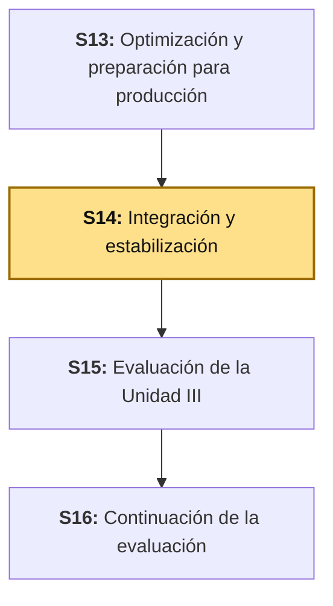
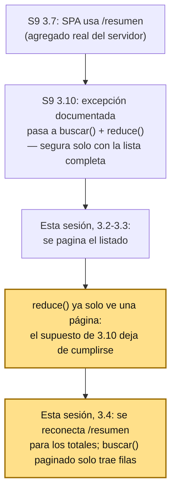

# S14 - Integración y Estabilización

*Por: Angel Sullon Macalupu @asullom - 2026*

## 1. Introducción

Tiempo: 20 min.

### 1.1 Presentación de la sesión

S13 optimizó el *build* y preparó la configuración de producción. Pero nadie verificó todavía si el sistema completo —backend, SPA, Keycloak, Oracle— sigue funcionando junto, de punta a punta, igual de bien que cada pieza por separado. Esta sesión responde exactamente eso, y empieza corrigiendo una consecuencia real de una decisión que la propia S9 dejó documentada a propósito.

`VentaServiceImpl.reporte()` existe desde S9: calcula el total, el conteo y el ticket promedio con una consulta agregada real en Oracle (`VentaAgregado`, `SUM`/`COUNT` en SQL, no en Java), y `VentaReporteComponent` lo consumió así desde S9 3.7. Pero S9 3.10 desconectó esa fuente **a propósito**, no por descuido, para poder mostrar el detalle línea por línea de cada venta —algo que `/resumen` omite deliberadamente—, y pasó a calcular los mismos tres números **en el navegador**, con `.reduce()` sobre el arreglo completo. Esa excepción se documentó como segura con una condición explícita: que el navegador siguiera teniendo siempre la lista completa cargada para sumar sobre ella. Esta sesión pagina ese listado (3.2-3.3) — y en cuanto el navegador deja de tener la lista completa, esa condición desaparece: sumar solo una página ya no da el total real.

Esta sesión corrige eso: pagina el listado sin perder el detalle por venta, reconecta la SPA al agregado real del servidor para los totales, verifica el flujo completo de punta a punta, agrega la auditoría que todavía no existe, y estabiliza el sistema con una prueba real, no con un mock.

### 1.2 Índice

1. Por qué un listado sin paginar no escala, aunque hoy "funcione".
2. El agregado del servidor frente al cálculo en el cliente.
3. Integración funcional: verificar el sistema completo, no módulo por módulo.
4. Auditoría: quién hizo qué, cuándo, sobre qué entidad.
5. Pruebas end-to-end reales frente a pruebas de un controlador con mocks.
6. Estabilización: bitácora de hallazgos, corrección y prueba de no regresión.

### 1.3 Propósito de aprendizaje

Al concluir la clase, estarás en condiciones de: **paginar** un listado de alto volumen sin romper sus totales agregados, **verificar** la integración funcional completa de tu propio proyecto de punta a punta, **construir** un registro de auditoría real sobre al menos una acción crítica, **escribir** una prueba end-to-end real contra la base de datos real (no contra mocks), y **estabilizar** el sistema registrando cada hallazgo en una bitácora con su corrección y su prueba de no regresión.

### 1.4 Producto de sesión

`GET /api/v1/ventas` paginado (`Page<VentaResponse>`), la SPA usando el agregado real de `/resumen` para sus totales en vez de recalcularlos en el navegador, el flujo completo verificado de punta a punta (login → crear venta → consultar → anular), un registro de auditoría real sobre `crear`/`anular`, una prueba end-to-end ejecutada contra la base real, y la bitácora de estabilización con al menos un hallazgo corregido.

### 1.5 Metodología

**Tabla 1. Metodología de la sesión**

| Actividades a Realizar en el Periodo | Orientaciones generales (Orientaciones Metodológicas) | Material de estudio recomendado |
|---|---|---|
| Revisión previa individual | Releer `VentaReporteComponent` (frontend) y `VentaServiceImpl.reporte()` (backend, S9) por separado, sin corregir nada todavía — solo confirmar si uno llama al otro. Trabajo individual, antes de clase. | S9 (3.7, 3.10), `venta-reporte.ts`, `VentaServiceImpl.java`. |
| Clase presencial | Diagnóstico guiado del hallazgo real, paginación del listado, reconexión de la SPA al agregado del servidor, verificación de integración funcional completa, construcción de auditoría real, y escritura de una prueba end-to-end. Trabajo individual en la propia laptop, siguiendo al docente paso a paso. | `bomerp-oracle` y Keycloak corriendo (S1, S10b), pasos 3.1 a 3.8 de esta guía. |
| Evaluación formativa | Revisión en clase del hallazgo diagnosticado, la paginación funcionando, la prueba end-to-end pasando, y la bitácora de estabilización. La evidencia se completa y sustenta de forma individual, fuera del aula, según los criterios mínimos de la sección 4.4. | Indicaciones de entrega (4.3), rúbrica de evaluación (4.6). |

### 1.6 Motivación de la sesión

#### 1.6.1 Caso: Knight Capital, 45 minutos y 440 millones de dólares (2012)

El 1 de agosto de 2012, un técnico de Knight Capital debía desplegar código nuevo (del *Retail Liquidity Program*, RLP) en ocho servidores idénticos que enrutaban órdenes de bolsa automáticamente. Copió el código nuevo en siete. El octavo servidor se quedó con el código viejo — incluida una función retirada años antes, "Power Peg", que nunca se borró del todo.

Fuente: U.S. Securities and Exchange Commission. (2013). *In the Matter of Knight Capital Americas LLC*. Release No. 34-70694.

El código nuevo reutilizó, sin saberlo, una bandera que antes activaba "Power Peg". Cuando una orden con esa bandera llegó al octavo servidor —el que nunca recibió la actualización—, activó la función retirada, que empezó a ejecutar órdenes en bloque, una tras otra, sin parar: el código que debía marcar cada orden como "completada" había cambiado después de retirar Power Peg, así que el servidor nunca se enteró de que ya había terminado, y seguía mandando más. En 45 minutos, generó cerca de 4 millones de operaciones por 397 millones de acciones en 154 papeles distintos, movió artificialmente el precio de 148 empresas, y le costó a Knight Capital 440 millones de dólares — la compañía perdió el 75% de su valor en dos días y tuvo que ser rescatada.

Nadie probó el sistema completo, los ocho servidores juntos, antes de dejarlo en producción — cada servidor, visto por separado, "tenía el código correcto" (siete lo tenían) o "tenía el código anterior, que ya funcionaba antes" (el octavo). El problema solo existía en la combinación de los dos, en producción real, con tráfico real. `VentaReporteComponent` (1.1) es una versión de bajo riesgo del mismo patrón de fondo: una pieza —el cálculo en el cliente que dejó S9 3.10— era segura bajo un supuesto concreto, documentado en su momento (la lista completa siempre cargada). El problema no es que esa pieza estuviera mal escrita: es que un cambio posterior en el resto del sistema (la paginación de esta sesión) invalida en silencio el supuesto del que dependía, igual que el código nuevo de Knight Capital reactivó, sin saberlo, una función retirada que seguía ahí, segura mientras nadie la disparara.

**Preguntas de análisis**

**Activación de conocimientos previos**

1. Antes de leer la causa técnica, ¿por qué un sistema donde "cada pieza funciona por separado" puede fallar igual cuando se junta todo?

**Comprensión del caso**

1. Según el caso, ¿por qué el código retirado ("Power Peg") seguía siendo peligroso si ya nadie lo usaba a propósito?
2. ¿Qué hubiera revelado una prueba que ejecutara el flujo completo contra los ocho servidores juntos, que una prueba servidor por servidor no podía revelar?
3. En tu propio proyecto, ¿qué parte del sistema nunca has probado end-to-end, con todas sus piezas reales conectadas al mismo tiempo?

### 1.7 Ubicación en el curso

- Producto del curso: Aplicación Full-Stack empresarial integrada, optimizada, monitoreada, estabilizada y preparada para producción.
- Producto de unidad: el mismo producto (Unidad III).
- Avance del producto en esta sesión: listado paginado sin romper sus agregados, integración funcional verificada de punta a punta, auditoría real, prueba end-to-end ejecutada, y bitácora de estabilización con al menos un hallazgo corregido.

**Figura 1. Roadmap del producto de la unidad**



## 2. Explica

Tiempo: 40 min.

### 2.1 Arquitectura de la sesión

**Figura 2. La excepción de S9 3.10, y por qué la paginación de esta sesión la invalida**



Lectura del diagrama: `/resumen` no se perdió ni se rompió — S9 3.10 lo desconectó a propósito, con una condición explícita de seguridad (la lista completa siempre cargada). Esta sesión no corrige un error de S9: retira esa condición, así que el mismo cambio que mejora el rendimiento (paginar, 3.2-3.3) obliga a reconectar el agregado real (3.4). Cada apartado siguiente desarrolla una pieza de la corrección, en el mismo orden del Índice (1.2).

### 2.2 Por qué un listado sin paginar no escala, aunque hoy "funcione"

Un *endpoint* que devuelve `List<T>` completa trae **todas** las filas que cumplen el filtro, sin límite — con 50 ventas de clase, es instantáneo; con 50,000 ventas reales, es una respuesta de varios segundos (o un error de memoria) por una sola carga de pantalla. **Paginación** (*pagination*) es el patrón que pide, y devuelve, un subconjunto acotado (una "página") más la información necesaria para pedir la siguiente — nunca el total completo de una sola vez (Spring Data, 2024).

**Tabla 2. `List<T>` frente a `Page<T>`**

| | `List<VentaResponse>` (hoy) | `Page<VentaResponse>` (esta sesión) |
|---|---|---|
| Qué trae | Todas las filas que cumplen el filtro. | Solo la página pedida (ej. 20 filas), más el total de páginas disponibles. |
| Costo con 50 filas | Insignificante. | Insignificante. |
| Costo con 50,000 filas | Una respuesta lenta, o un error, cada vez que se carga la pantalla. | El mismo costo que con 50 filas — solo cambia qué página se pide. |
| Quién decide cuántas filas trae | Nadie — trae todas. | El cliente, con `page`/`size` en la petición. |

### 2.3 El agregado del servidor frente al cálculo en el cliente

S9 3.10 dejó, a propósito, que `VentaReporteComponent` calculara sus tres totales en el cliente — una excepción documentada, segura **mientras la lista completa siguiera cargada en el navegador**. Paginar un listado, sin más, rompe exactamente esa condición: si la pantalla solo tiene la página 2 de 50 cargada, `ventas().reduce(...)` (1.1) solo puede sumar esa página, no el total real. La solución no es "sumar más páginas en el cliente" — es volver a separar las dos responsabilidades que S9 2.6 distinguía antes de la excepción de 3.10: el **total agregado** se calcula una sola vez, en el servidor, con una consulta que nunca trae las filas completas (`VentaAgregado`, S9 3.7); el **listado paginado** solo sirve para mostrar filas, nunca para calcular nada agregado.

**Tabla 3. Dos responsabilidades, dos consultas distintas**

| Responsabilidad | Quién la resuelve | Costo al crecer el volumen |
|---|---|---|
| "¿Cuánto es el total, el conteo, el promedio?" | El servidor, con una consulta `SUM`/`COUNT` (`VentaAgregado`, S9 3.7) — nunca viaja una sola fila de detalle. | Constante — el costo no depende de cuántas filas haya, solo de que el índice de fecha (BD2, S5) siga ayudando al filtro. |
| "¿Qué filas muestro en esta página?" | El servidor, con una consulta paginada (esta sesión) — trae solo las filas de la página pedida. | Constante por página — nunca crece con el volumen total. |

**Error frecuente**: paginar el listado y dejar que el cliente siga calculando el total sumando solo las filas que tiene cargadas en memoria. El resultado sería un total visiblemente incorrecto —la suma de una sola página, no del filtro completo— sin que ningún error lo señale.

### 2.4 Integración funcional: verificar el sistema completo, no módulo por módulo

Cada módulo de BomERP (`catalogo`, `ventas`, `seguridad`) ya se probó por separado, sesión por sesión. **Integración funcional** es verificar que, juntos, en una sola corrida real —login real, token real, petición real, persistencia real—, el sistema completo sigue haciendo lo que cada pieza por separado prometía. El caso de Knight Capital (1.6) es la versión real, a escala de producción financiera, de lo que pasa cuando esa verificación nunca ocurre.

### 2.5 Auditoría: quién hizo qué, cuándo, sobre qué entidad

**Auditoría** (*audit trail*) registra, para cada acción crítica del sistema, quién la ejecutó, cuándo, sobre qué entidad, y qué cambió — no para depurar un error (eso ya lo hace el *logging* de S13), sino para poder responder después "¿quién anuló esta venta, y cuándo" con una fuente verificable, no con una suposición. BD2 ya construyó auditoría a nivel de base de datos (`TRG_PRODUCTO_AUDITORIA`, Unified Auditing, S2/S9) — esta sesión construye la auditoría del lado del backend, sobre acciones de negocio (`crear`, `anular`), no sobre cambios de columna.

**Tabla 4. Auditoría de BD2 frente a la de esta sesión**

| | Auditoría de BD2 (S2, S9) | Auditoría de esta sesión (LP2) |
|---|---|---|
| Qué registra | Cambios de columna en una tabla (`PRODUCTOS.PRECIO`, `PRODUCTOS.STOCK`). | Una acción de negocio completa (`crear` una venta, `anular` una venta). |
| Quién la dispara | Oracle, automáticamente, al ejecutar el `UPDATE`. | El propio backend, explícitamente, después de completar la acción. |
| Qué actor registra | El usuario de base de datos que ejecutó el `UPDATE` (casi siempre `BOMERP_APP`, el mismo para toda la aplicación). | El `sub` real del JWT de Keycloak — la persona autenticada que de verdad ejecutó la acción. |

Las dos son complementarias, no una reemplaza a la otra: BD2 sabe que una columna cambió; esta sesión sabe qué persona, desde la aplicación, pidió ese cambio.

### 2.6 Pruebas end-to-end reales frente a pruebas de un controlador con mocks

`ProductoControllerTest` (ya existente desde S2-S3) usa `@WebMvcTest` con `@MockitoBean` — prueba el controlador **aislado**, con el servicio reemplazado por un doble que responde lo que el test le ordena. Es una prueba válida y necesaria, pero prueba una pieza, no el sistema. Una prueba **end-to-end** real levanta el contexto completo de Spring (`@SpringBootTest`) y ejecuta la petición contra la base de datos real — si algo entre el controlador y Oracle está roto, un test con mocks nunca lo detecta, porque nunca llega a tocar esa pieza.

**Tabla 5. Prueba de controlador (mock) frente a prueba end-to-end**

| | `@WebMvcTest` + mock (ya existente) | `@SpringBootTest` end-to-end (esta sesión) |
|---|---|---|
| Qué levanta | Solo la capa web (controlador, serialización). | Todo el contexto de Spring: controlador, servicio, repositorio, Oracle real. |
| Qué detecta | Errores de validación, de serialización, de códigos de estado HTTP. | Errores de integración real: una consulta mal escrita, una transacción que no hace lo que promete, un dato que no se persiste como se espera. |
| Qué NO detecta | Nada de lo anterior si el problema está en el repositorio o en Oracle. | — (es, por diseño, la prueba que sí llega hasta ahí). |
| Costo de ejecución | Milisegundos. | Segundos — levanta el contexto completo. |

Ninguna reemplaza a la otra: los tests con mocks siguen corriendo en cada `mvnw test`; el end-to-end de esta sesión se agrega, no se sustituye.

### 2.7 Estabilización: bitácora de hallazgos, corrección y prueba de no regresión

**Estabilizar** no es "corregir errores hasta que no quede ninguno" — es un proceso con evidencia: cada hallazgo real se registra, se corrige, y se verifica con una prueba que confirme que no vuelve a ocurrir (*regression test*). `u3/lp2-producto.md` ya tiene una bitácora de estabilización de referencia (plantilla del docente) — 3.8 agrega una fila real, con el hallazgo de esta misma sesión.

## 3. Aplica: actividad práctica guiada

Tiempo: 100 min.

**Actividad:** paginar el listado de ventas sin romper sus agregados, verificar la integración funcional completa, construir auditoría real sobre `crear`/`anular`, escribir una prueba end-to-end, y cerrar con la bitácora de estabilización.

**Propósito de la actividad:** corregir, con evidencia real, la causa de 1.1 —la excepción de S9 3.10, invalidada por la paginación de esta sesión— y aplicar el mismo criterio de verificación de punta a punta sobre el resto del sistema.

**Orientaciones metodológicas:** el docente diagnostica y corrige el hallazgo real en vivo, frente a la clase; los estudiantes repiten cada paso sobre su propio proyecto (sección 4), donde el hallazgo concreto puede ser distinto, pero el método de diagnóstico es el mismo.

**Punto de partida común:** todo el equipo debe comenzar exactamente desde donde quedó S13, no desde su propio avance individual. Clona la rama `s13-optimizacion-preparacion-produccion` (el snapshot de cierre de S13):

```bash
git clone --branch s13-optimizacion-preparacion-produccion https://github.com/262ciclo4/bomerp.git
```

**Actividades para realizar:**

- **3.1** Confirmar el estado real: la excepción de S9 3.10 y por qué la paginación la invalida.
- **3.2** Paginar el repositorio y el servicio de ventas.
- **3.3** Paginar el controlador de ventas.
- **3.4** Reconectar la SPA: paginar la tabla, usar el agregado real para los totales.
- **3.5** Verificar la integración funcional de punta a punta.
- **3.6** Construir la auditoría de acciones críticas.
- **3.7** Escribir y ejecutar una prueba end-to-end real.
- **3.8** Registrar y cerrar en la bitácora de estabilización.

### 3.1 Confirmar el estado real: la excepción de S9 3.10 y por qué la paginación la invalida

**Producto del paso:** confirmación, leyendo el código real, de que `VentaReporteComponent` sigue exactamente en el estado que dejó S9 3.10 —llama a `buscar()` y calcula sus totales con `.reduce()`— y de que, una vez paginado el listado (3.2-3.3), ese cálculo deja de ser correcto.

Revisa `venta-reporte.ts` (`totalVentas`, `montoTotal`, `ticketPromedio`, calculados con `computed()` sobre `this.ventas()`) y `venta-service.ts` (sin ningún método `reporte()` o `resumen()` — S9 3.10 los quitó a propósito). El *endpoint* `GET /api/v1/ventas/resumen` sigue existiendo, intacto, en `VentaController` desde S9 3.7 — nadie lo borró; el frontend simplemente dejó de llamarlo, con una condición explícita de por medio: que la lista siguiera completa en el navegador.

**Error frecuente**: tratar esto como un bug sin más y "revertir" S9 3.10 a ciegas — `buscar()` sigue siendo necesario para mostrar el detalle línea por línea que `/resumen` omite a propósito (S9 2.6). Esta sesión no deshace esa decisión, la combina con el agregado real: `buscar()` paginado para las filas (3.2-3.3), `/resumen` reconectado para los totales (3.4).

### 3.2 Paginar el repositorio y el servicio de ventas

**Producto del paso:** `VentaRepository.buscar` y `VentaServiceImpl.buscar` aceptando un `Pageable` y devolviendo un `Page<Venta>`/`Page<VentaResponse>`, en vez de una lista completa.

```java
// VentaRepository.java -- firma nueva, misma consulta JPQL de siempre
@EntityGraph(attributePaths = "detalles")
@Query("""
    SELECT v FROM Venta v
    WHERE (:estado IS NULL OR v.estado = :estado)
      AND (:desde IS NULL OR v.fecha >= :desde)
      AND (:hasta IS NULL OR v.fecha <= :hasta)
      AND (:vendedorId IS NULL OR v.vendedorId = :vendedorId)
    """)
Page<Venta> buscar(@Param("estado") EstadoVenta estado,
                    @Param("desde") LocalDateTime desde,
                    @Param("hasta") LocalDateTime hasta,
                    @Param("vendedorId") String vendedorId,
                    Pageable pageable);
```

```java
// VentaServiceImpl.java -- el Sort ya viene dentro del Pageable, no se pasa aparte
@Override
@Transactional(readOnly = true)
public Page<VentaResponse> buscar(EstadoVenta estado, LocalDateTime desde, LocalDateTime hasta,
        String vendedorId, Pageable pageable) {
    return ventaRepository.buscar(estado, desde, hasta, vendedorId, pageable)
            .map(ventaMapper::toResponse);
}
```

`Page<Venta>.map(...)` convierte cada `Venta` a `VentaResponse` sin perder los metadatos de paginación (página actual, total de páginas, total de elementos) — no hace falta reconstruir el `Page` a mano.

### 3.3 Paginar el controlador de ventas

**Producto del paso:** `GET /api/v1/ventas` aceptando `page`/`size`/`sort` como parámetros estándar de Spring, con un tamaño de página por defecto razonable.

```java
// VentaController.java
@Operation(summary = "Consulta ventas con filtros, ordenamiento y paginación")
@GetMapping
public ResponseEntity<Page<VentaResponse>> buscar(
        @RequestParam(required = false) EstadoVenta estado,
        @RequestParam(required = false) @DateTimeFormat(iso = DateTimeFormat.ISO.DATE_TIME) LocalDateTime desde,
        @RequestParam(required = false) @DateTimeFormat(iso = DateTimeFormat.ISO.DATE_TIME) LocalDateTime hasta,
        @PageableDefault(size = 20, sort = "fecha", direction = Sort.Direction.DESC) Pageable pageable,
        @AuthenticationPrincipal Jwt jwt) {
    String vendedorId = esVendedor(jwt) ? jwt.getSubject() : null;
    return ResponseEntity.ok(ventaService.buscar(estado, desde, hasta, vendedorId, pageable));
}
```

`ordenarPor`/`direccion` (los parámetros manuales de antes) se reemplazan por `sort` — el parámetro estándar de Spring Data (`?sort=total,desc`), que ya sabe validar que la columna pedida exista, algo que la versión manual no verificaba.

**Error frecuente**: cambiar la firma del método sin actualizar `VentaService` (la interfaz) — el proyecto no compila hasta que la interfaz y la implementación coincidan.

### 3.4 Reconectar la SPA: paginar la tabla, usar el agregado real para los totales

**Producto del paso:** `VentaReporteComponent` usando `/resumen` para sus tres números, y una tabla paginada con `mat-paginator` para las filas.

```typescript
// venta-service.ts -- reintroduce el método que S9 3.10 quitó a propósito; el endpoint sigue intacto desde S9 3.7
reporte(estado?: string, desde?: string, hasta?: string): Observable<VentaReporte> {
  let params = new HttpParams();
  if (estado) params = params.set('estado', estado);
  if (desde) params = params.set('desde', desde);
  if (hasta) params = params.set('hasta', hasta);
  return this.http.get<VentaReporte>(this.api.buildUrl(`${this.resource}/resumen`), { params });
}

buscarPaginado(
  estado?: string, desde?: string, hasta?: string,
  page = 0, size = 20, sort = 'fecha,desc',
): Observable<PageResponse<VentaResponse>> {
  let params = new HttpParams().set('page', page).set('size', size).set('sort', sort);
  if (estado) params = params.set('estado', estado);
  if (desde) params = params.set('desde', desde);
  if (hasta) params = params.set('hasta', hasta);
  return this.http.get<PageResponse<VentaResponse>>(this.api.buildUrl(this.resource), { params });
}
```

```typescript
// venta-reporte.ts -- los totales ya no se calculan con reduce(); vienen del agregado real
cargar(): void {
  this.loading.set(true);
  const desde = this.desdeFiltro() ? `${this.desdeFiltro()}T00:00:00` : undefined;
  const hasta = this.hastaFiltro() ? `${this.hastaFiltro()}T23:59:59` : undefined;

  this.ventaService.reporte(this.estadoFiltro() || undefined, desde, hasta)
      .subscribe(r => this.agregado.set(r.agregado)); // totalVentas, montoTotal, ticketPromedio reales

  this.ventaService.buscarPaginado(this.estadoFiltro() || undefined, desde, hasta, this.pageIndex(), this.pageSize())
      .subscribe({
        next: (page) => { this.filas.set(page.content); this.totalFilas.set(page.totalElements); },
        error: () => this.error.set('No se pudo cargar el reporte de ventas.'),
        complete: () => this.loading.set(false),
      });
}
```

`totalVentas`, `montoTotal` y `ticketPromedio` dejan de ser `computed()` sobre `this.ventas()` — ahora son el `agregado` que llega directo de `/resumen`, correcto sin importar cuántas páginas tenga el listado.

### 3.5 Verificar la integración funcional de punta a punta

**Producto del paso:** una corrida manual real, con el sistema completo levantado, confirmando que cada módulo sigue funcionando junto — el mismo criterio del caso de Knight Capital (1.6), aplicado al proyecto propio.

**Tabla 6. Checklist de integración funcional**

| Paso | Qué verificar |
|---|---|
| 1. Login real | Autenticación contra Keycloak completa, token recibido. |
| 2. Crear una venta | `catalogo` (stock descontado) y `ventas` (venta registrada) responden juntos, en la misma transacción. |
| 3. Consultar el listado paginado | La página 1 responde rápido, el total de páginas es coherente con el filtro aplicado. |
| 4. Consultar el reporte | `montoTotal`/`ticketPromedio` coinciden con una suma manual de las filas reales (verificación cruzada, no solo "se ve bien"). |
| 5. Anular la venta | El stock se restaura en `catalogo`, visible desde una consulta nueva. |
| 6. Cerrar sesión y repetir sin token | Cada paso anterior debe rechazarse con `401`, no ejecutarse a medias. |

### 3.6 Construir la auditoría de acciones críticas

**Producto del paso:** un registro real, persistido en Oracle, de quién ejecutó `crear` o `anular`, cuándo, y sobre qué venta.

```java
// RegistroAuditoria.java -- entidad nueva, modulo ventas
@Entity
@Table(name = "AUDITORIA")
@Getter @Setter
public class RegistroAuditoria {
    @Id @GeneratedValue(strategy = GenerationType.IDENTITY)
    private Long id;
    private String actor;      // sub del JWT -- quien ejecuto la accion
    private String accion;     // "CREAR", "ANULAR"
    private String entidad;    // "VENTA"
    private Long entidadId;
    private LocalDateTime fecha;
    private String detalle;
}
```

```java
// AuditoriaService.java
@Service
@RequiredArgsConstructor
public class AuditoriaService {
    private final RegistroAuditoriaRepository repository;

    public void registrar(String actor, String accion, String entidad, Long entidadId, String detalle) {
        RegistroAuditoria registro = new RegistroAuditoria();
        registro.setActor(actor);
        registro.setAccion(accion);
        registro.setEntidad(entidad);
        registro.setEntidadId(entidadId);
        registro.setFecha(LocalDateTime.now());
        registro.setDetalle(detalle);
        repository.save(registro);
    }
}
```

```java
// VentaServiceImpl.java -- se agrega justo despues de persistir, dentro de la misma transaccion
Venta guardada = ventaRepository.save(venta);
auditoriaService.registrar(vendedorId, "CREAR", "VENTA", guardada.getId(), "total=" + total);
return ventaMapper.toResponse(guardada);
```

`anular(Long id)` necesita recibir ahora el `vendedorId` (hoy no lo recibe) para poder registrar quién anuló — un cambio de firma que se propaga al controlador, igual que en 3.3.

**Error frecuente**: registrar la auditoría **antes** de que la operación principal se confirme. Si `auditoriaService.registrar(...)` corre antes de `ventaRepository.save(...)` y la venta falla después, quedaría un registro de auditoría de algo que nunca ocurrió.

### 3.7 Escribir y ejecutar una prueba end-to-end real

**Producto del paso:** una prueba que levanta el contexto completo de Spring y ejecuta, contra la base real, el flujo crear → consultar.

Agrega la dependencia de prueba al `pom.xml` (alcance `test`, no afecta el `.jar` de producción):

```xml
<dependency>
    <groupId>org.springframework.security</groupId>
    <artifactId>spring-security-test</artifactId>
    <scope>test</scope>
</dependency>
```

```java
// VentaEndToEndTest.java
import static org.springframework.security.test.web.servlet.request.SecurityMockMvcRequestPostProcessors.jwt;

@SpringBootTest(webEnvironment = SpringBootTest.WebEnvironment.RANDOM_PORT)
@AutoConfigureMockMvc
class VentaEndToEndTest {

    @Autowired private MockMvc mockMvc;
    @Autowired private ObjectMapper objectMapper;

    @Test
    void flujoCompleto_crearVentaYConsultarla() throws Exception {
        VentaRequest request = new VentaRequest();
        request.setDetalles(List.of(new DetalleVentaRequest(1L, 2))); // producto id real, ya sembrado

        String json = mockMvc.perform(post("/api/v1/ventas")
                        .with(jwt().jwt(j -> j.claim("sub", "vendedor-e2e")
                                .claim("realm_access", Map.of("roles", List.of("VENDEDOR")))))
                        .contentType(MediaType.APPLICATION_JSON)
                        .content(objectMapper.writeValueAsString(request)))
                .andExpect(status().isCreated())
                .andReturn().getResponse().getContentAsString();

        Long id = objectMapper.readTree(json).get("id").asLong();

        mockMvc.perform(get("/api/v1/ventas/" + id)
                        .with(jwt().jwt(j -> j.claim("sub", "vendedor-e2e")
                                .claim("realm_access", Map.of("roles", List.of("VENDEDOR"))))))
                .andExpect(status().isOk())
                .andExpect(jsonPath("$.id").value(id));
    }
}
```

`.with(jwt()...)` simula un JWT ya validado, con los claims reales que `esVendedor(jwt)` y `vendedorId` necesitan — no hace falta un login real contra Keycloak para que la prueba sea end-to-end: lo que la hace end-to-end es que el controlador, el servicio, el repositorio y Oracle corren de verdad, sin ningún mock entre ellos.

```powershell
.\mvnw.cmd test -Dtest=VentaEndToEndTest
```

```bash
./mvnw test -Dtest=VentaEndToEndTest
```

**Error frecuente**: dejar que la prueba end-to-end dependa de datos que otra prueba (o una ejecución anterior) pudo haber modificado — por ejemplo, un `productoId` fijo cuyo stock ya se agotó en una corrida previa. Verifica el estado real antes de asumirlo, o crea el producto que necesitas dentro de la misma prueba.

### 3.8 Registrar y cerrar en la bitácora de estabilización

**Producto del paso:** la bitácora de `u3/lp2-producto.md` con una fila real, correspondiente al hallazgo de esta sesión.

**Tabla 7. Bitácora de estabilización (fila real de esta sesión)**

| Hallazgo | Corrección | Evidencia |
|---|---|---|
| `VentaReporteComponent` seguía con la excepción documentada de S9 3.10 (`.reduce()` sobre la lista completa) — segura solo mientras la lista no estuviera paginada; al paginar el listado en esta misma sesión (3.2-3.3), ese cálculo dejó de ser correcto. | Se mantuvo `buscar()` paginado para las filas y se reconectó la SPA al agregado real del servidor (3.4) para los totales, separando ambas responsabilidades. | `VentaEndToEndTest` (3.7) en verde; verificación manual de que `montoTotal` coincide entre `/resumen` y una suma manual de las filas reales. |

**Evidencia de aprendizaje:**

- Causa real diagnosticada (3.1): la excepción de S9 3.10 invalidada por la paginación de esta sesión, con el código exacto que lo prueba.
- `GET /api/v1/ventas` paginado, con `Page<VentaResponse>` real.
- SPA reconectada: totales desde `/resumen`, tabla paginada con `mat-paginator`.
- Checklist de integración funcional (Tabla 6) completo.
- Auditoría real sobre `crear`/`anular`, verificada contra la tabla `AUDITORIA`.
- `VentaEndToEndTest` ejecutado y en verde contra la base real.
- Bitácora de estabilización con la fila de esta sesión.

## 4. Crea: actividad autónoma

Tiempo: 2h fuera del aula.

### 4.1 Actividad

Integración y estabilización del proyecto propio del equipo, documentada en evidencia individual.

Completa y evidencia estas tareas:

1. Diagnosticar, leyendo tu propio código, si tu propia SPA calcula en el cliente algún total que debería venir de un agregado real del servidor, y si ese cálculo depende de tener siempre la lista completa cargada (como el de 1.1) — si no encuentras ninguno, documenta explícitamente por qué tu proyecto no tiene ese riesgo.
2. Paginar al menos un listado de alto volumen de tu propio módulo transaccional, separando el total agregado (servidor) del listado paginado (filas).
3. Ejecutar el checklist de integración funcional (Tabla 6) sobre tu propio proyecto, con tu propio flujo transaccional.
4. Construir auditoría real sobre al menos dos acciones críticas de tu propio módulo (crear y anular, o su equivalente).
5. Escribir y ejecutar al menos una prueba end-to-end real, contra tu base de datos real, sin mocks en la cadena backend-base de datos.
6. Registrar al menos un hallazgo real en tu propia bitácora de estabilización, con su corrección y su evidencia.

### 4.2 Propósito

Que cada estudiante demuestre, de forma individual y fuera del aula, que puede diagnosticar un problema real de integración, paginar sin romper agregados, construir auditoría real, y verificar su sistema con una prueba end-to-end, sin el acompañamiento del docente.

### 4.3 Indicaciones

Entrega un PDF con el siguiente nombre:

```text
S14_LP2_Equipo##_ApellidoNombre.pdf
```

Cada captura de pantalla del informe debe mostrar, sin recortar, el reloj del sistema (fecha y hora) y tu usuario o foto de perfil (Windows, VS Code o navegador) visibles en pantalla.

#### 4.3.1 Estructura del informe

**Datos del estudiante**

- Nombre:
- Equipo:
- Sesión: S14 - Integración y Estabilización
- Rol o aporte realizado:
- Link de GitHub:

**Evidencia técnica**

Incluye capturas con una breve explicación debajo de cada una, organizadas en los mismos 5 bloques de la rúbrica (4.6):

1. *Listado paginado con agregado correcto*
    - El listado paginado real, y el agregado del servidor coincidiendo con una suma manual de verificación.
2. *Integración funcional completa*
    - El checklist (Tabla 6) de tu propio proyecto, con cada paso verificado en vivo.
3. *Auditoría real*
    - Al menos dos registros de auditoría reales, con actor, acción, entidad y fecha.
4. *Prueba end-to-end*
    - La prueba ejecutándose en verde, con su salida real de `mvnw test`.
5. *Bitácora de estabilización*
    - Al menos un hallazgo real, con su corrección y su evidencia.

**Error o hallazgo**

Describe el hallazgo real que diagnosticaste (o la justificación de por qué no encontraste ninguno), distinto al ya corregido en la sesión guiada.

**Reflexión técnica breve**

Responde en 5 a 8 líneas:

```text
Relaciona el caso de Knight Capital (1.6) con el hallazgo real que
encontraste (o no encontraste) en tu propio proyecto: ¿qué parte de
tu sistema nunca habías probado con todas sus piezas reales juntas,
y qué pasaría si esa parte fallara en producción sin que nadie la
hubiera probado así antes?
```

### 4.4 Criterios mínimos de aceptación

- El archivo respeta el nombre solicitado.
- El listado paginado funciona, y su agregado coincide con una verificación manual, no solo "se ve bien".
- El checklist de integración funcional está completo, con cada paso verificado en vivo.
- La auditoría registra al menos dos acciones reales, con actor real (no un valor fijo).
- La prueba end-to-end se ejecuta contra la base de datos real y pasa en verde.
- La bitácora de estabilización tiene al menos un hallazgo real, con corrección y evidencia.
- Cada captura de la evidencia técnica muestra el reloj del sistema y el usuario/perfil visible, sin recortar.
- Las fechas y horas de las capturas son coherentes con el historial de commits de su repositorio en GitHub.
- Incluye un error o hallazgo técnico diagnosticado.
- Incluye la reflexión técnica breve solicitada.

### 4.5 Preguntas de defensa

1. ¿Por qué paginar un listado, sin más, puede romper un total que antes era correcto? ¿Cómo se evita eso?
2. ¿Qué detecta una prueba end-to-end real que una prueba de controlador con mocks (como `ProductoControllerTest`) nunca podría detectar?
3. En tu propio hallazgo de integración, ¿qué pieza "funcionaba bien por separado" pero fallaba (o podía fallar) al juntarse con el resto?
4. ¿Por qué la auditoría se registra después de confirmar la operación principal, y nunca antes?
5. Relaciona el caso de Knight Capital (1.6) con tu propio checklist de integración funcional: ¿qué paso de tu checklist, si se hubiera omitido, podría causar un problema parecido en escala menor?
6. ¿Por qué `.with(jwt()...)` en una prueba de Spring Security Test no necesita un login real contra Keycloak para que la prueba siga siendo "end-to-end"?
7. Si tu bitácora de estabilización no tuviera ningún hallazgo real, ¿cómo demostrarías que de verdad buscaste uno, y no que simplemente no buscaste a fondo?

### 4.6 Rúbrica de evaluación

**Tabla 8. Rúbrica de evaluación**

| Criterio | Peso (%) | A (20 pts) | B (15 pts) | C (10 pts) | D (5 pts) | Nivel obtenido |
|---|---:|---|---|---|---|---:|
| 1. Listado paginado con agregado correcto* | 20 | Paginado real, con el agregado del servidor verificado contra una suma manual. | Paginado real, con el agregado presente pero sin verificación cruzada. | Paginado parcial o con el agregado roto por la paginación. | No presenta listado paginado. | |
| 2. Integración funcional completa* | 20 | Checklist completo (Tabla 6), cada paso verificado en vivo con evidencia. | Checklist completo, con algún paso verificado solo superficialmente. | Checklist incompleto. | No presenta verificación de integración funcional. | |
| 3. Auditoría real* | 20 | Al menos 2 acciones auditadas, con actor real, verificadas contra la tabla de auditoría. | Auditoría presente, con algún campo (actor o fecha) genérico. | Auditoría mencionada sin registros reales verificables. | No presenta auditoría. | |
| 4. Prueba end-to-end* | 20 | Prueba ejecutada en verde contra la base real, sin mocks entre controlador y base de datos. | Prueba ejecutada, con algún mock innecesario en la cadena. | Prueba escrita pero no ejecutada, o fallando. | No presenta prueba end-to-end. | |
| 5. Bitácora de estabilización* | 20 | Al menos un hallazgo real, con corrección y evidencia de no regresión. | Hallazgo presente, sin evidencia clara de no regresión. | Bitácora genérica, sin hallazgo real propio. | No presenta bitácora de estabilización. | |

\* Agregado manual.

Nota final = suma de (`Peso` / 100 × `Puntos del nivel obtenido`) = ____ / 20.

Para usar la rúbrica con IA (inteligencia artificial), solicita:

```text
Evalúa el PDF usando la rúbrica de la sesión.
Para cada criterio selecciona el nivel obtenido usando la escala A=20, B=15, C=10, D=5 puntos.
Justifica brevemente cada nivel asignado.
Verifica que cada captura muestre reloj del sistema y usuario/perfil visible, y que las fechas sean coherentes con el historial de commits de GitHub. Si falta esta evidencia o hay inconsistencias, indícalo explícitamente antes de calificar.
Calcula la nota final con la fórmula: suma de (Peso/100 × Puntos del nivel obtenido), directamente sobre 20.
Indica 2 fortalezas y 2 recomendaciones.
```

## 5. Cierre

Tiempo: 5 min.

**Resumen breve:** hoy se corrigió una consecuencia real, no un bug inventado: S9 3.10 había dejado, a propósito, que la SPA calculara sus totales en el navegador, seguro solo mientras la lista completa estuviera cargada — la paginación de hoy retiró esa condición. Se paginó el listado sin perder el detalle, se reconectó el agregado real que el backend ya calculaba en Oracle desde S9 3.7, y los dos problemas que parecían uno solo (rendimiento y corrección) se resolvieron juntos. El checklist de integración funcional confirmó que el sistema completo —login, venta, consulta, anulación— sigue funcionando de punta a punta, no solo módulo por módulo, el mismo criterio que el caso de Knight Capital (1.6) muestra fallando a escala real: una pieza segura bajo un supuesto que un cambio posterior invalidó en silencio. La auditoría real y la prueba end-to-end dejan evidencia verificable de quién hizo qué, y de que el sistema completo —no una pieza mockeada— sigue respondiendo correctamente.

**Dinámica participativa:** en una ronda rápida, cada estudiante comparte en una frase qué hallazgo real encontró (o no encontró, y por qué) al diagnosticar su propio proyecto.

**Metacognición:** ¿qué te costó más: encontrar un hallazgo real de integración en tu propio código, o escribir una prueba end-to-end que de verdad ejercite el sistema completo, sin ningún mock escondido?

**Proyección:** S15 integra todo el producto de la Unidad III —optimización, integración, estabilización, sobre el backend y la SPA construidos desde U1-U2— en la sustentación final del curso.

## Bibliografía

1. U.S. Securities and Exchange Commission. (2013). *In the Matter of Knight Capital Americas LLC*. Release No. 34-70694. https://www.sec.gov/files/litigation/admin/2013/34-70694.pdf
2. Spring Data. (2024). *Paging and Sorting*. Spring Data Commons Reference Documentation. https://docs.spring.io/spring-data/commons/reference/repositories/core-extensions.html#core.web.pageables
3. Spring Security. (2024). *Testing OAuth 2.0 Resource Server*. Spring Security Reference Documentation. https://docs.spring.io/spring-security/reference/servlet/test/method-security.html
