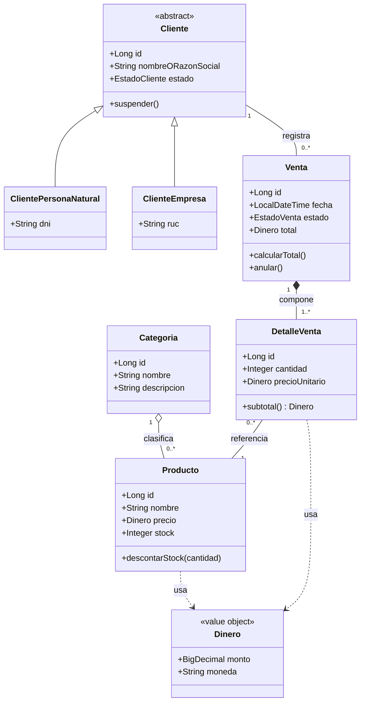

# ADS - Producto de Unidad 2

**Este documento es el ejemplo BomERP del docente, no una plantilla obligatoria.** Cada sede (Lima, Juliaca, Tarapoto) y cada grupo dentro de una misma sede sustenta su propio catálogo UML sobre su propio dominio, definido desde el [brief.md](../brief.md) de S2 y consolidado en su [Producto ADS U1](../u1/ads-producto.md). El diagrama de clases y la matriz de trazabilidad de este documento son los del ejemplo BomERP; cada equipo los reemplaza por los de su propio módulo transaccional (equivalente a `ventas`) y no transaccional (equivalente a `catalogo`). Lo exigible a todos es la estructura: modelo de dominio, diagrama de clases, transformación objeto-relacional, diagramas dinámicos, patrones aplicados y diseño de integración.

## Producto

**Catálogo UML con patrones de diseño e integración aplicados.**

## 1. Artefactos mínimos

**Tabla 1. Artefactos mínimos del producto U2**

| Artefacto | Evidencia |
|---|---|
| Modelo de dominio | Entidades, objetos de valor, reglas y módulos, con el lenguaje ubicuo y los agregados identificados (S6). |
| Diagrama de clases | Clases, atributos, operaciones, relaciones y multiplicidades, con agregación, composición y herencia (S7). |
| Diseño de clases por capas | Controller, Service, Repository, Mapper, entidades y DTO de un módulo, con su contrato REST (S8). |
| Transformación objeto-relacional | Relación clase-tabla-clave-DTO (S8). |
| Diagramas dinámicos | Secuencia y actividad del flujo principal, diagrama de interacción entre componentes (C3) y de comunicación de la misma colaboración, ciclo de vida de estados (si aplica), y matriz de consistencia frente a las clases de S8 (S9). |
| Patrones aplicados | Patrones GoF y GRASP aplicados sobre las clases de diseño (S10). |
| Diseño de integración | Capa anticorrupción y *Circuit Breaker* protegiendo un sistema externo obligatorio, evento de dominio con publicación confiable (*Outbox*), consumidor desacoplado, Saga coreografiada con su paso de compensación, y matriz de integración completa (S11). |

## 2. Diagrama de clases de referencia

**Este es el diagrama de dominio (UML/DDD, S6-S7), no una vista de Código C4** — no mezcla entidades con clases de implementación (`Service`/`Repository`/`Controller`, esas sí viven en la Vista de código de C4, ADS S2 2.6). Cruza los módulos `catalogo`, `ventas` y `clientes` a propósito: ese es precisamente el trabajo del modelo de dominio, mostrar el negocio completo, no cómo se organiza el código en componentes desplegables (S7, 3.6).

**Figura 1. Diagrama de clases de dominio de BomERP (U2)**

`Venta.anular()` y `Venta.calcularTotal()` ya viven en la entidad, no en un `VentaService` externo (Information Expert, ADS S7 2.3) — evitar el Anemic Domain Model no es un paso opcional que "el equipo puede aplicar si quiere": ya está hecho desde S7. Lo que sí queda como trabajo de **S8** es la organización por capas de cada módulo: un `VentaRepository` por raíz de agregado (`Venta`, no `DetalleVenta`), `VentaService` como interfaz con su implementación, y el DTO y el contrato REST que separan lo que decide el cliente de lo que decide el servidor. `catalogo` (CRUD simple de `Categoria`/`Producto`) sigue el mismo esquema de capas, pero no necesita un tratamiento de dominio más elaborado — esa decisión es por módulo, no para todo el sistema (S7, 2.8 vía S6). S10 no vuelve a dibujar esas clases: explica con patrones GoF y GRASP por qué están organizadas así. S11 cierra la unidad diseñando la frontera que ninguna sesión anterior cruzó: la integración de `ventas` con SUNAT (síncrona, vía Factura, y asíncrona por *ticket*, vía el Resumen Diario de Boletas, coordinado con una Saga coreografiada), protegida con capa anticorrupción y *Circuit Breaker*, y la publicación confiable del evento `VentaRegistrada` hacia consumidores internos.

## 3. Trazabilidad U2

**Tabla 2. Trazabilidad técnica U2**

| Diseño ADS | Evidencia BD2 | Evidencia LP2 |
|---|---|---|
| `Categoria` agregación `Producto` | Tablas `categorias`/`productos`, FK sin `ON DELETE CASCADE` | `@ManyToOne` de `Producto` hacia `Categoria` |
| `Venta` composición `DetalleVenta` | FK `NOT NULL` de `detalle_venta` hacia `venta` | `@OneToMany(cascade = ALL)` en `Venta` |
| `Cliente` con herencia (persona natural/empresa) | Estrategia de mapeo objeto-relacional (S8) | Aún no implementado en LP2 (módulo `clientes` sin sesión propia) |
| `Venta.anular()`/`calcularTotal()` como operaciones de entidad | Trigger/`CHECK` de auditoría e integridad | Lógica movida de `VentaService` a `Venta` |
| Diagrama de secuencia anular (S9) | Trigger de auditoría | Acción anular desde SPA |
| Integración full-stack | Persistencia y auditoría Oracle | Flujo SPA -> API -> Oracle |

## 4. Rúbrica de Evaluación

**Tabla 3. Rúbrica de evaluación de la Unidad 2**

| Criterio | Peso | CE / Nivel | A (20 pts) | B (15 pts) | C (10 pts) | D (5 pts) | Calificación obtenida |
|---|---:|---|---|---|---|---|---:|
| 1. Modela el dominio y delimita módulos funcionales | 16% | CE021-N2 (parcial) | Subdominios, entidades y reglas identificados, con lenguaje ubicuo y al menos un agregado como límite de consistencia, verificado contra el código real. | Dominio modelado con lenguaje ubicuo y agregado identificado, sin verificación completa contra el código. | Dominio modelado de forma parcial o genérica, sin lenguaje ubicuo claro ni agregado identificado. | No presenta modelo de dominio verificable. | |
| 2. Diseña clases, relaciones, multiplicidades y restricciones | 16% | CE021-N2 (parcial) | Diagrama de clases completo, con atributos, operaciones, multiplicidades, al menos una agregación, una composición y una jerarquía de herencia, coherente con el dominio de S6. | Diagrama completo con las relaciones exigidas, con alguna inconsistencia menor frente al dominio. | Diagrama incompleto o falta alguna de las relaciones exigidas (agregación, composición o herencia). | No presenta diagrama de clases verificable. | |
| 3. Relaciona diseño de clases con modelo relacional y persistencia | 16% | CE021-N2 (parcial) | Diseño de clases por capas completo (Controller, Service, Repository, Mapper, DTO), contrato REST conceptual y matriz de trazabilidad dominio-clase-tabla-DTO coherente con BD2. | Diseño por capas completo, con la matriz de trazabilidad con alguna inconsistencia frente a BD2. | Diseño por capas incompleto, o matriz de trazabilidad ausente o incoherente. | No presenta diseño de clases por capas ni transformación objeto-relacional. | |
| 4. Modela escenarios dinámicos mediante UML | 16% | CE021-N2 (parcial) | Diagramas de secuencia y actividad del escenario crítico, con interacción entre componentes, comunicación, y matriz de consistencia frente a las clases de S8, sin inconsistencias. | Diagramas de secuencia y actividad presentes, con la interacción/comunicación o la matriz de consistencia incompleta. | Solo diagrama de secuencia o solo de actividad, sin matriz de consistencia. | No presenta diagramas dinámicos verificables. | |
| 5. Aplica patrones de diseño, arquitectura empresarial e integración | 16% | CE021-N2 (parcial) | Al menos tres patrones GoF/GRASP aplicados y justificados sobre código real, más integración empresarial completa (capa anticorrupción, *Circuit Breaker*, evento con *Outbox*, Saga coreografiada con compensación). | Patrones aplicados y justificados, con la integración empresarial incompleta (falta la Saga o algún patrón de protección). | Patrones mencionados sin aplicación real sobre código propio, o integración limitada a una llamada sin ningún patrón de protección. | No presenta patrones aplicados ni diseño de integración. | |
| 6. Sustentación | 20% | CG | Sustenta con claridad y profesionalismo su aporte individual, respondiendo con precisión las preguntas del jurado. | Sustenta con solvencia, con detalles menores en claridad, orden o precisión. | Sustenta con dificultad; claridad, orden o precisión insuficientes. | No sustenta adecuadamente ni demuestra su aporte individual. | |

Nota final = suma de (`Peso` × `Puntos de la calificación obtenida`) / 100 × 20.

`CE021-N2 (parcial)` = porción de **diseño detallado** del Nivel 2 de CE021 (Ingeniería de Requerimientos) — la otra porción (arquitectura) ya se completó en la [Unidad 1 de ADS](../u1/ads-producto.md#9-rubrica-de-evaluacion). `CG` = Competencia General "Servicio y misión" del sílabo de ADS — no es CE021: los criterios 1-5 ya son la evidencia técnica, incluida su verificación en vivo; el criterio 6 verifica aporte individual y comunicación.

**Tabla 4. Subaspectos de la sustentación (Unidad 2)**

El criterio 6 se evalúa con los mismos 6 subaspectos de la sustentación integral del Proyecto Integrador ([Guía de Sustentación Final](../u3/guia-sustentacion.md#subaspectos-de-la-sustentacion-integral)) — exigibles también en esta segunda sustentación de unidad, igual que en la Unidad 1.

| Subaspecto | Qué observa en Unidad 2 |
|---|---|
| 1. Aporte individual | Cada integrante demuestra su propio aporte al diseño detallado y de integración. |
| 2. Comunicación y orden | Claridad, estructura, tiempo y lenguaje técnico durante la presentación. |
| 3. Presentación personal y actitud | Puntualidad, vestimenta limpia y adecuada, higiene, cabello ordenado, actitud profesional, respeto, honestidad y coherencia con los valores y principios cristianos de la institución. |
| 4. Repositorio y estándares | Organización, commits y reproducibilidad de la documentación de diseño detallado desde S6. |
| 5. MkDocs o equivalente | Documentación de Unidad 2 publicada, navegable y alineada con `ads-producto.md`. |
| 6. Pitch/demo ejecutiva | Avance del sistema con el diseño detallado ya aplicado, con apoyo visual (.pptx, Canva o equivalente) — no reemplaza la presentación técnica de S12, la precede. |

## 5. Trazabilidad y procedencia de la rúbrica

Los primeros cinco criterios son cita literal de los "Criterios de evaluación del producto" de la Unidad 2 en el sílabo de ADS; el sexto (Sustentación) corresponde a la sustentación exigida por el mismo sílabo (sesión 12, actividad 2).

**Con la malla curricular:** los criterios 1-5 corresponden a la porción de **diseño detallado** del **Nivel 2 de CE021** (Ingeniería de Requerimientos) — la porción de arquitectura de ese mismo nivel ya se completó en la Unidad 1 de ADS (vistas C1-C3, SOLID y estilo arquitectónico, frente al modelo de dominio, UML estructural/dinámico, patrones e integración de esta unidad). El criterio 6 (Sustentación) es transversal y no forma parte de la definición de la competencia.

A diferencia de la Unidad 1, esta unidad **no** aporta a CE024 (Calidad de Software): esa competencia solo usa la Sección 2 (Atributos de calidad) del [Producto U1](../u1/ads-producto.md) como insumo, formalizado recién en la Unidad 3 (criterio 3, "Justifica atributos de calidad y decisiones técnicas").
