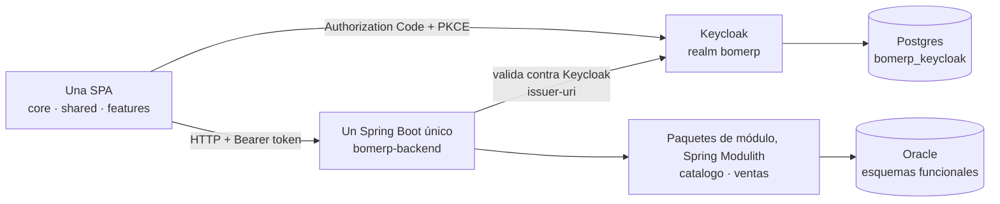

# LP2 - Producto de Unidad 2

**Este documento es el ejemplo BomERP del docente, no una plantilla obligatoria.** Cada sede (Lima, Juliaca, Tarapoto) y cada grupo dentro de una misma sede construye su propia SPA sobre su propio dominio, definido desde su propio [brief.md](../brief.md) de S2 y consolidado en su [Producto LP2 U1](../u1/lp2-demo.md). Los módulos, formularios y endpoints concretos de este documento (`catalogo`/`ventas`) son los del ejemplo BomERP; cada equipo los reemplaza por sus propios módulos. Lo exigible a todos es la estructura: SPA con `core`/`shared`/`features`, CRUD independiente y dependiente, un formulario cabecera-detalle real, seguridad backend/frontend y control de acceso.

**Sobre la seguridad: Keycloak, no JWT propio.** El sílabo (S10-S11) y la propia [ADR-005](../../lp2/adr/ADR-005-seguridad-jwt-propio-listo-para-reemplazo.md) describen un módulo `seguridad` con JWT propio — ese fue el diseño de S10, con la arquitectura explícitamente "lista para reemplazo" pero sin ese reemplazo agendado en ninguna sesión concreta. [S10b](../../lp2/sesiones/S10b_Seguridad_Backend_Keycloak.md) sí lo ejecutó antes de que empezara S11: `bomerp-backend` valida tokens emitidos por Keycloak (realm `bomerp`), no por `seguridad`, y la SPA inicia sesión con *Authorization Code* + PKCE (*Proof Key for Code Exchange*) contra Keycloak. Las secciones de abajo (y el JSON de ejemplo) reflejan ese estado real — `seguridad`/JWT propio queda como referencia histórica de diseño, no como lo que corre hoy; **ADR-005 quedó desactualizada frente a esta decisión posterior y debería revisarse aparte**.

## Producto

**Una SPA empresarial modular y segura, conectada al único backend Spring Boot de BomERP, con navegación por funcionalidades, CRUD, formulario transaccional, consultas, reportes y control de acceso.**

La demo usa navegador y almacenamiento local para representar un subconjunto de `Venta–DetalleVenta`: login, sesión, guard, registro, anulación y consulta. Es una referencia visual publicable en MkDocs, no reemplaza el producto evaluado. La implementación real debe ser una sola SPA y consumir el backend REST modular.

## 1. Organización funcional esperada

**Figura 1. Organización funcional esperada de la SPA U2**

```text
src/app/
├── core/
│   ├── auth/             # AuthService, PKCE, decodificación de JWT (Keycloak)
│   ├── guards/           # authGuard, rolGuard
│   ├── interceptors/     # adjunta el token, refresca en 401
│   └── layout/           # sesión, menú por rol y layout
├── shared/               # componentes reutilizables
└── features/
    ├── catalogo/         # funcional
    ├── ventas/           # funcional
    ├── inventario/       # ruta preparada o funcional según alcance
    └── compras/          # ruta preparada; no es requisito funcional
```

No hay carpeta `features/seguridad/`: la identidad no es una funcionalidad de negocio de BomERP, vive en `core/auth` (S11) y el proveedor real es Keycloak, no un login propio.

No se crean una SPA para ventas y otra para compras. Los módulos funcionales comparten el shell, pero mantienen rutas, componentes, servicios HTTP y modelos propios.

## 2. Demo ejecutable

[Abrir demo SPA U2](demo-spa/index.html)

## 3. Evidencias exigidas al producto real

**Tabla 1. Evidencias exigidas al producto real U2**

| Elemento | Qué demuestra |
|---|---|
| Login | *Authorization Code* + PKCE contra Keycloak (realm propio) — ninguna contraseña pasa por código de la SPA. |
| Guard | Bloqueo de vista protegida sin sesión activa, y de rutas de escritura sin el rol requerido. |
| Interceptor | Adjunta el token de Keycloak a cada petición hacia el backend, y refresca la sesión una sola vez ante un `401`. |
| Navegación modular | Shell único, menú, rutas y acceso a funcionalidades de la base de BomERP. |
| CRUD independiente | Gestión completa de `Producto`. |
| CRUD dependiente | Gestión de `Categoria–Producto`. |
| Formulario cabecera–detalle | `Venta–DetalleVenta` dinámico, cálculos, validaciones y confirmación. |
| Consultas y reportes | Filtros y presentación de respuestas resumidas. |
| Control de acceso | Menú, rutas y acciones condicionadas por rol o permiso. |

## 4. Casos de prueba

**Tabla 2. Casos de prueba de la demo U2**

| Caso | Acción | Resultado esperado |
|---|---|---|
| Acceso sin sesión | Entrar al dashboard sin haber iniciado sesión. | Redirige a Keycloak (`authGuard`). |
| Login válido | Iniciar sesión con un usuario real de Keycloak (`realm bomerp`). | Dashboard habilitado, con el nombre real del usuario. |
| CRUD maestro | Crear, editar y eliminar un dato independiente. | La SPA y el backend mantienen datos consistentes. |
| CRUD dependiente | Registrar un dato relacionado. | Las listas y dependencias se validan. |
| Crear venta | Enviar cliente y detalles válidos. | Venta aparece asociada al usuario autenticado. |
| Validación | Cantidad inválida o stock insuficiente. | Mensaje de error sin persistencia parcial. |
| Anular venta | Ejecutar anular. | Estado cambia, se repone stock y se actualiza el resumen. |
| Permiso insuficiente | Ejecutar una acción restringida. | La acción se oculta o responde 403. |

## 5. Integración esperada

**Figura 2. Integración esperada U2, con Keycloak como proveedor de identidad**



## 6. Rúbrica de Evaluación

**Tabla 3. Rúbrica de evaluación de la Unidad 2**

| Criterio | Peso | CE / Nivel | A (20 pts) | B (15 pts) | C (10 pts) | D (5 pts) | Calificación obtenida |
|---|---:|---|---|---|---|---|---:|
| 1. Crea la SPA con proyecto frontend, layout, menú, rutas, navegación, servicios HTTP y CRUD de una tabla independiente | 16% | CE023-N2 (parcial) | SPA navegable, conectada al backend real, con CRUD independiente funcional de punta a punta. | SPA navegable y conectada, con el CRUD independiente parcialmente funcional. | SPA creada, sin conexión real al backend o sin CRUD funcional. | No presenta una SPA ejecutable. | |
| 2. Implementa CRUD de tablas dependientes mediante selección de datos relacionados | 16% | CE023-N2 (parcial) | CRUD dependiente completo, con listas desplegables y validación de dependencias verificada en vivo. | CRUD dependiente funcional, con validación de dependencias incompleta. | CRUD dependiente presente, sin selección real de datos relacionados. | No presenta CRUD de tablas dependientes. | |
| 3. Implementa formularios transaccionales con cabecera–detalle, cálculos, validaciones, consultas y reportes | 16% | CE023-N2 (parcial) | Formulario cabecera-detalle completo, con cálculos, validaciones, confirmación, y al menos una consulta o reporte agregado funcionando. | Formulario completo, con la consulta o el reporte incompleto. | Formulario incompleto o sin cálculos/validaciones reales. | No presenta formulario cabecera-detalle. | |
| 4. Reemplaza la seguridad backend por un proveedor de identidad real (Keycloak), con roles y permisos efectivos | 16% | CE023-N2 (parcial) | `bomerp-backend` valida tokens de Keycloak (no JWT propio), con roles reales protegiendo endpoints, verificado con al menos dos usuarios de rol distinto. | Backend validando Keycloak, con la matriz de roles incompleta o sin verificar con más de un usuario. | Backend con seguridad propia (JWT hecho a mano) sin avanzar al proveedor externo. | No presenta ningún mecanismo de autorización por rol en el backend. | |
| 5. Implementa login, sesión, guards, interceptores, menú por permisos, rutas protegidas y manejo de 401/403 en el frontend | 16% | CE023-N2 (parcial) | Login real contra Keycloak (*Authorization Code* + PKCE), token en memoria, *guards* e interceptor funcionando, con refresco ante `401` y denegación clara ante `403`, verificado con la matriz de accesos completa. | Flujo de login y *guards* funcionando, con el interceptor o el refresco de token incompleto. | Login funcional con un flujo inseguro (ej. token en `localStorage`, o sin PKCE). | No presenta login ni protección de rutas en el frontend. | |
| 6. Sustentación | 20% | CG | Sustenta con claridad y profesionalismo su aporte individual, respondiendo con precisión las preguntas del jurado. | Sustenta con solvencia, con detalles menores en claridad, orden o precisión. | Sustenta con dificultad; claridad, orden o precisión insuficientes. | No sustenta adecuadamente ni demuestra su aporte individual. | |

Nota final = suma de (`Peso` × `Puntos de la calificación obtenida`) / 100 × 20.

`CE023-N2 (parcial)` = porción de **frontend SPA, seguridad e integración full-stack** del Nivel 2 de CE023 (Programación) — la otra porción (backend REST) ya se completó en la [Unidad 1 de LP2](../u1/lp2-demo.md#8-rubrica-de-evaluacion). Los criterios 4-5 evalúan sobre la implementación real del curso (Keycloak, S10b/S11), no sobre el JWT propio que el sílabo y la ADR-005 originales describían — ver la nota al inicio de este documento. `CG` = Competencia General "Innovación y solución de problemas" del sílabo de LP2 — no es CE023: los criterios 1-5 ya son la evidencia técnica, incluida su verificación en vivo; el criterio 6 verifica aporte individual y comunicación.

**Tabla 4. Subaspectos de la sustentación (Unidad 2)**

El criterio 6 se evalúa con los mismos 6 subaspectos de la sustentación integral del Proyecto Integrador ([Guía de Sustentación Final](../u3/guia-sustentacion.md#subaspectos-de-la-sustentacion-integral)) — exigibles también en esta segunda sustentación de unidad, igual que en la Unidad 1.

| Subaspecto | Qué observa en Unidad 2 |
|---|---|
| 1. Aporte individual | Cada integrante demuestra lo que construyó de su propia SPA segura. |
| 2. Comunicación y orden | Claridad, estructura, tiempo y lenguaje técnico durante la presentación. |
| 3. Presentación personal y actitud | Puntualidad, vestimenta limpia y adecuada, higiene, cabello ordenado, actitud profesional, respeto, honestidad y coherencia con los valores y principios cristianos de la institución. |
| 4. Repositorio y estándares | Topics académicos configurados desde S2, organización, commits y reproducibilidad de la SPA. |
| 5. MkDocs o equivalente | Documentación de Unidad 2 publicada, navegable y alineada con `lp2-demo.md`. |
| 6. Pitch/demo ejecutiva | Introducción breve de la SPA y su avance, con apoyo visual (.pptx, Canva o equivalente) — no reemplaza la demo técnica de S12, la precede. |

Para usar la rúbrica con IA, solicita:

```text
Evalúa la sustentación y el producto (lp2-demo.md o la sección 2 de la guía S12) usando la rúbrica de esta sección.
Para cada criterio selecciona la calificación obtenida: A=20, B=15, C=10, D=5.
Justifica brevemente cada nivel con evidencia concreta (endpoints, código, pruebas en vivo, Keycloak).
Calcula la nota final con la fórmula: suma de (Peso × Puntos de la calificación obtenida) / 100 × 20.
Indica 2 fortalezas y 2 recomendaciones para lo que sigue en Unidad III.
```

## 7. Trazabilidad y procedencia de la rúbrica

Los primeros cinco criterios son cita literal de los "Criterios de evaluación del producto" de la Unidad 2 en el sílabo de LP2; el sexto (Sustentación) corresponde a la sustentación exigida por el mismo sílabo (sesión 12, actividad 2).

**Con la malla curricular:** los criterios 1-5 corresponden a la porción de **frontend SPA, seguridad e integración full-stack** del **Nivel 2 de CE023** (Programación) — la porción de backend REST de ese mismo Nivel ya se completó en la Unidad 1 de LP2. El criterio 6 (Sustentación) es transversal y no forma parte de la definición de la competencia.
